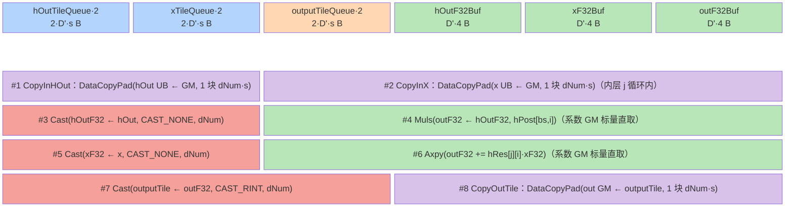
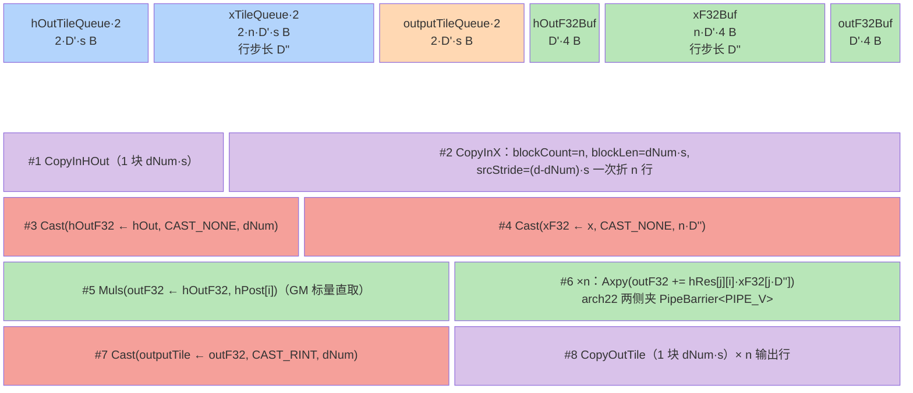

# mhc_post 多模板分发与内存复用设计

> **目标读者**：模型在设计阶段（Phase 4）为「一路主流按 N 路系数广播缩放 + 小系数矩阵对多路输入做加权和 + 残差相加」类算子（mHC Post Mapping、门控广播、逐流缩放残差）选择模板/tiling 方案，或复用其 UB 复用与广播源搬运模式。
> **范围**：从 README 确认平台支持 = Ascend 950PR/950DT（见姊妹卡）、Atlas A3 训练/推理系列、Atlas A2 训练/推理系列；Atlas 200I/500 A2 与 Atlas 推理/训练系列不支持。本文覆盖 **MemBase（ascend910b / ascend910_93，NpuArch::DAV_2201）** 的唯一实现（`op_kernel/mhc_post.cpp` + `op_kernel/arch22/`），TilingKey 0/1；arch35（ascend950，`mhc_post_apt.cpp` + `op_kernel/arch35/`）见 [mhc_post_a5.md](mhc_post_a5.md)。
> **前置阅读**：无。

---

## 本算子速览

- **数学定义**（[README:16-30](https://gitcode.com/cann/ops-transformer/blob/4b422ccf023d6be832b66bc838c6de8e5e5b18d1/mhc/mhc_post/README.md)）：`out[i,:] = Σ_j hRes[j][i]·x[j,:] + hPost[i]·hOut[:]`，即对 `hOut`（1 路，D 维向量）按 `hPost[i]` 缩放后广播到 N 路，再叠加系数矩阵转置加权的多路 `x`；参考实现见 [tests/assert/golden.py:20-30](https://gitcode.com/cann/ops-transformer/blob/4b422ccf023d6be832b66bc838c6de8e5e5b18d1/mhc/mhc_post/tests/assert/golden.py)（`h_post.unsqueeze(-1) * h_out.unsqueeze(-2)` 外积 + 逐行 `addcmul`）。
- **shape/layout**：ND；`x/hRes` 为 4D `BSND / BSNn` 或 3D `TND / Tnn`（`totalItems = B·S` 或 `T`），`hOut` 为 `BSD / TD`，`hPost` 为 `BSn / Tn`，`out` 与 `x` 同 shape（[mhc_post_infershape.cpp:102-110](https://gitcode.com/cann/ops-transformer/blob/4b422ccf023d6be832b66bc838c6de8e5e5b18d1/mhc/mhc_post/op_host/op_tiling/mhc_post_infershape.cpp)）。MemBase 端规格约束：`n == 4`、`d ∈ (0, 100000)` 且 `d % 128 == 0`（[mhc_post_tiling_base_arch22.cpp:462-471](https://gitcode.com/cann/ops-transformer/blob/4b422ccf023d6be832b66bc838c6de8e5e5b18d1/mhc/mhc_post/op_host/op_tiling/arch22/mhc_post_tiling_base_arch22.cpp)）。
- **dtype**：`x/hOut/out` ∈ FLOAT16/BFLOAT16（同型），`hRes/hPost` ∈ FLOAT32；无可选输入（`hRes` 在 MemBase 端必传）。
- **纯 Vector 算子**：路由入口声明 `KERNEL_TASK_TYPE_DEFAULT(KERNEL_TYPE_AIV_ONLY)`（[mhc_post.cpp:28](https://gitcode.com/cann/ops-transformer/blob/4b422ccf023d6be832b66bc838c6de8e5e5b18d1/mhc/mhc_post/op_kernel/mhc_post.cpp)），全部计算由 `Cast/Muls/Axpy` 等 Vector 指令完成，无 Cube。
- **计算管线一行**：`CopyIn hOut/x -> Cast 升 fp32 -> Muls(hPost[i]) 广播缩放 -> n×n 次 Axpy(hRes[j][i]) 残差映射 -> Cast 降精度(CAST_RINT) -> CopyOut`，外层对 `i ∈ [0,n)` 逐输出行重复，累加器 `outF32` 单份覆盖重用。
- **模板数**：2 个 TilingKey = 1 个模板类 `MhcPostKernel<T, USE_PERMANENT_X>` 的两个编译期实例（`if constexpr` 切换 `x` 的搬运形态）。

## 1. 源码路径与文件职责

### 1.1 Host 侧（Tiling 计算）

| 文件 | 职责 |
|------|------|
| [`op_host/mhc_post_def.cpp:52-69`](https://gitcode.com/cann/ops-transformer/blob/4b422ccf023d6be832b66bc838c6de8e5e5b18d1/mhc/mhc_post/op_host/mhc_post_def.cpp) | 算子定义：`x/h_out` REQUIRED fp16/bf16、`h_res` **OPTIONAL** fp32、`h_post` REQUIRED fp32、`y` REQUIRED；平台配置 `ascend910b`/`ascend910_93` -> `opFile.value = "mhc_post"`（56-58）、`ascend950` -> `"mhc_post_apt"`（67-69） |
| [`op_host/op_tiling/mhc_post_tiling_base.cpp:24-38`](https://gitcode.com/cann/ops-transformer/blob/4b422ccf023d6be832b66bc838c6de8e5e5b18d1/mhc/mhc_post/op_host/op_tiling/mhc_post_tiling_base.cpp) | 注册入口：`IMPL_OP_OPTILING(MhcPost).Tiling(TilingForMhcPost)`，转发 `TilingRegistryArch::DoTilingImpl`（按 NpuArch 选模板类） |
| [`op_host/op_tiling/mhc_post_tiling.h:25-30`](https://gitcode.com/cann/ops-transformer/blob/4b422ccf023d6be832b66bc838c6de8e5e5b18d1/mhc/mhc_post/op_host/op_tiling/mhc_post_tiling.h) | `MhcPostCompileInfo`（aicNum/aivNum/socVersion/npuArch） |
| [`op_host/op_tiling/arch22/mhc_post_tiling_base_arch22.cpp:499-542`](https://gitcode.com/cann/ops-transformer/blob/4b422ccf023d6be832b66bc838c6de8e5e5b18d1/mhc/mhc_post/op_host/op_tiling/arch22/mhc_post_tiling_base_arch22.cpp) | `ComputeTiling`：D 轴倍增分裂（503-526）、对齐与尾块（527-530）、核均分（532-536）、`usePermanentX` UB 预算门控（538-541） |
| [`op_host/op_tiling/arch22/mhc_post_tiling_base_arch22.cpp:451-472`](https://gitcode.com/cann/ops-transformer/blob/4b422ccf023d6be832b66bc838c6de8e5e5b18d1/mhc/mhc_post/op_host/op_tiling/arch22/mhc_post_tiling_base_arch22.cpp) | `CheckSpecConstraints`：`d>0 且 d<100000 且 d%128==0`、`n==4`；`socVer == 4(950)` 时整体跳过（458-460） |
| [`op_host/op_tiling/arch22/mhc_post_tiling_base_arch22.cpp:121-141`](https://gitcode.com/cann/ops-transformer/blob/4b422ccf023d6be832b66bc838c6de8e5e5b18d1/mhc/mhc_post/op_host/op_tiling/arch22/mhc_post_tiling_base_arch22.cpp) | `IsCapable()=true`（本架构唯一模板）+ `GetPlatformInfo`（AIV 核数 / UB 容量） |
| [`op_host/op_tiling/arch22/mhc_post_tiling_base_arch22.cpp:571-596`](https://gitcode.com/cann/ops-transformer/blob/4b422ccf023d6be832b66bc838c6de8e5e5b18d1/mhc/mhc_post/op_host/op_tiling/arch22/mhc_post_tiling_base_arch22.cpp) | `PostTiling`（12 字段 TilingData 回写 + `SetBlockDim(usedCoreNum)`）+ `GetTilingKey = GET_TPL_TILING_KEY(usePermanentX_)` |
| [`op_host/op_tiling/mhc_post_infershape.cpp:73-135`](https://gitcode.com/cann/ops-transformer/blob/4b422ccf023d6be832b66bc838c6de8e5e5b18d1/mhc/mhc_post/op_host/op_tiling/mhc_post_infershape.cpp) | 输出 shape/dtype 推导（与 `x` 完全一致）+ unknown rank/shape 透传 |

### 1.2 Kernel 侧（模板实现）

| 文件 | TilingKey | 类名 | 职责 |
|------|-----------|------|------|
| [`op_kernel/arch22/mhc_post_arch22.h:37-84`](https://gitcode.com/cann/ops-transformer/blob/4b422ccf023d6be832b66bc838c6de8e5e5b18d1/mhc/mhc_post/op_kernel/arch22/mhc_post_arch22.h) | 0 / 1 | `MhcPostKernel<T, USE_PERMANENT_X>` | 唯一模板类：3 个双缓冲队列 + 3 个 fp32 计算 TBuf；`if constexpr` 切换 `ComputeCopyOut`（逐 (i,j) 现取 x）与 `ComputeCopyOutAllX`（x 整块预搬） |
| [`op_kernel/arch22/mhc_post_tiling_data.h:19-32`](https://gitcode.com/cann/ops-transformer/blob/4b422ccf023d6be832b66bc838c6de8e5e5b18d1/mhc/mhc_post/op_kernel/arch22/mhc_post_tiling_data.h) | - | `MhcPostTilingData` | 裸结构体 12 个 int64：n/d/usedCoreNum/normal·tailCoreProcessNum/bs·/d· 内外尾 |
| [`op_kernel/arch22/mhc_post_tiling_key.h:21-30`](https://gitcode.com/cann/ops-transformer/blob/4b422ccf023d6be832b66bc838c6de8e5e5b18d1/mhc/mhc_post/op_kernel/arch22/mhc_post_tiling_key.h) | - | `ASCENDC_TPL_ARGS_DECL/SEL` | 模板参数选择声明：唯一 bool 维 `USE_PERMANENT_X ∈ {0,1}` + `ASCENDC_TPL_KERNEL_TYPE_SEL(AIV_ONLY)` |

### 1.3 路由分发

| 文件 | 职责 |
|------|------|
| [`op_kernel/mhc_post.cpp:24-36`](https://gitcode.com/cann/ops-transformer/blob/4b422ccf023d6be832b66bc838c6de8e5e5b18d1/mhc/mhc_post/op_kernel/mhc_post.cpp) | MemBase 路由入口：**无 `TILING_KEY_IS` if-else 链**，`template <uint16_t usePermanentX> __global__ mhc_post(...)`，由 `ASCENDC_TPL_SEL` 框架按 TilingKey 实例化并分发；`REGISTER_TILING_DEFAULT(MhcPostTilingData)` + `GET_TILING_DATA_WITH_STRUCT` |

---

## 2. 算子特定优化 trick（高杠杆速览）

### 2.1 广播源整块预搬：n² 次 DMA 折叠为 1 次（USE_PERMANENT_X=1）

- **摘要**: N 路输出都要消费同一份多行输入时，用 `DataCopyPad` 的 `blockCount=n + srcStride` 一次把 n 行折进同一块 UB，之后 n² 次乘加全部用 UB 内行偏移 `xF32[j·D'']` 寻址；`USE_PERMANENT_X=0` 则在内层 j 循环里逐行重新 `CopyInX`，同一 tile 的 x 被重复搬 n² 次。
- **触发**: `usePermanentX_ = ((n+2)·8·dInner ≤ UB_SIZE)`（[tiling_base_arch22.cpp:538-541](https://gitcode.com/cann/ops-transformer/blob/4b422ccf023d6be832b66bc838c6de8e5e5b18d1/mhc/mhc_post/op_host/op_tiling/arch22/mhc_post_tiling_base_arch22.cpp)）；kernel 侧 `xFactor_ = n`（[mhc_post_arch22.h:103-106](https://gitcode.com/cann/ops-transformer/blob/4b422ccf023d6be832b66bc838c6de8e5e5b18d1/mhc/mhc_post/op_kernel/arch22/mhc_post_arch22.h)）。
- **golden源**: [mhc_post_arch22.h:245-252](https://gitcode.com/cann/ops-transformer/blob/4b422ccf023d6be832b66bc838c6de8e5e5b18d1/mhc/mhc_post/op_kernel/arch22/mhc_post_arch22.h)（blockCount=n 的 CopyInX）、[mhc_post_arch22.h:207-231](https://gitcode.com/cann/ops-transformer/blob/4b422ccf023d6be832b66bc838c6de8e5e5b18d1/mhc/mhc_post/op_kernel/arch22/mhc_post_arch22.h)（`xF32[j*dNumAlign]` 行偏移 + n 次 Axpy）、[mhc_post_arch22.h:186-192](https://gitcode.com/cann/ops-transformer/blob/4b422ccf023d6be832b66bc838c6de8e5e5b18d1/mhc/mhc_post/op_kernel/arch22/mhc_post_arch22.h)（反例形态：内层 j 循环逐行 CopyInX）
- **实例化公共原则**: -> `runbooks/operator-optimization/vv-fusion-common.md#OPT-2 多行广播源整块预搬 + host UB 预算门控分档`（编号为候选占位，最终编号待编排器串行合并回写）
- **预期收益**: 待轨迹验证（高杠杆：单 tile 的 x 路 DMA 次数从 `n²+n+1` 降到 `n+2`，n=4 时 21 -> 6；golden 为此专门开 TilingKey 分档）
- **迁移条件**: 适用=多路输出共享同一份多行操作数的广播/加权类算子；前提=该操作数全宽可驻留 UB（host 用字节公式门控）；失效=操作数宽度过大装不下时退回逐行现取（本模板 KEY 0 形态）。

**坏实践（反例）**：内层 `for j in [0,n)` 里每轮 `CopyInX -> DeQue -> Cast -> Axpy -> FreeTensor`（[mhc_post_arch22.h:186-192](https://gitcode.com/cann/ops-transformer/blob/4b422ccf023d6be832b66bc838c6de8e5e5b18d1/mhc/mhc_post/op_kernel/arch22/mhc_post_arch22.h)）--同一行 x 被搬 n 次、整个 tile 被搬 n² 次，MTE2 队列同步开销同步放大 n² 倍。

**示意图**（高收益双表示）：

```
USE_PERMANENT_X = 0（KEY 0）                USE_PERMANENT_X = 1（KEY 1）
for i in [0,n):   # 输出行                  CopyInX(blockCount=n, srcStride)   #1 次
  for j in [0,n): # 加权输入行                   ┌──────────────────────────┐
    CopyInX(row j)      ← n² 次 DMA             │ xF32: row0|row1|row2|row3│  UB 驻留
    Cast / Axpy                                 └──────────────────────────┘
  CopyOut(row i)  ← n 次                    for i in [0,n):
                                              Muls + n×Axpy(xF32[j·D''])  ← 0 次 DMA
                                              CopyOut(row i)  ← n 次
DMA 次数/tile = n²+n+1 = 21                DMA 次数/tile = n+2 = 6
```

### 2.2 小系数操作数的获取方式：标量直取 vs 常驻复用

- **摘要**: 系数矩阵（n×n）与系数向量（n）总量极小，本模板直接用 `hPostGm_.GetValue(...)` / `hResGm_.GetValue(...)` 在每次使用点标量直取，省去「搬 UB -> EnQue/DeQue -> 取标量」的整条流水；代价是每个 tile 重复 n+n² 次标量读。姊妹卡 arch35 路径则改为逐 n 块批量搬 UB、跨整个 D 内层循环复用（同一次摄入的两种形态）。
- **触发**: 全部 tile（`ComputeCopyOut` 与 `ComputeCopyOutAllX` 的 `Muls/Axpy` 系数来源）。
- **golden源**: [mhc_post_arch22.h:185](https://gitcode.com/cann/ops-transformer/blob/4b422ccf023d6be832b66bc838c6de8e5e5b18d1/mhc/mhc_post/op_kernel/arch22/mhc_post_arch22.h)（`hPostGm_.GetValue(hPostBase+i)`）、[mhc_post_arch22.h:190](https://gitcode.com/cann/ops-transformer/blob/4b422ccf023d6be832b66bc838c6de8e5e5b18d1/mhc/mhc_post/op_kernel/arch22/mhc_post_arch22.h)（`hResGm_.GetValue(hResBase+j*n+i)`）
- **实例化公共原则**: -> `runbooks/operator-optimization/vv-fusion-common.md#OPT-1 小系数操作数常驻复用，禁止热循环内逐 tile 重取`（编号为候选占位）
- **预期收益**: 待轨迹验证（取舍点：系数被复用次数少且 tile 数不多时标量直取更省；D 内层循环成百上千轮时必须改常驻）
- **迁移条件**: 适用=系数总量 ≤ 数十字节、使用点稀疏的算子；前提=平台标量 GM 读不在生产黑名单场景（非逐元素遍历）；失效=系数被内层大循环反复消费时改为整批搬 UB 常驻（见 arch35 姊妹卡）。

**坏实践（反例）**：把系数当作普通大输入每 tile 重新 `DataCopyPad + EnQue/DeQue` 一遍--队列同步与 MTE2 带宽开销远超其数据量；或反过来在成百上千轮的 D 内层循环里逐 tile 标量重取 n² 个系数。

### 2.3 fp32 计算域、出口才降精度（CAST_RINT）

- **摘要**: `x/hOut` 入口 `Cast(CAST_NONE)` 升 fp32，`Muls/Axpy` 加权求和全程 fp32，仅每输出行出口 `Cast(CAST_RINT)` 降回原生 dtype；三块 fp32 计算缓冲按 `sizeof(float)` 分配，与原生 dtype 队列分离。
- **触发**: 所有 dtype（fp16 与 bf16 同一路径）。
- **golden源**: [mhc_post_arch22.h:180](https://gitcode.com/cann/ops-transformer/blob/4b422ccf023d6be832b66bc838c6de8e5e5b18d1/mhc/mhc_post/op_kernel/arch22/mhc_post_arch22.h)（入口 CAST_NONE）、[mhc_post_arch22.h:194](https://gitcode.com/cann/ops-transformer/blob/4b422ccf023d6be832b66bc838c6de8e5e5b18d1/mhc/mhc_post/op_kernel/arch22/mhc_post_arch22.h)（出口 CAST_RINT）、[mhc_post_arch22.h:128-130](https://gitcode.com/cann/ops-transformer/blob/4b422ccf023d6be832b66bc838c6de8e5e5b18d1/mhc/mhc_post/op_kernel/arch22/mhc_post_arch22.h)（fp32 TBuf 按 4B 分配）
- **实例化公共原则**: -> `runbooks/operator-optimization/vv-fusion-common.md#OPT-6 入口升 fp32 / 出口才降精度`（编号为候选占位）
- **预期收益**: 待轨迹验证
- **迁移条件**: 适用=含加权求和/归约的 fp16/bf16 算子；前提=UB 预算按 fp32 口径重算仍装得下目标 tile；失效=纯逐元素且精度不敏感时可省 cast 直接原 dtype 计算。

**坏实践（反例）**：在 fp16/bf16 域内直接累加 n 项加权和--半精度尾数逐项舍入，n 越大误差越大；或全程 fp32 却忘了出口降精度（输出 dtype 不符）。

### 2.4 全队列双缓冲 + 流式输入禁 L2 缓存

- **摘要**: 三个队列（2 入 1 出）全部 `bufferNum=2`（[mhc_post_arch22.h:32](https://gitcode.com/cann/ops-transformer/blob/4b422ccf023d6be832b66bc838c6de8e5e5b18d1/mhc/mhc_post/op_kernel/arch22/mhc_post_arch22.h)），tile 宽由 host 保证 24·dInner ≤ UB（KEY 0）时双缓冲必然装得下；同时 4 路输入 GlobalTensor 全部 `SetL2CacheHint(CacheMode::CACHE_MODE_DISABLE)`，单次消费的流式数据不占 L2。
- **触发**: 所有 tile；`SetL2CacheHint` 在 `Init` 一次性设置（[mhc_post_arch22.h:115-118](https://gitcode.com/cann/ops-transformer/blob/4b422ccf023d6be832b66bc838c6de8e5e5b18d1/mhc/mhc_post/op_kernel/arch22/mhc_post_arch22.h)）。
- **golden源**: [mhc_post_arch22.h:115-118](https://gitcode.com/cann/ops-transformer/blob/4b422ccf023d6be832b66bc838c6de8e5e5b18d1/mhc/mhc_post/op_kernel/arch22/mhc_post_arch22.h)（4 路 L2 hint 关闭）、[mhc_post_arch22.h:121-125](https://gitcode.com/cann/ops-transformer/blob/4b422ccf023d6be832b66bc838c6de8e5e5b18d1/mhc/mhc_post/op_kernel/arch22/mhc_post_arch22.h)（3 队列 depth=2）
- **实例化公共原则**: -> `runbooks/operator-optimization/vv-fusion-common.md#OPT-7 计算区单缓冲 TBuf + 搬运介质队列双缓冲`、`runbooks/operator-optimization/vv-fusion-common.md#OPT-8 流式单次消费输入禁用 L2 缓存`（编号均为候选占位）
- **预期收益**: 待轨迹验证
- **迁移条件**: 适用=输入只被消费一次的流式算子；前提=tile 宽已被 host 按「双缓冲后仍 ≤ UB」反推；失效=同一数据被多核/多次读取时应保留 L2；注意 arch35 姊妹卡的对应实现**未**设 L2 hint（平台变体漂移，见姊妹卡对比总表）。

**坏实践（反例）**：无条件 `bufferNum=2` 但 tile 宽不由 host 按 UB 公式反推--装不下时 `InitBuffer` 直接越界；或对流式只读输入保留默认 L2 策略--污染 L2 挤掉真正可复用的系数/权重。

### 2.5 对齐尾块统一 UB 行步长（dTailAlign 预留）

- **摘要**: 尾块真实宽 `dTail` 与对齐宽 `dTailAlign = ceil16(dTail)` 分两个字段下发；KEY 1 路径把多行 x 的 `Cast` 与 `Axpy` 行偏移统一按 `dNumAlign`（非尾块 = dInner、尾块 = dTailAlign）计算，使 UB 内行步长恒等于对齐宽，避免为尾块单独走一套步长逻辑。
- **触发**: KEY 1 的 `ComputeCopyOutAllX`（[mhc_post_arch22.h:207](https://gitcode.com/cann/ops-transformer/blob/4b422ccf023d6be832b66bc838c6de8e5e5b18d1/mhc/mhc_post/op_kernel/arch22/mhc_post_arch22.h)）。
- **golden源**: [mhc_post_arch22.h:207](https://gitcode.com/cann/ops-transformer/blob/4b422ccf023d6be832b66bc838c6de8e5e5b18d1/mhc/mhc_post/op_kernel/arch22/mhc_post_arch22.h)（dNumAlign 选取）、[tiling_base_arch22.cpp:527-530](https://gitcode.com/cann/ops-transformer/blob/4b422ccf023d6be832b66bc838c6de8e5e5b18d1/mhc/mhc_post/op_host/op_tiling/arch22/mhc_post_tiling_base_arch22.cpp)（dTailAlign 推导）
- **实例化公共原则**: -> `runbooks/operator-optimization/vv-fusion-common.md#OPT-9 二维块搬运 blockCount + 双侧 stride 的行收集/散发`（编号为候选占位）
- **预期收益**: 待轨迹验证
- **迁移条件**: 适用=多行折进同一 UB 块且行内真实宽非对齐的场景；前提=尾块真实宽满足对齐单位（d % 128 == 0 且 dInner % 16 == 0 时 dTail 必为 16 的倍数，dTailAlign == dTail）；失效=真实宽不满足对齐单位时，多块 `DataCopyPad` 的落块步长与寻址宽不一致（见姊妹卡 CT）。

**坏实践（反例）**：多行折进同一 UB 后仍按真实宽 `dNum` 计算行偏移--`DataCopyPad` 实际按 32B 落块，行间出现 `对齐宽-真实宽` 的间隙，后续行全部错位。

---

## 3. 多模板分发原则

### 3.1 分发维度

MemBase 侧只有**一个模板类**注册于 `NpuArch::DAV_2201`（优先级 0，[tiling_base_arch22.cpp:598-599](https://gitcode.com/cann/ops-transformer/blob/4b422ccf023d6be832b66bc838c6de8e5e5b18d1/mhc/mhc_post/op_host/op_tiling/arch22/mhc_post_tiling_base_arch22.cpp)），`IsCapable()` 恒 true；分叉只发生在「x 是否整块预搬」这一个 bool 上。与经典「TilingKey 枚举 + `TILING_KEY_IS` if-else 链」不同，本算子用 **`ASCENDC_TPL` 模板参数选择框架**：host 返回 `GET_TPL_TILING_KEY(usePermanentX_)`，kernel 入口是模板化 `__global__` 函数，框架按 TilingKey 位组合实例化。

```
host（MhcPostTilingBaseArch22）
│ CheckParam：dtype 同型校验 + shape 3D/4D 一致性 + 规格约束（n==4、d%128==0）
│ ComputeTiling：
│   dOuter 倍增分裂 D 轴：
│     while (T·dOuter ≤ coreNum/2  ||  dInner ≥ UB/24):
│         if dInner ≤ 256: break        ← tile 下限 256 元素（512B），防过碎
│         dOuter ×= 2; dInner = d / dOuter
│     dInner = ceil16(dInner); dOuter = ceil(d/dInner); dTail; dTailAlign = ceil16(dTail)
│   totalCount = T·dOuter
│   usedCoreNum = min(totalCount, aivNum); normal = ceil(totalCount/used); used = ceil(totalCount/normal)
│   usePermanentX = ((n+2)·8·dInner ≤ UB_SIZE)     ← 唯一 TilingKey 分叉
└─ GetTilingKey() = GET_TPL_TILING_KEY(usePermanentX)   →  {0, 1}

kernel（mhc_post.cpp，模板化入口，无 TILING_KEY_IS 链）
  TilingKey 0 -> MhcPostKernel<T, 0>   x 逐 (i,j) 现取
  TilingKey 1 -> MhcPostKernel<T, 1>   x 整块预搬（§2.1）
```

### 3.2 设计阶段就必须决策

「同一多行操作数被全部 N 路输出消费时，用 UB 预算门控决定整块预搬还是逐行现取」这一设计期决策原则已上提泛化库：候选 `runbooks/operator-optimization/vv-fusion-common.md#OPT-2 多行广播源整块预搬 + host UB 预算门控分档` 的「迁移条件」节（编号待编排器串行合并回写）。本文件只留此一行指针，不再重复正文。

### 3.3 子维度：dtype × 可用 TilingKey

| dtype | 计算域 | 可用 TilingKey | 说明 |
|-------|--------|----------------|------|
| FLOAT16 | fp32（出入口 Cast） | 0 / 1 | `T=half`，由 `DTYPE_X` 宏决定模板参数 |
| BFLOAT16 | fp32（出入口 Cast） | 0 / 1 | `T=bfloat16_t`，同上；无 bf16 专属分支 |

dtype 不参与 TilingKey 分档（与按 dtype 拆模板矩阵的做法相反）；`<T, USE_PERMANENT_X>` 的 dtype 模板化本身是 C++ 技巧，精度维度的泛化点见 §2.3（-> OPT-6）。

---

## 4. 模板一：逐行现取（USE_PERMANENT_X=0，TilingKey=0）

### 4.1 触发条件

`usePermanentX_ = 0`，即 `(n+2)·8·dInner > UB_SIZE`（[tiling_base_arch22.cpp:538-541](https://gitcode.com/cann/ops-transformer/blob/4b422ccf023d6be832b66bc838c6de8e5e5b18d1/mhc/mhc_post/op_host/op_tiling/arch22/mhc_post_tiling_base_arch22.cpp)）--x 无法以 n 行宽常驻 UB 时的兜底形态。此时 `xFactor_ = 1`，x 队列/计算缓冲都按单行宽分配，换来的是内层 `for j` 每轮重新搬一次当前行。

### 4.2 Tiling 参数

`MhcPostTilingData`（[mhc_post_tiling_data.h:19-32](https://gitcode.com/cann/ops-transformer/blob/4b422ccf023d6be832b66bc838c6de8e5e5b18d1/mhc/mhc_post/op_kernel/arch22/mhc_post_tiling_data.h)）：

| 字段 | 用途 |
|------|------|
| n / d | 流数 N（固定 4）/ 特征维 D |
| usedCoreNum / normalCoreProcessNum / tailCoreProcessNum | 核数 / 常规核 tile 数 = ceil(totalCount/used) / 尾核 tile 数 |
| bsOuter / bsInner / bsTail | `bsOuter = totalItems`、`bsInner = bsTail = 1`（本实现未做 bs 轴细分，仅占位） |
| dInner / dOuter / dTail | D 轴内宽（ceil16）/ 分块数 / 尾块真实宽 |
| dTailAlign | 尾块对齐宽 ceil16(dTail)（本模板未用，KEY 1 用） |

★ 本模板的「工作单元」是 `(bsIdx, dIdx)` 一个 tile（`dInner` 个元素），粒度极细：`totalCount = totalItems·dOuter`，一个 tile 内做 n×n 次乘加 + n 次输出行搬出。

### 4.3 UB 分配与内存复用

#### 4.3.1 UBuf 内存布局（mermaid block-beta）

以 `D' = dInner`、`s = sizeof(T) = 2` 计（全部块均按 `D'` 元素为单位）：



#### 4.3.2 UB 总占用

由 `InitBuffer` 实参（[mhc_post_arch22.h:121-130](https://gitcode.com/cann/ops-transformer/blob/4b422ccf023d6be832b66bc838c6de8e5e5b18d1/mhc/mhc_post/op_kernel/arch22/mhc_post_arch22.h)）：

```
总占用 = 2·D'·s        ← hOutTileQueue（VECIN，depth=2）
       + 2·D'·s        ← xTileQueue（VECIN，depth=2，xFactor=1）
       + 2·D'·s        ← outputTileQueue（VECOUT，depth=2）
       + D'·4 + D'·4 + D'·4   ← hOutF32Buf / xF32Buf / outF32Buf（VECCALC，单缓冲）
       = (8·s + 16)·D' = 24·D'   （s = 2）
host 反推（tiling_base_arch22.cpp:513-515）：bytesPerTileD = 3·(2·2 + 1·4) = 24，maxTileD = UB_SIZE/24
  ★ 与 InitBuffer 精确互为镜像（无余量项），D 轴分裂循环以 dInner < maxTileD 收敛
```

#### 4.3.3 复用序与内存复用策略表

| 子区（同一 UB 空间） | 复用链（自上而下） |
|------|------|
| outF32Buf | 第 i 路输出：`#4 Muls` 建立初值 -> n 次 `#6 Axpy` 累加 -> `#7 Cast` 读出 -> 第 i+1 路整体覆盖（跨输出行覆盖重用） |
| hOutF32Buf | `#3` 升精度结果 -> n 次 `#4 Muls` 源（跨输出行只读复用，不重搬） |
| xF32Buf | 每轮 j 覆盖为当前行升精度结果（跨迭代覆盖） |
| outputTileQueue 槽 | 每个输出行 Alloc/EnQue/DeQue/Free 一轮（跨迭代覆盖） |

4 种复用策略对应位置：①原地操作=无（`Muls/Axpy` 目的与源均不同缓冲，fp32 域内无原地写）；②跨迭代覆盖=`outF32Buf` 跨 n 个输出行覆盖、队列槽逐轮 Alloc/Free；③预处理分支消除=本模板无编译期分支（dtype 走 `DTYPE_X` 宏）；④计算直写输出队列=`#7 Cast` 的 dst 直接位于 outputTileQueue（[mhc_post_arch22.h:194](https://gitcode.com/cann/ops-transformer/blob/4b422ccf023d6be832b66bc838c6de8e5e5b18d1/mhc/mhc_post/op_kernel/arch22/mhc_post_arch22.h)）。

### 4.4 计算流程伪码

```
Init()                                              ← mhc_post_arch22.h:87-131
├─ blockIdx ≥ usedCoreNum -> 整核早退
├─ curCoreItemCount_ = 常规核 ? normalCoreProcessNum : tailCoreProcessNum
├─ itemStart_ = blockIdx · normalCoreProcessNum
├─ xFactor_ = 1                                     ★ KEY 0：x 按单行宽分配
├─ 5 路 GlobalTensor + 4 路输入 SetL2CacheHint(CACHE_MODE_DISABLE)
└─ InitBuffer(3 队列 depth=2, 3 个 fp32 TBuf)        #见 §4.3.2

Process()                                           ← mhc_post_arch22.h:134-154
└─ for itemIdx in [0, curCoreItemCount_):
    ├─ globalItemIdx = itemStart_ + itemIdx
    ├─ bsIdx = globalItemIdx / dOuter ; dIdx = 余项    ★ tile = (bs, d 块) 二维展平
    ├─ dNum = (dIdx < dOuter-1) ? dInner : dTail
    ├─ CopyInHOut(bsIdx, dIdx, dNum)                              #1
    └─ ComputeCopyOut(bsIdx, dIdx, dNum)

CopyInHOut(bsIdx, dIdx, dNum)                       ← 157-166
└─ DataCopyPad(hOutTile, hOutGm[bsIdx·d + dIdx·dInner],
               {blockCount=1, blockLen=dNum·s}, pad={false,0,0,0})   #1
   ★ 单块连续搬，dstStride=0（hOut 是 1 路连续流，无行间空隙）

ComputeCopyOut(bsIdx, dIdx, dNum)                   ← 169-200
├─ hPostBase = bsIdx·n ; hResBase = bsIdx·n·n        ★ 系数在 GM 的偏移基址
├─ Cast(hOutF32, hOutTile, CAST_NONE, dNum)                       #3
└─ for i in [0, n):                                   ← 输出行循环
    ├─ outputTile ← outputTileQueue.Alloc
    ├─ Muls(outF32, hOutF32, hPostGm.GetValue(hPostBase+i), dNum)  #4
    │   ★ hPost 标量直取：每 tile 每输出行一次 GM 标量读
    ├─ for j in [0, n):                               ← 加权输入行循环
    │   ├─ CopyInX(bsIdx, dIdx, j, dNum)                          #2
    │   ├─ xTile ← xTileQueue.DeQue
    │   ├─ Cast(xF32, xTile, CAST_NONE, dNum)                     #5
    │   ├─ Axpy(outF32, xF32, hResGm.GetValue(hResBase+j·n+i), dNum)   #6
    │   │   ★ dst 兼作累加器：out += coef·x；hRes 标量直取
    │   └─ xTileQueue.FreeTensor(xTile)
    ├─ Cast(outputTile, outF32, CAST_RINT, dNum)                   #7  ★ 直写输出队列
    ├─ outputTileQueue.EnQue -> CopyOutTile(bsIdx, dIdx, i, dNum)  #8
    │   └─ DataCopyPad(outGm[bsIdx·n·d + i·d + dIdx·dInner],
    │                 {blockCount=1, blockLen=dNum·s})
    └─ （循环末）hOutTileQueue.FreeTensor(hOutTile)
```

### 4.5 路由代码

```cpp
// mhc_post.cpp:24-36（全文；无 if-else，TilingKey 由 ASCENDC_TPL 框架绑定到模板实参）
template <uint16_t usePermanentX>
__global__ __aicore__ void mhc_post(GM_ADDR x, GM_ADDR hRes, GM_ADDR hOut, GM_ADDR hPost,
                                    GM_ADDR output, GM_ADDR workspace, GM_ADDR tiling) {
    KERNEL_TASK_TYPE_DEFAULT(KERNEL_TYPE_AIV_ONLY);
    REGISTER_TILING_DEFAULT(MhcPostTilingData);
    GET_TILING_DATA_WITH_STRUCT(MhcPostTilingData, tilingData, tiling);
    TPipe tPipe;
    MhcPostKernel<DTYPE_X, usePermanentX> op(&tPipe, &tilingData);
    op.Init(x, hRes, hOut, hPost, output, workspace);
    op.Process();
}
```

---

## 5. 模板二：广播源整块预搬（USE_PERMANENT_X=1，TilingKey=1）

### 5.1 触发条件

`usePermanentX_ = 1`，即 `(n+2)·8·dInner ≤ UB_SIZE`（[tiling_base_arch22.cpp:538-541](https://gitcode.com/cann/ops-transformer/blob/4b422ccf023d6be832b66bc838c6de8e5e5b18d1/mhc/mhc_post/op_host/op_tiling/arch22/mhc_post_tiling_base_arch22.cpp)）。`xFactor_ = n`（[mhc_post_arch22.h:103-106](https://gitcode.com/cann/ops-transformer/blob/4b422ccf023d6be832b66bc838c6de8e5e5b18d1/mhc/mhc_post/op_kernel/arch22/mhc_post_arch22.h)），x 队列与计算缓冲按 n 行宽分配；`Process` 改为 `CopyInX(bsIdx, dIdx, 0, dNum)` 一次 + `ComputeCopyOutAllX`（[mhc_post_arch22.h:147-152](https://gitcode.com/cann/ops-transformer/blob/4b422ccf023d6be832b66bc838c6de8e5e5b18d1/mhc/mhc_post/op_kernel/arch22/mhc_post_arch22.h)）。

### 5.2 Tiling 参数

与 §4.2 完全相同（同一 `MhcPostTilingData`）；差异只在 kernel 侧对 `dTailAlign` 的使用：`dNumAlign = (dIdx < dOuter-1) ? dNum : dTailAlign`（[mhc_post_arch22.h:207](https://gitcode.com/cann/ops-transformer/blob/4b422ccf023d6be832b66bc838c6de8e5e5b18d1/mhc/mhc_post/op_kernel/arch22/mhc_post_arch22.h)），作为 UB 内多行 x 的统一行步长。

### 5.3 UB 分配与内存复用

#### 5.3.1 UBuf 内存布局（mermaid block-beta）

`D' = dInner`、`D'' = dNumAlign`（非尾块 = D'，尾块 = dTailAlign）、`n = 4`、`s = 2`：



#### 5.3.2 UB 总占用

由 `InitBuffer` 实参（[mhc_post_arch22.h:121-130](https://gitcode.com/cann/ops-transformer/blob/4b422ccf023d6be832b66bc838c6de8e5e5b18d1/mhc/mhc_post/op_kernel/arch22/mhc_post_arch22.h)，`xFactor_ = n`）：

```
总占用 = 2·D'·s + 2·n·D'·s + 2·D'·s + D'·4 + n·D'·4 + D'·4
       = (16 + 8·n)·D' = 48·D'   （n = 4, s = 2）
host 反推（tiling_base_arch22.cpp:538-541）：(n + 2)·(2·2 + 4)·D' = (n+2)·8·D' ≤ UB_SIZE
  ★ 与 InitBuffer 精确互为镜像（n=4 时 48·D'），门控通过即整块预搬版必然可驻留
```

#### 5.3.3 复用序与内存复用策略表

| 子区 | 复用链 |
|------|------|
| outF32Buf | 第 i 路输出：`#5 Muls` 初值 -> n 次 `#6 Axpy` -> `#7 Cast` -> 第 i+1 路覆盖（跨输出行覆盖重用） |
| hOutF32Buf | `#3` 升精度 -> n 次 `#5` 源（跨输出行只读复用） |
| xF32Buf / xTileQueue | `#2` 一次折 n 行 -> `#4` 一次升精度 -> n·n 次 `#6` 只读行偏移寻址（**跨输出行与跨加权行双重复用，0 次重搬**） |
| outputTileQueue 槽 | 每输出行 Alloc/Free 一轮 |

4 种复用策略对应位置：①原地操作=无；②跨迭代覆盖=`outF32Buf` 跨输出行覆盖、队列槽逐轮 Alloc/Free；③预处理分支消除=`if constexpr (USE_PERMANENT_X == 1)` 编译期裁剪另一条路径（[mhc_post_arch22.h:147-152](https://gitcode.com/cann/ops-transformer/blob/4b422ccf023d6be832b66bc838c6de8e5e5b18d1/mhc/mhc_post/op_kernel/arch22/mhc_post_arch22.h)）；④计算直写输出队列=`#7 Cast` dst 直接位于 outputTileQueue。

### 5.4 计算流程伪码

```
Init()：同 §4.4，唯 xFactor_ = n → x 队列/缓冲按 n 行宽分配        ← 103-106

Process()                                           ← 134-154
└─ for itemIdx in [0, curCoreItemCount_):
    ├─ bsIdx / dIdx / dNum 同 §4.4
    ├─ CopyInHOut(bsIdx, dIdx, dNum)                              #1
    ├─ CopyInX(bsIdx, dIdx, 0, dNum)                              #2  ★ nJ 参数不再使用
    └─ ComputeCopyOutAllX(bsIdx, dIdx, dNum)

CopyInX(bsIdx, dIdx, nJ, dNum)                      ← 238-255
├─ xOffset = bsIdx·n·d + 0·d + dIdx·dInner            ★ 从第 0 行起整块折入
└─ USE_PERMANENT_X == 1：
    DataCopyPad(xTile, xGm[xOffset],
                {blockCount=n, blockLen=dNum·s, srcStride=(d-dNum)·s, dstStride=0},
                pad={false,0,0,0})                                #2
    ★ GM 侧行距 d·s，UB 侧按 32B 落块 → 行步长 = 对齐宽 D''；一次 MTE2 事务替代 n 次

ComputeCopyOutAllX(bsIdx, dIdx, dNum)               ← 202-235
├─ dNumAlign = (dIdx < dOuter-1) ? dNum : dTailAlign   ★ 统一行步长（§2.5）
├─ Cast(hOutF32, hOutTile, CAST_NONE, dNum)                        #3
├─ Cast(xF32, xTile, CAST_NONE, n·dNumAlign)                       #4  ★ 一次升精度 n 行
└─ for i in [0, n):
    ├─ outputTile ← outputTileQueue.Alloc
    ├─ Muls(outF32, hOutF32, hPostGm.GetValue(hPostBase+i), dNum)  #5
    ├─ for j in [0, n):
    │   ├─ PipeBarrier<PIPE_V>()                          ★ arch22 版显式栅栏（arch35 版无）
    │   ├─ Axpy(outF32, xF32[j·dNumAlign],
    │   │          hResGm.GetValue(hResBase+j·n+i), dNum)          #6  ★ UB 行偏移寻址，0 次 DMA
    │   └─ PipeBarrier<PIPE_V>()
    ├─ Cast(outputTile, outF32, CAST_RINT, dNum)                   #7
    └─ EnQue -> CopyOutTile(bsIdx, dIdx, i, dNum)                  #8
```

### 5.5 路由代码

与 §4.5 同一入口；TilingKey 1 由 `ASCENDC_TPL_SEL`（[mhc_post_tiling_key.h:25-30](https://gitcode.com/cann/ops-transformer/blob/4b422ccf023d6be832b66bc838c6de8e5e5b18d1/mhc/mhc_post/op_kernel/arch22/mhc_post_tiling_key.h)）绑定到 `usePermanentX = 1` 实例，`if constexpr (USE_PERMANENT_X == 1)` 在编译期选择 `ComputeCopyOutAllX` 分支。

---

## 6. 模板对比总表

【实例化: -> OPT-2（多行广播源整块预搬的 host 门控与两形态对比；编号待串行合并回写）】

| 维度 | KEY 0（逐行现取） | KEY 1（整块预搬） |
|------|------|------|
| dtype 支持 | fp16 / bf16（无分档） | fp16 / bf16（无分档） |
| Queue 深度 | 全 2（hOut/x/output） | 全 2（同左，x 块按 n 行宽） |
| TBuf 数 | 3（hOutF32 / xF32 / outF32） | 3（同左，xF32 按 n 行宽） |
| fp32 计算域 | 入口 CAST_NONE / 出口 CAST_RINT | 同左（含 n·D'' 一次升精度） |
| 触发条件 | `(n+2)·8·dInner > UB` | `(n+2)·8·dInner ≤ UB` |
| 循环层级 | 2 层（tile × 输出行）+ 内层 j 循环含 DMA | 2 层（tile × 输出行），j 循环纯计算 |
| x 路 DMA 次数 / tile | n² + n + 1（n=4 → 21） | n + 2（n=4 → 6） |
| 系数获取 | `GetValue` 标量直取（每 tile n+n² 次） | 同左 |
| UB 行步长 | 不涉及（单行） | `dNumAlign`（对齐宽统一，§2.5） |
| 同步细节 | 队列同步隐含 | `PipeBarrier<PIPE_V>` 夹 Axpy（arch22 特有） |
| 设计复杂度 | ★☆☆ | ★★☆ |

---

<!-- okf:related:start -->

# 相关

- 相关主题: [mhc_post_a5.md](mhc_post_a5.md) - arch35（Ascend 950）三模板（nohres / RegBase MicroAPI / 兜底）姊妹卡，与本文互链；其 RegBase 形态是本文 §2.2「小系数操作数」的常驻复用对照实现

<!-- okf:related:end -->
