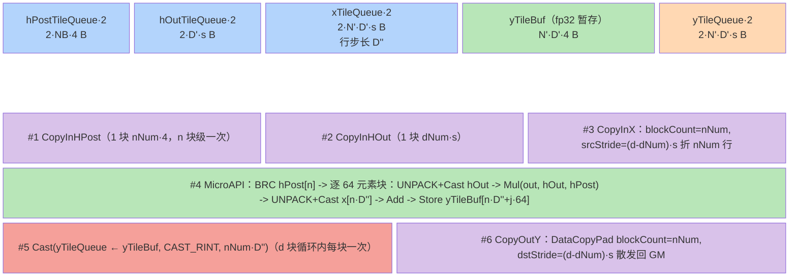
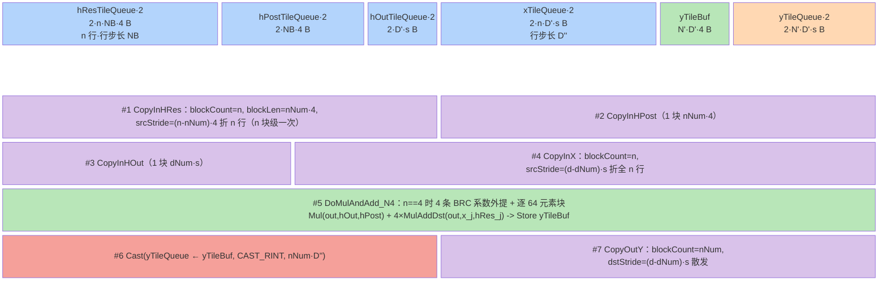
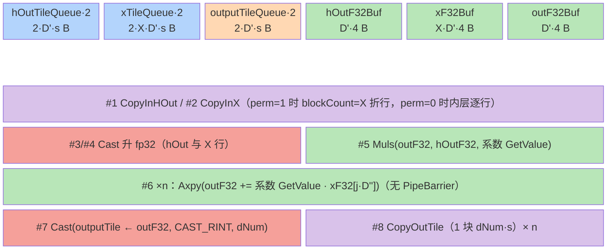

# mhc_post arch35 三模板分发与 MicroAPI 寄存器累加设计

> **目标读者**：模型在设计阶段（Phase 4）为 arch35（Ascend 950PR/950DT）上的「一路主流按 N 路系数广播缩放 + 小系数矩阵加权 + 残差」类算子选择实现形态，或需要 RegBase MicroAPI（`RegTensor/__VEC_SCOPE__`）寄存器累加与广播加载的参考模式。
> **范围**：arch35 RegBase 路径（`op_kernel/mhc_post_apt.cpp` + `op_kernel/arch35/` + `op_host/op_tiling/arch35/`），仅覆盖 Ascend 950PR/950DT；MemBase（910b/910_93，`mhc_post.cpp` + `op_kernel/arch22/`，TilingKey 0/1）见姊妹卡 [mhc_post.md](mhc_post.md)。arch35 端 `h_res` 支持传 nullptr 退化为直接残差（README 约束说明），故多出一条 nohres 路径。
> **前置阅读**：无。

---

## 本算子速览

- **数学定义**：与姊妹卡相同——`out[i,:] = Σ_j hRes[j][i]·x[j,:] + hPost[i]·hOut[:]`；`hRes` 缺省（nullptr）时 `out[i,:] = x[i,:] + hPost[i]·hOut[:]`（[mhc_post_apt.cpp:14-15](https://gitcode.com/cann/ops-transformer/blob/4b422ccf023d6be832b66bc838c6de8e5e5b18d1/mhc/mhc_post/op_kernel/mhc_post_apt.cpp)、[README:26-30](https://gitcode.com/cann/ops-transformer/blob/4b422ccf023d6be832b66bc838c6de8e5e5b18d1/mhc/mhc_post/README.md)）。
- **shape/layout**：同姊妹卡（ND，`BSND/BSNn` 或 `TND/Tnn`，`totalItems = B·S` 或 `T`）；arch35 端**不强制** `n==4`/`d%128`（arch35 三个 tiling 类均无规格约束校验），regbase `IsCapable` 只要求 `n ≥ 4`。
- **dtype**：`x/hOut/out` ∈ FLOAT16/BFLOAT16（同型），`hRes/hPost` ∈ FLOAT32。
- **纯 Vector 算子**：`KERNEL_TASK_TYPE_DEFAULT(KERNEL_TYPE_AIV_ONLY)`（[mhc_post_apt.cpp:31](https://gitcode.com/cann/ops-transformer/blob/4b422ccf023d6be832b66bc838c6de8e5e5b18d1/mhc/mhc_post/op_kernel/mhc_post_apt.cpp)）；regbase/nohres 两模板核心计算在 `__VEC_SCOPE__` 寄存器域完成，无 Cube。
- **计算管线一行**：`CopyIn hPost/hRes（n 轴级，跨 D 循环常驻）-> [CopyIn hOut/x -> MicroAPI: Cast 升 fp32 -> Mul(广播缩放) -> n×MulAddDst(寄存器累加) -> Store fp32 暂存] × D 块 -> Cast 降精度 -> 多行 DataCopyPad 散发`。
- **模板数**：3 个模板类 × 3 个 bool TilingKey 位（`USE_PERMANENT_X / USE_REGBASE / USE_H_RES`），实际合法组合 4 个（见 §3.1）。

## 1. 源码路径与文件职责

### 1.1 Host 侧（Tiling 计算）

| 文件 | 职责 |
|------|------|
| [`op_host/mhc_post_def.cpp:28-33,60-69`](https://gitcode.com/cann/ops-transformer/blob/4b422ccf023d6be832b66bc838c6de8e5e5b18d1/mhc/mhc_post/op_host/mhc_post_def.cpp) | `h_res` 为 **OPTIONAL** 输入；`ascend950` 配置 `opFile.value = "mhc_post_apt"` + `DynamicCompileStaticFlag/DynamicFormatFlag/DynamicRankSupportFlag/DynamicShapeSupportFlag` |
| [`op_host/op_api/aclnn_mhc_post.cpp:282-289`](https://gitcode.com/cann/ops-transformer/blob/4b422ccf023d6be832b66bc838c6de8e5e5b18d1/mhc/mhc_post/op_host/op_api/aclnn_mhc_post.cpp) | 平台护栏：`hRes == nullptr` 时校验 `GetCurNpuArch() == NpuArch::DAV_3510`，否则报运行时错误（nohres 仅 950 支持） |
| [`op_host/op_tiling/arch35/mhc_post_tiling_nohres_arch35.cpp:100-113`](https://gitcode.com/cann/ops-transformer/blob/4b422ccf023d6be832b66bc838c6de8e5e5b18d1/mhc/mhc_post/op_host/op_tiling/arch35/mhc_post_tiling_nohres_arch35.cpp) | nohres `IsCapable`：以 index3 是否为 fp32 探测「可选输入是否真实存在」；优先级 **5** |
| [`op_host/op_tiling/arch35/mhc_post_tiling_nohres_arch35.cpp:411-450,505-512`](https://gitcode.com/cann/ops-transformer/blob/4b422ccf023d6be832b66bc838c6de8e5e5b18d1/mhc/mhc_post/op_host/op_tiling/arch35/mhc_post_tiling_nohres_arch35.cpp) | nohres `ComputeTiling`（D 轴从 dOuter=1 递增找最大可驻留 tile，`D_ALIGN=D_MIN=32`、`N_ALIGN=N_MIN=8`）+ `GetTilingKey=(0,1,0)` + 注册 |
| [`op_host/op_tiling/arch35/mhc_post_tiling_regbase_arch35.cpp:105-155`](https://gitcode.com/cann/ops-transformer/blob/4b422ccf023d6be832b66bc838c6de8e5e5b18d1/mhc/mhc_post/op_host/op_tiling/arch35/mhc_post_tiling_regbase_arch35.cpp) | regbase `IsCapable`：`totalItems ≥ aivNum/2`（并行度门控）、`n ≥ 4`、最小 UB 占用 `< UB_SIZE`；优先级 **10** |
| [`op_host/op_tiling/arch35/mhc_post_tiling_regbase_arch35.cpp:503-549,599-606`](https://gitcode.com/cann/ops-transformer/blob/4b422ccf023d6be832b66bc838c6de8e5e5b18d1/mhc/mhc_post/op_host/op_tiling/arch35/mhc_post_tiling_regbase_arch35.cpp) | regbase `ComputeTiling`（核按 bs 均分 + D/N 双轴从 1 递增找最大可驻留 tile）+ `GetTilingKey=(0,1,1)` + 注册 |
| [`op_host/op_tiling/arch35/mhc_post_tiling_base_arch35.cpp:467-510,560-567`](https://gitcode.com/cann/ops-transformer/blob/4b422ccf023d6be832b66bc838c6de8e5e5b18d1/mhc/mhc_post/op_host/op_tiling/arch35/mhc_post_tiling_base_arch35.cpp) | 兜底模板 `ComputeTiling`（与 MemBase 逐行同构）+ `GetTilingKey=(usePermanentX_,0,1)` + 注册（优先级 **20**） |
| [`op_host/op_tiling/mhc_post_tiling_base.cpp:24-38`](https://gitcode.com/cann/ops-transformer/blob/4b422ccf023d6be832b66bc838c6de8e5e5b18d1/mhc/mhc_post/op_host/op_tiling/mhc_post_tiling_base.cpp) | 注册入口：`TilingRegistryArch::DoTilingImpl` 按 NpuArch + 优先级链选模板类 |

### 1.2 Kernel 侧（模板实现）

| 文件 | TilingKey | 类名 | 职责 |
|------|-----------|------|------|
| [`op_kernel/arch35/mhc_post_nohres.h:32-75`](https://gitcode.com/cann/ops-transformer/blob/4b422ccf023d6be832b66bc838c6de8e5e5b18d1/mhc/mhc_post/op_kernel/arch35/mhc_post_nohres.h) | (0,1,0) | `MhcPostNoHRes<T>` | 缺省系数矩阵路径：无 hRes 队列/寄存器，`Mul + Add` 两步完成缩放残差 |
| [`op_kernel/arch35/mhc_post_regbase.h:35-85`](https://gitcode.com/cann/ops-transformer/blob/4b422ccf023d6be832b66bc838c6de8e5e5b18d1/mhc/mhc_post/op_kernel/arch35/mhc_post_regbase.h) | (0,1,1) | `MhcPostRegbase<T>` | 主力路径：MicroAPI 寄存器累加，`n==4` 走 `DoMulAndAdd_N4` 全展开特化 |
| [`op_kernel/arch35/mhc_post_arch35.h:33-80`](https://gitcode.com/cann/ops-transformer/blob/4b422ccf023d6be832b66bc838c6de8e5e5b18d1/mhc/mhc_post/op_kernel/arch35/mhc_post_arch35.h) | (perm,0,1) | `MhcPostKernel<T, USE_PERMANENT_X>` | 兜底：高层 API 形态，与 MemBase 姊妹卡同构（少 L2 hint、少 PipeBarrier） |
| [`op_kernel/arch35/mhc_post_tiling_data.h:19-47`](https://gitcode.com/cann/ops-transformer/blob/4b422ccf023d6be832b66bc838c6de8e5e5b18d1/mhc/mhc_post/op_kernel/arch35/mhc_post_tiling_data.h) | - | `MhcPostTilingData` + `MhcPostRegbaseTilingData` | 两套裸结构体：前者 12 字段（与 MemBase 相同），后者把核粒度改为 bs 块并增加 nInner/nOuter/nTail |
| [`op_kernel/arch35/mhc_post_tiling_key.h:23-59`](https://gitcode.com/cann/ops-transformer/blob/4b422ccf023d6be832b66bc838c6de8e5e5b18d1/mhc/mhc_post/op_kernel/arch35/mhc_post_tiling_key.h) | - | `ASCENDC_TPL_ARGS_DECL/SEL` | 3 个 bool 维 + 3 条合法组合（`USE_PERMANENT_X` 仅在 REGBASE=0 分支自由，另两支固定 0）；`REG_ALIGN_N=8`、`REG_ALIGN_D=16` |

### 1.3 路由分发

| 文件 | 职责 |
|------|------|
| [`op_kernel/mhc_post_apt.cpp:27-54`](https://gitcode.com/cann/ops-transformer/blob/4b422ccf023d6be832b66bc838c6de8e5e5b18d1/mhc/mhc_post/op_kernel/mhc_post_apt.cpp) | arch35 路由入口：`template<USE_PERMANENT_X, USE_REGBASE, USE_H_RES>` + `if constexpr (USE_H_RES==0) -> MhcPostNoHRes`、`else if constexpr (USE_REGBASE==0) -> MhcPostKernel`、`else -> MhcPostRegbase`；每分支各自 `REGISTER_TILING_FOR_TILINGKEY` 绑定对应 TilingData 结构体 |

---

## 2. 算子特定优化 trick（高杠杆速览）

### 2.1 小系数矩阵常驻 UB、跨整个 D 内层循环复用（n 轴外提）

- **摘要**: 把循环序定为 `bs -> n 块 -> D 块`，系数矩阵（n×n）与系数向量（n）在 n 块级一次 `DataCopyPad` 搬入 UB 后，对**全部** D 块复用；D 块循环体内只剩 hOut/x 的大流量搬运与寄存器计算。n×n 只有十几个 fp32，若放进 D 块循环则重复搬运 `nOuter·dOuter` 次。
- **触发**: regbase 模板 `Process`（[mhc_post_regbase.h:284-303](https://gitcode.com/cann/ops-transformer/blob/4b422ccf023d6be832b66bc838c6de8e5e5b18d1/mhc/mhc_post/op_kernel/arch35/mhc_post_regbase.h)）；nohres 模板同构（[mhc_post_nohres.h:189-209](https://gitcode.com/cann/ops-transformer/blob/4b422ccf023d6be832b66bc838c6de8e5e5b18d1/mhc/mhc_post/op_kernel/arch35/mhc_post_nohres.h)，仅少 hRes）。
- **golden源**: [mhc_post_regbase.h:286-301](https://gitcode.com/cann/ops-transformer/blob/4b422ccf023d6be832b66bc838c6de8e5e5b18d1/mhc/mhc_post/op_kernel/arch35/mhc_post_regbase.h)（CopyInHRes/CopyInHPost 在 dIdx 循环外、FreeTensor 在 dIdx 循环后）、[mhc_post_regbase.h:332-345](https://gitcode.com/cann/ops-transformer/blob/4b422ccf023d6be832b66bc838c6de8e5e5b18d1/mhc/mhc_post/op_kernel/arch35/mhc_post_regbase.h)（CopyInHRes blockCount=n 折行）
- **实例化公共原则**: -> `runbooks/operator-optimization/vv-fusion-common.md#OPT-1 小系数操作数常驻复用，禁止热循环内逐 tile 重取`（编号为候选占位，最终编号待编排器串行合并回写）
- **预期收益**: 待轨迹验证（高杠杆：D 块循环通常数百上千轮，系数搬运量从 O(轮数) 降为 O(1)）
- **迁移条件**: 适用=「小系数操作数 × 大流维」结构的广播缩放/加权算子；前提=系数在 bs 与 n 块粒度上不变、UB 能容纳 n·对齐(n 块宽)·4 字节；失效=系数随 D 块变化（无复用性）时只能逐块取。

**坏实践（反例）**：把系数矩阵放进 D 块内层循环搬运，或在循环内逐元素标量重取（姊妹卡 MemBase 形态，仅在使用点稀疏时才划算）--数百轮循环各付一次队列同步/标量读。

### 2.2 寄存器域累加 + 融合乘加链，仅末次写回

- **摘要**: 一路输出的 `Mul + n×加权累加` 全部在一条 vreg 上完成：`Mul(outReg, hOutF32, hPostReg)` 建立初值后，n 次 `MulAddDst(outReg, xRegFloat_j, hResReg_j)` 直接累加进同一 vreg，最后一条 `DataCopy` 写 fp32 暂存区；全程无累加器 UB 读写，也无需在 UB 上物化 n 份中间和。
- **触发**: regbase `DoMulAndAdd_N4`（[mhc_post_regbase.h:256-260](https://gitcode.com/cann/ops-transformer/blob/4b422ccf023d6be832b66bc838c6de8e5e5b18d1/mhc/mhc_post/op_kernel/arch35/mhc_post_regbase.h)）与通用 `DoMulAndAdd`（[mhc_post_regbase.h:168-177](https://gitcode.com/cann/ops-transformer/blob/4b422ccf023d6be832b66bc838c6de8e5e5b18d1/mhc/mhc_post/op_kernel/arch35/mhc_post_regbase.h)）。
- **golden源**: [mhc_post_regbase.h:256-262](https://gitcode.com/cann/ops-transformer/blob/4b422ccf023d6be832b66bc838c6de8e5e5b18d1/mhc/mhc_post/op_kernel/arch35/mhc_post_regbase.h)（Mul + 4×MulAddDst + 单次 Store）、[mhc_post_regbase.h:179](https://gitcode.com/cann/ops-transformer/blob/4b422ccf023d6be832b66bc838c6de8e5e5b18d1/mhc/mhc_post/op_kernel/arch35/mhc_post_regbase.h)（通用路径同构）
- **实例化公共原则**: -> `runbooks/operator-optimization/vv-fusion-common.md#OPT-3 寄存器域累加 + 融合乘加链单次写回`（编号为候选占位）
- **预期收益**: 待轨迹验证（高杠杆：n 路加权和的 UB 读写从 2n 次降到 1 次；姊妹卡 MemBase 需 `Axpy` 直写 UB 累加器 + 出口再读回）
- **迁移条件**: 适用=「初值 + n 项加权和」的固定短累加链；前提=arch35 RegBase MicroAPI 可用、n 小到寄存器够放；失效=累加链过长（寄存器压力）或需跨 D 块累计时退回 UB 累加器。

**坏实践（反例）**：在 UB 上开累加缓冲，每项乘加都 `Load -> 计算 -> Store` 回 UB--n 项加权和产生 2n 次 UB 往返，寄存器带宽优势全失。

**示意图**（高收益双表示）：

```
UB 累加器形态（MemBase 姊妹卡）            寄存器累加形态（本卡 regbase）
Cast(xF32 ← x_j)      ← UB 写             DataCopy(xReg_j,  DIST_UNPACK_B16)
Cast(hOutF32 ← hOut)  ← UB 写             Cast(xRegFloat_j, ...)
Muls(outF32, hOutF32, c)  ← UB 写         DataCopy<BRC_B32>(hResReg_j)
  for j: Axpy(outF32, xF32, c_j)          DataCopy<BRC_B32>(hPostReg)
           ↑ 每项一次 UB 读+写            Mul(outReg, hOutF32, hPostReg)
Cast(out ← outF32)    ← UB 读               for j: MulAddDst(outReg, xRegFloat_j, hResReg_j)
UB 往返 = 2n + 4                         DataCopy(yAddr, outReg)      ← 仅 1 次
                                         UB 往返 = 1（fp32 暂存，出口一次 Cast）
```

### 2.3 n==4 定长特化：4 组寄存器展开 + 广播外提

- **摘要**: `n==4` 时走独立函数：4 条系数广播加载提到 D 块循环外、一次取满 4 个 vreg，块内循环只做 4 组 `x 加载 + Cast + MulAddDst`；通用路径则把系数广播放在 `i` 与块的双重循环内，每 64 元素重复加载一次系数。定长分支同时把寄存器数固定下来，便于编译期调度。
- **触发**: `tilingData_->n == 4`（[mhc_post_regbase.h:128-131](https://gitcode.com/cann/ops-transformer/blob/4b422ccf023d6be832b66bc838c6de8e5e5b18d1/mhc/mhc_post/op_kernel/arch35/mhc_post_regbase.h)），运行期分支（MemBase 规格里 n 恒为 4，950 端 n 可 > 4）。
- **golden源**: [mhc_post_regbase.h:192-273](https://gitcode.com/cann/ops-transformer/blob/4b422ccf023d6be832b66bc838c6de8e5e5b18d1/mhc/mhc_post/op_kernel/arch35/mhc_post_regbase.h)（DoMulAndAdd_N4 全函数）、[mhc_post_regbase.h:224-233](https://gitcode.com/cann/ops-transformer/blob/4b422ccf023d6be832b66bc838c6de8e5e5b18d1/mhc/mhc_post/op_kernel/arch35/mhc_post_regbase.h)（4 条广播外提）
- **实例化公共原则**: -> `runbooks/operator-optimization/vv-fusion-common.md#OPT-4 定长小 N 特化展开 + 广播外提`（编号为候选占位）
- **预期收益**: 待轨迹验证
- **迁移条件**: 适用=某固定小尺寸（如 4）占绝对主流的维度；前提=主流尺寸可静态判定且寄存器组够放 N 条广播；失效=尺寸分布分散时维护成本超过收益，保留通用循环即可。

**坏实践（反例）**：只有通用循环形态，把系数广播留在最内层--每 64 元素重复发 n 条广播加载；或为每个可能尺寸都开一套特化（代码爆炸）。

### 2.4 广播加载指令形态替代 Load + Duplicate

- **摘要**: 系数（fp32 标量）用 `DataCopy<float, LoadDist::DIST_BRC_B32>(reg, addr)` 一条指令完成「加载 + 全 lane 广播」，输入（fp16/bf16 向量）用 `LoadDist::DIST_UNPACK_B16` 一条指令完成「加载 + 解包成 fp32 槽位」，两者都省掉独立的 Duplicate/单独 Cast 前置搬移。
- **触发**: regbase/nohres 两模板的全部寄存器域加载（[mhc_post_regbase.h:161-176](https://gitcode.com/cann/ops-transformer/blob/4b422ccf023d6be832b66bc838c6de8e5e5b18d1/mhc/mhc_post/op_kernel/arch35/mhc_post_regbase.h)、[mhc_post_nohres.h:142-159](https://gitcode.com/cann/ops-transformer/blob/4b422ccf023d6be832b66bc838c6de8e5e5b18d1/mhc/mhc_post/op_kernel/arch35/mhc_post_nohres.h)）。
- **golden源**: [mhc_post_regbase.h:224-233](https://gitcode.com/cann/ops-transformer/blob/4b422ccf023d6be832b66bc838c6de8e5e5b18d1/mhc/mhc_post/op_kernel/arch35/mhc_post_regbase.h)（DIST_BRC_B32 系数广播）、[mhc_post_regbase.h:238-249](https://gitcode.com/cann/ops-transformer/blob/4b422ccf023d6be832b66bc838c6de8e5e5b18d1/mhc/mhc_post/op_kernel/arch35/mhc_post_regbase.h)（DIST_UNPACK_B16 向量加载）
- **实例化公共原则**: -> `runbooks/operator-optimization/vv-fusion-common.md#OPT-5 广播/解包加载形态替代 Load+Duplicate+Cast 前置`（编号为候选占位）
- **预期收益**: 待轨迹验证
- **迁移条件**: 适用=RegBase 平台上「标量广播 + 半精度向量升精度」两类高频加载；前提=数据已在 UB 且布局与加载形态匹配（BRC 要求连续标量、UNPACK 要求半精度连续）；失效=需要跨行/带 stride 的复杂重排时（应改 UB 侧搬运或 DataCopyPad 折行）。

**坏实践（反例）**：先 `DataCopy` 标量到 UB 再 `Duplicate` 广播到 vreg--多一次 UB 写 + 一条额外指令；或半精度数据先整块 Cast 落 UB 再加载。

### 2.5 fp32 计算域 + 整块出口降精度

- **摘要**: 寄存器域以 `CastTrait{ZERO, UNKNOWN, ZEROING, UNKNOWN}` 把 fp16/bf16 升 fp32 参与全部乘加，fp32 结果先写单份 `yTileBuf` 暂存，一个 n 块的全部 D 块算完后用一条高层 `Cast(CAST_RINT, nNum·D'')` 整块降精度进输出队列；半精度只在出入口各出现一次。
- **触发**: 全部三模板（regbase/nohres 寄存器域 castTrait + 整块 Cast；兜底模板高层 API `Cast CAST_NONE/CAST_RINT`）。
- **golden源**: [mhc_post_regbase.h:83-84](https://gitcode.com/cann/ops-transformer/blob/4b422ccf023d6be832b66bc838c6de8e5e5b18d1/mhc/mhc_post/op_kernel/arch35/mhc_post_regbase.h)（castTrait）、[mhc_post_regbase.h:270-272](https://gitcode.com/cann/ops-transformer/blob/4b422ccf023d6be832b66bc838c6de8e5e5b18d1/mhc/mhc_post/op_kernel/arch35/mhc_post_regbase.h)（整块 CAST_RINT）、[mhc_post_arch35.h:171-185](https://gitcode.com/cann/ops-transformer/blob/4b422ccf023d6be832b66bc838c6de8e5e5b18d1/mhc/mhc_post/op_kernel/arch35/mhc_post_arch35.h)（兜底模板出入口 Cast）
- **实例化公共原则**: -> `runbooks/operator-optimization/vv-fusion-common.md#OPT-6 入口升 fp32 / 出口才降精度`（编号为候选占位）
- **预期收益**: 待轨迹验证
- **迁移条件**: 适用=fp16/bf16 的加权求和/归约类算子；前提=UB 预算按 fp32 暂存口径重算仍可驻留；失效=纯逐元素且精度不敏感时可省 cast 与 fp32 暂存。

**坏实践（反例）**：在 fp16/bf16 域内逐项累加（误差随项数放大）；或每个 D 块各做一次小规模降精度（指令条数与 UB 往返均被放大 dOuter 倍）。

### 2.6 并行度门控：任务量不足时回退简单模板

- **摘要**: 主力 regbase 模板的 `IsCapable` 先查 `totalItems ≥ aivNum/2` 再查 UB 最小占用，不满足就让位给兜底模板（`IsCapable` 恒 true）--小 shape 下核间并行不足，寄存器特化与多队列带来的 UB 占用反而压缩 tile，简单高层 API 形态更优。
- **触发**: `totalItems < aivNum/2` 或 `n < 4` 或最小 UB 占用不满足（[mhc_post_tiling_regbase_arch35.cpp:105-155](https://gitcode.com/cann/ops-transformer/blob/4b422ccf023d6be832b66bc838c6de8e5e5b18d1/mhc/mhc_post/op_host/op_tiling/arch35/mhc_post_tiling_regbase_arch35.cpp)）。
- **golden源**: [mhc_post_tiling_regbase_arch35.cpp:135-152](https://gitcode.com/cann/ops-transformer/blob/4b422ccf023d6be832b66bc838c6de8e5e5b18d1/mhc/mhc_post/op_host/op_tiling/arch35/mhc_post_tiling_regbase_arch35.cpp)（并行度与 UB 双门控）、[mhc_post_tiling_base_arch35.cpp:115-118](https://gitcode.com/cann/ops-transformer/blob/4b422ccf023d6be832b66bc838c6de8e5e5b18d1/mhc/mhc_post/op_host/op_tiling/arch35/mhc_post_tiling_base_arch35.cpp)（兜底 `IsCapable()=true`）
- **实例化公共原则**: -> `runbooks/operator-optimization/vv-fusion-common.md#OPT-10 并行度优先分轴 + tile 上下限双约束`（编号为候选占位）
- **预期收益**: 待轨迹验证
- **迁移条件**: 适用=同一算子内「特化模板 + 通用兜底」并存的多模板体系；前提=特化收益可由 host 侧可判定的量（任务数、UB 占用）表达；失效=任务量与收益无关（如固定 tile 形态）时无需门控。

**坏实践（反例）**: 特化模板 `IsCapable` 恒 true 一路通吃--小 shape 下核利用率低、UB 被多队列占满，性能反而低于简单实现。

---

## 3. 多模板分发原则

### 3.1 分发维度

arch35 侧是「**优先级链（host）+ 编译期 bool 组合（kernel）**」双层分发：三个 tiling 类都注册于 `NpuArch::DAV_3510`，按优先级 5 / 10 / 20 依次尝试 `IsCapable()`（数值小者优先）；选中后 `GetTilingKey()` 返回 3 个 bool 的位组合，kernel 入口用 `if constexpr` 三分支（[mhc_post_apt.cpp:35-53](https://gitcode.com/cann/ops-transformer/blob/4b422ccf023d6be832b66bc838c6de8e5e5b18d1/mhc/mhc_post/op_kernel/mhc_post_apt.cpp)）各自绑定对应 TilingData 结构体。

```
TilingRegistryArch 优先级链（全部注册于 DAV_3510，数值小者优先）
│
├─ P5  NoHRes   IsCapable = 可选系数矩阵输入不存在（index3 非空且为 fp32 -> false）
├─ P10 RegBase  IsCapable = totalItems ≥ aivNum/2  &&  n ≥ 4  &&  最小 UB 占用 < UB_SIZE
└─ P20 Base     IsCapable = true（兜底）

kernel（mhc_post_apt.cpp，if constexpr 三分支）
  USE_H_RES  == 0 -> MhcPostNoHRes<DTYPE_X>            TilingData = MhcPostRegbaseTilingData
  USE_REGBASE== 0 -> MhcPostKernel<DTYPE_X, PERM>      TilingData = MhcPostTilingData
  USE_REGBASE== 1 -> MhcPostRegbase<DTYPE_X>           TilingData = MhcPostRegbaseTilingData

GetTilingKey 实际组合（GET_TPL_TILING_KEY(perm, regbase, hres)）
  NoHRes  -> (0, 1, 0)        RegBase -> (0, 1, 1)        Base -> (usePermanentX_, 0, 1)
  ★ USE_PERMANENT_X 仅在 Base 分支有意义；合法组合 4 个
```

nohres 的 `IsCapable` 用「探测 index3 的 dtype」识别可选输入是否被框架折叠（[mhc_post_tiling_nohres_arch35.cpp:101-113](https://gitcode.com/cann/ops-transformer/blob/4b422ccf023d6be832b66bc838c6de8e5e5b18d1/mhc/mhc_post/op_host/op_tiling/arch35/mhc_post_tiling_nohres_arch35.cpp)）：可选输入为 nullptr 时入参序前移（`x, hOut, hPost` 三路），此时 index1 = hOut、index2 = hPost（见该文件 36-40 行的索引常量）。

### 3.2 设计阶段就必须决策

「主力特化模板 + 并行度门控 + 恒真兜底」这一多模板体系规划原则已上提泛化库：候选 `runbooks/operator-optimization/vv-fusion-common.md#OPT-10 并行度优先分轴 + tile 上下限双约束` 的「迁移条件」节（编号待编排器串行合并回写）。本文件只留此一行指针，不再重复正文。

### 3.3 子维度：dtype × 可用 TilingKey

| dtype | 计算域 | 可用 TilingKey | 说明 |
|-------|--------|----------------|------|
| FLOAT16 | fp32（castTrait / CAST_NONE） | 4 个组合全可用 | 寄存器域 `DIST_UNPACK_B16 + Cast` 升 fp32 |
| BFLOAT16 | fp32（同上） | 4 个组合全可用 | 与 fp16 共用同一 `castB16ToB32` trait，无专属分支 |

dtype 不参与 TilingKey 分档（`DTYPE_X` 宏决定模板参数 `T`）；系数矩阵/系数向量恒为 fp32，无需 cast。

---

## 4. 模板一：MhcPostNoHRes 缺省系数路径（TilingKey (0,1,0)，优先级 5）

### 4.1 触发条件

`IsCapable`（[mhc_post_tiling_nohres_arch35.cpp:100-113](https://gitcode.com/cann/ops-transformer/blob/4b422ccf023d6be832b66bc838c6de8e5e5b18d1/mhc/mhc_post/op_host/op_tiling/arch35/mhc_post_tiling_nohres_arch35.cpp)）：index3 非空且 dtype 为 fp32 -> false（可选系数矩阵实际存在）；否则要求 index2（系数向量）dtype 为 fp32。语义上即「可选输入传 nullptr，退化为直接残差」，且仅 950 合法（[aclnn_mhc_post.cpp:282-289](https://gitcode.com/cann/ops-transformer/blob/4b422ccf023d6be832b66bc838c6de8e5e5b18d1/mhc/mhc_post/op_host/op_api/aclnn_mhc_post.cpp)）。kernel 侧无系数矩阵队列与寄存器，`Mul + Add` 两步完成（[mhc_post_nohres.h:154-162](https://gitcode.com/cann/ops-transformer/blob/4b422ccf023d6be832b66bc838c6de8e5e5b18d1/mhc/mhc_post/op_kernel/arch35/mhc_post_nohres.h)）。

### 4.2 Tiling 参数

`MhcPostRegbaseTilingData`（[mhc_post_tiling_data.h:34-47](https://gitcode.com/cann/ops-transformer/blob/4b422ccf023d6be832b66bc838c6de8e5e5b18d1/mhc/mhc_post/op_kernel/arch35/mhc_post_tiling_data.h)）：

| 字段 | 用途 |
|------|------|
| n / d | 流数 N / 特征维 D |
| usedCoreNum / bsInner / bsOuter / bsTail | 核数按 bs 均分（[mhc_post_tiling_nohres_arch35.cpp:413-417](https://gitcode.com/cann/ops-transformer/blob/4b422ccf023d6be832b66bc838c6de8e5e5b18d1/mhc/mhc_post/op_host/op_tiling/arch35/mhc_post_tiling_nohres_arch35.cpp)），每核工作单元 = bsInner 个 bs 项 |
| nInner / nOuter / nTail | n 轴内宽（align8，下限 8）/ 分块数 / 尾块 |
| dInner / dOuter / dTail | d 轴内宽（align32，下限 32）/ 分块数 / 尾块 |

★ 分轴次序：**先 d 后 n**（[mhc_post_tiling_nohres_arch35.cpp:426-449](https://gitcode.com/cann/ops-transformer/blob/4b422ccf023d6be832b66bc838c6de8e5e5b18d1/mhc/mhc_post/op_host/op_tiling/arch35/mhc_post_tiling_nohres_arch35.cpp)），两轴都从 1 起递增分块数、取「第一个能装进 UB」的组合 = 最大化 tile；核间并行由 bs 轴均分独立解决，不靠 d/n 细分（与 MemBase 用 d 细分凑并行度相反）。

### 4.3 UB 分配与内存复用

#### 4.3.1 UBuf 内存布局（mermaid block-beta）

`N' = nInner`、`D' = dInner`、`D'' = ceil16(dNum)`（UB 行步长）、`NB = align8(N')`、`s = 2`：



#### 4.3.2 UB 总占用

由 `InitBuffer` 实参（[mhc_post_nohres.h:100-107](https://gitcode.com/cann/ops-transformer/blob/4b422ccf023d6be832b66bc838c6de8e5e5b18d1/mhc/mhc_post/op_kernel/arch35/mhc_post_nohres.h)）：

```
总占用 = 2·NB·4          ← hPostTileQueue（VECIN，depth=2，NB = align8(nInner)）
       + 2·D'·s          ← hOutTileQueue（VECIN，depth=2）
       + 2·N'·D'·s       ← xTileQueue（VECIN，depth=2，按 nInner 行宽）
       + N'·D'·4         ← yTileBuf（VECCALC，fp32 暂存，单缓冲）
       + 2·N'·D'·s       ← yTileQueue（VECOUT，depth=2）
       = 12·N'·D' + 4·D' + 8·NB   （s = 2）
host 反推（mhc_post_tiling_nohres_arch35.cpp:430-436,439-449）：
  DB_BYTES_F32·N' + DB_BYTES_F16·D' + 2·DB_BYTES_F16·N'·D' + 4·N'·D' < UB_SIZE
  ★ 与 InitBuffer 精确互为镜像（N_ALIGN=8 ⇒ NB == N'，无余量项）
```

#### 4.3.3 复用序与内存复用策略表

| 子区 | 复用链 |
|------|------|
| yTileBuf（fp32 暂存） | 第 nIdx 块内：逐 dIdx 覆盖写 -> `#5` 整块 Cast 读出 -> 下一 dIdx 再覆盖（跨 D 块覆盖重用） |
| hPostTileQueue 槽 | n 块级 Alloc/DeQue/Free 一轮，D 块循环期间只读（§2.1 常驻） |
| xTileQueue / hOutTileQueue 槽 | 每 dIdx Alloc/Free 一轮（跨迭代覆盖） |

4 种复用策略对应位置：①原地操作=寄存器域 `Add(outReg, outReg, xRegFloat)` 累加（[mhc_post_nohres.h:162](https://gitcode.com/cann/ops-transformer/blob/4b422ccf023d6be832b66bc838c6de8e5e5b18d1/mhc/mhc_post/op_kernel/arch35/mhc_post_nohres.h)）；②跨迭代覆盖=yTileBuf 跨 D 块覆盖、队列槽逐轮 Alloc/Free；③预处理分支消除=无 hRes 路径整体独立成模板（缺省输入的分支在编译期消失）；④计算直写输出队列=`#5` Cast dst 位于 yTileQueue（[mhc_post_nohres.h:174-176](https://gitcode.com/cann/ops-transformer/blob/4b422ccf023d6be832b66bc838c6de8e5e5b18d1/mhc/mhc_post/op_kernel/arch35/mhc_post_nohres.h)）。

### 4.4 计算流程伪码

```
Init()                                              ← mhc_post_nohres.h:78-108
├─ blockIdx ≥ usedCoreNum -> 整核早退；curBS_ = 常规核 ? bsInner : bsTail
├─ 4 路 GlobalTensor（无 hResGm_）
└─ InitBuffer：yTileBuf(单缓冲 fp32) / 4 队列(depth=2)    #见 §4.3.2

Process()                                           ← 180-211
└─ for itemIdx in [0, curBS_):
    ├─ bsIdx = blockIdx·bsInner + itemIdx
    └─ for nIdx in [0, nOuter):
        ├─ nNum = (nIdx < nOuter-1) ? nInner : nTail
        ├─ CopyInHPost(bsIdx, nIdx, nNum)                         #1  ★ n 块级
        ├─ hPostUb ← hPostTileQueue.DeQue
        └─ for dIdx in [0, dOuter):
            ├─ dNum = (dIdx < dOuter-1) ? dInner : dTail
            ├─ CopyInHOut(bsIdx, dIdx, dNum)                      #2
            ├─ CopyInX(bsIdx, nIdx, nNum, dIdx, dNum)             #3
            ├─ DoMulAndAdd(hPostUb, nNum, dNum)                   #4/#5
            └─ CopyOutY(bsIdx, nIdx, nNum, dIdx, dNum)            #6
        └─ hPostTileQueue.FreeTensor(hPostUb)   ★ 系数跨整个 D 块循环常驻

CopyInX(bsIdx, nIdx, nNum, dIdx, dNum)              ← 239-252
└─ DataCopyPad(xTile, xGm[bsIdx·n·d + nIdx·nInner·d + dIdx·dInner],
               {blockCount=nNum, blockLen=dNum·s, srcStride=(d-dNum)·s, dstStride=0})   #3
   ★ 只折当前 n 块需要的 nNum 行；GM 侧行距 d·s，UB 侧按 32B 落块 → 行步长 D''

DoMulAndAdd(hPostUb, nNum, dNum)                    ← 111-177
├─ dAlign = ceil16(dNum) ; dRepeat = ceil(dNum / 64)     （VL_FP32 = 64 lane）
├─ __VEC_SCOPE__：
│   for nIndex in [0, nNum):
│     DataCopy<float, DIST_BRC_B32>(hPostReg, hPostAddr + nIndex)      ★ 标量广播
│     for j in [0, dRepeat):
│       pMask = UpdateMask<float>(dAlign)
│       DataCopy<T, DIST_UNPACK_B16>(hOutReg, hOutAddr + j·64)         #4
│       Cast<float,T,castB16ToB32>(hOutRegFloat, hOutReg, pMask)
│       Mul(outRegFloat, hOutRegFloat, hPostReg, pMask)                ★ 缩放
│       DataCopy<T, DIST_UNPACK_B16>(xReg, xAddr + nIndex·dAlign + j·64)
│       Cast<float,T,castB16ToB32>(xRegFloat, xReg, pMask)
│       Add(outRegFloat, outRegFloat, xRegFloat, pMask)                ★ 直接残差
│       DataCopy(yAddr + nIndex·dAlign + j·64, outRegFloat, pMask)
├─ Free(hOut/x 队列)
└─ Cast(yTileLocal, yTileBuf, CAST_RINT, nNum·dAlign) -> EnQue            #5

CopyOutY(...)                                       ← 255-269
└─ DataCopyPad(outGm[bsIdx·n·d + nIdx·nInner·d + dIdx·dInner], yTile,
               {blockCount=nNum, blockLen=dNum·s, srcStride=0,
                dstStride=(d-dNum)·s})                                #6
   ★ 多行散发：GM 侧留行距，UB 侧连续
```

### 4.5 路由代码

```cpp
// mhc_post_apt.cpp:35-40（分支一）
if constexpr (USE_H_RES == 0) {
    REGISTER_TILING_FOR_TILINGKEY("USE_H_RES == 0", MhcPostRegbaseTilingData);
    GET_TILING_DATA_WITH_STRUCT(MhcPostRegbaseTilingData, tilingData, tiling);
    MhcPostNoHRes<DTYPE_X> op(&tPipe, &tilingData);
    op.Init(x, hOut, hPost, output, workspace);   ★ 入参少一路 hRes
    op.Process();
}
```

---

## 5. 模板二：MhcPostRegbase 寄存器累加主力路径（TilingKey (0,1,1)，优先级 10）

### 5.1 触发条件

`IsCapable`（[mhc_post_tiling_regbase_arch35.cpp:105-155](https://gitcode.com/cann/ops-transformer/blob/4b422ccf023d6be832b66bc838c6de8e5e5b18d1/mhc/mhc_post/op_host/op_tiling/arch35/mhc_post_tiling_regbase_arch35.cpp)）：`totalItems ≥ aivNum/2`（并行度门控，§2.6）且 `n ≥ 4` 且最小 UB 占用 `192·n + 1216 < UB_SIZE`（`D_MIN=32`、`N_MIN=4`、`N_BUF_ALIGN=8` 口径）。nohres `IsCapable` 失败（系数矩阵存在）时本模板为 950 端的主力形态。

### 5.2 Tiling 参数

与 §4.2 同一 `MhcPostRegbaseTilingData`；差异：`N_ALIGN = 4`、`N_MIN = 4`（[mhc_post_tiling_regbase_arch35.cpp:516-517](https://gitcode.com/cann/ops-transformer/blob/4b422ccf023d6be832b66bc838c6de8e5e5b18d1/mhc/mhc_post/op_host/op_tiling/arch35/mhc_post_tiling_regbase_arch35.cpp)，nohres 为 8/8）；分轴同为「先 d 后 n、从 1 递增取最大可驻留 tile」（[mhc_post_tiling_regbase_arch35.cpp:520-548](https://gitcode.com/cann/ops-transformer/blob/4b422ccf023d6be832b66bc838c6de8e5e5b18d1/mhc/mhc_post/op_host/op_tiling/arch35/mhc_post_tiling_regbase_arch35.cpp)）。UB 预算式额外计入系数矩阵缓冲 `DB_BYTES_F32·n·nInnerBuf + DB_BYTES_F32·nInnerBuf`。

### 5.3 UB 分配与内存复用

#### 5.3.1 UBuf 内存布局（mermaid block-beta）

`N' = nInner`、`D' = dInner`、`D'' = ceil16(dNum)`、`NB = align8(N')`、`n` 为完整流数（系数矩阵按全 n 折行）、`s = 2`：



#### 5.3.2 UB 总占用

由 `InitBuffer` 实参（[mhc_post_regbase.h:112-121](https://gitcode.com/cann/ops-transformer/blob/4b422ccf023d6be832b66bc838c6de8e5e5b18d1/mhc/mhc_post/op_kernel/arch35/mhc_post_regbase.h)）：

```
总占用 = 2·n·NB·4        ← hResTileQueue（VECIN，depth=2，n 行·行步长 NB）
       + 2·NB·4          ← hPostTileQueue（VECIN，depth=2）
       + 2·D'·s          ← hOutTileQueue（VECIN，depth=2）
       + 2·n·D'·s        ← xTileQueue（VECIN，depth=2，按全 n 行宽）
       + N'·D'·4         ← yTileBuf（VECCALC，fp32 暂存）
       + 2·N'·D'·s       ← yTileQueue（VECOUT，depth=2）
       = 8·n·NB + 8·NB + 4·D' + 4·n·D' + 8·N'·D'   （s = 2）
host 反推（mhc_post_tiling_regbase_arch35.cpp:540-542）：与上式逐项相等（精确互为镜像）
```

#### 5.3.3 复用序与内存复用策略表

| 子区 | 复用链 |
|------|------|
| hResTileQueue / hPostTileQueue 槽 | n 块级 Alloc/DeQue/Free 一轮，D 块循环期间只读（§2.1 常驻复用） |
| yTileBuf | 第 nIdx 块内逐 dIdx 覆盖写 -> `#6` Cast 读出 -> 覆盖（跨 D 块覆盖重用） |
| xTileQueue 槽 | 每 dIdx Alloc/Free；块内被 nNum 个输出行的 `#5` 只读行偏移复用 n 次 |
| 寄存器组（非 UB） | `outRegFloat` 单条 vreg 承载 `Mul + n×MulAddDst` 全链（§2.2） |

4 种复用策略对应位置：①原地操作=寄存器域 `MulAddDst(outReg, ..., outReg)` 累加；②跨迭代覆盖=yTileBuf 跨 D 块覆盖、队列槽逐轮 Alloc/Free；③预处理分支消除=`if (n == 4) DoMulAndAdd_N4` 运行期分派 + 寄存器数编译期固定（[mhc_post_regbase.h:128-131](https://gitcode.com/cann/ops-transformer/blob/4b422ccf023d6be832b66bc838c6de8e5e5b18d1/mhc/mhc_post/op_kernel/arch35/mhc_post_regbase.h)）；④计算直写输出队列=`#6` Cast dst 位于 yTileQueue。

### 5.4 计算流程伪码

```
Init()：同 §4.4，另设 hResGm_ 与 hResTileQueue（n·NB·4·2 B）        ← 88-122

Process()                                           ← 276-304
└─ for itemIdx in [0, curBS_):
    ├─ bsIdx = blockIdx·bsInner + itemIdx
    └─ for nIdx in [0, nOuter):
        ├─ nNum = (nIdx < nOuter-1) ? nInner : nTail
        ├─ CopyInHRes(bsIdx, nIdx, nNum)                          #1  ★ n 块级，跨 D 常驻
        │   DataCopyPad(hResTile, hResGm[bsIdx·n² + nIdx·nInner],
        │      {blockCount=n, blockLen=nNum·4, srcStride=(n-nNum)·4})   ★ 折全 n 行
        ├─ CopyInHPost(bsIdx, nIdx, nNum)                         #2
        ├─ hPostUb ← DeQue ; hResUb ← DeQue
        └─ for dIdx in [0, dOuter):
            ├─ dNum = (dIdx < dOuter-1) ? dInner : dTail
            ├─ CopyInHOut / CopyInX                               #3/#4
            ├─ DoMulAndAdd(hPostUb, hResUb, nNum, dNum)           #5
            └─ CopyOutY(bsIdx, nIdx, nNum, dIdx, dNum)            #7
        └─ Free(hPostUb / hResUb)

DoMulAndAdd(hPostUb, hResUb, nNum, dNum)            ← 125-189
├─ if n == 4: DoMulAndAdd_N4(...)   else 通用循环                     ★ 运行期分派
├─ nAlign = align8(nNum) ; dAlign = ceil16(dNum) ; repeat = ceil(dNum/64)
├─ DoMulAndAdd_N4                                    ← 192-273
│   __VEC_SCOPE__：
│   for nIndex in [0, nNum=4):
│     DataCopy<BRC_B32>(hResReg0..3, hResAddr + {0,1,2,3}·nAlign + nIndex)  ★ 4 条广播外提
│     DataCopy<BRC_B32>(hPostReg,  hPostAddr + nIndex)
│     for j in [0, repeat):
│       pMask = UpdateMask<float>(dAlign)
│       DataCopy<UNPACK_B16>(hOutReg, hOutAddr + j·64) + Cast(hOutRegFloat)
│       DataCopy<UNPACK_B16>(xReg0..3, xAddr + {0..3}·dAlign + j·64)        #4
│       Cast(xRegFloat0..3, xReg0..3)
│       Mul(outRegFloat, hOutRegFloat, hPostReg)                            #5
│       MulAddDst(outRegFloat, xRegFloat0, hResReg0)                        #5 ★ 融合乘加
│       MulAddDst(outRegFloat, xRegFloat1, hResReg1)
│       MulAddDst(outRegFloat, xRegFloat2, hResReg2)
│       MulAddDst(outRegFloat, xRegFloat3, hResReg3)
│       DataCopy(yAddr + nIndex·dAlign + j·64, outRegFloat, pMask)          ★ 仅末次写回
│   ★ 通用路径（133-189）同构，但 hRes 广播在 i 循环与块循环内逐次重发（§2.3 反例形态）
├─ Free(hOut/x 队列)
└─ Cast(yTileLocal, yTileBuf, CAST_RINT, nNum·dAlign) -> EnQue            #6
```

### 5.5 路由代码

```cpp
// mhc_post_apt.cpp:47-53（分支三）
} else {
    REGISTER_TILING_FOR_TILINGKEY("USE_REGBASE == 1", MhcPostRegbaseTilingData);
    GET_TILING_DATA_WITH_STRUCT(MhcPostRegbaseTilingData, tilingData, tiling);
    MhcPostRegbase<DTYPE_X> op(&tPipe, &tilingData);
    op.Init(x, hRes, hOut, hPost, output, workspace);
    op.Process();
}
```

---

## 6. 模板三：MhcPostKernel 兜底路径（TilingKey (perm,0,1)，优先级 20）

### 6.1 触发条件

前两级 `IsCapable` 均失败（小任务量 `totalItems < aivNum/2`、或 `n < 4`、或最小 UB 占用不满足）时的恒真兜底（[mhc_post_tiling_base_arch35.cpp:115-118](https://gitcode.com/cann/ops-transformer/blob/4b422ccf023d6be832b66bc838c6de8e5e5b18d1/mhc/mhc_post/op_host/op_tiling/arch35/mhc_post_tiling_base_arch35.cpp)）。与 MemBase 姊妹卡完全同构（同一类名/同一算法），仅两处差异：

1. **无 `SetL2CacheHint`**（对比 [mhc_post_arch22.h:115-118](https://gitcode.com/cann/ops-transformer/blob/4b422ccf023d6be832b66bc838c6de8e5e5b18d1/mhc/mhc_post/op_kernel/arch22/mhc_post_arch22.h)）；
2. **`Axpy` 不夹 `PipeBarrier<PIPE_V>`**（对比 [mhc_post_arch22.h:223-225](https://gitcode.com/cann/ops-transformer/blob/4b422ccf023d6be832b66bc838c6de8e5e5b18d1/mhc/mhc_post/op_kernel/arch22/mhc_post_arch22.h)）。

### 6.2 Tiling 参数

`MhcPostTilingData` 12 字段，与 MemBase 姊妹卡 §4.2 完全一致；`ComputeTiling`（[mhc_post_tiling_base_arch35.cpp:467-510](https://gitcode.com/cann/ops-transformer/blob/4b422ccf023d6be832b66bc838c6de8e5e5b18d1/mhc/mhc_post/op_host/op_tiling/arch35/mhc_post_tiling_base_arch35.cpp)）逐行同构：D 轴倍增分裂（凑半核并行度）、tile 下限 256 元素、`usePermanentX = ((n+2)·8·dInner ≤ UB_SIZE)`。注意 arch35 端**无** `d%128`/`n==4` 规格校验（无 `CheckSpecConstraints`），故本模板的 n 可非 4、d 可非 128 的倍数。

### 6.3 UB 分配与内存复用

#### 6.3.1 UBuf 内存布局（mermaid block-beta）

`D' = dInner`、`D'' = dNumAlign`、`X = usePermanentX ? n : 1`、`s = 2`（整块预搬细节见姊妹卡 §2.1/§5）：



#### 6.3.2 UB 总占用

由 `InitBuffer` 实参（[mhc_post_arch35.h:112-121](https://gitcode.com/cann/ops-transformer/blob/4b422ccf023d6be832b66bc838c6de8e5e5b18d1/mhc/mhc_post/op_kernel/arch35/mhc_post_arch35.h)）：

```
总占用 = (16 + 8·X)·D'   （X = 1 -> 24·D'；X = n -> (16+8n)·D'，n=4 时 48·D'）
host 反推（mhc_post_tiling_base_arch35.cpp:513-515,538-541）：
  bytesPerTileD = 24（maxTileD = UB/24，约束 perm=0 分支）
  usePermanentX 门控 = (n+2)·8·dInner ≤ UB_SIZE（约束 perm=1 分支）
  ★ 两式分别与 X=1 / X=n 的 InitBuffer 精确互为镜像
```

#### 6.3.3 复用序与内存复用策略表

与 MemBase 姊妹卡 §4.3.3 / §5.3.3 一致：`outF32Buf` 跨 n 个输出行覆盖重用、`hOutF32Buf` 跨输出行只读复用、`xF32Buf` 在 perm=1 时跨输出行与加权行双重复用、队列槽逐轮 Alloc/Free、`#7 Cast` 直写输出队列。

### 6.4 计算流程伪码

与 MemBase 姊妹卡 §4.4（perm=0）/ §5.4（perm=1）逐行同构，此处只列差异：

```
Init()：无 SetL2CacheHint(CACHE_MODE_DISABLE)（arch22 版有）        ← mhc_post_arch35.h:104-109
ComputeCopyOutAllX：Axpy 两侧无 PipeBarrier<PIPE_V>()               ← mhc_post_arch35.h:213-215
其余（Process 循环 / CopyInX 两形态 / CopyOutTile）与姊妹卡一致
```

### 6.5 路由代码

```cpp
// mhc_post_apt.cpp:41-46（分支二）
} else if constexpr (USE_REGBASE == 0) {
    REGISTER_TILING_FOR_TILINGKEY("USE_REGBASE == 0", MhcPostTilingData);
    GET_TILING_DATA_WITH_STRUCT(MhcPostTilingData, tilingData, tiling);
    MhcPostKernel<DTYPE_X, USE_PERMANENT_X> op(&tPipe, &tilingData);
    op.Init(x, hRes, hOut, hPost, output, workspace);
    op.Process();
}
```

---

## 7. 模板对比总表

【实例化: -> OPT-3 / OPT-4（寄存器累加与定长特化的适用边界；编号待串行合并回写）】

| 维度 | NoHRes（(0,1,0)，P5） | RegBase（(0,1,1)，P10） | 兜底 Base（(perm,0,1)，P20） |
|------|------|------|------|
| 触发 | 可选系数矩阵缺省（nullptr） | `totalItems ≥ aivNum/2` 且 `n ≥ 4` 且 UB 够 | 上述均失败（恒真兜底） |
| dtype 支持 | fp16 / bf16 | fp16 / bf16 | fp16 / bf16 |
| Queue 深度 | 全 2（3 入 1 出） | 全 2（4 入 1 出） | 全 2（2 入 1 出） |
| TBuf 数 | 1（yTileBuf fp32） | 1（yTileBuf fp32） | 3（三块 fp32 计算区） |
| 系数获取 | UB 常驻（n 块级一次） | UB 常驻（n 块级一次） | `GetValue` 标量直取（每 tile） |
| n 轴处理 | 单模板通用循环，N_ALIGN=8 | `n==4` 特化全展开 + 通用循环（N_ALIGN=4） | 循环（n 可非 4） |
| 核心计算 | 寄存器域 `Mul + Add` | 寄存器域 `Mul + 4×MulAddDst` | 高层 API `Muls + Axpy`（UB 累加器） |
| 计算管线循环序 | bs -> n -> d（d 内层） | bs -> n -> d（d 内层） | tile=(bs,d) -> 输出行 i（j 内层） |
| x 搬运 | blockCount=nNum 折行（每 n 块） | blockCount=n 折行（每 n 块 × 每 d 块） | perm=1 整块 / perm=0 逐行 n² 次 |
| fp32 暂存 | yTileBuf 单份 + 整块 Cast | yTileBuf 单份 + 整块 Cast | outF32Buf 单份 + 逐输出行 Cast |
| L2 cache hint | 无 | 无 | 无（MemBase 姊妹版有，平台漂移） |
| 规格约束（host） | 无 n/d 校验 | `n ≥ 4` + UB 门控 | 无 n/d 校验 |
| 设计复杂度 | ★★☆ | ★★★ | ★★☆（与 MemBase 共享形态） |

---

<!-- okf:related:start -->

# 相关

- 相关主题: [mhc_post.md](mhc_post.md) - MemBase（910b/910_93）双 TilingKey 高层 API 实现姊妹卡，与本文互链；其 §2.2「小系数操作数标量直取」与本文 §2.1「常驻复用」构成同一取舍的两形态

<!-- okf:related:end -->
