# mhc_post_backward cube↔vector 融合设计

> **目标读者**：为「反向一次要出 4 个梯度（2 个 half 全宽 + 2 个 f32 窄矩阵）」类 MHC / 超连接残差反向算子选择实现形态的设计者；核心问题是**按归约长度选引擎**——K=D（可达 10 万级）的那个矩阵乘交给 Cube，K=n（≤8）的三个小矩阵乘留在 Vector，以及两域**不做 workspace 数据交接**时如何靠「输出互不重叠」保证正确性。
> **范围**：`mhc/mhc_post_backward/`（`aclnnMhcPostBackward`）。平台支持 = Ascend 950PR/950DT、Atlas A3 训练/推理、Atlas A2 训练/推理；Atlas 200I/500 A2、Atlas 推理/训练系列不支持（[README.md:5-12](https://gitcode.com/cann/ops-transformer/blob/4b422ccf023d6be832b66bc838c6de8e5e5b18d1/mhc/mhc_post_backward/README.md)）。本卡**单卡覆盖两套平台实现**：`op_kernel/arch35/`（Ascend 950，§2，MIX_AIC_1_2）与 `op_kernel/arch22/`（910b/910_93，§3，AIV_ONLY）；host 侧按 `NpuArch` 选路（§0.3）。知识库内尚无 mhc 家族其他卡（mhc_post / mhc_pre_backward 等），同族以 GitCode 路径互指（见文末 `# 相关`）。**注意**：`experimental/mhc/`（mhc_post / mhc_pre / mhc_res）是同仓另一套实验实现，前缀同名但不是本卡对象。
> **前置阅读**：无（MHC 背景见 §1.1 的前向公式回放）。

---

## 写作纪律与符号约定

1. 字节单位统一；每块子区字节相加 = 块总字节（逐块核对）。
2. 分配量 ≠ 实际数据：对齐冗余、预留未用、host 与 kernel 口径差都要标明。
3. 不张冠李戴：写清「读用户输入还是读 workspace」「matmul 是 cube 做的还是 vector 手写做」等。
4. double buffer 是评估项，不是默认（看 InitBuffer 深度 / 是否用 TQue）。
5. 复用安全判据：同一子区相邻两次写之间须夹着对旧值的读。
6. 字节来源是 InitBuffer 公式，可追溯行号，不靠估。
7. 交代图/伪码的范围（哪一层循环、哪个域）。
8. 平实写法，不自造概念；引用源码用相对路径 + 行号。

符号约定：`P` = item 数（代码 `totalItems`，4D 时 = B·S、3D 时 = T），每个 item 是一组 `[n,D]` 的 token；`n` = MHC 中间窄维（4/6/8）；`D` = 隐藏维（`channel`，代码里 grad_y 最后一维）；`T` = kernel 模板参数，即 half 侧 dtype（fp16 或 bf16，2 字节）；`tileD` = arch35 一次 UB 处理的 D 宽；`C` = `blockChannel`（arch22 一次 UB 处理的 D 宽，≤1024）；`alignedN`/`alignedNN` = `n`/`n²` 向上对齐到 8 个 float；字节公式系数已含 dtype 宽（T×2、f32×4、u8×1）。

---

## 0. 分发总览

### 0.1 golden 目录与源码边界

```text
mhc/mhc_post_backward/
├── README.md / docs/aclnnMhcPostBackward.md      # 功能、公式、平台矩阵、n/D 约束
├── op_host/mhc_post_backward_def.cpp             # 5 入 4 出 dtype/format 矩阵 + 3 个 Soc 的 opFile 指向
├── op_host/op_tiling/
│   ├── mhc_post_backward_tiling.cpp              # 唯一入口：按 NpuArch 分流到两套模板
│   ├── mhc_post_backward_infershape.cpp          # 4 个输出的 shape/dtype 推导（含未知 shape）
│   ├── arch22/mhc_post_backward_tiling_base_arch22.cpp   # 910b/910_93
│   └── arch35/mhc_post_backward_tiling_base_arch35.cpp   # Ascend 950 (DAV_3510)
├── op_host/op_api/{mhc_post_backward.cpp,h}      # L0 层：h_res 为空时造空 tensor 透传
├── op_host/config/ascend950/                     # binary.json（FP16/BF16 两套）+ simplified_key.ini(default=0)
├── op_kernel/
│   ├── mhc_post_backward.cpp          # arch22 入口（AIV_ONLY）
│   ├── mhc_post_backward_apt.cpp      # arch35 入口（MIX_AIC_1_2）
│   ├── arch22/mhc_post_backward_arch22.h          # 纯向量实现（无 cube）
│   └── arch35/mhc_post_backward_kernel.h          # MIX 实现（含 MatmulImpl）
└── tests/ut/op_host/                              # 仅 tiling/infershape 的 host UT
```

源码边界（如实收敛）：**仓内没有数值 golden / executor 脚本**——`tests/` 下只有 host 侧 UT（`tests/ut/op_host/test_mhc_post_backward_tiling.cpp`），`examples/test_aclnn_mhc_post_backward.cpp` 只是两段式 aclnn 调用样例（常量 1.0 填充），`torch_extension/` 只是 aclnn 的 PyTorch wrapper（[mhc_post_backward.py:55-60](https://gitcode.com/cann/ops-transformer/blob/4b422ccf023d6be832b66bc838c6de8e5e5b18d1/mhc/mhc_post_backward/torch_extension/mhc_post_backward.py)）。因此 §1.1 的数学式以 README/docs 公式为纲、以 kernel 实现为对照，**无法给出第三方数值参考**。

### 0.2 分发映射表

| 平台 | tilingKey | 二进制入口（`opFile.value`） | kernel 入口 | 流水线形态 | 章节 |
|---|---|---|---|---|---|
| Ascend 950（`NpuArch::DAV_3510`） | `TILING_KEY=1` + `IS_HRES∈{0,1}` | `mhc_post_backward_apt` | [mhc_post_backward_apt.cpp:26-46](https://gitcode.com/cann/ops-transformer/blob/4b422ccf023d6be832b66bc838c6de8e5e5b18d1/mhc/mhc_post_backward/op_kernel/mhc_post_backward_apt.cpp) | 单融合 MIX_AIC_1_2（1 AIC : 2 AIV） | §2 |
| Ascend 910b / 910_93（A2/A3） | `GET_TPL_TILING_KEY(0)`（`SCHMODE=0` 唯一取值） | `mhc_post_backward` | [mhc_post_backward.cpp:23-36](https://gitcode.com/cann/ops-transformer/blob/4b422ccf023d6be832b66bc838c6de8e5e5b18d1/mhc/mhc_post_backward/op_kernel/mhc_post_backward.cpp) | 单融合 AIV_ONLY（无 cube） | §3 |

- 平台到 tiling 模板的分流在唯一入口 [mhc_post_backward_tiling.cpp:27-36](https://gitcode.com/cann/ops-transformer/blob/4b422ccf023d6be832b66bc838c6de8e5e5b18d1/mhc/mhc_post_backward/op_host/op_tiling/mhc_post_backward_tiling.cpp)：`GetCurNpuArch() == NpuArch::DAV_3510` 走 `TilingRegistryArch`（arch35 模板，[REGISTER_TILING_TEMPLATE_WITH_ARCH … DAV_3510 :877-878](https://gitcode.com/cann/ops-transformer/blob/4b422ccf023d6be832b66bc838c6de8e5e5b18d1/mhc/mhc_post_backward/op_host/op_tiling/arch35/mhc_post_backward_tiling_base_arch35.cpp)），否则走 `TilingRegistryNew`（arch22 模板，[REGISTER_TILING_TEMPLATE_WITH_SOCVERSION 910B/910_93 :244-250](https://gitcode.com/cann/ops-transformer/blob/4b422ccf023d6be832b66bc838c6de8e5e5b18d1/mhc/mhc_post_backward/op_host/op_tiling/arch22/mhc_post_backward_tiling_base_arch22.cpp)）。
- 二进制入口名由 `op_host/mhc_post_backward_def.cpp` 决定：910b/910_93 的 `opFile.value = "mhc_post_backward"`（[:95](https://gitcode.com/cann/ops-transformer/blob/4b422ccf023d6be832b66bc838c6de8e5e5b18d1/mhc/mhc_post_backward/op_host/mhc_post_backward_def.cpp)），ascend950 的 `opFile.value = "mhc_post_backward_apt"`（[:107](https://gitcode.com/cann/ops-transformer/blob/4b422ccf023d6be832b66bc838c6de8e5e5b18d1/mhc/mhc_post_backward/op_host/mhc_post_backward_def.cpp)）。ascend950 的 `binary.json` 只编译 FP16 / BF16 两种 dtype 组合（[mhc_post_backward_binary.json:2-5](https://gitcode.com/cann/ops-transformer/blob/4b422ccf023d6be832b66bc838c6de8e5e5b18d1/mhc/mhc_post_backward/op_host/config/ascend950/mhc_post_backward_binary.json)）。
- arch35 内部的 `IS_HRES∈{0,1}`（[tiling_key_arch35.h:20-26](https://gitcode.com/cann/ops-transformer/blob/4b422ccf023d6be832b66bc838c6de8e5e5b18d1/mhc/mhc_post_backward/op_kernel/arch35/mhc_post_backward_tiling_key_arch35.h)，host 取值见 [:852-855](https://gitcode.com/cann/ops-transformer/blob/4b422ccf023d6be832b66bc838c6de8e5e5b18d1/mhc/mhc_post_backward/op_host/op_tiling/arch35/mhc_post_backward_tiling_base_arch35.cpp)）**不构成第二条流水线**：它只是同一个 kernel 模板的 `template <typename T, bool IS_HRES>` 第二参数（[kernel.h:34](https://gitcode.com/cann/ops-transformer/blob/4b422ccf023d6be832b66bc838c6de8e5e5b18d1/mhc/mhc_post_backward/op_kernel/arch35/mhc_post_backward_kernel.h)），差异仅 3 处 `if constexpr`（h_res 队列是否存在、grad_x 算 H_res·grad_y 还是直拷），§2 一并覆盖。arch22 没有 h_res 缺省分支——`h_res` 可选是 950 独有（[docs:52](https://gitcode.com/cann/ops-transformer/blob/4b422ccf023d6be832b66bc838c6de8e5e5b18d1/mhc/mhc_post_backward/docs/aclnnMhcPostBackward.md)）。

### 0.3 host 选路决策（一句话版）

`def.cpp` 按 Soc 注册 2 份 `OpAICoreConfig`（910b / 910_93 共用一份，ascend950 一份，[def.cpp:87-108](https://gitcode.com/cann/ops-transformer/blob/4b422ccf023d6be832b66bc838c6de8e5e5b18d1/mhc/mhc_post_backward/op_host/mhc_post_backward_def.cpp)）→ host 唯一入口按 `NpuArch` 选 tiling 模板 → arch35 模板再按「h_res 是否有效（shape numel ≠ 0）」选 `IS_HRES`（[T35:183](https://gitcode.com/cann/ops-transformer/blob/4b422ccf023d6be832b66bc838c6de8e5e5b18d1/mhc/mhc_post_backward/op_host/op_tiling/arch35/mhc_post_backward_tiling_base_arch35.cpp)）→ 两条流水线各自只有一个 tilingKey 取值（arch22）或两个取值（arch35）。**没有 shape 分档、没有量化模式、没有模板优先级链**——本算子的分发维度只有「平台 + h_res 有无」。

---

## 1. 算子计算公式

### 1.1 数学公式 / golden

前向（同仓 [mhc_post/README.md:14-27](https://gitcode.com/cann/ops-transformer/blob/4b422ccf023d6be832b66bc838c6de8e5e5b18d1/mhc/mhc_post/README.md)）：`x_{l+1} = (H_res)ᵀ·x_l + h_out ⊗ h_post`，其中 `h_out[B,S,D]`、`h_post[B,S,n]` 外积出 `[B,S,n,D]` 项。反向对 4 个输入各给一个梯度（[README.md:18-26](https://gitcode.com/cann/ops-transformer/blob/4b422ccf023d6be832b66bc838c6de8e5e5b18d1/mhc/mhc_post_backward/README.md)）：

```text
记 grad_y = dL/dx_{l+1}，形状 [P, n, D]（P=B·S；x、grad_x、h_res 同为 [P,n,D]，h_out [P,D]，h_post [P,n]）

① grad_x[p,i,d]     = Σ_j H_res[p,i,j] · grad_y[p,j,d]        # [n,n]·[n,D] → [n,D]，K=n
② grad_h_res[p,i,j] = Σ_d x[p,i,d] · grad_y[p,j,d]            # x·grad_yᵀ → [n,n]，K=D（长归约）
③ grad_h_out[p,d]   = Σ_i grad_y[p,i,d] · h_post[p,i]         # (grad_y ⊙ h_post.unsqueeze(-2)).sum(dim=-2)... 见下
④ grad_h_post[p,i]  = Σ_d grad_y[p,i,d] · h_out[p,d]          # 对最后一维 D 归约 → [n]

h_res 缺省分支（仅 950）：grad_x = grad_y（①退化为直拷），②③④不变
```

> ③ 对应 README 的 `(grad_y * (H_post.unsqueeze(-1))).sum(dim=-2)` → `[P,D]`（对 n 轴归约），④ 对应 `(grad_y * (h_out.unsqueeze(-2))).sum(dim=-1)` → `[P,n]`（对 D 轴归约）。
> **源码边界**：仓内无数值 golden（§0.1）。上式与两套 kernel 逐一对上——② 的 `K=D` 是唯一长归约，这就是它被放到 Cube 的原因（§2.1）；①③④ 的 `K` 要么是 `n≤8`、要么按 D 分块后每块内层长度为 `tileD`，都在 Vector 里用乘加/归约完成。

### 1.2 Shape · dtype 速查表

| 张量 | shape（4D / 3D） | dtype | format | 来源 |
|---|---|---|---|---|
| grad_y（输入） | [B,S,n,D] / [T,n,D] | fp16 / bf16 | ND | [def.cpp:24-30](https://gitcode.com/cann/ops-transformer/blob/4b422ccf023d6be832b66bc838c6de8e5e5b18d1/mhc/mhc_post_backward/op_host/mhc_post_backward_def.cpp) |
| x（输入） | 同 grad_y | 同 grad_y | ND | [def.cpp:31-37](https://gitcode.com/cann/ops-transformer/blob/4b422ccf023d6be832b66bc838c6de8e5e5b18d1/mhc/mhc_post_backward/op_host/mhc_post_backward_def.cpp) |
| h_res（输入，950 可缺省） | [B,S,n,n] / [T,n,n] | float32 | ND | [def.cpp:38-44](https://gitcode.com/cann/ops-transformer/blob/4b422ccf023d6be832b66bc838c6de8e5e5b18d1/mhc/mhc_post_backward/op_host/mhc_post_backward_def.cpp) |
| h_out（输入） | [B,S,D] / [T,D] | 同 grad_y | ND | [def.cpp:45-51](https://gitcode.com/cann/ops-transformer/blob/4b422ccf023d6be832b66bc838c6de8e5e5b18d1/mhc/mhc_post_backward/op_host/mhc_post_backward_def.cpp) |
| h_post（输入） | [B,S,n] / [T,n] | float32 | ND | [def.cpp:52-58](https://gitcode.com/cann/ops-transformer/blob/4b422ccf023d6be832b66bc838c6de8e5e5b18d1/mhc/mhc_post_backward/op_host/mhc_post_backward_def.cpp) |
| grad_x（输出） | 同 grad_y | 同 grad_y | ND | [def.cpp:59-65](https://gitcode.com/cann/ops-transformer/blob/4b422ccf023d6be832b66bc838c6de8e5e5b18d1/mhc/mhc_post_backward/op_host/mhc_post_backward_def.cpp) |
| grad_h_res（输出） | [B,S,n,n] / [T,n,n] | float32 | ND | [def.cpp:66-72](https://gitcode.com/cann/ops-transformer/blob/4b422ccf023d6be832b66bc838c6de8e5e5b18d1/mhc/mhc_post_backward/op_host/mhc_post_backward_def.cpp) |
| grad_h_out（输出） | [B,S,D] / [T,D] | 同 grad_y | ND | [def.cpp:73-79](https://gitcode.com/cann/ops-transformer/blob/4b422ccf023d6be832b66bc838c6de8e5e5b18d1/mhc/mhc_post_backward/op_host/mhc_post_backward_def.cpp) |
| grad_h_post（输出） | [B,S,n] / [T,n] | float32 | ND | [def.cpp:80-86](https://gitcode.com/cann/ops-transformer/blob/4b422ccf023d6be832b66bc838c6de8e5e5b18d1/mhc/mhc_post_backward/op_host/mhc_post_backward_def.cpp) |

约束与校验处：

| 约束 | arch35（950） | arch22（A2/A3） |
|---|---|---|
| rank ∈ {3(TND), 4(BSND)} | 校验（[T35:364-392](https://gitcode.com/cann/ops-transformer/blob/4b422ccf023d6be832b66bc838c6de8e5e5b18d1/mhc/mhc_post_backward/op_host/op_tiling/arch35/mhc_post_backward_tiling_base_arch35.cpp)）；infershape 同（[IS:148-151](https://gitcode.com/cann/ops-transformer/blob/4b422ccf023d6be832b66bc838c6de8e5e5b18d1/mhc/mhc_post_backward/op_host/op_tiling/mhc_post_backward_infershape.cpp)） | 校验（[T22:186-197](https://gitcode.com/cann/ops-transformer/blob/4b422ccf023d6be832b66bc838c6de8e5e5b18d1/mhc/mhc_post_backward/op_host/op_tiling/arch22/mhc_post_backward_tiling_base_arch22.cpp)） |
| 全部输入/输出 shape 两两一致 | 逐张量校验（[T35:394-680](https://gitcode.com/cann/ops-transformer/blob/4b422ccf023d6be832b66bc838c6de8e5e5b18d1/mhc/mhc_post_backward/op_host/op_tiling/arch35/mhc_post_backward_tiling_base_arch35.cpp)） | **不校验**（只取 grad_y 的 shape 做基准） |
| `n` 取值 | `n ∈ {4,6,8}` host 强校验（[T35:692-695](https://gitcode.com/cann/ops-transformer/blob/4b422ccf023d6be832b66bc838c6de8e5e5b18d1/mhc/mhc_post_backward/op_host/op_tiling/arch35/mhc_post_backward_tiling_base_arch35.cpp)），对齐 [docs:324](https://gitcode.com/cann/ops-transformer/blob/4b422ccf023d6be832b66bc838c6de8e5e5b18d1/mhc/mhc_post_backward/docs/aclnnMhcPostBackward.md) | **代码不校验**；docs 声明仅支持 4（[docs:321](https://gitcode.com/cann/ops-transformer/blob/4b422ccf023d6be832b66bc838c6de8e5e5b18d1/mhc/mhc_post_backward/docs/aclnnMhcPostBackward.md)）——文档约束，无 host 闸门 |
| `D` 128 对齐、∈[1,100000] | **不校验**（D 任意，靠 `tileD` 切分 + `DataCopyPad` 补齐） | **不校验**（同左，docs 声明见 [docs:321](https://gitcode.com/cann/ops-transformer/blob/4b422ccf023d6be832b66bc838c6de8e5e5b18d1/mhc/mhc_post_backward/docs/aclnnMhcPostBackward.md)） |
| dtype 组合 | `grad_y/x/h_out/grad_x/grad_h_out ∈ {fp16,bf16}`（同侧一致），`h_res/h_post/grad_h_res/grad_h_post = f32`（[T35:279-354](https://gitcode.com/cann/ops-transformer/blob/4b422ccf023d6be832b66bc838c6de8e5e5b18d1/mhc/mhc_post_backward/op_host/op_tiling/arch35/mhc_post_backward_tiling_base_arch35.cpp)） | 同组合（[T22:146-177](https://gitcode.com/cann/ops-transformer/blob/4b422ccf023d6be832b66bc838c6de8e5e5b18d1/mhc/mhc_post_backward/op_host/op_tiling/arch22/mhc_post_backward_tiling_base_arch22.cpp)） |
| `h_res` 缺省 | 用 `shape numel == 0` 判 `isHResActive_`（[T35:183](https://gitcode.com/cann/ops-transformer/blob/4b422ccf023d6be832b66bc838c6de8e5e5b18d1/mhc/mhc_post_backward/op_host/op_tiling/arch35/mhc_post_backward_tiling_base_arch35.cpp)）；L0 层 nullptr 时造 `{0}` 空 tensor 透传（[op_api/mhc_post_backward.cpp:60-70](https://gitcode.com/cann/ops-transformer/blob/4b422ccf023d6be832b66bc838c6de8e5e5b18d1/mhc/mhc_post_backward/op_host/op_api/mhc_post_backward.cpp)） | 不支持（docs [docs:52](https://gitcode.com/cann/ops-transformer/blob/4b422ccf023d6be832b66bc838c6de8e5e5b18d1/mhc/mhc_post_backward/docs/aclnnMhcPostBackward.md)） |
| `totalItems > 0` | 校验（[T35:688-691](https://gitcode.com/cann/ops-transformer/blob/4b422ccf023d6be832b66bc838c6de8e5e5b18d1/mhc/mhc_post_backward/op_host/op_tiling/arch35/mhc_post_backward_tiling_base_arch35.cpp)） | 不校验 |
| 非连续 tensor | 支持（`AutoContiguous`，[def.cpp:28-30](https://gitcode.com/cann/ops-transformer/blob/4b422ccf023d6be832b66bc838c6de8e5e5b18d1/mhc/mhc_post_backward/op_host/mhc_post_backward_def.cpp)）；未知 shape/rank 由 infershape 兜底（[IS:125-146](https://gitcode.com/cann/ops-transformer/blob/4b422ccf023d6be832b66bc838c6de8e5e5b18d1/mhc/mhc_post_backward/op_host/op_tiling/mhc_post_backward_infershape.cpp)） | 同左 |

### 1.3 计算图分解（AscendC API 接口）

**arch35（§2）**：`T` 侧先 `Cast` 到 f32 做全部计算，出口一次性 `Cast` 回 `T`；`n`/`n²` 侧全程 f32。

| 步 | 数学 | AscendC API 接口（关键实参） |
|---|---|---|
| 搬入权重 | h_post / h_res → UB | `DataCopyPad(hPostLocal, hPostGm_[i*n], {1, n*sizeof(float),0,0}, {true,0,alignedN-n,0})`（[K35:269-270](https://gitcode.com/cann/ops-transformer/blob/4b422ccf023d6be832b66bc838c6de8e5e5b18d1/mhc/mhc_post_backward/op_kernel/arch35/mhc_post_backward_kernel.h)）；h_res 同形（[:279-280](https://gitcode.com/cann/ops-transformer/blob/4b422ccf023d6be832b66bc838c6de8e5e5b18d1/mhc/mhc_post_backward/op_kernel/arch35/mhc_post_backward_kernel.h)） |
| ④ grad_h_post 累加块 | `grad_y[i,·]⊙h_out` 对 D 归约 | `Cast` → `Mul(tempLocal, gradOutF32[i*tileD], hOutF32, actualTileD)` → **`HierarchicalReduceSum`**（自研：≤64 直接 `ReduceSum`，>64 就地二分 `Add` + 收尾 `WholeReduceSum(…,1,1,1,finalAlignedCount/8)`，[K35:389-465](https://gitcode.com/cann/ops-transformer/blob/4b422ccf023d6be832b66bc838c6de8e5e5b18d1/mhc/mhc_post_backward/op_kernel/arch35/mhc_post_backward_kernel.h)）→ `SetValue` → 跨块 `Add(gradHPostLocal, gradHPostLocal, sums, alignedN)` |
| ③ grad_h_out 块 | `Σ_i grad_y[i,·]·h_post[i]` | MicroAPI（[ComputeGradHOutTile K35:468-505](https://gitcode.com/cann/ops-transformer/blob/4b422ccf023d6be832b66bc838c6de8e5e5b18d1/mhc/mhc_post_backward/op_kernel/arch35/mhc_post_backward_kernel.h)）：`LoadAlign(gradOutF32)` + `LoadAlign<float, LoadDist::DIST_BRC_B32>(hPost+i)`（标量广播）→ `Mul` → `Add` 累 `n` 次 → `Cast<T,float,CAST_RINT>` + `StoreAlign<…, DIST_PACK_B32>` |
| ① grad_x 块 | `Σ_j H_res[i,j]·grad_y[j,·]` | MicroAPI（[ComputeGradXTile K35:509-550](https://gitcode.com/cann/ops-transformer/blob/4b422ccf023d6be832b66bc838c6de8e5e5b18d1/mhc/mhc_post_backward/op_kernel/arch35/mhc_post_backward_kernel.h)）：三层 `i/k/j` 循环，`DIST_BRC_B32` 广播 `hRes[i*n+j]`，`Mul`+`Add` 累 `n` 次后打包回 `T`；`IS_HRES=false` 时整段退化为 `DataCopy(gradXTile, gradOutTile, n*actualTileD)`（[:378](https://gitcode.com/cann/ops-transformer/blob/4b422ccf023d6be832b66bc838c6de8e5e5b18d1/mhc/mhc_post_backward/op_kernel/arch35/mhc_post_backward_kernel.h)） |
| ② grad_h_res | `x·grad_yᵀ → f32 [n,n]` | **Cube**：`MatmulImpl<aType(GM,ND,T), bType(GM,ND,T,true), cType(GM,ND,float)>`（[K35:100-103](https://gitcode.com/cann/ops-transformer/blob/4b422ccf023d6be832b66bc838c6de8e5e5b18d1/mhc/mhc_post_backward/op_kernel/arch35/mhc_post_backward_kernel.h)）+ `mm.Init(&matmulTiling, pipe_)`（[:220](https://gitcode.com/cann/ops-transformer/blob/4b422ccf023d6be832b66bc838c6de8e5e5b18d1/mhc/mhc_post_backward/op_kernel/arch35/mhc_post_backward_kernel.h)）→ `SetSingleShape(n,n,singleCoreK)` → `SetTensorA(xGm_[base])` / `SetTensorB(gradOutputGm_[base], true)`（B 转置）→ `IterateAll(gradHResGm_[base])` → `End()`（[:610-614](https://gitcode.com/cann/ops-transformer/blob/4b422ccf023d6be832b66bc838c6de8e5e5b18d1/mhc/mhc_post_backward/op_kernel/arch35/mhc_post_backward_kernel.h)） |
| 搬出 | 4 个输出 → GM | `DataCopyPad` 出 grad_h_out（[K35:562](https://gitcode.com/cann/ops-transformer/blob/4b422ccf023d6be832b66bc838c6de8e5e5b18d1/mhc/mhc_post_backward/op_kernel/arch35/mhc_post_backward_kernel.h)）、grad_x n 行（[:579-580](https://gitcode.com/cann/ops-transformer/blob/4b422ccf023d6be832b66bc838c6de8e5e5b18d1/mhc/mhc_post_backward/op_kernel/arch35/mhc_post_backward_kernel.h)）、grad_h_post（[:599](https://gitcode.com/cann/ops-transformer/blob/4b422ccf023d6be832b66bc838c6de8e5e5b18d1/mhc/mhc_post_backward/op_kernel/arch35/mhc_post_backward_kernel.h)）；grad_h_res 由 cube 的 `IterateAll` 直写，不经 AIV |

**arch22（§3）**：无 cube；4 个矩阵乘全部手写。两个原语——

| 原语 | 语义 | API |
|---|---|---|
| `VecMatmulMknk(A[m,k],B[k,n],C[m,n])` | `C += A·B`（对 k 归约，结果驻留累加） | 每行 `Mul(bcast[i*k + r*k], A[i*k], B[r*k], k)`（r=0..3 展开）→ `ReduceSum<float, Pattern::Reduce::AR, isReuse=true>(reduce[i*alignN], bcast, tmpU8, {n,k}, true)` → 收尾 `Add(C, C, reduce, m*alignN)`（[arch22.h:384-415](https://gitcode.com/cann/ops-transformer/blob/4b422ccf023d6be832b66bc838c6de8e5e5b18d1/mhc/mhc_post_backward/op_kernel/arch22/mhc_post_backward_arch22.h)） |
| `VecMatmulMkkn(A[m,k],B[k,n],C[m,n])` | `C = A·B`（对 k 乘加，直出） | `Broadcast<float,2,1>(bcast, A, {m*k,n}, {m*k,1})` → 双层 `i/j` 循环 `MulAddDst(C[i*n], bcast[(i*m+j)*n], B[j*n], n)`（[arch22.h:418-436](https://gitcode.com/cann/ops-transformer/blob/4b422ccf023d6be832b66bc838c6de8e5e5b18d1/mhc/mhc_post_backward/op_kernel/arch22/mhc_post_backward_arch22.h)） |

四个输出的落点：`grad_h_post += VecMatmulMknk(h_out, grad_y)`；`grad_h_res += VecMatmulMknk(x, grad_y)`（驻留累加）；`grad_h_out = VecMatmulMkkn(h_post, grad_y)`；`grad_x = VecMatmulMkkn(H_res, grad_y)`（直出）。> 注意 [arch22.h:265](https://gitcode.com/cann/ops-transformer/blob/4b422ccf023d6be832b66bc838c6de8e5e5b18d1/mhc/mhc_post_backward/op_kernel/arch22/mhc_post_backward_arch22.h) 的注释写「dx_l: H_res^T@dF」，实际调用是 `VecMatmulMkkn(A=HLResUb, B=dFPostResUb, m=n,k=n)` 即 `C[i,c]=Σ_j H_res[i,j]·dF[j,c] = (H_res·dF)[i,c]`，与 §1.1① 一致——**注释里的「ᵀ」是笔误，代码没有转置**。

### 1.4 计算特征总结

| 项 | 内容 |
|---|---|
| 轴含义 | `P`=token 项数（B·S 或 T）；`n`=MHC 窄维（4/6/8）；`D`=隐藏宽（matmul 的 K、grad_y 的尾轴） |
| 切分 | **两套平台都按 item 均分核，再在 D 轴内部分块**：arch35 把 `P` 均分给 `2×AIC` 个 AIV 与 `AIC` 个 AIC（[T35:735-740](https://gitcode.com/cann/ops-transformer/blob/4b422ccf023d6be832b66bc838c6de8e5e5b18d1/mhc/mhc_post_backward/op_host/op_tiling/arch35/mhc_post_backward_tiling_base_arch35.cpp)），item 内按 `tileD` 分 `nTilesD` 趟；arch22 把 `P` 均分给 AIV（[T22:199-205](https://gitcode.com/cann/ops-transformer/blob/4b422ccf023d6be832b66bc838c6de8e5e5b18d1/mhc/mhc_post_backward/op_host/op_tiling/arch22/mhc_post_backward_tiling_base_arch22.cpp)），item 内按 `blockChannel(≤1024)` 分 `loopC` 趟 + `tailC` 尾趟 |
| 引擎配比 | arch35：`KERNEL_TYPE_MIX_AIC_1_2`（[apt.cpp:31](https://gitcode.com/cann/ops-transformer/blob/4b422ccf023d6be832b66bc838c6de8e5e5b18d1/mhc/mhc_post_backward/op_kernel/mhc_post_backward_apt.cpp)，1 AIC : 2 AIV）；arch22：`ASCENDC_TPL_AIV_ONLY`（[tiling_key_arch22.h:26](https://gitcode.com/cann/ops-transformer/blob/4b422ccf023d6be832b66bc838c6de8e5e5b18d1/mhc/mhc_post_backward/op_kernel/arch22/mhc_post_backward_tiling_key_arch22.h)），**无 AIC** |
| cube↔vector 交接 | **没有 GM workspace 数据交接**（§2.1⑤）：AIC 只读 `x/grad_y`、只写 `grad_h_res`；AIV 只读 `grad_y/h_out/h_post/h_res`、写 `grad_x/grad_h_out/grad_h_post`——读写集合互不相交，故无需 flag/轮次。workspace 仅 matmul lib 工作区（[T35:837](https://gitcode.com/cann/ops-transformer/blob/4b422ccf023d6be832b66bc838c6de8e5e5b18d1/mhc/mhc_post_backward/op_host/op_tiling/arch35/mhc_post_backward_tiling_base_arch35.cpp)） |
| 执行遍数 | 单遍：每个 item 只过一遍；D 轴分块只是同一遍内的内层循环，`grad_h_post`/`grad_h_res`（arch22）跨块在 UB 累加，不回写中间结果 |

---

## 2. 流水线一：arch35（Ascend 950，单融合 MIX_AIC_1_2）

### 2.1 Cube↔Vector 协作（**无 GM workspace 数据交接**——本算子 CV 融合的关键差异点）

① **原始 shape**：`grad_y/x [P,n,D]`、`h_out [P,D]`、`h_post [P,n]`、`h_res [P,n,n]`；4 个输出同形对应。一个 item = 一个 token 的 `[n,D]` 切面，`n≤8`、`D` 任意大。

② **cube 切块与跨核分发**：**以 item 为最小粒度**，不做 `baseM×baseN` 二维切块。`ComputeTiling` 先算 AIC 侧均分（[T35:738-740](https://gitcode.com/cann/ops-transformer/blob/4b422ccf023d6be832b66bc838c6de8e5e5b18d1/mhc/mhc_post_backward/op_host/op_tiling/arch35/mhc_post_backward_tiling_base_arch35.cpp)）：`usedAic_ = min(P, AIC核数)`、`itemsPerAic_/remainderItemsAic_`；AIV 侧同构但核数翻倍（`usedCores_ = min(P, 2×AIC核数)`，[:735](https://gitcode.com/cann/ops-transformer/blob/4b422ccf023d6be832b66bc838c6de8e5e5b18d1/mhc/mhc_post_backward/op_host/op_tiling/arch35/mhc_post_backward_tiling_base_arch35.cpp)，对应 1:2 任务类型）。每个 AIC 对自己名下的 item 调一次 `SetSingleShape(n, n, singleCoreK)` + `IterateAll`（[K35:610-613](https://gitcode.com/cann/ops-transformer/blob/4b422ccf023d6be832b66bc838c6de8e5e5b18d1/mhc/mhc_post_backward/op_kernel/arch35/mhc_post_backward_kernel.h)）——即**一个 item 的整个 `[n,n]` 输出由一个 AIC 独立算完**，`K=D` 在核内按 `singleCoreK` 迭代；`matmulTiling.usedCoreNum = usedAic_`（[T35:803](https://gitcode.com/cann/ops-transformer/blob/4b422ccf023d6be832b66bc838c6de8e5e5b18d1/mhc/mhc_post_backward/op_host/op_tiling/arch35/mhc_post_backward_tiling_base_arch35.cpp)）与 `SetBlockDim(usedAic_)`（[:846](https://gitcode.com/cann/ops-transformer/blob/4b422ccf023d6be832b66bc838c6de8e5e5b18d1/mhc/mhc_post_backward/op_host/op_tiling/arch35/mhc_post_backward_tiling_base_arch35.cpp)）一致，各核 `outputBase = item×n×n` 互不重叠（[K35:607](https://gitcode.com/cann/ops-transformer/blob/4b422ccf023d6be832b66bc838c6de8e5e5b18d1/mhc/mhc_post_backward/op_kernel/arch35/mhc_post_backward_kernel.h)），核间不存在同一输出的协作切分。

③ **中转 workspace：没有**。这是本算子与「matmul 落 GM workspace → AIV 读回」型 CV 融合的根本区别：cube 的输出 `grad_h_res` 本身就是最终输出（f32，`cType = GM,ND,float`，[K35:102](https://gitcode.com/cann/ops-transformer/blob/4b422ccf023d6be832b66bc838c6de8e5e5b18d1/mhc/mhc_post_backward/op_kernel/arch35/mhc_post_backward_kernel.h)），由 `IterateAll` 直接 fixpipe 到用户输出 GM；AIV 需要的 `grad_y/h_out/h_post/h_res` 全是**用户输入**，不是 cube 产物。`GetWorkspaceSize()` 只申请 `GetLibApiWorkSpaceSize()`（[T35:837-841](https://gitcode.com/cann/ops-transformer/blob/4b422ccf023d6be832b66bc838c6de8e5e5b18d1/mhc/mhc_post_backward/op_host/op_tiling/arch35/mhc_post_backward_tiling_base_arch35.cpp)），kernel 入口对 `workspace/userWS` 只做非空检查后原样传入 `Init`（[apt.cpp:34-43](https://gitcode.com/cann/ops-transformer/blob/4b422ccf023d6be832b66bc838c6de8e5e5b18d1/mhc/mhc_post_backward/op_kernel/mhc_post_backward_apt.cpp)）——**没有一笔业务数据经 workspace**。

④ **vector 切块读**：AIV 同样以 item 为粒度（`itemStart_/myItemCount_`，[K35:179-185](https://gitcode.com/cann/ops-transformer/blob/4b422ccf023d6be832b66bc838c6de8e5e5b18d1/mhc/mhc_post_backward/op_kernel/arch35/mhc_post_backward_kernel.h)），item 内再按 `tileD` 把 D 轴切 `nTilesD_` 趟（`lastTileD_` 收尾）。每趟搬入 `[n, actualTileD]` 的 grad_y（n 次 `DataCopyPad` 逐行搬到 UB 连续区，[K35:319-324](https://gitcode.com/cann/ops-transformer/blob/4b422ccf023d6be832b66bc838c6de8e5e5b18d1/mhc/mhc_post_backward/op_kernel/arch35/mhc_post_backward_kernel.h)）和 `[actualTileD]` 的 h_out；`h_post/h_res` 是 **item 级驻留**（每 item 只搬一次，靠 TQue 的 EnQue/DeQue 往返跨趟复用，[:382](https://gitcode.com/cann/ops-transformer/blob/4b422ccf023d6be832b66bc838c6de8e5e5b18d1/mhc/mhc_post_backward/op_kernel/arch35/mhc_post_backward_kernel.h)、[:591-596](https://gitcode.com/cann/ops-transformer/blob/4b422ccf023d6be832b66bc838c6de8e5e5b18d1/mhc/mhc_post_backward/op_kernel/arch35/mhc_post_backward_kernel.h)）。cube 粒度（item）与 vector 粒度（item + D 轴 `tileD`）天然对齐，因为两者都直接寻址用户输入的 item 基址。

⑤ **两域同步：不需要**。`grad_h_res`（AIC 写）与 `grad_x/grad_h_out/grad_h_post`（AIV 写）是 4 个互不重叠的输出缓冲；AIC 读的 `x/grad_y` 是只读输入，AIV 不会改写它们。因此**全 kernel 无一处 `CrossCoreSetFlag/WaitFlag/SyncAll`**（grep `op_kernel/arch35/` 为空），两域是「并发、无依赖」关系而非「流水衔接」关系。需要同步的只有 AIV 自己的 TQue 隐式依赖（`EnQue/DeQue`）与 `HierarchicalReduceSum` 内的 `V_S` 事件（标量读回，[K35:362-364](https://gitcode.com/cann/ops-transformer/blob/4b422ccf023d6be832b66bc838c6de8e5e5b18d1/mhc/mhc_post_backward/op_kernel/arch35/mhc_post_backward_kernel.h)、[:460-462](https://gitcode.com/cann/ops-transformer/blob/4b422ccf023d6be832b66bc838c6de8e5e5b18d1/mhc/mhc_post_backward/op_kernel/arch35/mhc_post_backward_kernel.h)）。

**流程**（①~⑤ 串接；AIC/AIV 两域独立，`itemIdx` 是各自域内的 item 循环）：

```text
# 输入 grad_y/x [P,n,D]、h_out [P,D]、h_post [P,n]、h_res [P,n,n]；① P 个 item，n≤8

AIC ── Process() AIC 分支（K35:248-257）：                      # ②
  for itemIdx in [0, myItemCount_):           # myItemCount_ = itemsPerAic_(+1)
    globalItemIdx = itemStart_ + itemIdx
    #18 mm.SetSingleShape(n, n, singleCoreK)
        mm.SetTensorA(xGm_[i·n·D]); mm.SetTensorB(gradOutputGm_[i·n·D], true)
        mm.IterateAll(gradHResGm_[i·n·n]); mm.End()   # ③ K=D 核内迭代，f32 直写输出 GM

AIV ── Process() AIV 分支（K35:227-247）：                       # ④
  for itemIdx in [0, myItemCount_):           # myItemCount_ = itemsPerCore_(+1)，核数 2×AIC
    globalItemIdx = itemStart_ + itemIdx
    #1/#2 搬 h_post / h_res（item 级驻留）
    #3  grad_h_post 累加器清零
    for tileId in [0, nTilesD_):              # ④ D 轴分趟
      #4/#5 搬 h_out / grad_y 的 [n, actualTileD] 块
      #6~#14 ④ grad_h_post 块归约累加 ｜ ③ grad_h_out ｜ ① grad_x（见 §2.2.3）
      #15/#16 搬出 grad_h_out / grad_x
    #17 搬出 grad_h_post；释放 h_post/h_res     # ⑤ 无跨域 flag
```

### 2.2 Vector Tile 循环与内存分配

#### 2.2.1 UBuf 内存布局（block-beta，AIV 域）

所有队列 `QUEUE_DEPTH = 1`（[K35:32](https://gitcode.com/cann/ops-transformer/blob/4b422ccf023d6be832b66bc838c6de8e5e5b18d1/mhc/mhc_post_backward/op_kernel/arch35/mhc_post_backward_kernel.h)），**无 double buffer**。按 `IS_HRES=true` 画（`false` 时去掉 Q4 一列）；`tileD` 记为 `t`。

```mermaid
block-beta
  columns 24
  b1H["B1 gradOutF32Buf_ TBuf·4n·t B"]:8 q1H["Q1 gradOutTileQueue_ TQue·2n·t B"]:5 q6H["Q6 gradXTileQueue_ TQue·2n·t B"]:5 sH["tileD 小户 Q2/Q5/B2/B3/B4 合计 16·t B"]:4 mH["小缓冲 Q3/Q7/B5 4·alignedN ×3 + Q4 4·alignedNN B"]:2
  b1B["n 行 · 每行 t · f32"]:8 q1B["n 行 · 每行 t · T"]:5 q6B["n 行 · 每行 t · T"]:5 sB["Q2 hOut 2t ｜ Q5 gradHOut 2t ｜ B2 hOutF32 4t ｜ B3 temp 4t ｜ B4 work 4t"]:4 mB["Q3 hPost ｜ Q7 gradHPost ｜ B5 sums 各 4·alignedN ｜ Q4 hRes 4·alignedNN"]:2
  space:8 space:5 space:5 space:4 c123["#1 #2 权重搬入 #3 清零"]:2
  space:8 c5["#5 grad_y n 行搬入"]:5 space:5 c4["#4 h_out 搬入"]:4 c6["#6 sums 清零"]:2
  c7["#7 Cast T→f32"]:8 space:5 space:5 c8["#8 Cast T→f32"]:4 space:2
  space:8 space:5 space:5 c910["#9 Mul 行积 → B3 ｜ #10 层次二分归约 B3→B4"]:4 c1112["#11 SetValue → B5 ｜ #12 Add → Q7"]:2
  space:8 space:5 space:5 c13["#13 MicroAPI Σ grad_y·h_post → Q5"]:4 space:2
  space:8 space:5 c14["#14 MicroAPI Σ H_res·grad_y → Q6"]:5 space:4 space:2
  space:8 space:5 c16["#16 grad_x n 行 → GM"]:5 c15["#15 grad_h_out → GM"]:4 space:2
  space:8 space:5 space:5 space:4 c17["#17 grad_h_post → GM"]:2

  classDef hq fill:#fff2cc,stroke:#d6b656;
  classDef band fill:#fafafa,stroke:#bbb;
  classDef big fill:#dae8fc,stroke:#6c8ebf;
  classDef small fill:#d5e8d4,stroke:#82b366;
  classDef tiny fill:#f8cecc,stroke:#b85450;
  classDef outb fill:#ffe6cc,stroke:#d79b00;
  class b1H,q1H,q6H,sH,mH hq
  class b1B,q1B,q6B,sB,mB band
  class c7,c5,c14 big
  class c4,c8,c910,c13 small
  class c123,c6,c1112,c17 tiny
  class c15,c16 outb
```



复用序（同子区自上而下；本流水线**几乎不复用**——每块单一职责，这是「UB 换复用」的设计）：
1. `B3 temp`：`#9 写 → #10 读+就地改（二分半减）→ 下一 i 的 #9 覆盖`（旧值已读完）✓。
2. `Q7 gradHPost`：`#3 清零 → 每趟 #12 读+写累加 → #17 读后 Free`（跨 `nTilesD` 趟驻留的累加器，靠 EnQue/DeQue 往返）✓。
3. `Q4 hRes`：`#2 写 → 每趟 #14 读 → #17 后 Free`（item 级驻留，无二次写）✓。
4. `B1/Q1/Q2/Q5/Q6/B2/B4`：每趟各写一次、读若干次，趟间整体覆盖 ✓。

> 说明：`B1/Q1/Q6` 是「分配 `n·tileD`、实际每行只用 `actualTileD`」——末趟 `actualTileD = lastTileD_ < tileD_` 时尾部为分配冗余（[K35:304-305](https://gitcode.com/cann/ops-transformer/blob/4b422ccf023d6be832b66bc838c6de8e5e5b18d1/mhc/mhc_post_backward/op_kernel/arch35/mhc_post_backward_kernel.h)）；`h_post/h_res` 搬入时 `DataCopyPad` 右侧补零到 `alignedN/alignedNN`（[:267-270](https://gitcode.com/cann/ops-transformer/blob/4b422ccf023d6be832b66bc838c6de8e5e5b18d1/mhc/mhc_post_backward/op_kernel/arch35/mhc_post_backward_kernel.h)、[:276-280](https://gitcode.com/cann/ops-transformer/blob/4b422ccf023d6be832b66bc838c6de8e5e5b18d1/mhc/mhc_post_backward/op_kernel/arch35/mhc_post_backward_kernel.h)），补零量 = `alignedN−n` / `alignedNN−n²` 个 float。

#### 2.2.2 UB 总占用与切分约束

逐块按 `InitBuffer` 实参（[K35:188-208](https://gitcode.com/cann/ops-transformer/blob/4b422ccf023d6be832b66bc838c6de8e5e5b18d1/mhc/mhc_post_backward/op_kernel/arch35/mhc_post_backward_kernel.h)，`t = tileD`）：

```text
Q1 gradOutTileQueue_      = n·t·sizeof(T)   = 2n·t
Q2 hOutTileQueue_         = t·sizeof(T)     = 2·t
Q3 hPostQueue_            = alignedN·4      = 4·alignedN
Q4 hResQueue_(IS_HRES)    = alignedNN·4     = 4·alignedNN
Q5 gradHOutTileQueue_     = t·sizeof(T)     = 2·t
Q6 gradXTileQueue_        = n·t·sizeof(T)   = 2n·t
Q7 gradHPostQueue_        = alignedN·4      = 4·alignedN
B1 gradOutF32Buf_         = n·t·4           = 4n·t
B2 hOutF32Buf_            = t·4             = 4·t
B3 tempBuf_               = t·4             = 4·t
B4 workBuf_               = t·4             = 4·t
B5 gradHPostTileSumsBuf_  = alignedN·4      = 4·alignedN
────────────────────────────────────────────────────────────────────
IS_HRES=true  总 = 8n·t + 16·t + 12·alignedN + 4·alignedNN   字节
IS_HRES=false 总 = 8n·t + 16·t + 12·alignedN                 字节
```

每块都是单一子区（无 ReinterpretCast / 头尾分区），故「子区相加 = 块总」逐块平凡成立 ✓；块间相加：`n·t` 系数 2+2+4 = 8，`t` 系数 2+2+4+4+4 = 16，`alignedN` 系数 4+4+4 = 12。

**host 反推 `tileD`**（[T35:747-763](https://gitcode.com/cann/ops-transformer/blob/4b422ccf023d6be832b66bc838c6de8e5e5b18d1/mhc/mhc_post_backward/op_host/op_tiling/arch35/mhc_post_backward_tiling_base_arch35.cpp)）：

```text
bytesPerTileD   = (2n+2)·2 + (n+3)·4 = 8n+16          # = kernel 的 8n·t + 16·t 每 t 系数 ✓ 完全一致
smallBufferBytes = (3·alignedN + 2·alignedNN)·4 = 12·alignedN + 8·alignedNN   # host 口径
kernel 实际小缓冲 = 12·alignedN + 4·alignedNN(IS_HRES=true) / 12·alignedN(false)
                  → host 比 kernel 多预留 4·alignedNN（true 时），源码未注释原因，按保守余量读
availableUB = UB_SIZE − smallBufferBytes
maxTileD    = AlignDown(availableUB / bytesPerTileD, 16)     # 16 元素 = 32B（T 侧对齐）
tileD_      = alignedD                当 alignedD ≤ maxTileD（nTilesD=1）
tileD_      = maxTileD；nTilesD_ = CeilDiv(alignedD, tileD_)；lastTileD_ = alignedD − (nTilesD−1)·tileD_
```

即约束式 `（8n+16)·tileD ≤ UB_SIZE − smallBufferBytes`。代入 `n`（`alignedN = AlignUp(n,8)`、`alignedNN = AlignUp(n²,8)`，[T35:744-745](https://gitcode.com/cann/ops-transformer/blob/4b422ccf023d6be832b66bc838c6de8e5e5b18d1/mhc/mhc_post_backward/op_host/op_tiling/arch35/mhc_post_backward_tiling_base_arch35.cpp)）：

| n | alignedN | alignedNN | 每 tileD 字节（8n+16） | smallBufferBytes |
|---|---|---|---|---|
| 4 | 8 | 16 | 48 | 12·8 + 8·16 = 224 |
| 6 | 8 | 40 | 64 | 96 + 320 = 416 |
| 8 | 8 | 64 | 80 | 96 + 512 = 608 |

n 越大每趟 D 越窄（80 vs 48 字节/元素），`D` 大时 `nTilesD` 随之增多——这就是「D 大 → 趟数多」的反比关系，`tileD` 由 UB 反推而非拍常量（与 arch22 的常量 `BLOCK_C=1024` 形成对照，§3.2.2）。

**double buffer 评估**：所有 TQue 深度都是 `QUEUE_DEPTH = 1`（[K35:32](https://gitcode.com/cann/ops-transformer/blob/4b422ccf023d6be832b66bc838c6de8e5e5b18d1/mhc/mhc_post_backward/op_kernel/arch35/mhc_post_backward_kernel.h)），TBuf 天然单份 → **全程不开 double buffer**。源码注释只写「Single Buffer depth for all queues」，未给出理由；从结构看代价可接受：AIV 每趟的搬入/计算/搬出都因 `EnQue/DeQue` 串行，且 `Q5`（grad_h_out）被刻意在 `ComputeTile` 之后单独 `CopyOutGradHOut`（[K35:240-242](https://gitcode.com/cann/ops-transformer/blob/4b422ccf023d6be832b66bc838c6de8e5e5b18d1/mhc/mhc_post_backward/op_kernel/arch35/mhc_post_backward_kernel.h)，注释「Can overlap with gradX computation」）——作者把「重叠」押在出队/搬出的顺序拆分上，而不是 buffer 翻倍。

**死量（如实登记）**：host 算出的 `isNAligned_/isNNAligned_/isDAligned_`（[T35:765-767](https://gitcode.com/cann/ops-transformer/blob/4b422ccf023d6be832b66bc838c6de8e5e5b18d1/mhc/mhc_post_backward/op_host/op_tiling/arch35/mhc_post_backward_tiling_base_arch35.cpp)）**不进 TilingData**（[tiling_data_arch35.h:18-36](https://gitcode.com/cann/ops-transformer/blob/4b422ccf023d6be832b66bc838c6de8e5e5b18d1/mhc/mhc_post_backward/op_kernel/arch35/mhc_post_backward_tiling_data_arch35.h) 无这三个字段），只在 `OP_LOGI` 打印（[T35:806-807](https://gitcode.com/cann/ops-transformer/blob/4b422ccf023d6be832b66bc838c6de8e5e5b18d1/mhc/mhc_post_backward/op_host/op_tiling/arch35/mhc_post_backward_tiling_base_arch35.cpp)）；kernel 侧读入的 `S_`/`alignedD_`（[K35:143](https://gitcode.com/cann/ops-transformer/blob/4b422ccf023d6be832b66bc838c6de8e5e5b18d1/mhc/mhc_post_backward/op_kernel/arch35/mhc_post_backward_kernel.h)、[:148](https://gitcode.com/cann/ops-transformer/blob/4b422ccf023d6be832b66bc838c6de8e5e5b18d1/mhc/mhc_post_backward/op_kernel/arch35/mhc_post_backward_kernel.h)）读后未使用。

#### 2.2.3 内存复用与计算过程

派生：`gradOutTile/hOutTile/hPostLocal/hResLocal/gradHPostLocal/gradHOutTile/gradXTile` 分别由对应 TQue `AllocTensor/DeQue` 得到；`gradOutF32 = gradOutF32Buf_.Get<float>()`、`hOutF32/hLocal(temp)/workLocal` 同理（无偏移、无 ReinterpretCast，[K35:335-345](https://gitcode.com/cann/ops-transformer/blob/4b422ccf023d6be832b66bc838c6de8e5e5b18d1/mhc/mhc_post_backward/op_kernel/arch35/mhc_post_backward_kernel.h)）。

本段范围 = AIV 域 `Process` 的 item 循环体（每 AIV 处理 `myItemCount_` 个 item）：`#1~#3` 是 item 级（每 item 一次）；`#4~#16` 在 `for tileId in [0, nTilesD_)` 内（每趟一次）；`#9~#11` 再嵌一层 `for i in [0, n)`；`#17` 在 item 末（出循环）。`#18` 是 AIC 域（与 AIV 并发，见 §2.1 伪码）。标签：`[入]` GM→UB · `[出]` UB→GM · `[移]` UB 内拷贝/广播 · `[算]` 向量计算；行末 `→子区(覆盖#k)` 是内存复用。

```cpp
// ── item 级（CopyInWeights K35:261-283 / ComputeInitGrads K35:286-295）──
/* #1 */ DataCopyPad(hPostLocal, hPostGm_[i*n], {1, n*4,0,0}, {true,0,alignedN-n,0});  // [入] h_post → Q3（item 驻留）
/* #2 */ DataCopyPad(hResLocal, hResGm_[i*n*n], {1, n*n*4,0,0}, {true,0,alignedNN-n*n,0}); // [入] h_res → Q4（IS_HRES）
/* #3 */ Duplicate(gradHPostLocal, 0.0f, alignedN);                                    // [算] grad_h_post 累加器清零 → Q7
// ── 趟级：for tileId in [0, nTilesD_)（CopyInTile K35:298-328）──
/* #4 */ DataCopyPad(hOutTile, hOutGm_[i*D+dStart], {1, gmCopyD*2,0,0}, {true,0,actualTileD-gmCopyD,0}); // [入] h_out → Q2
/* #5 */ for (i = 0; i < n; i++)                                                        // [入] grad_y n 行 → Q1 连续区
           DataCopyPad(gradOutTile[i*actualTileD], gradOutputGm_[i*n*D + i*D_ + dStart], …);
//   ── ComputeTile K35:331-386 ──
/* #6 */ Duplicate(gradHPostTileSums, 0.0f, alignedN);                                  // [算] 块内 n 项和清零 → B5
/* #7 */ Cast(gradOutF32, gradOutTile, RoundMode::CAST_NONE, n*actualTileD);            // [算] T→f32 → B1
/* #8 */ Cast(hOutF32, hOutTile, RoundMode::CAST_NONE, actualTileD);                    // [算] T→f32 → B2
for (i = 0; i < n; i++) {                              // ④ grad_h_post：逐 i 行 × h_out 再对 D 归约
/* #9 */   Mul(tempLocal, gradOutF32[i*actualTileD], hOutF32, actualTileD);            // [算] 行积 → B3
/* #10*/   sumHPost = HierarchicalReduceSum(tempLocal, workLocal, actualTileD);        // [算] 二分归约 → B4（就地改 B3）
           SetFlag/WaitFlag<HardEvent::V_S>;                                          //   标量读回同步
/* #11*/   gradHPostTileSums.SetValue(i, sumHPost);                                    // [算] 第 i 项 → B5
}
/* #12*/ Add(gradHPostLocal, gradHPostLocal, gradHPostTileSums, alignedN);              // [算] 跨趟累加 → Q7(读+覆盖#3)
/* #13*/ ComputeGradHOutTile(gradOutF32, hPostLocal, gradHOutTile, actualTileD);        // [算] ③ MicroAPI，读 B1/Q3 → Q5
if constexpr (IS_HRES) {
/* #14*/   ComputeGradXTile(gradOutF32, hResLocal, gradXTile, actualTileD);            // [算] ① MicroAPI，读 B1/Q4 → Q6
} else {
/* #14*/   DataCopy(gradXTile, gradOutTile, n*actualTileD);                            // [移] h_res 缺省：grad_x = grad_y → Q6
}
//   ── 搬出（CopyOutGradHOut K35:553-565 / CopyOutGradX K35:568-584，拆两次调用以重叠）──
/* #15*/ DataCopyPad(gradHOutGm_[i*D+dStart], gradHOutTile, {1, gmCopyD*2,0,0});        // [出] grad_h_out 块 → GM
/* #16*/ for (i = 0; i < n; i++)                                                        // [出] grad_x n 行 → GM
           DataCopyPad(gradXGm_[i*n*D + i*D_ + dStart], gradXTile[i*actualTileD], …);
// ── item 末（出 tileId 循环；CopyOutWeightGrads K35:587-601）──
/* #17*/ DataCopyPad(gradHPostGm_[i*n], gradHPostLocal, {1, n*4,0,0});                  // [出] grad_h_post → GM；随后 Free Q3/Q4
// （AIC 域，与上述并发）
/* #18*/ mm.SetSingleShape(n,n,singleCoreK); mm.SetTensorA(xGm_[i*n*D]);
//       mm.SetTensorB(gradOutputGm_[i*n*D], true); mm.IterateAll(gradHResGm_[i*n*n]); mm.End();  // ② grad_h_res 直写 GM
```

复用安全核对（同子区相邻两次写之间须夹读）：`B3` `#9 写 → #10 读+就地改 → 下个 i 的 #9 写` ✓；`Q7` `#3 写 → 每趟 #12 读+写 → #17 读 → Free` ✓；`B5` `#6 写 → #11 写（不同下标 i，互不覆盖）→ #12 读` ✓；`Q1/Q2/B1/B2/Q5/Q6` 每趟一次写、随后读、下趟覆盖 ✓；`Q3/Q4` item 内只写一次（`#1/#2`）、每趟读、item 末 Free ✓。`#13` 与 `#14` 都只读 `B1`，无写冲突。

### 2.3 该流水线 Tiling 参数

`MhcPostBackwardTilingDataArch35` 全部 16 个字段（[tiling_data_arch35.h:18-36](https://gitcode.com/cann/ops-transformer/blob/4b422ccf023d6be832b66bc838c6de8e5e5b18d1/mhc/mhc_post_backward/op_kernel/arch35/mhc_post_backward_tiling_data_arch35.h)）：

| 参数 | 含义 · 第 2 章用处 | 计算方式 |
|---|---|---|
| `totalItems`（P） | item 数（§2.1①④、§2.2.2 无关） | 4D：`B·S`；3D：`T`（[T35:375](https://gitcode.com/cann/ops-transformer/blob/4b422ccf023d6be832b66bc838c6de8e5e5b18d1/mhc/mhc_post_backward/op_host/op_tiling/arch35/mhc_post_backward_tiling_base_arch35.cpp)、[:384](https://gitcode.com/cann/ops-transformer/blob/4b422ccf023d6be832b66bc838c6de8e5e5b18d1/mhc/mhc_post_backward/op_host/op_tiling/arch35/mhc_post_backward_tiling_base_arch35.cpp)） |
| `S` | 原始 S 维（kernel 读入但未用，死量） | `grad_y.dim1`（4D）/ 1（3D） |
| `n` / `D` | 窄维 / 隐藏维（§1.1、§2.2.2 公式入参） | `grad_y.dim2 / dim3`（3D 为 dim1/dim2） |
| `usedAic_` → `matmulTiling.usedCoreNum` | AIC 核数（§2.1②、SetBlockDim） | `min(P, GetCoreNumAic())`（[T35:738](https://gitcode.com/cann/ops-transformer/blob/4b422ccf023d6be832b66bc838c6de8e5e5b18d1/mhc/mhc_post_backward/op_host/op_tiling/arch35/mhc_post_backward_tiling_base_arch35.cpp)） |
| `usedCores` / `itemsPerCore` / `remainderItems` | AIV 核数与 item 均分（§2.1④，核数 = 2×AIC） | `min(P, 2·AIC核数)`；`P/usedCores`、`P%usedCores`（[T35:735-737](https://gitcode.com/cann/ops-transformer/blob/4b422ccf023d6be832b66bc838c6de8e5e5b18d1/mhc/mhc_post_backward/op_host/op_tiling/arch35/mhc_post_backward_tiling_base_arch35.cpp)） |
| `itemsPerAic` / `remainderItemsAic` | AIC 侧 item 均分（§2.1②） | 同上，除数为 `usedAic_`（[T35:739-740](https://gitcode.com/cann/ops-transformer/blob/4b422ccf023d6be832b66bc838c6de8e5e5b18d1/mhc/mhc_post_backward/op_host/op_tiling/arch35/mhc_post_backward_tiling_base_arch35.cpp)） |
| `alignedN` / `alignedNN` | n/n² 对齐到 8 float（§2.2 小缓冲、`DataCopyPad` 补零量） | `AlignUp(n,8)` / `AlignUp(n·n,8)`（[T35:744-745](https://gitcode.com/cann/ops-transformer/blob/4b422ccf023d6be832b66bc838c6de8e5e5b18d1/mhc/mhc_post_backward/op_host/op_tiling/arch35/mhc_post_backward_tiling_base_arch35.cpp)） |
| `alignedD` | D 对齐到 16 个 T（=32B） | `AlignUp(D,16)`（[T35:754](https://gitcode.com/cann/ops-transformer/blob/4b422ccf023d6be832b66bc838c6de8e5e5b18d1/mhc/mhc_post_backward/op_host/op_tiling/arch35/mhc_post_backward_tiling_base_arch35.cpp)） |
| `tileD`（= §2.2 的 `t`） | 每趟 D 宽（§2.2.1/2.2.2 的核心） | `alignedD`（若 ≤`maxTileD`）否则 `AlignDown(availableUB/bytesPerTileD, 16)`（[T35:751-760](https://gitcode.com/cann/ops-transformer/blob/4b422ccf023d6be832b66bc838c6de8e5e5b18d1/mhc/mhc_post_backward/op_host/op_tiling/arch35/mhc_post_backward_tiling_base_arch35.cpp)） |
| `nTilesD` / `lastTileD` | 趟数 / 末趟宽（§2.1④、§2.2.3 循环边界） | `CeilDiv(alignedD, tileD)` / `alignedD − (nTilesD−1)·tileD`（[T35:760-763](https://gitcode.com/cann/ops-transformer/blob/4b422ccf023d6be832b66bc838c6de8e5e5b18d1/mhc/mhc_post_backward/op_host/op_tiling/arch35/mhc_post_backward_tiling_base_arch35.cpp)） |

补充：
- **matmul tiling 的产生与覆盖**：`MultiCoreMatmulTiling mm(ascendcPlatform)` → 按 dtype 选 `DT_FLOAT16/DT_BFLOAT16` → `SetAType(GM,ND,half)` / `SetBType(GM,ND,half,true)`（B 转置） / `SetCType(GM,ND,DT_FLOAT)` / `SetBiasType(GM,ND,DT_FLOAT)` / `SetShape(n,n,D)` / `SetOrgShape(n,n,D)` / `EnableBias(false)` / `SetBufferSpace(-1,-1,-1)`（L1/L0/UB 全交由库推） → `GetTiling(tilingData_->matmulTiling)`，随后**唯一覆盖项**是 `usedCoreNum = usedAic_`（[T35:785-803](https://gitcode.com/cann/ops-transformer/blob/4b422ccf023d6be832b66bc838c6de8e5e5b18d1/mhc/mhc_post_backward/op_host/op_tiling/arch35/mhc_post_backward_tiling_base_arch35.cpp)）。kernel 只额外读 `matmulTiling.singleCoreK` 作为 `SetSingleShape` 的 K 步长（[K35:153](https://gitcode.com/cann/ops-transformer/blob/4b422ccf023d6be832b66bc838c6de8e5e5b18d1/mhc/mhc_post_backward/op_kernel/arch35/mhc_post_backward_kernel.h)、[:610](https://gitcode.com/cann/ops-transformer/blob/4b422ccf023d6be832b66bc838c6de8e5e5b18d1/mhc/mhc_post_backward/op_kernel/arch35/mhc_post_backward_kernel.h)）。
- **核数下发**：`SetBlockDim(usedAic_)`（[T35:846](https://gitcode.com/cann/ops-transformer/blob/4b422ccf023d6be832b66bc838c6de8e5e5b18d1/mhc/mhc_post_backward/op_host/op_tiling/arch35/mhc_post_backward_tiling_base_arch35.cpp)）；任务类型 `KERNEL_TYPE_MIX_AIC_1_2` 在 kernel 里声明（[apt.cpp:31](https://gitcode.com/cann/ops-transformer/blob/4b422ccf023d6be832b66bc838c6de8e5e5b18d1/mhc/mhc_post_backward/op_kernel/mhc_post_backward_apt.cpp)），AIV 分支用 `blockIdx_ >= usedCores_`、AIC 分支用 `blockIdx_ >= usedAic_` 判本核是否参与（[K35:228](https://gitcode.com/cann/ops-transformer/blob/4b422ccf023d6be832b66bc838c6de8e5e5b18d1/mhc/mhc_post_backward/op_kernel/arch35/mhc_post_backward_kernel.h)、[:249](https://gitcode.com/cann/ops-transformer/blob/4b422ccf023d6be832b66bc838c6de8e5e5b18d1/mhc/mhc_post_backward/op_kernel/arch35/mhc_post_backward_kernel.h)）——两域各自从 0 编号，且 AIV 核数天然是 AIC 的 2 倍。
- **workspace**：仅 `GetLibApiWorkSpaceSize()`（[T35:837](https://gitcode.com/cann/ops-transformer/blob/4b422ccf023d6be832b66bc838c6de8e5e5b18d1/mhc/mhc_post_backward/op_host/op_tiling/arch35/mhc_post_backward_tiling_base_arch35.cpp)），无业务中转区（§2.1③）。
- **tilingKey 分发入口**：`isHResActive_ ? GET_TPL_TILING_KEY(1,1) : GET_TPL_TILING_KEY(1,0)`（[T35:852-855](https://gitcode.com/cann/ops-transformer/blob/4b422ccf023d6be832b66bc838c6de8e5e5b18d1/mhc/mhc_post_backward/op_host/op_tiling/arch35/mhc_post_backward_tiling_base_arch35.cpp)），模板声明见 [tiling_key_arch35.h:20-26](https://gitcode.com/cann/ops-transformer/blob/4b422ccf023d6be832b66bc838c6de8e5e5b18d1/mhc/mhc_post_backward/op_kernel/arch35/mhc_post_backward_tiling_key_arch35.h)（`TILING_KEY` 取值列表 `{1}`、`IS_HRES` 取值 `{0,1}`，具体编码由 `GET_TPL_TILING_KEY` 宏完成）；kernel 侧以 `template <int64_t TILING_KEY, int64_t IS_HRES>` 承接（[apt.cpp:26](https://gitcode.com/cann/ops-transformer/blob/4b422ccf023d6be832b66bc838c6de8e5e5b18d1/mhc/mhc_post_backward/op_kernel/mhc_post_backward_apt.cpp)）。

---

## 3. 流水线二：arch22（Atlas A2 / A3，AIV_ONLY 纯向量）

### 3.1 域协作（无 cube；单域 UB 驻留累加）

① **原始 shape**：同 §2.1①。区别在 `n` 被 docs 限定为 4（§1.2），`D` 可达 10 万级。

② **切块与跨核分发**：**只有 AIV 域**。`DoOpTiling` 用 `GetCoreNumAiv()`（[T22:130](https://gitcode.com/cann/ops-transformer/blob/4b422ccf023d6be832b66bc838c6de8e5e5b18d1/mhc/mhc_post_backward/op_host/op_tiling/arch22/mhc_post_backward_tiling_base_arch22.cpp)）把 `P` 个 item 均分（`singleCoreBS = ceil(P/核数)`、`tailBS = P/核数`、`frontCore = P%核数`、`blockDim_ = frontCore+tailCore`，[T22:199-205](https://gitcode.com/cann/ops-transformer/blob/4b422ccf023d6be832b66bc838c6de8e5e5b18d1/mhc/mhc_post_backward/op_host/op_tiling/arch22/mhc_post_backward_tiling_base_arch22.cpp)）；每个 AIV 连续处理自己区间 `[startIdx, endIdx)` 的 item（[arch22.h:161-165](https://gitcode.com/cann/ops-transformer/blob/4b422ccf023d6be832b66bc838c6de8e5e5b18d1/mhc/mhc_post_backward/op_kernel/arch22/mhc_post_backward_arch22.h)）。

③ **中转缓冲：GM workspace 同样没有，连 cube 都没有**。4 个矩阵乘全部在 UB 内用 vector 原语完成（§1.3）；`workspaceSize_ = GetLibApiWorkSpaceSize()`（[T22:240](https://gitcode.com/cann/ops-transformer/blob/4b422ccf023d6be832b66bc838c6de8e5e5b18d1/mhc/mhc_post_backward/op_host/op_tiling/arch22/mhc_post_backward_tiling_base_arch22.cpp)），kernel 甚至不接收 workspace 指针（[mhc_post_backward.cpp:24-27](https://gitcode.com/cann/ops-transformer/blob/4b422ccf023d6be832b66bc838c6de8e5e5b18d1/mhc/mhc_post_backward/op_kernel/mhc_post_backward.cpp) 的入参里有 `workspace` 但不使用）。真正的「中转」是 **UB 驻累加器**：`grad_h_post`/`grad_h_res` 按 D 分块算出的部分和驻留在 `dHLPostBuf/dHLResBuf`，跨 `loopC+1` 趟累加，item 末一次写出。

④ **vector 切块读**：item 内按 `blockChannel = min(1024, D)`（[T22:216](https://gitcode.com/cann/ops-transformer/blob/4b422ccf023d6be832b66bc838c6de8e5e5b18d1/mhc/mhc_post_backward/op_host/op_tiling/arch22/mhc_post_backward_tiling_base_arch22.cpp)）把 D 轴切 `loopC = D/blockChannel` 趟 + `tailC = D%blockChannel` 尾趟；每趟用 `DataCopyExtParams` 的 **stride 版 2D 搬入**（`blockCount=n, blockLen=C*sizeof(T), srcStride=(D−C)*sizeof(T)`，[arch22.h:215-231](https://gitcode.com/cann/ops-transformer/blob/4b422ccf023d6be832b66bc838c6de8e5e5b18d1/mhc/mhc_post_backward/op_kernel/arch22/mhc_post_backward_arch22.h)）一次取 `[n, C]`——这与 arch35「逐行 n 次 DataCopyPad」是两种取 `[n,·]` 块的写法。`h_post/h_res` 同样 item 级驻留（[arch22.h:195-198](https://gitcode.com/cann/ops-transformer/blob/4b422ccf023d6be832b66bc838c6de8e5e5b18d1/mhc/mhc_post_backward/op_kernel/arch22/mhc_post_backward_arch22.h)）。

⑤ **同步**：无跨域同步（没有第二域）。但因为没有 TQue，**MTE2/MTE3/V 三条流水线之间的依赖全部手写事件**：搬入前 `V_MTE2`（等上一次对同一 TBuf 的向量读完成）、清零前 `MTE3_V`（等上一趟对 `dHLPostBuf/dHLResBuf` 的写出完成）、算之前 `MTE2_V`、搬出前 `V_MTE3`（[arch22.h:192-193](https://gitcode.com/cann/ops-transformer/blob/4b422ccf023d6be832b66bc838c6de8e5e5b18d1/mhc/mhc_post_backward/op_kernel/arch22/mhc_post_backward_arch22.h)、[:201-213](https://gitcode.com/cann/ops-transformer/blob/4b422ccf023d6be832b66bc838c6de8e5e5b18d1/mhc/mhc_post_backward/op_kernel/arch22/mhc_post_backward_arch22.h)、[:233-237](https://gitcode.com/cann/ops-transformer/blob/4b422ccf023d6be832b66bc838c6de8e5e5b18d1/mhc/mhc_post_backward/op_kernel/arch22/mhc_post_backward_arch22.h)、[:279-280](https://gitcode.com/cann/ops-transformer/blob/4b422ccf023d6be832b66bc838c6de8e5e5b18d1/mhc/mhc_post_backward/op_kernel/arch22/mhc_post_backward_arch22.h)、[:376-377](https://gitcode.com/cann/ops-transformer/blob/4b422ccf023d6be832b66bc838c6de8e5e5b18d1/mhc/mhc_post_backward/op_kernel/arch22/mhc_post_backward_arch22.h)）——事件 ID 复用 `0/1/2` 三档。

**流程**（单域；`i` 是 item 循环，`j` 是 D 轴分块循环）：

```text
AIV ── Process()（arch22.h:152-381）：coreId ≥ coreUsed 则返回（③ 无第二域）
  for item i in [startIdx, endIdx):
    #1/#2 搬 h_post [n] / h_res [n,n] → 驻留
    #3/#4 grad_h_post / grad_h_res 累加器清零
    for j in [0, loopC):                         # ④ D 轴满块
      #5/#6/#7 stride 搬入 grad_y[n,C] / h_out[C] / x[n,C]
      #8/#9/#10 Cast T→f32
      #11 grad_h_post += h_out·grad_yᵀ   (VecMatmulMknk)
      #12 grad_h_res  += x·grad_yᵀ       (VecMatmulMknk)   # ③ 跨 j 驻留累加
      #13/#15 grad_h_out / grad_x 清零
      #14 grad_h_out  = h_post·grad_y    (VecMatmulMkkn)
      #16 grad_x      = H_res·grad_y     (VecMatmulMkkn)
      #17/#18 Cast f32→T（CAST_ROUND）
      #19 搬出 grad_x[n,C] / grad_h_out[C]
    if tailC != 0: 同上整套（代码重复一遍，arch22.h:289-370）
    #20 搬出 grad_h_post[n] / grad_h_res[n,n]      # ⑤ item 末一次写出
```

### 3.2 Vector Tile 循环与内存分配

#### 3.2.1 UBuf 内存布局（block-beta，AIV 域）

19 个 `TBuf<VECCALC>`（[arch22.h:47-51](https://gitcode.com/cann/ops-transformer/blob/4b422ccf023d6be832b66bc838c6de8e5e5b18d1/mhc/mhc_post_backward/op_kernel/arch22/mhc_post_backward_arch22.h)、`InitBuffer` 见 [:127-149](https://gitcode.com/cann/ops-transformer/blob/4b422ccf023d6be832b66bc838c6de8e5e5b18d1/mhc/mhc_post_backward/op_kernel/arch22/mhc_post_backward_arch22.h)），**无 TQue**。按功能分 5 组画（`C = blockChannel`、`alignN` 为 n 对齐 8 float 后的元素数）：


复用序（同子区自上而下）：
1. `Tmp1/Tmp3/Tmp4` 被 `#11`、`#12` **先后复用**（同一对 buffer 服务两个 `VecMatmulMknk` 调用）：`#11 写 Tmp1/Tmp3 → 读出累加 → #12 再写 → 再读` ✓（两次写之间夹着 `Add(C,C,reduce,…)` 的读）。
2. `Tmp2` 只被 `#14`、`#16` 当广播中转（每次调用整体覆盖）✓。
3. `f32 工作组` 的 `dFPostResBuf` 是 `#8 → #11/#12/#14/#16` 的高频读源，本身每趟只写一次；`FOutBuf` 是 `#9 → #11`、`xLBuf` 是 `#10 → #12`、`dFOutBuf/dxLBuf` 是 `#13/#15 清零 → #14/#16 覆盖`（两次写之间夹 `Broadcast` 的读）✓。
4. `驻留组` 的 `dHLPostBuf/dHLResBuf` 是**跨趟累加器**：`#3/#4 清零 → 每趟 #11/#12 读+写 → #20 读出` ✓。
5. `T 入口/出口组` 每趟整体覆盖一次 ✓。

> 说明：`BLOCK_C=1024` 是 host 常量（[T22:60](https://gitcode.com/cann/ops-transformer/blob/4b422ccf023d6be832b66bc838c6de8e5e5b18d1/mhc/mhc_post_backward/op_host/op_tiling/arch22/mhc_post_backward_tiling_base_arch22.cpp)），`D ≤ 1024` 时 `C=D`、`loopC=1`、`tailC=0`（单趟）；`D > 1024` 时按 1024 切块。类里声明的 `BUFFER_NUM = 1`（[arch22.h:37](https://gitcode.com/cann/ops-transformer/blob/4b422ccf023d6be832b66bc838c6de8e5e5b18d1/mhc/mhc_post_backward/op_kernel/arch22/mhc_post_backward_arch22.h)）**全程未被引用**（无 TQue，深度概念不适用），是死常量。

#### 3.2.2 UB 总占用与切分约束

逐块按 `InitBuffer` 实参（[arch22.h:127-149](https://gitcode.com/cann/ops-transformer/blob/4b422ccf023d6be832b66bc838c6de8e5e5b18d1/mhc/mhc_post_backward/op_kernel/arch22/mhc_post_backward_arch22.h)）：

```text
T 入口   dFPostResCastBuf 2n·C ＋ xLCastBuf 2n·C ＋ FOutCastBuf 2·C            = (4n+2)·C
f32 工作 dFPostResBuf 4n·C ＋ xLBuf 4n·C ＋ dxLBuf 4n·C ＋ FOutBuf 4·C ＋ dFOutBuf 4·C = (12n+8)·C
T 出口   dFOutCastBuf 2·C ＋ dxLCastBuf 2n·C                                   = (2n+2)·C
Tmp      dHLResTmpBuf1 4n·C ＋ dHLResTmpBuf2 4·C·n² ＋ dHLResTmpBuf3 4n·alignN
         ＋ dHLResTmpBuf4 n²·1 ＋ dxLTmpBuf2 4n²
驻留累加 HLPostBuf 4n ＋ HLResBuf 4n² ＋ dHLPostBuf 4·alignN ＋ dHLResBuf 4n·alignN
──────────────────────────────────────────────────────────────────────────────
总 = (22n+12)·C + 4·C·n² + 8·n·alignN + 9n² + 4n + 4·alignN   字节
    （22n·C = 2+2+2 + 4+4+4 + 4，即 3 个 T 入口 n·C 项 + 3 个 f32 [n,C] 项 + Tmp1）
```

子区核对（n=4、C=1024、`alignN = ceil(n·4/32)·32/4 = 8`，[T22:215](https://gitcode.com/cann/ops-transformer/blob/4b422ccf023d6be832b66bc838c6de8e5e5b18d1/mhc/mhc_post_backward/op_host/op_tiling/arch22/mhc_post_backward_tiling_base_arch22.cpp)）：

```text
T 入口   (4·4+2)·1024            = 18432
f32 工作 (12·4+8)·1024           = 57344
T 出口   (2·4+2)·1024            = 10240
Tmp      4·4·1024 + 4·1024·16 + 4·4·8 + 16 + 4·16 = 16384+65536+128+16+64 = 82128
驻留累加 16 + 64 + 32 + 128       = 240
────────────────────────────────────────────────
总 = 18432+57344+10240+82128+240 = 168384 B ≈ 164.44 KiB
```

**切分约束不是「反推 tile」而是「常量组合」**：host 声明 `BLOCK_C = 1024` 并取 `blockChannel = min(1024, D)`（[T22:60](https://gitcode.com/cann/ops-transformer/blob/4b422ccf023d6be832b66bc838c6de8e5e5b18d1/mhc/mhc_post_backward/op_host/op_tiling/arch22/mhc_post_backward_tiling_base_arch22.cpp)、[:216](https://gitcode.com/cann/ops-transformer/blob/4b422ccf023d6be832b66bc838c6de8e5e5b18d1/mhc/mhc_post_backward/op_host/op_tiling/arch22/mhc_post_backward_tiling_base_arch22.cpp)），**没有用 UB_SIZE 做任何反推**——host 明明取了 UB 容量（`GetCoreMemSize(CoreMemType::UB, ubSizePlatForm)`，[T22:206-207](https://gitcode.com/cann/ops-transformer/blob/4b422ccf023d6be832b66bc838c6de8e5e5b18d1/mhc/mhc_post_backward/op_host/op_tiling/arch22/mhc_post_backward_tiling_base_arch22.cpp)），但该局部变量后续未被引用，是死代码。UB 预算由「`C≤1024` 常量 + docs 限定 `n=4`」隐式保证：按上式 `n=4` 得 164.44 KiB，对照 910b 平台公开的 192 KiB UB（**平台规格，非本仓源码**）余量约 27.6 KiB；若 `n` 上升到 8，`4·C·n²` 一项就从 65536 涨到 262144 B，直接越界——这正是 docs 把 A2/A3 的 `n` 钉死在 4 的实现层代价（代码本身无闸门，§1.2）。与 arch35「`tileD` 由 UB 反推」相比，这条流水线把容量压力转嫁到了文档约束上。

**double buffer 评估**：全部是 `TBuf`（无 TQue、无深度概念），**不开 double buffer**；靠 `#5/#6/#7 → #8/#9/#10 → #19` 的手工事件（§3.1⑤）串行化。跨趟重叠的只有 MTE2 搬入与 V 计算（事件 ID 0/1/2 分相），代价是 `grad_h_out/grad_x` 每趟都要等 Cast 完成才能搬出。

#### 3.2.3 内存复用与计算过程

派生：全部 `TBuf` 在 `Process` 开头一次性 `Get<T>()` 成成员 `LocalTensor`（[arch22.h:167-188](https://gitcode.com/cann/ops-transformer/blob/4b422ccf023d6be832b66bc838c6de8e5e5b18d1/mhc/mhc_post_backward/op_kernel/arch22/mhc_post_backward_arch22.h)），无 Alloc/Free、无偏移视图（`dHLResTmpBuf4` 取 `uint8_t` 视图作 `ReduceSum` 的工作区，[arch22.h:397](https://gitcode.com/cann/ops-transformer/blob/4b422ccf023d6be832b66bc838c6de8e5e5b18d1/mhc/mhc_post_backward/op_kernel/arch22/mhc_post_backward_arch22.h)）。

本段范围 = AIV 域 `Process` 的 item 循环体：`#1~#4` item 级；`#5~#19` 在 `for j in [0, loopC)` 内（尾趟 `tailC` 是同一段代码的重复，不重复编号）；`#20` item 末。标签同 §2.2.3。

```cpp
// ── item 级（arch22.h:190-205）──
/* #1 */ DataCopyPad(HLPostUb, HLPostGm[i*n], {1, n*4,0,0,0});            // [入] h_post → 驻留组
/* #2 */ DataCopyPad(HLResUb,  HLResGm[i*n*n], {1, n*n*4,0,0,0});         // [入] h_res → 驻留组
/* #3 */ Duplicate(dHLPostUb, 0.0f, alignN);                              // [算] grad_h_post 累加器清零（MTE3_V 先行）
/* #4 */ Duplicate(dHLResUb, 0.0f, n*alignN);                             // [算] grad_h_res 累加器清零
// ── D 轴分块：for j in [0, loopC)（arch22.h:207-287）──
/* #5 */ DataCopyPad(dFPostResCastUb, dFPostResGm[i*n*D + j*C],           // [入] grad_y [n,C]（srcStride=(D−C)·2）
                     {n, C*2, (D−C)*2, 0, 0});
/* #6 */ DataCopyPad(FOutCastUb, FOutGm[i*D + j*C], {1, C*2,0,0,0});      // [入] h_out [C]
/* #7 */ DataCopyPad(xLCastUb, xLGm[i*n*D + j*C], {n, C*2, (D−C)*2,0,0}); // [入] x [n,C]
/* #8 */ Cast(dFPostResUb, dFPostResCastUb, CAST_NONE, n*C);              // [算] grad_y T→f32
/* #9 */ Cast(FOutUb, FOutCastUb, CAST_NONE, C);                          // [算] h_out T→f32
/* #10*/ Cast(xLUb, xLCastUb, CAST_NONE, n*C);                            // [算] x T→f32
/* #11*/ VecMatmulMknk(FOutUb, dFPostResUb, dHLPostUb, Tmp1, Tmp3, 1, C, n, alignN);
//       [算] grad_h_post += h_out·grad_yᵀ（Mul×4 段 → ReduceSum<AR> → Add 累加；写 Tmp1/Tmp3/Tmp4）
/* #12*/ VecMatmulMknk(xLUb, dFPostResUb, dHLResUb, Tmp1, Tmp3, n, C, n, alignN);
//       [算] grad_h_res += x·grad_yᵀ（跨 j 驻留累加；复用 Tmp1/Tmp3/Tmp4）
/* #13*/ Duplicate(dFOutUb, 0.0f, C);                                     // [算] grad_h_out 直出缓冲清零
/* #14*/ VecMatmulMkkn(HLPostUb, dFPostResUb, dFOutUb, Tmp2, 1, n, C);
//       [算] grad_h_out = h_post·grad_y（Broadcast→Tmp2，MulAddDst 累 n 次）
/* #15*/ Duplicate(dxLUb, 0.0f, n*C);                                     // [算] grad_x 直出缓冲清零
/* #16*/ VecMatmulMkkn(HLResUb, dFPostResUb, dxLUb, Tmp2, n, n, C);
//       [算] grad_x = H_res·grad_y（注释里的「ᵀ」是笔误，见 §1.3）
/* #17*/ Cast(dFOutCastUb, dFOutUb, CAST_ROUND, C);                       // [算] f32→T（V_MTE3 先行）
/* #18*/ Cast(dxLCastUb, dxLUb, CAST_ROUND, n*C);                         // [算] f32→T
/* #19*/ DataCopyPad(dxLGm[i*n*D + j*C], dxLCastUb, {n, C*2,0,(D−C)*2,0});// [出] grad_x [n,C]
//       DataCopyPad(dFOutGm[i*D + j*C], dFOutCastUb, {1, C*2,0,0,0});     // [出] grad_h_out [C]
// ── item 末（arch22.h:372-379）──
/* #20*/ DataCopyPad(dHPostGm[i*n], dHLPostUb, {1, n*4,0,0,0});           // [出] grad_h_post（跨趟累加结果）
//       DataCopyPad(dHResGm[i*n*n], dHLResUb, {n, n*4,0,0,0});           // [出] grad_h_res
```

复用安全核对：`Tmp1/Tmp3` `#11 写 → #11 的 Add 读 → #12 写 → #12 的 Add 读` ✓；`dHLPostUb/dHLResUb` `#3/#4 写 → 每趟 #11/#12 读+写 → #20 读` ✓（写前有 `MTE3_V` 保证上一趟的 `#20` 尚未发生、清零不被搬出覆盖——严格说 `MTE3_V(0)` 在 `#3/#4` 之前等的是**上一 item** 的搬出，[arch22.h:201-205](https://gitcode.com/cann/ops-transformer/blob/4b422ccf023d6be832b66bc838c6de8e5e5b18d1/mhc/mhc_post_backward/op_kernel/arch22/mhc_post_backward_arch22.h)）；`dFOutUb/dxLUb` `#13/#15 清零 → #14/#16 读+写` ✓；`Tmp2` `#14 写 → #14 的 MulAddDst 读 → #16 写` ✓。

> **复用该原语的隐藏约束**：`VecMatmulMkkn` 用 `bcast[(i*m+j)*n]` 取广播缓冲（[arch22.h:433](https://gitcode.com/cann/ops-transformer/blob/4b422ccf023d6be832b66bc838c6de8e5e5b18d1/mhc/mhc_post_backward/op_kernel/arch22/mhc_post_backward_arch22.h)），而缓冲按 `m*k` 行排布，正确下标应是 `(i*k+j)*n`——两者只在 `m==k` 或 `m==1` 时相等。本流水线的两个调用点恰好是 `m=1`（`#14`）与 `m=n=k`（`#16`），故结果正确；若把该原语复用到 `m≠k 且 m>1` 的场景会读错位。这是「看起来通用、实际绑定调用形状」的典型，改这段时必须连同下标一起改。

### 3.3 该流水线 Tiling 参数

`MhcPostBackwardTilingDataArch22` 全部 17 个字段（[tiling_data_arch22.h:18-37](https://gitcode.com/cann/ops-transformer/blob/4b422ccf023d6be832b66bc838c6de8e5e5b18d1/mhc/mhc_post_backward/op_kernel/arch22/mhc_post_backward_tiling_data_arch22.h)；其中 `tileC` 未被 host 填写，死字段）：

| 参数 | 含义 · 第 3 章用处 | 计算方式 |
|---|---|---|
| `coreUsed` / `frontCore` / `tailCore` | 参与核数与前/尾核划分（§3.1②、item 区间） | `frontCore = P%核数`（整除时取核数）、`tailCore = 核数−frontCore`、`blockDim_=两者和`（[T22:199-205](https://gitcode.com/cann/ops-transformer/blob/4b422ccf023d6be832b66bc838c6de8e5e5b18d1/mhc/mhc_post_backward/op_host/op_tiling/arch22/mhc_post_backward_tiling_base_arch22.cpp)） |
| `singleCoreBS` / `tailBS` | 每核 item 数（前核/尾核） | `ceil(P/核数)`、`P/核数`（[T22:202-203](https://gitcode.com/cann/ops-transformer/blob/4b422ccf023d6be832b66bc838c6de8e5e5b18d1/mhc/mhc_post_backward/op_host/op_tiling/arch22/mhc_post_backward_tiling_base_arch22.cpp)） |
| `n` / `alignN` | 窄维 /其对齐宽（§3.2 全部 buffer 公式入参） | `grad_y.dim(倒数第2)`；`alignN = ceil(n·4/32)·32/4`（[T22:215](https://gitcode.com/cann/ops-transformer/blob/4b422ccf023d6be832b66bc838c6de8e5e5b18d1/mhc/mhc_post_backward/op_host/op_tiling/arch22/mhc_post_backward_tiling_base_arch22.cpp)） |
| `channel`（D） / `blockChannel`（C） | 隐藏宽 / 每趟 D 宽（§3.1④、§3.2.2） | `grad_y 尾轴`；`min(BLOCK_C=1024, D)`（[T22:216](https://gitcode.com/cann/ops-transformer/blob/4b422ccf023d6be832b66bc838c6de8e5e5b18d1/mhc/mhc_post_backward/op_host/op_tiling/arch22/mhc_post_backward_tiling_base_arch22.cpp)） |
| `loopC` / `tailC` | 满块趟数 / 尾块宽（§3.1④、§3.2.3 循环边界） | `D/C`、`D%C`（[T22:217-218](https://gitcode.com/cann/ops-transformer/blob/4b422ccf023d6be832b66bc838c6de8e5e5b18d1/mhc/mhc_post_backward/op_host/op_tiling/arch22/mhc_post_backward_tiling_base_arch22.cpp)） |
| `dFPostResSize` / `xSize` / `hResSize` / `hOutSize` / `hPostSize` | 5 个输入的元素总数（仅用于 `SetGlobalBuffer` 容量，[arch22.h:116-125](https://gitcode.com/cann/ops-transformer/blob/4b422ccf023d6be832b66bc838c6de8e5e5b18d1/mhc/mhc_post_backward/op_kernel/arch22/mhc_post_backward_arch22.h)） | 各输入 `GetShapeSize()`（[T22:209-213](https://gitcode.com/cann/ops-transformer/blob/4b422ccf023d6be832b66bc838c6de8e5e5b18d1/mhc/mhc_post_backward/op_host/op_tiling/arch22/mhc_post_backward_tiling_base_arch22.cpp)） |

补充：
- **无 matmul tiling**：这条流水线没有 cube，host 也不调 `MatmulApiTiling`（对照 §2.3），TilingData 里没有 `TCubeTiling` 字段。
- **核数下发**：`SetBlockDim(blockDim_)`（[T22:110](https://gitcode.com/cann/ops-transformer/blob/4b422ccf023d6be832b66bc838c6de8e5e5b18d1/mhc/mhc_post_backward/op_host/op_tiling/arch22/mhc_post_backward_tiling_base_arch22.cpp)）；任务类型由模板声明 `ASCENDC_TPL_AIV_ONLY`（[tiling_key_arch22.h:26](https://gitcode.com/cann/ops-transformer/blob/4b422ccf023d6be832b66bc838c6de8e5e5b18d1/mhc/mhc_post_backward/op_kernel/arch22/mhc_post_backward_tiling_key_arch22.h)），kernel 入口未再调 `KERNEL_TASK_TYPE_DEFAULT`（[mhc_post_backward.cpp:23-36](https://gitcode.com/cann/ops-transformer/blob/4b422ccf023d6be832b66bc838c6de8e5e5b18d1/mhc/mhc_post_backward/op_kernel/mhc_post_backward.cpp)）。
- **workspace**：`GetLibApiWorkSpaceSize()`（[T22:240](https://gitcode.com/cann/ops-transformer/blob/4b422ccf023d6be832b66bc838c6de8e5e5b18d1/mhc/mhc_post_backward/op_host/op_tiling/arch22/mhc_post_backward_tiling_base_arch22.cpp)），未用于业务数据。
- **tilingKey**：唯一取值 `GET_TPL_TILING_KEY(0)`（`SCHMODE` 取值列表 `{0}`，[T22:93-96](https://gitcode.com/cann/ops-transformer/blob/4b422ccf023d6be832b66bc838c6de8e5e5b18d1/mhc/mhc_post_backward/op_host/op_tiling/arch22/mhc_post_backward_tiling_base_arch22.cpp)、[tiling_key_arch22.h:20-30](https://gitcode.com/cann/ops-transformer/blob/4b422ccf023d6be832b66bc838c6de8e5e5b18d1/mhc/mhc_post_backward/op_kernel/arch22/mhc_post_backward_tiling_key_arch22.h)）——本流水线内无分发。

---

## 4. 流水线对比总表

| 维度 | §2 arch35（Ascend 950） | §3 arch22（A2/A3） |
|---|---|---|
| 任务类型 / 引擎配比 | `MIX_AIC_1_2`，1 AIC : 2 AIV（[apt.cpp:31](https://gitcode.com/cann/ops-transformer/blob/4b422ccf023d6be832b66bc838c6de8e5e5b18d1/mhc/mhc_post_backward/op_kernel/mhc_post_backward_apt.cpp)） | `AIV_ONLY`，无 AIC（[tiling_key_arch22.h:26](https://gitcode.com/cann/ops-transformer/blob/4b422ccf023d6be832b66bc838c6de8e5e5b18d1/mhc/mhc_post_backward/op_kernel/arch22/mhc_post_backward_tiling_key_arch22.h)） |
| `grad_h_res`（K=D 长归约）落点 | **Cube**（`MatmulImpl` + `IterateAll`，f32 直写输出 GM） | **Vector**（`VecMatmulMknk` 按 C 分块 UB 驻留累加） |
| 其余 3 个梯度落点 | AIV（`Cast`+MicroAPI+自研层次二分归约） | AIV（`Mul/ReduceSum`、`Broadcast/MulAddDst`） |
| GM workspace 数据交接 | 无（仅 lib 工作区；两域读写不相交） | 无（连 cube 都没有） |
| UB 占用公式 | `8n·tileD + 16·tileD + 12·alignedN (+4·alignedNN)` | `(22n+12)·C + 4·C·n² + 8n·alignN + 9n² + 4n + 4·alignN` |
| D 轴切分来源 | **由 UB 反推**（`AlignDown((UB−small)/(8n+16),16)`） | **常量**（`BLOCK_C=1024`，host 读取 UB 大小但未使用） |
| n 约束 | host 强校验 `{4,6,8}` | 无校验（docs 限 4；n=8 时 UB 会越界） |
| buffer 组织 | 7 `TQue`（深度 1）+ 5 `TBuf`，职责单一、几乎不复用 | 19 个 `TBuf`，`Tmp1/2/3/4` 多调用复用、2 个驻留累加器 |
| double buffer | 无（`QUEUE_DEPTH=1`） | 无（无 TQue；手工 `SetFlag/WaitFlag` 三相事件） |
| item 级驻留 | `h_post`/`h_res` 驻留；`grad_h_post` 跨趟累加 | `h_post`/`h_res` 驻留；`grad_h_post`/`grad_h_res` 跨趟累加 |
| `[n,·]` 块搬入方式 | 逐行 n 次 `DataCopyPad`（补齐到 `actualTileD`） | 一次 stride 版 2D `DataCopyPad`（`blockCount=n, srcStride=D−C`） |
| f32→T 出口舍入 | `CAST_RINT`（MicroAPI `CastTrait`，[K35:63-65](https://gitcode.com/cann/ops-transformer/blob/4b422ccf023d6be832b66bc838c6de8e5e5b18d1/mhc/mhc_post_backward/op_kernel/arch35/mhc_post_backward_kernel.h)） | `CAST_ROUND`（[arch22.h:276-277](https://gitcode.com/cann/ops-transformer/blob/4b422ccf023d6be832b66bc838c6de8e5e5b18d1/mhc/mhc_post_backward/op_kernel/arch22/mhc_post_backward_arch22.h)）——同仓对同一语义用了两种舍入模式 |
| `h_res` 可缺省 | 支持（`IS_HRES` 模板参数 + tilingKey） | 不支持（950 独有） |
| 设计复杂度 | ★★☆（两域并发 + 库 matmul + 手写归约原语） | ★★★（19 buffer 手工复用 + 全手工事件同步 + D 轴双份代码路径：满块/尾块） |

---

# 相关

<!-- okf:related:start -->
- 同族姊妹算子（同仓同目录，本文 §1.1 前向语义的出处）: [mhc_post README:14-27](https://gitcode.com/cann/ops-transformer/blob/4b422ccf023d6be832b66bc838c6de8e5e5b18d1/mhc/mhc_post/README.md) - 前向 `x_{l+1} = (H_res)ᵀ·x_l + h_out ⊗ h_post`；同族 `mhc_pre`/`mhc_pre_backward`/`mhc_sinkhorn*` 同在 [mhc/](https://gitcode.com/cann/ops-transformer/tree/4b422ccf023d6be832b66bc838c6de8e5e5b18d1/mhc/) 下，本库均未建卡
- 非本卡对象（前缀同名，避免混淆）: [experimental/mhc/](https://gitcode.com/cann/ops-transformer/tree/4b422ccf023d6be832b66bc838c6de8e5e5b18d1/experimental/mhc/) - mhc_post/mhc_pre/mhc_res 的另一套实验实现，无 `mhc_post_backward`
- 同类目 CV 融合（「按归约长度/形状选引擎」的另一实例）: [fused_infer_attention_score.md](../attention/fused_infer_attention_score.md) - 同为 arch22 / arch35 两套平台实现单卡覆盖，可对照其「cube 出口 fixpipe 融合 epilogue」与本文「cube 只做 1/4 个输出、其余留 AIV」的分工差异
- 同类目 CV 融合（GM workspace 交接形态对照）: [weight_quant_batch_matmul.md](../../nn/matmul/weight_quant_batch_matmul.md) - 其「vector 产中间量 → cube 读回 workspace」与本文 §2.1⑤「无 workspace、两域并发写不相交输出」是 CV 融合的两种交接极端
- 上游接口文档: [docs/aclnnMhcPostBackward.md:28-52](https://gitcode.com/cann/ops-transformer/blob/4b422ccf023d6be832b66bc838c6de8e5e5b18d1/mhc/mhc_post_backward/docs/aclnnMhcPostBackward.md)（公式与 h_res 缺省分支）、[:318-326](https://gitcode.com/cann/ops-transformer/blob/4b422ccf023d6be832b66bc838c6de8e5e5b18d1/mhc/mhc_post_backward/docs/aclnnMhcPostBackward.md)（n/D 平台约束）；调用样例 [examples/test_aclnn_mhc_post_backward.cpp:522-547](https://gitcode.com/cann/ops-transformer/blob/4b422ccf023d6be832b66bc838c6de8e5e5b18d1/mhc/mhc_post_backward/examples/test_aclnn_mhc_post_backward.cpp)
- 跨算子泛化优化点: [runbooks/operator-optimization/vv-fusion-common.md](../../../runbooks/operator-optimization/vv-fusion-common.md) - 本库现有的是 VV 域泛化 runbook；本文的「K 长归约下放 Cube、K≤8 留 AIV」「输出不相交即免同步」两条可作 CV 域 runbook 的候选结论
<!-- okf:related:end -->
