# mhc_pre cube↔vector 融合设计

> **目标读者**：为「小 N 大 K 的 RMSNorm→matmul→分段激活→二次收缩」这类 mHC（manifold hyper-connection）前投影算子选择 cube↔vector 协作形态的设计者。核心议题三个：① N 只有 4/6/8 而 K=nD 很大时，matmul 的 A 矩阵来自 vector 域现场产出（xGamma）、B 矩阵是常驻权重（phi），交接该走 GM 中转还是 AIV 直写 L1；② K 切到多核后，部分和该用 `SetAtomicAdd` 原地累加、还是落成 `[partialK, M, N]` 三维部分和再由 vector 归约；③ 同一算子在两代平台分别用 **Basic API（手写 LoadData/Mmad/Fixpipe + MicroAPI）** 与**高层 `MatmulImpl`** 实现，两套写法的交接与同步差异。
> **范围**：golden = [`mhc/mhc_pre/`](https://gitcode.com/cann/ops-transformer/tree/4b422ccf023d6be832b66bc838c6de8e5e5b18d1/mhc/mhc_pre/)（`aclnnMhcPre` / `aclnnMhcPreV2`）。平台支持 = Ascend 950PR/950DT、Atlas A3 训练/推理、Atlas A2 训练/推理；Atlas 200I/500 A2、Atlas 推理系列、Atlas 训练系列不支持（[README.md:5-12](https://gitcode.com/cann/ops-transformer/blob/4b422ccf023d6be832b66bc838c6de8e5e5b18d1/mhc/mhc_pre/README.md)）。本卡**单卡覆盖两套平台实现**：§2~§5 = arch35/ascend950（`op_kernel/mhc_pre_apt.cpp` + `op_kernel/arch35/`，opFile 由 [mhc_pre_def.cpp:84-92](https://gitcode.com/cann/ops-transformer/blob/4b422ccf023d6be832b66bc838c6de8e5e5b18d1/mhc/mhc_pre/op_host/mhc_pre_def.cpp) 指定）；§6 = ascend910b / ascend910_93（`op_kernel/mhc_pre.cpp`，MemBase tiling）。host 侧两套 tiling 由 [`mhc_pre_membase_tiling.cpp:559-570`](https://gitcode.com/cann/ops-transformer/blob/4b422ccf023d6be832b66bc838c6de8e5e5b18d1/mhc/mhc_pre/op_host/op_tiling/mhc_pre_membase_tiling.cpp) 的 `TilingForMhcPre` 按 `IsRegbaseSocVersion` 分流。同目录 `mhc_pre_sinkhorn` / `mhc_sinkhorn` / `mhc_post` / `*_backward` 是同族独立算子（本算子的后继环节，见文末「相关」）。
> **前置阅读**：无。

---

## 写作纪律与符号约定

1. 字节单位统一；每块子区字节相加 = 块总字节（逐块核对）。
2. 分配量 ≠ 实际数据：对齐冗余、预留未用都要标明（本卡 §3.2/§4.2/§5.2/§6.2 各有一处）。
3. 不张冠李戴：写清「读 workspace 的哪一段」「AIC 的 ND2NZ 做的还是 AIV 的 DataCopy」「fixpipe 写的是 hMix 部分和还是 xGamma」。
4. double buffer 是评估项，不是默认——本算子的乒乓全部来自 `InitBuffer` 显式 depth=2、`(count % 2)` 槽位偏移或 `^= 1` 的 id 翻转，逐处标注。
5. 复用安全判据：同一子区相邻两次写之间须夹着对旧值的读。
6. 字节来源是 `InitBuffer` 实参、host tiling 公式与常量定义，可追溯行号，不靠估。
7. 交代图/伪码的范围（哪一层循环、哪个域：AIC/AIV、host/kernel、第几个 chunk）。
8. 平实写法，不自造概念；引用源码用 GitCode blob 永久链接 + `文件:行号`。

符号约定（arch35 侧，[mhc_pre_tiling.cpp:497-503](https://gitcode.com/cann/ops-transformer/blob/4b422ccf023d6be832b66bc838c6de8e5e5b18d1/mhc/mhc_pre/op_host/op_tiling/arch35/mhc_pre_tiling.cpp) 推导）：`T`=totalLength（=B·S 或 TND 的 T，行数）；`n`=每 token 的头数（4/6/8）；`D`=head 维；`K`=`nD`=n·D（matmul reduce 维）；`F`=fusionSize=matN（hasResi 时 n²+2n，否则 2n，matmul 输出宽）；`m`=一趟 UB 处理的行数；`Tc`=`chunkTSize_`（每 AIC 分到的行数）。MemBase 侧（[mhc_pre_membase_tiling.h:43-90](https://gitcode.com/cann/ops-transformer/blob/4b422ccf023d6be832b66bc838c6de8e5e5b18d1/mhc/mhc_pre/op_host/op_tiling/mhc_pre_membase_tiling.h)）命名不同：`bs`↔T、`hcMult`↔n、`d`↔D、`hcMix`↔F、`hcMultAlign`=align(n,8)。字节公式系数已含 dtype 字节（bf16/f16×2、f32×4）。

**溯源边界（如实声明）**：本算子 arch35 的三条路径共用同一个 `MhcPreVectorCompute`（AIV）与 `MhcPreCubeCompute`（AIC），差异只在编排层（`mhc_pre_split_bs.h` / `mhc_pre_split_nd.h` / `mhc_pre_m_k_split.h`）。因此本卡把**公共尾段**（hMix → hRes/hPost/hPre/hIn，四条路径完全一致）抽成 §2.1 单独成节，各路径章只展开自己的 prologue/编排；§2.1 图与 §3~§5 图的 `#n` 序列**各自独立**、互不混用，每张图只与同节的伪码块同号。平台信息（UB/L1 容量、核数上限）由框架注入，本仓不可见，涉及容量的结论只给「可核算的分配量 + host 校验口径」，不推断芯片容量上限。

标签体系：`[入]` GM→片上 · `[出]` 片上→GM · `[移]` 片上各级存储间搬运（UB/L1/L0）· `[算]` 计算（MMAD / 向量指令）。

结构自适应说明：本算子**存在多条流水线**（arch35 三条 + 910b 一条两段），故生成 §0 分发总览与文末对比总表。CV 体裁的「§x.2 Vector Tile 循环与内存分配」在本卡是 AIV 侧 UB 布局；AIC 侧因走 Basic API / `MatmulImpl`，其 L1/L0 组织在 §2.2 与 §6.1 一并交代，不单独立章。

---

## 0. 分发总览

### 0.1 平台与 tiling 双轨路由

host 入口只有一个：[`TilingForMhcPre`](https://gitcode.com/cann/ops-transformer/blob/4b422ccf023d6be832b66bc838c6de8e5e5b18d1/mhc/mhc_pre/op_host/op_tiling/mhc_pre_membase_tiling.cpp)（[mhc_pre_membase_tiling.cpp:559-570](https://gitcode.com/cann/ops-transformer/blob/4b422ccf023d6be832b66bc838c6de8e5e5b18d1/mhc/mhc_pre/op_host/op_tiling/mhc_pre_membase_tiling.cpp)）——regbase 平台（ascend950）转发到模板注册表里的 [`MhcPreBaseTiling`](https://gitcode.com/cann/ops-transformer/blob/4b422ccf023d6be832b66bc838c6de8e5e5b18d1/mhc/mhc_pre/op_host/op_tiling/arch35/mhc_pre_tiling.cpp)（`REGISTER_OPS_TILING_TEMPLATE(MhcPre, …, 1000)`，[mhc_pre_tiling.cpp:139](https://gitcode.com/cann/ops-transformer/blob/4b422ccf023d6be832b66bc838c6de8e5e5b18d1/mhc/mhc_pre/op_host/op_tiling/arch35/mhc_pre_tiling.cpp)），其余走 `MhcPreTiling`（MemBase）。

```text
host: TilingForMhcPre (membase_tiling.cpp:559)
 ├─ IsRegbaseSocVersion ──是──> MhcPreBaseTiling (arch35/mhc_pre_tiling.cpp:139, 优先级 1000)
 │                               └─ TilingProcess (:806-828) → 3 选 1（见 §0.2 决策树）
 │                                  GetTilingKey (:909) = GET_TPL_TILING_KEY(tilingMode_, hasResi_?0:1)
 │                               kernel: mhc_pre_apt.cpp (__CCE_AICORE__==310 才编入, :15)
 └─ 否（ascend910b / ascend910_93）> MhcPreTiling::DoOpTiling (:366)
                                 PostTiling (:531-551) → tilingKey ∈ {0, 10, 11}（按 isFac/hasResi）
                                 kernel: mhc_pre.cpp (!=310 才编入, :16)
```

`AICore` 配置三选一（[mhc_pre_def.cpp:81-92](https://gitcode.com/cann/ops-transformer/blob/4b422ccf023d6be832b66bc838c6de8e5e5b18d1/mhc/mhc_pre/op_host/mhc_pre_def.cpp)）：`ascend910b`、`ascend910_93` 用默认 opFile；`ascend950` 显式 `opFile.value = "mhc_pre_apt"` 且打开 `DynamicCompileStaticFlag/DynamicRankSupportFlag/DynamicShapeSupportFlag`。这就是同一个 L0 op 名下两套 kernel 并存的注册层证据。

### 0.2 tilingKey → 路径语义 → kernel 映射表

arch35 侧（6 个 key，由 [`ASCENDC_TPL_SEL`](https://gitcode.com/cann/ops-transformer/blob/4b422ccf023d6be832b66bc838c6de8e5e5b18d1/mhc/mhc_pre/op_kernel/arch35/mhc_pre_tiling_key.h) 枚举 3 模式 × 2 残差分支，[mhc_pre_tiling_key.h:34-58](https://gitcode.com/cann/ops-transformer/blob/4b422ccf023d6be832b66bc838c6de8e5e5b18d1/mhc/mhc_pre/op_kernel/arch35/mhc_pre_tiling_key.h)；key 数值本身由 `GET_TPL_TILING_KEY` 生成，源码不出现字面量）：

| TILING_MODE | 模板常量 | 路径语义（从编排代码读出） | 流水线形态 | kernel 文件 | 本卡 |
|---|---|---|---|---|---|
| 0 | `MHC_PRE_SPLIT_BS` | 行轴按 `Tc` 分块 + K 轴按 256 切片、每 1024 有序部分和 | 单 kernel，AIV↔AIC 双向 flag 流水 | [mhc_pre_split_bs.h](https://gitcode.com/cann/ops-transformer/blob/4b422ccf023d6be832b66bc838c6de8e5e5b18d1/mhc/mhc_pre/op_kernel/arch35/mhc_pre_split_bs.h) | §3 |
| 1 | `MHC_PRE_SPLIT_ND` | M 轴按核整分 + K 轴跨核切、部分和落 GM 由 AIV 在 UB 内归约 | 单 kernel，先全 AIV→全 AIC→全 AIV 三相 | [mhc_pre_split_nd.h](https://gitcode.com/cann/ops-transformer/blob/4b422ccf023d6be832b66bc838c6de8e5e5b18d1/mhc/mhc_pre/op_kernel/arch35/mhc_pre_split_nd.h) | §4 |
| 2 | `MHC_PRE_SPLIT_M_K` | M×K 二维分核 + X 的 AIV→AIC 乒乓交接 + **两段（Part1/Part2，`TPipe` 销毁重建）** | 两段单 kernel（同一 `__global__` 内顺序执行） | [mhc_pre_m_k_split.h](https://gitcode.com/cann/ops-transformer/blob/4b422ccf023d6be832b66bc838c6de8e5e5b18d1/mhc/mhc_pre/op_kernel/arch35/mhc_pre_m_k_split.h) | §5 |
| ×2 | `MHC_PRE_HAS_RESI` / `MHC_PRE_NO_RESI` | alpha 是否含第 3 段（hRes 支路），**编译期**模板参数，不改内存布局 | 同上 | 同上 | — |

arch35 的**路径选择**（[TilingProcess, mhc_pre_tiling.cpp:806-828](https://gitcode.com/cann/ops-transformer/blob/4b422ccf023d6be832b66bc838c6de8e5e5b18d1/mhc/mhc_pre/op_host/op_tiling/arch35/mhc_pre_tiling.cpp)）：

```text
context_->GetDeterministicLevel() == 3      → SPLIT_BS     # 确定性批要求 BS 累加序 (:810-811)
else if CanUseMk()                          → SPLIT_M_K    # :636-644，见下
else                                        → T ≤ 256 ? SPLIT_ND : SPLIT_BS   # DECODE_BS_THRESHOLD=256 (:79)
```

`CanUseMk()` 四个条件（[:636-644](https://gitcode.com/cann/ops-transformer/blob/4b422ccf023d6be832b66bc838c6de8e5e5b18d1/mhc/mhc_pre/op_host/op_tiling/arch35/mhc_pre_tiling.cpp)）：n ∈ {4,6,8}；`T ≤ 10240`（`M_K_MAX_VALIDATED_TOTAL_LENGTH`，注释明言这是已扫精度/性能域）；`T ≤ min(aicNum, aivNum/2) × 256`（每个 M-K AIC 独占一个 M tile）；`K = nD ≥ 512`。

MemBase 侧（3 个 key，数值在 host 写死，[mhc_pre_membase_tiling.cpp:533-540](https://gitcode.com/cann/ops-transformer/blob/4b422ccf023d6be832b66bc838c6de8e5e5b18d1/mhc/mhc_pre/op_host/op_tiling/mhc_pre_membase_tiling.cpp)）：

| tilingKey | isFac（phi 宽 = n!+2n） | hasResi（alpha=[3]） | 模板实例 | kernel 文件 | 本卡 |
|---|---|---|---|---|---|
| 0 | 是 | 是 | `MhcPreStage1<T,true,true>` + `MhcPreStage2<T,true,true>` | [mhc_pre.cpp:44-58](https://gitcode.com/cann/ops-transformer/blob/4b422ccf023d6be832b66bc838c6de8e5e5b18d1/mhc/mhc_pre/op_kernel/mhc_pre.cpp) | §6 |
| 10 | 否 | 是 | `<T,false,true>` | [mhc_pre.cpp:59-73](https://gitcode.com/cann/ops-transformer/blob/4b422ccf023d6be832b66bc838c6de8e5e5b18d1/mhc/mhc_pre/op_kernel/mhc_pre.cpp) | §6 |
| 11 | 否 | 否 | `<T,false,false>` | [mhc_pre.cpp:74-89](https://gitcode.com/cann/ops-transformer/blob/4b422ccf023d6be832b66bc838c6de8e5e5b18d1/mhc/mhc_pre/op_kernel/mhc_pre.cpp) | §6 |

三条 key **共用同一套 Stage1→Stage2 两段流水线**，模板 bool 只改 hRes 支路宽度（`Factorial(n)` vs `n·n`）与有无，因此 §6 只立一章。**注意平台能力差异**：factorial 布局（n!+2n）只有 910b 支持——arch35 的 host 端 `matN_` 只允许 n²+2n 或 2n（[:499-503](https://gitcode.com/cann/ops-transformer/blob/4b422ccf023d6be832b66bc838c6de8e5e5b18d1/mhc/mhc_pre/op_host/op_tiling/arch35/mhc_pre_tiling.cpp)），phi 首维不等于它直接报错；对应地 arch35 的输出形状校验恒要求 hRes 为 `[b,s,n,n]`（[:340-350](https://gitcode.com/cann/ops-transformer/blob/4b422ccf023d6be832b66bc838c6de8e5e5b18d1/mhc/mhc_pre/op_host/op_tiling/arch35/mhc_pre_tiling.cpp)），而共享 infershape 在 isFac 时会推 `[b,s,n!]`（[mhc_pre_infershape.cpp:174-180](https://gitcode.com/cann/ops-transformer/blob/4b422ccf023d6be832b66bc838c6de8e5e5b18d1/mhc/mhc_pre/op_host/mhc_pre_infershape.cpp)）——两者不冲突，因为 isFac 在 arch35 走不到。

### 0.3 引擎配比与核数下发

| 项 | arch35 | 910b / 910_93 |
|---|---|---|
| 任务类型声明 | `KERNEL_TASK_TYPE_DEFAULT(KERNEL_TYPE_MIX_AIC_1_2)`（[mhc_pre_apt.cpp:33](https://gitcode.com/cann/ops-transformer/blob/4b422ccf023d6be832b66bc838c6de8e5e5b18d1/mhc/mhc_pre/op_kernel/mhc_pre_apt.cpp)、[mhc_pre.cpp:31](https://gitcode.com/cann/ops-transformer/blob/4b422ccf023d6be832b66bc838c6de8e5e5b18d1/mhc/mhc_pre/op_kernel/mhc_pre.cpp)） | 同左 |
| AIC:AIV | 1:2（模板选择器 `ASCENDC_TPL_KERNEL_TYPE_SEL(ASCENDC_TPL_MIX_AIC_1_2)`，[tiling_key.h:36](https://gitcode.com/cann/ops-transformer/blob/4b422ccf023d6be832b66bc838c6de8e5e5b18d1/mhc/mhc_pre/op_kernel/arch35/mhc_pre_tiling_key.h)） | 同左（kernel 侧 `CV_RATIO = 2` 显式体现，[mhc_pre_m_split_core.h:282](https://gitcode.com/cann/ops-transformer/blob/4b422ccf023d6be832b66bc838c6de8e5e5b18d1/mhc/mhc_pre/op_kernel/mhc_pre_m_split_core.h)） |
| `SetBlockDim` | `tilingData_.get_coreNum()` = `GetCoreNumAic()`（[:573](https://gitcode.com/cann/ops-transformer/blob/4b422ccf023d6be832b66bc838c6de8e5e5b18d1/mhc/mhc_pre/op_host/op_tiling/arch35/mhc_pre_tiling.cpp)、[:924](https://gitcode.com/cann/ops-transformer/blob/4b422ccf023d6be832b66bc838c6de8e5e5b18d1/mhc/mhc_pre/op_host/op_tiling/arch35/mhc_pre_tiling.cpp)）；M_K 路径实为 `min(aicNum, aivNum/2)`（[:689-690](https://gitcode.com/cann/ops-transformer/blob/4b422ccf023d6be832b66bc838c6de8e5e5b18d1/mhc/mhc_pre/op_host/op_tiling/arch35/mhc_pre_tiling.cpp)） | `SetBlockDim(aicCoreNum_)`（[membase_tiling.cpp:542](https://gitcode.com/cann/ops-transformer/blob/4b422ccf023d6be832b66bc838c6de8e5e5b18d1/mhc/mhc_pre/op_host/op_tiling/mhc_pre_membase_tiling.cpp)） |
| AIC↔AIV 配对 | AIV `coreIdx_ = GetBlockIdx()/2`，与 AIC 的 `GetBlockIdx()` 同号（[mhc_pre_split_bs.h:43](https://gitcode.com/cann/ops-transformer/blob/4b422ccf023d6be832b66bc838c6de8e5e5b18d1/mhc/mhc_pre/op_kernel/arch35/mhc_pre_split_bs.h)、[mhc_pre_split_nd.h:189](https://gitcode.com/cann/ops-transformer/blob/4b422ccf023d6be832b66bc838c6de8e5e5b18d1/mhc/mhc_pre/op_kernel/arch35/mhc_pre_split_nd.h)） | AIV 用整块 blockIdx，AIC 用 `blockIdx/2` 反推（[mhc_pre_m_split_core.h:46-47](https://gitcode.com/cann/ops-transformer/blob/4b422ccf023d6be832b66bc838c6de8e5e5b18d1/mhc/mhc_pre/op_kernel/mhc_pre_m_split_core.h)、[mhc_pre_cube_compute.h:96-97](https://gitcode.com/cann/ops-transformer/blob/4b422ccf023d6be832b66bc838c6de8e5e5b18d1/mhc/mhc_pre/op_kernel/mhc_pre_cube_compute.h)） |
| ScheduleMode | `SetScheduleMode(1)`（[:925](https://gitcode.com/cann/ops-transformer/blob/4b422ccf023d6be832b66bc838c6de8e5e5b18d1/mhc/mhc_pre/op_host/op_tiling/arch35/mhc_pre_tiling.cpp)） | 未设置 |

MK 路径的「activeCoreNum = min(aicNum, aivNum/2)」是这套配比下真正可用的核数上限：每个 AIC 配 2 个 AIV，AIV 也要跑 K 方向的搬运，因此 K 分块数不能超过这个值，否则同一 (m,k) 块没有 AIV 能服务。

---

## 1. 算子计算公式

### 1.1 数学公式 / golden

源 = [README.md:18-46](https://gitcode.com/cann/ops-transformer/blob/4b422ccf023d6be832b66bc838c6de8e5e5b18d1/mhc/mhc_pre/README.md)。`xFlat` 表示把 x 的最后两维 n、D 拉平成长度 nD 的向量，`gammaFlat` 同理，`@` 矩阵乘，`⊙` 逐元素乘，`σ` 为 sigmoid：

```text
invRms = (mean(xFlat²) + normEps)^(-1/2)                    # 逐 token 标量；mean 分母 = nD
xGamma = xFlat ⊙ gammaFlat   (gamma 非 null)；否则 = xFlat   # RMSNorm 的缩放分支
hMix   = xGamma @ phiᵀ                                       # phi ∈ R^(F × nD)，输出宽 F
w      = hMix ⊙ invRms
(pPre, pPost, pRes) = split(w, (n, n, n²))    # alpha=[3]；alpha=[2] 时只有 (pPre,pPost)，pRes≡0
hPre  = σ(pPre  ⊙ alpha0 + bias0) + hcEps
hPost = 2·σ(pPost ⊙ alpha1 + bias1)           # alpha=[2] 时再 + hcEps（alpha=[3] 不加）
hRes  = pRes ⊙ alpha2 + bias2                 # alpha=[2] 时 = 0
hIn_d = Σ_{i=0..n-1} hPre_i · x_{i,d}         # 沿 n 的加权收缩，输出 [T, D]
```

代码侧的对应关系（逐条可核验）：

| 公式项 | 实现位置 | 说明 |
|---|---|---|
| `Σx² → +eps → sqrt → 倒数` | [`VFDoV0ProcessInvRms`](https://gitcode.com/cann/ops-transformer/blob/4b422ccf023d6be832b66bc838c6de8e5e5b18d1/mhc/mhc_pre/op_kernel/arch35/mhc_pre_vector_compute.h):417-438 | `Muls(scaleMean)` → `Adds(normEps)` → `Sqrt` → `Div(1/·)`；`scaleMean = 1/nD` 在 host 算好下发（[:658,691,766](https://gitcode.com/cann/ops-transformer/blob/4b422ccf023d6be832b66bc838c6de8e5e5b18d1/mhc/mhc_pre/op_host/op_tiling/arch35/mhc_pre_tiling.cpp)） |
| `xGamma` | [`VFDoV0ProcessXIn`](https://gitcode.com/cann/ops-transformer/blob/4b422ccf023d6be832b66bc838c6de8e5e5b18d1/mhc/mhc_pre/op_kernel/arch35/mhc_pre_vector_compute.h):370-415（BS/MK）/ [`VFDoV0ProcessXInSingleReduce`](https://gitcode.com/cann/ops-transformer/blob/4b422ccf023d6be832b66bc838c6de8e5e5b18d1/mhc/mhc_pre/op_kernel/arch35/mhc_pre_split_nd.h):309-358（ND） | cast + γ乘，**同一趟顺带产出 Σx²**（`Mul(xSquaReg,…)`→`Reduce<SUM>`） |
| `hMix` | Basic API：[`MmadBase`](https://gitcode.com/cann/ops-transformer/blob/4b422ccf023d6be832b66bc838c6de8e5e5b18d1/mhc/mhc_pre/op_kernel/arch35/mhc_pre_cube_compute.h):240-263；高层 API：[`ProcessMatmulXPhi`](https://gitcode.com/cann/ops-transformer/blob/4b422ccf023d6be832b66bc838c6de8e5e5b18d1/mhc/mhc_pre/op_kernel/mhc_pre_cube_compute.h):91-105 | `SetTensorB(phiGm_, true)` 即转置 B，对应 `phiᵀ` |
| `w = hMix ⊙ invRms` | [`MhcPreVFPostSegments`](https://gitcode.com/cann/ops-transformer/blob/4b422ccf023d6be832b66bc838c6de8e5e5b18d1/mhc/mhc_pre/op_kernel/arch35/mhc_pre_vector_compute.h):104-128 的首个 `Mul`（910b：[`ProcessPre/Post` 的 `MulABLastDimBrcInline`](https://gitcode.com/cann/ops-transformer/blob/4b422ccf023d6be832b66bc838c6de8e5e5b18d1/mhc/mhc_pre/op_kernel/mhc_pre_base.h):417,504） | 三段共用同一次 invRms 广播 |
| `split(w,(n,n,n²))` | 同上，**按固定 UB 偏移 0 / n / 2n 取**，无独立 split 拷贝（源码注释原文「Consume pre/post/res by fixed UB offsets in one VF loop. This replaces Gather…」，:102-103） | 这是本算子最省的一段设计 |
| `hPre = σ(·)+hcEps` | [`AIV1ProcessHPre`](https://gitcode.com/cann/ops-transformer/blob/4b422ccf023d6be832b66bc838c6de8e5e5b18d1/mhc/mhc_pre/op_kernel/arch35/mhc_pre_vector_compute.h):583-612（910b：[`ProcessPre`](https://gitcode.com/cann/ops-transformer/blob/4b422ccf023d6be832b66bc838c6de8e5e5b18d1/mhc/mhc_pre/op_kernel/mhc_pre_base.h):411-424） | **分两步**：先算仿射部分存 `hPreBuff_`，再统一 σ |
| `hPost = 2σ(·)` | [`AIV1ProcessHPost`](https://gitcode.com/cann/ops-transformer/blob/4b422ccf023d6be832b66bc838c6de8e5e5b18d1/mhc/mhc_pre/op_kernel/arch35/mhc_pre_vector_compute.h):614-657（910b：[`ProcessPost`](https://gitcode.com/cann/ops-transformer/blob/4b422ccf023d6be832b66bc838c6de8e5e5b18d1/mhc/mhc_pre/op_kernel/mhc_pre_base.h):498-511） | `Muls(2.0)`；`RESI_MODE==NO_RESI` 时补 `Adds(hcEps)`（:642-644） |
| `hRes = pRes⊙α2+β2` | arch35：`MhcPreVFPostSegments` 的 `HAS_RESI` 分支（:120-127）后**原样写 GM**；910b：[`mhc_pre_m_split_core.h:502-543`](https://gitcode.com/cann/ops-transformer/blob/4b422ccf023d6be832b66bc838c6de8e5e5b18d1/mhc/mhc_pre/op_kernel/mhc_pre_m_split_core.h) | 无 σ，是非激活支路 |
| `hIn_d = Σ hPre_i·x_{i,d}` | [`VFDoV1ProcessHInRows`](https://gitcode.com/cann/ops-transformer/blob/4b422ccf023d6be832b66bc838c6de8e5e5b18d1/mhc/mhc_pre/op_kernel/arch35/mhc_pre_vector_compute.h):659-727（910b：[`ProcessY`](https://gitcode.com/cann/ops-transformer/blob/4b422ccf023d6be832b66bc838c6de8e5e5b18d1/mhc/mhc_pre/op_kernel/mhc_pre_base.h):486-496） | n 只有 4/6/8，用 n 个 `RegTensor` 展开累加，**不进 Cube** |
| `op_impl_mode`（HF32） | [`MhcPreCubeCompute::Init`](https://gitcode.com/cann/ops-transformer/blob/4b422ccf023d6be832b66bc838c6de8e5e5b18d1/mhc/mhc_pre/op_kernel/arch35/mhc_pre_cube_compute.h):103-108 `SetHF32Mode/TransMode`；[`MmadBase`:244](https://gitcode.com/cann/ops-transformer/blob/4b422ccf023d6be832b66bc838c6de8e5e5b18d1/mhc/mhc_pre/op_kernel/arch35/mhc_pre_cube_compute.h) 里 `mmKStep` 由 FP32 的 32 放大到整段 baseK | 仅 950 支持；A2/A3 README 明言只允许 0（[README.md:177-180](https://gitcode.com/cann/ops-transformer/blob/4b422ccf023d6be832b66bc838c6de8e5e5b18d1/mhc/mhc_pre/README.md)） |

README 把 `out_flag` 写作「可选输入」，但 [mhc_pre_def.cpp:94](https://gitcode.com/cann/ops-transformer/blob/4b422ccf023d6be832b66bc838c6de8e5e5b18d1/mhc/mhc_pre/op_host/mhc_pre_def.cpp) 与两侧 host（[arch35:584](https://gitcode.com/cann/ops-transformer/blob/4b422ccf023d6be832b66bc838c6de8e5e5b18d1/mhc/mhc_pre/op_host/op_tiling/arch35/mhc_pre_tiling.cpp)、[membase:102](https://gitcode.com/cann/ops-transformer/blob/4b422ccf023d6be832b66bc838c6de8e5e5b18d1/mhc/mhc_pre/op_host/op_tiling/mhc_pre_membase_tiling.cpp)）都按 **attribute** 读取（`OUT_FLAG_ATTR_INDEX = 0`）。以代码为准。

### 1.2 Shape · dtype 速查表

dtype/format 矩阵来自 [mhc_pre_def.cpp:23-79](https://gitcode.com/cann/ops-transformer/blob/4b422ccf023d6be832b66bc838c6de8e5e5b18d1/mhc/mhc_pre/op_host/mhc_pre_def.cpp)；输出形状来自 [mhc_pre_infershape.cpp:166-201](https://gitcode.com/cann/ops-transformer/blob/4b422ccf023d6be832b66bc838c6de8e5e5b18d1/mhc/mhc_pre/op_host/mhc_pre_infershape.cpp)。

| 张量 | 形状（BSND 输入 / TND 输入） | dtype | format |
|---|---|---|---|
| x（输入 0） | `[B,S,n,D]` / `[T,n,D]` | BF16 / FP16 | ND |
| phi（输入 1） | `[F, nD]`；F = n²+2n（950）、n!+2n 或 n²+2n（910b）、2n（alpha=[2]） | FP32 | ND |
| alpha（输入 2） | `[2]` 或 `[3]` | FP32 | ND |
| bias（输入 3） | `[F]` | FP32 | ND |
| gamma（可选输入 4） | `[n, D]` | FP32 | ND |
| hin（输出 0） | `[B,S,D]` / `[T,D]` | 与 x 相同 | ND |
| h_post（输出 1） | `[B,S,n]` / `[T,n]` | FP32 | ND |
| h_res（输出 2，alpha=[3] 必填） | `[B,S,n,n]` / `[T,n,n]`；isFac 时 `[B,S,n!]`（仅 910b） | FP32 | ND |
| inv_rms（可选输出 3） | `[B,S]` / `[T]` | FP32 | ND |
| h_mix（可选输出 4） | `[B,S,F]` / `[T,F]` | FP32 | ND |
| h_pre（可选输出 5） | `[B,S,n]` / `[T,n]` | FP32 | ND |

属性（[mhc_pre_def.cpp:94-97](https://gitcode.com/cann/ops-transformer/blob/4b422ccf023d6be832b66bc838c6de8e5e5b18d1/mhc/mhc_pre/op_host/mhc_pre_def.cpp)）：`out_flag:Int=0`、`norm_eps:Float=1e-6`、`hc_eps:Float=1e-6`、`op_impl_mode:Int=0`。

shape 约束与校验处：

| 约束 | arch35 校验 | MemBase 校验 |
|---|---|---|
| x 维数 ∈ {3,4} | [mhc_pre_tiling.cpp:173-181](https://gitcode.com/cann/ops-transformer/blob/4b422ccf023d6be832b66bc838c6de8e5e5b18d1/mhc/mhc_pre/op_host/op_tiling/arch35/mhc_pre_tiling.cpp) | [membase_tiling.cpp:118-128](https://gitcode.com/cann/ops-transformer/blob/4b422ccf023d6be832b66bc838c6de8e5e5b18d1/mhc/mhc_pre/op_host/op_tiling/mhc_pre_membase_tiling.cpp)（3/4 维分支，越界静默走默认） |
| n ∈ {4,6,8} | `N_VALID_VALUES`，[:479-489](https://gitcode.com/cann/ops-transformer/blob/4b422ccf023d6be832b66bc838c6de8e5e5b18d1/mhc/mhc_pre/op_host/op_tiling/arch35/mhc_pre_tiling.cpp) | 不显式校验 n（README 约束 n=4，[README.md:179](https://gitcode.com/cann/ops-transformer/blob/4b422ccf023d6be832b66bc838c6de8e5e5b18d1/mhc/mhc_pre/README.md)） |
| D ∈ [16,16384] 且 16 对齐 | `D_MIN/D_MAX/D_ALIGNMENT`，[:59,63-64,434-439,491-495](https://gitcode.com/cann/ops-transformer/blob/4b422ccf023d6be832b66bc838c6de8e5e5b18d1/mhc/mhc_pre/op_host/op_tiling/arch35/mhc_pre_tiling.cpp) | 不校验（README 给 A2/A3 的口径是 D ≤ 100000 且 128 对齐） |
| alpha.size ∈ {2,3} | [:157-168](https://gitcode.com/cann/ops-transformer/blob/4b422ccf023d6be832b66bc838c6de8e5e5b18d1/mhc/mhc_pre/op_host/op_tiling/arch35/mhc_pre_tiling.cpp) | [:133-138](https://gitcode.com/cann/ops-transformer/blob/4b422ccf023d6be832b66bc838c6de8e5e5b18d1/mhc/mhc_pre/op_host/op_tiling/mhc_pre_membase_tiling.cpp) |
| phi ∈ R^(F×nD)，F 与 n/alpha 一致 | [:505-526](https://gitcode.com/cann/ops-transformer/blob/4b422ccf023d6be832b66bc838c6de8e5e5b18d1/mhc/mhc_pre/op_host/op_tiling/arch35/mhc_pre_tiling.cpp) | [:148-173](https://gitcode.com/cann/ops-transformer/blob/4b422ccf023d6be832b66bc838c6de8e5e5b18d1/mhc/mhc_pre/op_host/op_tiling/mhc_pre_membase_tiling.cpp)（含 isFac 判定） |
| gamma = [n,D]（可选） | [:282-288](https://gitcode.com/cann/ops-transformer/blob/4b422ccf023d6be832b66bc838c6de8e5e5b18d1/mhc/mhc_pre/op_host/op_tiling/arch35/mhc_pre_tiling.cpp)（只查 dtype，形状不查） | [:175-184](https://gitcode.com/cann/ops-transformer/blob/4b422ccf023d6be832b66bc838c6de8e5e5b18d1/mhc/mhc_pre/op_host/op_tiling/mhc_pre_membase_tiling.cpp) |
| 输出形状一致性与 hIn dtype == x dtype | `CheckOutputShapeConsistency` [:299-431](https://gitcode.com/cann/ops-transformer/blob/4b422ccf023d6be832b66bc838c6de8e5e5b18d1/mhc/mhc_pre/op_host/op_tiling/arch35/mhc_pre_tiling.cpp)、`CheckDataType` [:290-295](https://gitcode.com/cann/ops-transformer/blob/4b422ccf023d6be832b66bc838c6de8e5e5b18d1/mhc/mhc_pre/op_host/op_tiling/arch35/mhc_pre_tiling.cpp) | 不做（MemBase 侧无对应校验） |
| x 所有维 > 0 | `CheckShapePositive` [:222-254](https://gitcode.com/cann/ops-transformer/blob/4b422ccf023d6be832b66bc838c6de8e5e5b18d1/mhc/mhc_pre/op_host/op_tiling/arch35/mhc_pre_tiling.cpp) | 不做 |

### 1.3 计算图分解（AscendC API 接口）

按引擎分段。arch35 走 **Basic API / MicroAPI**（AIC 上无 `Matmul` 高层对象），910b 走 **高层 API**。

| 段 | 数学 | arch35（Basic API / MicroAPI） | 910b（高层 API） |
|---|---|---|---|
| V0 · 载入 | x, γ → UB | `DataCopyPad` + `DataCopyExtParams{blockCount=curMLen, blockLen=curNdLen·2, srcStride=(nD−curNdLen)·2}`（[`DataCopyX`:440-454](https://gitcode.com/cann/ops-transformer/blob/4b422ccf023d6be832b66bc838c6de8e5e5b18d1/mhc/mhc_pre/op_kernel/arch35/mhc_pre_vector_compute.h)） | `CopyIn`（`DataCopyPad` 封装，[mhc_pre_base.h:601-617](https://gitcode.com/cann/ops-transformer/blob/4b422ccf023d6be832b66bc838c6de8e5e5b18d1/mhc/mhc_pre/op_kernel/mhc_pre_base.h)） |
| V0 · cast/γ | xGamma | `MicroAPI::LoadAlign<T,DIST_UNPACK_B16>` → `Cast<float,T,B16→FP32>` → `Mul(γ)` → `StoreAlign`（[:395-405](https://gitcode.com/cann/ops-transformer/blob/4b422ccf023d6be832b66bc838c6de8e5e5b18d1/mhc/mhc_pre/op_kernel/arch35/mhc_pre_vector_compute.h)） | `Cast(xCastLocal, xLocal, CAST_NONE, count)` → 逐行 `Mul` γ（[mhc_pre_m_split_core.h:167-196](https://gitcode.com/cann/ops-transformer/blob/4b422ccf023d6be832b66bc838c6de8e5e5b18d1/mhc/mhc_pre/op_kernel/mhc_pre_m_split_core.h)） |
| V0 · Σx² | ΣxFlat² | `Mul(x,x)` → `MicroAPI::Reduce<ReduceType::SUM>` → `Add(sumReg,…)`（[:407-409](https://gitcode.com/cann/ops-transformer/blob/4b422ccf023d6be832b66bc838c6de8e5e5b18d1/mhc/mhc_pre/op_kernel/arch35/mhc_pre_vector_compute.h)） | `Mul` → `ReduceSum<float, Pattern::Reduce::AR, true>(…, srcShape{curBs,curNc}, true)` → `Add(sumLocal,…)`（[:173-182](https://gitcode.com/cann/ops-transformer/blob/4b422ccf023d6be832b66bc838c6de8e5e5b18d1/mhc/mhc_pre/op_kernel/mhc_pre_m_split_core.h)） |
| V0 · invRms | (Σ·s+eps)^-1/2 | `Muls`→`Adds`→`Sqrt`→`Duplicate(1)`→`Div`（[:429-435](https://gitcode.com/cann/ops-transformer/blob/4b422ccf023d6be832b66bc838c6de8e5e5b18d1/mhc/mhc_pre/op_kernel/arch35/mhc_pre_vector_compute.h)） | `Muls(invNc)`→`Adds`→`Sqrt`→`Duplicate(1)`→`Div`（[mhc_pre_m_split_core.h:210-219](https://gitcode.com/cann/ops-transformer/blob/4b422ccf023d6be832b66bc838c6de8e5e5b18d1/mhc/mhc_pre/op_kernel/mhc_pre_m_split_core.h)） |
| V0 → Cube | xGamma 交接 | ① GM workspace：`DataCopyPad(xFloatGm_[…])`（[split_nd.h:293-305](https://gitcode.com/cann/ops-transformer/blob/4b422ccf023d6be832b66bc838c6de8e5e5b18d1/mhc/mhc_pre/op_kernel/arch35/mhc_pre_split_nd.h)）② AIV UB→GM→L1（BS）③ AIV 软件 ND2NZ 后 **UB→L1**：`MicroAPI::DataCopy<DATA_BLOCK_COPY>`（[`MhcPreMkVFTransND2NZ`](https://gitcode.com/cann/ops-transformer/blob/4b422ccf023d6be832b66bc838c6de8e5e5b18d1/mhc/mhc_pre/op_kernel/arch35/mhc_pre_m_k_split.h):34-91）+ `DataCopy(currentNd2Nz, aL1_[…])`（[m_k_split.h:751-765](https://gitcode.com/cann/ops-transformer/blob/4b422ccf023d6be832b66bc838c6de8e5e5b18d1/mhc/mhc_pre/op_kernel/arch35/mhc_pre_m_k_split.h)） | GM workspace：`CopyOut(xCastLocal, xCastWsGm[…])`（[mhc_pre_m_split_core.h:201-206](https://gitcode.com/cann/ops-transformer/blob/4b422ccf023d6be832b66bc838c6de8e5e5b18d1/mhc/mhc_pre/op_kernel/mhc_pre_m_split_core.h)） |
| Cube · GM→L1 | A/B 进 L1 | `DataCopy(al1Local, aGlobal, Nd2NzParams{ndNum=1, nValue=m, dValue=curK, srcDValue, dstNzC0Stride=align(m,16), dstNzNStride=1, dstNzMatrixStride=1})`（[`CopyInA1Nd2Nz`:56-78](https://gitcode.com/cann/ops-transformer/blob/4b422ccf023d6be832b66bc838c6de8e5e5b18d1/mhc/mhc_pre/op_kernel/arch35/mhc_pre_cube_compute.h)、[`CopyInB1Nd2Nz`:111-131](https://gitcode.com/cann/ops-transformer/blob/4b422ccf023d6be832b66bc838c6de8e5e5b18d1/mhc/mhc_pre/op_kernel/arch35/mhc_pre_cube_compute.h)） | `MatmulImpl` 内部处理 |
| Cube · L1→L0 | 分块 | `LoadData(l0, al1[off], LoadData2DParamsV2{mStep=⌈m/16⌉, kStep=⌈k/8⌉, srcStride=mStep, dstStride=mStep, ifTranspose=false})`（[`CopyInA2/CopyInB2`:206-238](https://gitcode.com/cann/ops-transformer/blob/4b422ccf023d6be832b66bc838c6de8e5e5b18d1/mhc/mhc_pre/op_kernel/arch35/mhc_pre_cube_compute.h)） | — |
| Cube · Mmad | xGamma·phiᵀ | `Mmad(cL0, aL0[innerK·mAlign], bL0[innerK·nAlign], MmadParams{m,n,k,disableGemv=true, cmatrixInitVal=(首 K), unitFlag=2/3})`（[`MmadBase`:240-263](https://gitcode.com/cann/ops-transformer/blob/4b422ccf023d6be832b66bc838c6de8e5e5b18d1/mhc/mhc_pre/op_kernel/arch35/mhc_pre_cube_compute.h)） | `mm1_.SetTensorA(ws[…])` → `SetTensorB(phiGm_, true)` → `SetOrgShape/SetSingleShape(64, F, nD)` → `IterateAll<false>(hcBeforeNorm[off])` → `End()`（[mhc_pre_cube_compute.h:97-104](https://gitcode.com/cann/ops-transformer/blob/4b422ccf023d6be832b66bc838c6de8e5e5b18d1/mhc/mhc_pre/op_kernel/mhc_pre_cube_compute.h)） |
| Cube · L0→GM | hMix/部分和 | `DataCopy(dstGlobal, cL0, DataCopyCO12DstParams{nSize,mSize,dstStride,srcStride=align(baseM,16), quantPre=NoQuant, nz2ndEn=true, unitFlag=3})` + `SetFixpipeNz2ndFlag(1,1,1)`（[`CopyOut(GM)`:290-306](https://gitcode.com/cann/ops-transformer/blob/4b422ccf023d6be832b66bc838c6de8e5e5b18d1/mhc/mhc_pre/op_kernel/arch35/mhc_pre_cube_compute.h)）；ND 路径另有 `Fixpipe<float,float,CFG_ROW_MAJOR_UB>` 直写 UB（[:265-288](https://gitcode.com/cann/ops-transformer/blob/4b422ccf023d6be832b66bc838c6de8e5e5b18d1/mhc/mhc_pre/op_kernel/arch35/mhc_pre_cube_compute.h)，**本 golden 未调用**，见 §4.1 注） | `IterateAll` 直写 GM |
| Cube→V1 | hMix 回 AIV | `DataCopyPad(hMixLocal, hMixGm_[…], {blockCount=…, blockLen=lenT·F·4})`（[`HMixCopyIn`:473-487](https://gitcode.com/cann/ops-transformer/blob/4b422ccf023d6be832b66bc838c6de8e5e5b18d1/mhc/mhc_pre/op_kernel/arch35/mhc_pre_vector_compute.h)）；ND 读多块部分和再 `Add`（[split_nd.h:493-498](https://gitcode.com/cann/ops-transformer/blob/4b422ccf023d6be832b66bc838c6de8e5e5b18d1/mhc/mhc_pre/op_kernel/arch35/mhc_pre_split_nd.h)）；MK-Part2 读 `[groupK, lenT·F]` 后 VF 归约（[m_k_split.h:896-957](https://gitcode.com/cann/ops-transformer/blob/4b422ccf023d6be832b66bc838c6de8e5e5b18d1/mhc/mhc_pre/op_kernel/arch35/mhc_pre_m_k_split.h)） | `CopyInWithOuterFor(hcBeforeNormGm[…], mxies01Local, …)`（[mhc_pre_m_split_core.h:443-452](https://gitcode.com/cann/ops-transformer/blob/4b422ccf023d6be832b66bc838c6de8e5e5b18d1/mhc/mhc_pre/op_kernel/mhc_pre_m_split_core.h)） |
| V1 · 仿射+σ | w, hPre, hPost | `Mul/Muls/AddBA…` 见 §2.1；σ = `Neg`→`Exp`→`Adds(1)`→`Div<DivSpecificMode>`（[:594-604](https://gitcode.com/cann/ops-transformer/blob/4b422ccf023d6be832b66bc838c6de8e5e5b18d1/mhc/mhc_pre/op_kernel/arch35/mhc_pre_vector_compute.h)） | `SigmoidPerf`（`Duplicate(1)` + `CalcDenominator` = `Muls(−1)`→`Exp`→`Adds(1)` + 分 repeat 的 `Div`，[mhc_pre_base.h:386-409](https://gitcode.com/cann/ops-transformer/blob/4b422ccf023d6be832b66bc838c6de8e5e5b18d1/mhc/mhc_pre/op_kernel/mhc_pre_base.h)） |
| V1 · hIn 收缩 | Σ hPre_i·x_i | n 个 `RegTensor` 展开 + `Cast<P→T,CAST_RINT>` + `StoreAlign<T,DIST_PACK_B32>`（[:679-724](https://gitcode.com/cann/ops-transformer/blob/4b422ccf023d6be832b66bc838c6de8e5e5b18d1/mhc/mhc_pre/op_kernel/arch35/mhc_pre_vector_compute.h)） | `CastTwoDim` → `MulABLastDimBrcInline2` → `ReduceSumARAPerf` → `CastTwoDim`（[mhc_pre_base.h:486-496](https://gitcode.com/cann/ops-transformer/blob/4b422ccf023d6be832b66bc838c6de8e5e5b18d1/mhc/mhc_pre/op_kernel/mhc_pre_base.h)） |
| 同步 | 两域握手 | `CrossCoreSetFlag<0x4, PIPE_x>(id)` / `CrossCoreWaitFlag<0x4, PIPE_x>(id)`，id = 8/9/10 + 子块偏移 16（[mhc_pre_common.h:94-99](https://gitcode.com/cann/ops-transformer/blob/4b422ccf023d6be832b66bc838c6de8e5e5b18d1/mhc/mhc_pre/op_kernel/arch35/mhc_pre_common.h)）；ND 另用 1/2/3/4；`SyncAll<false>()` | flag 8（AIC→AIV）/ 9（AIV→AIC），mode 2（[mhc_pre_m_split_core.h:113-114,279-281](https://gitcode.com/cann/ops-transformer/blob/4b422ccf023d6be832b66bc838c6de8e5e5b18d1/mhc/mhc_pre/op_kernel/mhc_pre_m_split_core.h)）+ 段间 `SyncAll()`（[:380](https://gitcode.com/cann/ops-transformer/blob/4b422ccf023d6be832b66bc838c6de8e5e5b18d1/mhc/mhc_pre/op_kernel/mhc_pre_m_split_core.h)） |

### 1.4 计算特征总结

| 项 | 内容 |
|---|---|
| 轴含义 | T=token 行数（B·S 或 TND 的 T）；n=头数（4/6/8）；D=head 维；K=nD=matmul reduce 维；F=matmul 输出宽（n²+2n / 2n，910b 另有 n!+2n） |
| 切分 | **arch35 BS**：T 按 `Tc`(≤128) 分块跨核，块内 K 按 256 切片、每 1024 出一个有序部分和；**arch35 ND**：M 按 `⌈T/aicNum⌉` 整分到核、K 跨核切；**arch35 MK**：M×K 二维分核（`cubeBlockDimM × cubeBlockDimK`），X 按 `mL1Size×kL1Size` 小块流转；**910b**：Stage1 AIV 按 32 行/任务、AIC 按 64 行/任务（2 AIV:1 AIC），Stage2 按 AIV 整分 |
| 引擎 | MIX 1:2。AIC 只做 `xGamma·phiᵀ`（唯一一次 matmul）；其余全部在 AIV：RMSNorm 的 cast/γ/Σx²、invRms 闭式、三段仿射+σ、hRes 支路、hIn 的 n 点收缩 |
| cube↔vector 交接 | **arch35 BS**：GM `xStage`（每 AIC 2 槽乒乓）→ + GM `hMix[M,F]`（`SetAtomicAdd` 原地累加，无独立归约）；**arch35 ND**：GM `xFloat[M,nD]`（完整 A）→ + GM `partial[mmResBlockNum, M, F]` → AIV 在 UB 内 `Add`；**arch35 MK**：GM `xStage[mDim·Kblk, 2, mL1, kL1]`（或 AIV 直写 L1）→ + GM `partialMm[groupK,T,F]` + `partialRms[Kblk,T]` → Part2 AIV 归约；**910b**：GM `xCast`（每 AIV 2 槽乒乓）→ + GM `hcBeforeNorm[T,F]`（或直接写 h_mix 输出） |
| 执行遍数 | hMix 数据读 1~2 遍（BS：AIC 写 1 遍 + AIV 读 1 遍；ND/MK：写 groupK 遍 + AIV 读 groupK 遍）；x 读 2 遍（V0 一次、V1 算 hIn 再一次）；invRms 在 V0/V1 之间驻留 UB 或落 workspace |
| 交接成本对比 | BS 用 `SetAtomicAdd` 把「K 归约」塞回 fixpipe（省一遍 GM 读）；ND/MK 显式留部分和数组、由 AIV 归约（代价是 `groupK` 倍的 GM 写读，换来 K 维并行度不受 fixpipe 串行化约束） |

---

## 2. arch35 公共件（§3~§5 三条路径共用）

三条 arch35 路径的 AIV 侧都是同一个 [`MhcPreVectorCompute<T,P,RESI_MODE>`](https://gitcode.com/cann/ops-transformer/blob/4b422ccf023d6be832b66bc838c6de8e5e5b18d1/mhc/mhc_pre/op_kernel/arch35/mhc_pre_vector_compute.h) 的成员，AIC 侧都是 [`MhcPreCubeCompute`](https://gitcode.com/cann/ops-transformer/blob/4b422ccf023d6be832b66bc838c6de8e5e5b18d1/mhc/mhc_pre/op_kernel/arch35/mhc_pre_cube_compute.h)（无模板，纯 FP32 + 可选 HF32）。差异只在「谁来产 xGamma、K 怎么切、部分和怎么收」。本节把完全共用的**尾段**与 **Basic API cube 服务**抽出来，各路径章只讲自己的编排。

### 2.1 公共 AIV 尾段：`AIV1PostProcessTile`（hMix → hRes / hPost / hPre / hIn）

**输入契约**：调用方已把本趟的 hMix 行块（`lenT` 行 × `F` 列，FP32）搬进 `hMixLocal`，`invRmsUb_` 里已有本核所辖行的 invRms（arch35 三路径都如此），`alphaInUb_`/`biasInUb_` 已在 `AIVPreLoad`（[:531-566](https://gitcode.com/cann/ops-transformer/blob/4b422ccf023d6be832b66bc838c6de8e5e5b18d1/mhc/mhc_pre/op_kernel/arch35/mhc_pre_vector_compute.h)）与 `BiasCopyIn`（[:568-581](https://gitcode.com/cann/ops-transformer/blob/4b422ccf023d6be832b66bc838c6de8e5e5b18d1/mhc/mhc_pre/op_kernel/arch35/mhc_pre_vector_compute.h)）中就绪。本节范围 = **一次 `AIV1PostProcessTile` 调用**（[:794-841](https://gitcode.com/cann/ops-transformer/blob/4b422ccf023d6be832b66bc838c6de8e5e5b18d1/mhc/mhc_pre/op_kernel/arch35/mhc_pre_vector_compute.h)），域 = AIV；`lenT` 取 `V1_BASE_T`（BS/MK=16、ND=8、MK-Part2≤32），`B` 记 `v1BufferRows`。

①**输入**：hMix 行块（来自 GM workspace 或 outQueue，见各路径）；invRms 向量；α（2 或 3 个标量，已在 UB 内按 `α0·n | α1·n | α2·n²` 展开成与 `F` 同长的向量，[`MhcPreVFExpandAlpha`](https://gitcode.com/cann/ops-transformer/blob/4b422ccf023d6be832b66bc838c6de8e5e5b18d1/mhc/mhc_pre/op_kernel/arch35/mhc_pre_vector_compute.h):131-151）；bias 长度 F。②**切分**：按 `lenT` 行一次进 VF，n² 支路用 `HEAD_NUM²` 掩码一次算完，**没有按行循环之外的切分**。③**中转**：hMix 不再落 GM（除 ND/MK 的部分和场景，由调用方处理）；hRes/hPost/hIn 经 `outQueue_`（depth 2）出。④**同步**：无跨核同步，纯本核顺序依赖。⑤**hIn 需要再读一遍 x**（GM），这是本算子 x 被读两遍的来源。

**关键设计**（源码注释原文，[:102-103](https://gitcode.com/cann/ops-transformer/blob/4b422ccf023d6be832b66bc838c6de8e5e5b18d1/mhc/mhc_pre/op_kernel/arch35/mhc_pre_vector_compute.h)）：三段（pre/post/res）**用固定 UB 偏移消费**（0 / n / 2n），一次 VF 循环里各写各的目的地，**用 ExpandAlpha + 常量偏移替代了 Gather**——这也是 hPre 能先存仿射结果、再被 σ 步原地覆盖的前提。

UB 布局（block-beta，宽度非比例；`F=n²+2n` 例取 n=4 → F=24；`B`=v1BufferRows）：


复用序（同子区自上而下）：1. hPre 子区 `#T1 → #T6`（写→读+写）；2. hPost 子区 `#T1 → #T4`（写→读）；3. outQueue_ 三连 `#T1(hRes)→#T3 出→#T4(hPost)→#T5 出→#T8/T9(hIn)→#T10 出`，槽与槽之间有 `Alloc/Free` 隔离。

> 说明：tmpBuff_ 的分配量随路径不同——BS 用 `2·align(B·F·4,32)` 恰好两子区（[split_bs.h:147-153](https://gitcode.com/cann/ops-transformer/blob/4b422ccf023d6be832b66bc838c6de8e5e5b18d1/mhc/mhc_pre/op_kernel/arch35/mhc_pre_split_bs.h)）；ND 用 `kTmpBufferBytes=20KiB`（[:171](https://gitcode.com/cann/ops-transformer/blob/4b422ccf023d6be832b66bc838c6de8e5e5b18d1/mhc/mhc_pre/op_kernel/arch35/mhc_pre_split_nd.h)）、MK-Part2 用 `40KiB`（[mhc_pre_vector_compute.h:272](https://gitcode.com/cann/ops-transformer/blob/4b422ccf023d6be832b66bc838c6de8e5e5b18d1/mhc/mhc_pre/op_kernel/arch35/mhc_pre_vector_compute.h)），实际只占 `2·B·F·4`（ND=1.5KiB / Part2=6KiB），**其余为预留未用**。α/bias/invRms 三块是本节的**输入**，由各路径 prologue 产出，在 §3~§5 图中另行编号。

逐 API 展开（范围 = 一次 `AIV1PostProcessTile`；标签 `[算]` 向量计算、`[出]` UB→GM、`[移]` UB 内）：

```cpp
// 派生：hPreBuff_/hPostBuff_ = tmpBuff_.GetWithOffset<P>(B·F, 0 / B·F·4)
//       hResOutLocal = outQueue_.AllocTensor<P>()        // 仅 RESI_MODE==HAS_RESI
//       matmulRes_ = hMixLocal（调用方传入，未拷贝）
/* #T1 */ MhcPreVFPostSegments<P, N_, HAS_RESI>(hPreBuff_, hPostBuff_, hResOutLocal,
            matmulRes_, invRmsUb_, alphaInUb_, biasInUb_, lenT, invRmsOffset, hMixRowStride);
          //   逐行(row<lenT)：Load invRms[row] → Duplicate 广播 n
          //     Load mm[row·stride + 0] → Mul invRms → Mul α0 → Add β0 → Store hPre[row·n]   [算]
          //     Load mm[row·stride + n] → 同式(α1/β1)      → Store hPost[row·n]               [算]
          //     HAS_RESI: 广播 n² → Load mm[row·stride+2n] → 同式(α2/β2) → Store hRes[row·n²] [算]
/* #T2 */ PipeBarrier<PIPE_V>();
/* #T3 */ outQueue_.EnQue/DeQue(hResOutLocal) + DataCopyPad(hResGm_[out·n²], hResOutLocal,
            {blockCount=1, blockLen=lenT·n²·4})        // [出] HAS_RESI 才有；WAIT_HRES_COPY 时补 MTE3_V 事件
/* #T4 */ AIV1ProcessHPost: Load hPostBuff → Neg → Exp → Adds(1) → Div(1/·) → Muls(2.0)
            [NO_RESI: +Adds(hcEps)] → Store hPostOutLocal(outQueue_ 槽)                    // [算]
/* #T5 */ DataCopyPad(hPostGm_[out·n], hPostOutLocal, lenT·n·4) + FreeTensor               // [出]
/* #T6 */ AIV1ProcessHPre: Load hPreBuff → Neg → Exp → Adds(1) → Div(1/·) → Adds(hcEps)
            → Store hPreBuff（原地，覆盖 #T1）                                              // [算]
/* #T7 */ DataCopyOutHPre: SetFlag/WaitFlag<V_MTE3>(EVENT_ID2) + DataCopyPad(hPreGm_[out·n],
            hPreBuff_, lenT·n·4)                          // [出] 仅 outFlag_==true
/* #T8 */ AIV1ProcessHInBatched: for offsetD in [0,D) 步 dChunkSize(=D 若整块放得下, 否则 v1ChunkDSize=5120):
            for rowOffset 步 rowsPerBatch(=min(maxRowsByX, maxRowsByOut, ⌈Tc≤32?2:4⌉, lenT)):
              AllocTensor xIn(xInQueue_) + DataCopyPad(xGm_[globalRow·n·D + offsetD])      // [入]
              AllocTensor hinOut(outQueue_)
/* #T9 */   VFDoV1ProcessHInRows<N_>(…): 逐行 BRC 载 hPre[0..n) 到 n 个 RegTensor；
              for dIdx: acc=0 → n×(LoadAlign x(DIST_UNPACK_B16)→Cast→Mul hPre→Add acc)
              → Cast<P→T,CAST_RINT> → StoreAlign(hinOut, DIST_PACK_B32)                    // [算]
/* #T10*/   DataCopyPad(hinGm_[globalRow·D + offsetD], hinOut, …) + FreeTensor ×2          // [出]
```

复用安全核对：hPre 子区 `#T1` 写 → `#T6` **先 `LoadAlign` 后 `StoreAlign` 同偏移**（[:596-604](https://gitcode.com/cann/ops-transformer/blob/4b422ccf023d6be832b66bc838c6de8e5e5b18d1/mhc/mhc_pre/op_kernel/arch35/mhc_pre_vector_compute.h)）→ `#T8/#T9` 读，满足「两次写之间夹着读」；hPost 子区只有一次写；outQueue_ 三次占用之间均有 `EnQue/DeQue/Free/Alloc`。`#T7` 前的 `SetFlag/WaitFlag<V_MTE3>` 是为了让 VF 侧的 σ 结果先于 MTE3 可见（[:526-527](https://gitcode.com/cann/ops-transformer/blob/4b422ccf023d6be832b66bc838c6de8e5e5b18d1/mhc/mhc_pre/op_kernel/arch35/mhc_pre_vector_compute.h)）。

### 2.2 Basic API cube 服务：`MhcPreCubeCompute`（LoadData / Mmad / Fixpipe 手写序列）

**为什么不用高层 `Matmul`**：本算子的 A 来自 AIV 现场产出的 xGamma，shape 是 `[curSingleCoreM, currentK]` 且 K 逐步推进；Basic API 允许 AIC 直接对着一段已就绪的 L1 做小步 Mmad，并能把部分和通过 fixpipe 的 `nz2ndEn` 直接落 GM（高层 API 的 `IterateAll` 做不到每 1024 个 K 出一次部分和）。代价是 AIC 侧的乒乓、事件与 L0 布局全部手写。

L1 布局（[mhc_pre_common.h:81-83](https://gitcode.com/cann/ops-transformer/blob/4b422ccf023d6be832b66bc838c6de8e5e5b18d1/mhc/mhc_pre/op_kernel/arch35/mhc_pre_common.h)）：`InitBuffer(l1Buffer_, 512KiB)`（TBuf `TPosition::A1`），`aL1_ = l1Buffer_.Get<float>()`，`bL1_ = aL1_[2·128·256]`（即字节偏移 256KiB）。A 侧用 `aL1BufferId·128KiB` 乒乓、B 侧用 `bL1BufferId·128KiB` 乒乓，`128KiB = 128·256 元素 = L1_BUF_OFFSET`。合计 4×128KiB = 512KiB，恰好占满。

| 子区 | 字节 | 用途 |
|---|---|---|
| aL1_[0 · 128KiB] | 131072 | A ping（`aL1BufferId=0`） |
| aL1_[1 · 128KiB] | 131072 | A pong |
| bL1_[0 · 128KiB] | 131072 | B ping（`bL1BufferID_` 偶） |
| bL1_[1 · 128KiB] | 131072 | B pong |
| **合计** | **524288 = 512KiB** | = `MHC_PRE_BASIC_API_L1_ALLOC_SIZE` ✓ |

事件协议（[mhc_pre_cube_compute.h:95-100](https://gitcode.com/cann/ops-transformer/blob/4b422ccf023d6be832b66bc838c6de8e5e5b18d1/mhc/mhc_pre/op_kernel/arch35/mhc_pre_cube_compute.h)）：`MTE1_MTE2(0/1)`（L0→L1 归还）、`M_MTE1(3/4)`（L0 归还，offset +3）、`FIX_M(0/1)`（L0C 归还），全部**先 Set 后用**，形成 MTE1/M/FIX 三级乒乓。L0 布局：`aL0/bL0 = 256×32` 元素、`cL0 = 256×128` 元素，各 ping/pong 两份（[:83-92](https://gitcode.com/cann/ops-transformer/blob/4b422ccf023d6be832b66bc838c6de8e5e5b18d1/mhc/mhc_pre/op_kernel/arch35/mhc_pre_cube_compute.h)）。

`baseK` 的自适应推导（三处一致，[split_bs.h:200-203](https://gitcode.com/cann/ops-transformer/blob/4b422ccf023d6be832b66bc838c6de8e5e5b18d1/mhc/mhc_pre/op_kernel/arch35/mhc_pre_split_bs.h)、[split_nd.h:249-253](https://gitcode.com/cann/ops-transformer/blob/4b422ccf023d6be832b66bc838c6de8e5e5b18d1/mhc/mhc_pre/op_kernel/arch35/mhc_pre_split_nd.h)、[m_k_split.h:648-649](https://gitcode.com/cann/ops-transformer/blob/4b422ccf023d6be832b66bc838c6de8e5e5b18d1/mhc/mhc_pre/op_kernel/arch35/mhc_pre_m_k_split.h)）：

```text
baseK = (256 / max(mAlign, nAlign)) × 32        # mAlign=align(m,16), nAlign=align(F,16)
# 例：F=24→nAlign=32；BS 路径 mAlign=128 → baseK = (256/128)·32 = 64
# 设计意图（源码注释 :202）：按当前 M/N 实际占用的 L0 行数反推 K 步长，
# 使 256 行的 L0 预算被 m/n/k 三轴平分，而不是为某一个 shape 硬编码 baseK。
```

Mmad 内层（[`MmadBase`](https://gitcode.com/cann/ops-transformer/blob/4b422ccf023d6be832b66bc838c6de8e5e5b18d1/mhc/mhc_pre/op_kernel/arch35/mhc_pre_cube_compute.h):240-263）：`mmKStep` 在 FP32 时固定 32（注释：「FP32 keeps K=32 accumulation order for precision」），HF32 时取整段 `mmK`；`unitFlag` 用 2/3 区分非末次/末次累加（`FINAL_ACCUMULATION=3`），与 fixpipe 的 `unitFlag=3` 配对，保证 L0C 只在末次 K 后被读走。

---

## 3. 流水线一（arch35）：`SPLIT_BS` —— T 分块 + K=256 切片 + 1024 有序部分和

**适用域**：确定性批（`GetDeterministicLevel()==3`）强制走此路径；否则当 `T > 256` 且 `CanUseMk()` 不成立时兜底（§0.2）。host 侧参数见 §3.4。

### 3.1 Cube↔Vector 协作（经 GM workspace）

①**原始 shape**：x `[T, nD]`（bf16/f16，nD=n·D）、phi `[F, nD]`（fp32）。`T` 按 `Tc = min(align32(⌈T/aicNum⌉), 128)` 分成 `tBlockNum = ⌈T/Tc⌉` 个块，AIC `i` 与 AIV 对 `(2i, 2i+1)` 负责第 `i, i+aicNum, …` 块（[`Process` 的 `curblock` 循环](https://gitcode.com/cann/ops-transformer/blob/4b422ccf023d6be832b66bc838c6de8e5e5b18d1/mhc/mhc_pre/op_kernel/arch35/mhc_pre_split_bs.h):54-108）。

②**cube 切块**：块内 K 轴按 `ND_LENGTH=256` 切片（[mhc_pre_vector_compute.h:172](https://gitcode.com/cann/ops-transformer/blob/4b422ccf023d6be832b66bc838c6de8e5e5b18d1/mhc/mhc_pre/op_kernel/arch35/mhc_pre_vector_compute.h)，`offsetNd` 循环）；每片做 `curSingleCoreM × 256 × F` 的 Mmad，L1 内再按 `baseK`（§2.2 公式，BS 例 =64）细分，L0 内 FP32 再按 `mmKStep=32` 细分。**每 1024 个 K（`MHC_PRE_BS_SEQUENTIAL_PARTIAL_K`，[split_bs.h:24](https://gitcode.com/cann/ops-transformer/blob/4b422ccf023d6be832b66bc838c6de8e5e5b18d1/mhc/mhc_pre/op_kernel/arch35/mhc_pre_split_bs.h)）收口一次**。

③**两块中转 workspace**：(a) `xStage`——形状 `[Tc·256·2] 每核`，即每 AIC 两个 `Tc×256` 的 FP32 槽（host 公式 `Tc·256·2·4·aicNum` 字节，[mhc_pre_tiling.cpp:677-678](https://gitcode.com/cann/ops-transformer/blob/4b422ccf023d6be832b66bc838c6de8e5e5b18d1/mhc/mhc_pre/op_host/op_tiling/arch35/mhc_pre_tiling.cpp)），落点 `Tc·256·(coreIdx + (vectorCount%2)·coreNum)`（[:514-516](https://gitcode.com/cann/ops-transformer/blob/4b422ccf023d6be832b66bc838c6de8e5e5b18d1/mhc/mhc_pre/op_kernel/arch35/mhc_pre_vector_compute.h)）；(b) `hMix`——形状 `[T, F]` FP32（**紧凑，不按部分和分维**），`outFlag` 时直接用 h_mix 输出张量，否则从 workspace 偏移 `Tc·256·2·4·coreNum` 起（[`InitHMixBuffer`](https://gitcode.com/cann/ops-transformer/blob/4b422ccf023d6be832b66bc838c6de8e5e5b18d1/mhc/mhc_pre/op_kernel/arch35/mhc_pre_vector_compute.h):243-252）。

④**vector 切块读**：尾段按行消费 hMix——本核所辖 `Tc` 行先按 `subBlockIdx` 对半分（[`ConfigureDirectUbRowPartition`](https://gitcode.com/cann/ops-transformer/blob/4b422ccf023d6be832b66bc838c6de8e5e5b18d1/mhc/mhc_pre/op_kernel/arch35/mhc_pre_split_bs.h):156-171），每趟 `V1_BASE_T=16` 行整宽 F 读入（[`AIV1ProcessDirect`](https://gitcode.com/cann/ops-transformer/blob/4b422ccf023d6be832b66bc838c6de8e5e5b18d1/mhc/mhc_pre/op_kernel/arch35/mhc_pre_split_bs.h):222-241）。AIC 的行粒度 `Tc` 与 AIV 的 16 行粒度靠 hMix 的行主布局对齐。

⑤**同步**：4 个 flag（[mhc_pre_common.h:96-99](https://gitcode.com/cann/ops-transformer/blob/4b422ccf023d6be832b66bc838c6de8e5e5b18d1/mhc/mhc_pre/op_kernel/arch35/mhc_pre_common.h)），`X_READY=8` / `X_CONSUMED=9` / `MM_READY=10`，`+16` 是第二个 AIV 子块的影子 flag（`MHC_PRE_SUBBLOCK_FLAG_OFFSET`）。AIV 先产、AIC 后消、消费完归还槽位（槽位上限 2 → AIV 第 3 片起必须 `WaitFlag(X_CONSUMED)`，[split_bs.h:72-76](https://gitcode.com/cann/ops-transformer/blob/4b422ccf023d6be832b66bc838c6de8e5e5b18d1/mhc/mhc_pre/op_kernel/arch35/mhc_pre_split_bs.h)）；块末 AIC 置 `MM_READY`，AIV 在读 hMix 前 `WaitFlag(MM_READY)`（[:96-104](https://gitcode.com/cann/ops-transformer/blob/4b422ccf023d6be832b66bc838c6de8e5e5b18d1/mhc/mhc_pre/op_kernel/arch35/mhc_pre_split_bs.h)）。**不需要 `SyncAll`**——flag 链本身保证了「整行 F 的 256-切片都已写完」（每个切片的 `MM_READY` 都在该块全部切片之后才置位）。

**流程**（①~⑤ 串接；范围 = 一个 `curblock` 迭代，AIC/AIV 两域；`#n` 与 §3.2 图同号）：

```text
# T = totalLength;  nD = n·D;  F = n²+2n;  Tc ≤ 128;  tBlockNum = ⌈T/Tc⌉

AIC+AIV 对 (i, 2i/2i+1)，for curblock = i; curblock < tBlockNum; curblock += aicNum:
  InitBlockParams(curblock)               # globalOffsetM_ = curblock·Tc; 末块 curSingleT_ 收尾
  ConfigureDirectUbRowPartition()         # AIV: 本 subblock 拿 (Tc+1)/2 行

  for offsetNd in [0, nD) 步 256:          # ← K 切片循环（BS 的主循环）
    AIV 域（每个 subblock 各跑一份，flag 带 +16 影子）:
      if vectorCount_ ≥ 2: CrossCoreWaitFlag(9)                # ← ⑤ 等 AIC 归还槽（第 3 片起）
      #1   (hasGamma) gammaInQueue_.AllocTensor + DataCopyGamma(256, offsetNd)      # [入] γ→UB·1KiB
      #2   for offsetM 步 16（本 subblock 半区）:
             xInQueue_.AllocTensor + DataCopyX(16, 256, offsetM, offsetNd)           # [入] x bf16 16×256
             outQueue_.AllocTensor
             VFDoV0ProcessXIn<hasGamma, isFirstND>(…, 16, 256)   # [算] xGamma→outQueue + Σx²→invRmsUb
             DataCopyOutToWorkSpace(…, offsetM, offsetNd)        # [出] → xStage 槽（vectorCount%2 选槽）
      #3   CrossCoreSetFlag(8)                                     # ← ⑤ 通知 AIC xGamma 就绪
    AIC 域:
      #4   CrossCoreWaitFlag(8) ×2
           CopyInA1Nd2Nz(Tc, 256, xFloatGm_[xOffset], aL1_[ping·128KiB])              # [移] GM→L1 ND2NZ
           CopyInB1Nd2Nz(nD, 256, F, phiGm_[offsetNd], bL1_[bId·128KiB])              # [移] GM→L1 ND2NZ
      #5   Process(…, baseK=(256/128)·32=64, isFirstKL1, isLastKL1, …)                # [算] L1→L0 + Mmad(k=32)
      #6   if isPartialEnd（offsetNd+256 ≡ 0 mod 1024 或到 nD）:
             if partialIndex>0: SetAtomicAdd<float>()        # ★ 有序部分和：第 2 个 1024 起原地累加
             CopyOut(hMixGm_[globalOffsetM·F], F)            # [出] L0C→GM（nz2ndEn）
      #7   CrossCoreSetFlag(9) ×2                            # ← ⑤ 归还槽
  #7   (块末, AIC) CrossCoreSetFlag(10)                      # ← ⑤ 本块全部切片完成

  AIV 域:
      #8   V0PostProcess → VFDoV0ProcessInvRms(invRmsUb, scaleMean, normEps)          # [算] 闭式
             + DataCopyOutInvRmsUb → inv_rms GM                                      # [出]
      #9   CrossCoreWaitFlag(10) → AIV1ProcessDirect:
             HMixCopyIn(hMixOffset, lenT≤16) + AIV1PostProcessTile(§2.1 #T1~#T10)
# 收尾: AIV Free invRms/bias；AIC mmService_.End(implMode)
```

### 3.2 UB 内存布局与字节账（AIV 侧）

buffer 全部来自 [`InitUbBuffersBasicApi`](https://gitcode.com/cann/ops-transformer/blob/4b422ccf023d6be832b66bc838c6de8e5e5b18d1/mhc/mhc_pre/op_kernel/arch35/mhc_pre_split_bs.h):119-154（**不是**共享的 `InitUbBuffers`——BS 自己写了一份更紧凑的 tmpBuff_ 分配）。图与伪码同号：


复用序（同子区自上而下）：1. xInQueue_ 的 80KiB 槽 `#2(V0 用 8KiB) → #9(hMix 1.5KiB / hIn x 块)`；2. outQueue_ `#2(xGamma 16KiB) → #9(hRes/hPost/hIn)`；3. invRms 子区 `#2 累加 → #8 闭式 → §2.1 #T1 读`。

**字节账**（每项均可追溯行号）：

```text
xInQueue_        = 2 × 80·1024                          = 163840  B   (split_bs.h:125-126)
outQueue_        = 2 × 20·1024                          =  40960  B   (split_bs.h:127-128)
invRmsOutQueue_  = align(⌈Tc/2⌉, 8)·4  (Tc≤128 → ≤256)  ≤    256  B   (split_bs.h:130-134)
gammaInQueue_    = 256·4  (hasGamma)                    =   1024  B   (split_bs.h:136-139)
biasInQue_       = align(F·4, 32)  (F=24 → 96)          =     96  B   (split_bs.h:141-143)
alphaBuf_        = 同 biasInQue_                        =     96  B   (split_bs.h:144)
tmpBuff_         = 2 × align(16·F·4, 32)  (F=24 → 2·1536) =  3072  B   (split_bs.h:147-149)
─────────────────────────────────────────────────────────────────────
合计（F=24, hasGamma, Tc=128）                 = 209344 B ≈ 204.4 KiB
```

> **分配量 ≠ 实际数据**（两条）：① `xInQueue_` 单槽 80KiB，V0 一趟只放 16×256 的 bf16 = 8KiB，其余 72KiB 留给尾段 `AIV1ProcessHInBatched` 的 x 块（`rowsPerBatch·localStride·2B`，[mhc_pre_vector_compute.h:744-749](https://gitcode.com/cann/ops-transformer/blob/4b422ccf023d6be832b66bc838c6de8e5e5b18d1/mhc/mhc_pre/op_kernel/arch35/mhc_pre_vector_compute.h)）——同一队列两段承载两种几何。② `outQueue_` 单槽 20KiB，V0 用 16KiB，尾段 hRes/hPost 合计 ≤ 4KiB+0.5KiB。

**host 校验口径与 kernel 实际分配不一致**（如实记录）：[`CheckUbBufferSize`](https://gitcode.com/cann/ops-transformer/blob/4b422ccf023d6be832b66bc838c6de8e5e5b18d1/mhc/mhc_pre/op_host/op_tiling/arch35/mhc_pre_tiling.cpp):830-866 对 SPLIT_BS/M_K 取 `fixed = BASIC_API_BUFFER_POOL0_SIZE + POOL1_SIZE = 64KiB + 96KiB = 160KiB`（[:90-91,837-839](https://gitcode.com/cann/ops-transformer/blob/4b422ccf023d6be832b66bc838c6de8e5e5b18d1/mhc/mhc_pre/op_host/op_tiling/arch35/mhc_pre_tiling.cpp)），再加动态项 `F·4·2 + invRms + γ` ≈ 1.3KiB，合计 ≈161.3KiB。这与上表 kernel 实际 ≈204.4KiB **不是同一套口径**（host 未计入 outQueue_ 的第二份 20KiB 与 tmpBuff_）。因此该 host 校验在本路径上是一个**偏松的下界**，不能当作 UB 预算依据；本仓不含平台 UB 容量信息，无法据此判断余量。

**double buffer**：`xInQueue_`/`outQueue_` 显式 depth=2（跨 MTE2/V/MTE3 重叠，源码注释 [mhc_pre_vector_compute.h:260](https://gitcode.com/cann/ops-transformer/blob/4b422ccf023d6be832b66bc838c6de8e5e5b18d1/mhc/mhc_pre/op_kernel/arch35/mhc_pre_vector_compute.h)）；`invRmsOutQueue_`/`gammaInQueue_`/`biasInQue_` 均 depth=1（无乒乓，invRms 是跨切片累加量、γ/bias 整块复用，乒乓无收益）。AIC 侧另有 L1 双缓冲（§2.2）与 L0 三级乒乓。

**workspace**（host，[:674-681](https://gitcode.com/cann/ops-transformer/blob/4b422ccf023d6be832b66bc838c6de8e5e5b18d1/mhc/mhc_pre/op_host/op_tiling/arch35/mhc_pre_tiling.cpp)）：

```text
xStage        = Tc · 256 · 2 · 4 · aicNum   字节   # 每 AIC 两个 Tc×256 FP32 槽
hMix          = outFlag ? 0 : T · F · 4     字节   # outFlag 时直接写 h_mix 输出
SYSTEM        = 20 MiB
workspaceSize = xStage + hMix + SYSTEM
```

### 3.3 内存复用与计算过程

§3.1 的伪码即本节内容（`#1~#9` 与 §3.2 图同号；`§2.1 #T1~#T10` 是尾段，编号独立）。补充三点复用细节：

- **xStage 槽的乒乓是「跨核」的**：槽位偏移里的 `vectorCount_ % PARALLEL_NUM`（AIV 侧写，[:515](https://gitcode.com/cann/ops-transformer/blob/4b422ccf023d6be832b66bc838c6de8e5e5b18d1/mhc/mhc_pre/op_kernel/arch35/mhc_pre_vector_compute.h)）与 `cubeCount_ % 2`（AIC 侧读 L1 ping，[split_bs.h:188](https://gitcode.com/cann/ops-transformer/blob/4b422ccf023d6be832b66bc838c6de8e5e5b18d1/mhc/mhc_pre/op_kernel/arch35/mhc_pre_split_bs.h)）是两个**独立计数器**，靠 flag 链对齐而非数值相等——AIV 的第 2k/2k+1 片写入两个槽，AIC 依 `X_READY` 顺序消费。
- **部分和的有序性**：`SetAtomicAdd` 只在 `partialIndex != 0` 时开（[:211-213](https://gitcode.com/cann/ops-transformer/blob/4b422ccf023d6be832b66bc838c6de8e5e5b18d1/mhc/mhc_pre/op_kernel/arch35/mhc_pre_split_bs.h)），且 `DisableDmaAtomic` 在 `offsetNd+currentK >= nD` 时调用（[:215-217](https://gitcode.com/cann/ops-transformer/blob/4b422ccf023d6be832b66bc838c6de8e5e5b18d1/mhc/mhc_pre/op_kernel/arch35/mhc_pre_split_bs.h)）。同一行的多个 1024-K 部分和由**同一个 AIC 顺序产出**，因此原子加的顺序即 K 升序——这就是注释「retaining the required order」的含义（[:208-209](https://gitcode.com/cann/ops-transformer/blob/4b422ccf023d6be832b66bc838c6de8e5e5b18d1/mhc/mhc_pre/op_kernel/arch35/mhc_pre_split_bs.h)），也是确定性批只能选 BS 路径的原因。
- **invRms 的跨切片累加**：`invRmsUb_` 在 `isFirstND==false` 时以 `Load(sumReg, invRmsDst+mIdx)` 续加（[mhc_pre_vector_compute.h:386-387](https://gitcode.com/cann/ops-transformer/blob/4b422ccf023d6be832b66bc838c6de8e5e5b18d1/mhc/mhc_pre/op_kernel/arch35/mhc_pre_vector_compute.h)），因此 depth=1 且必须在所有切片之后才能做闭式（`#8` 在 K 循环外）。

### 3.4 该路径 Tiling 参数

| 参数 | 含义 · 第 3 章用处 | 计算方式 |
|---|---|---|
| `T`=`totalLength` | 行数（§3.1①、§3.2 workspace） | BSND：`B·S`；TND：`T`（[:449,459](https://gitcode.com/cann/ops-transformer/blob/4b422ccf023d6be832b66bc838c6de8e5e5b18d1/mhc/mhc_pre/op_host/op_tiling/arch35/mhc_pre_tiling.cpp)） |
| `K`=`nD` | reduce 维（§3.1②） | `n·D`（matK_，[:450,463](https://gitcode.com/cann/ops-transformer/blob/4b422ccf023d6be832b66bc838c6de8e5e5b18d1/mhc/mhc_pre/op_host/op_tiling/arch35/mhc_pre_tiling.cpp)） |
| `F`=`fusionSize` | matmul 输出宽（§3.1③） | hasResi ? `n²+2n` : `2n`（[:499-503](https://gitcode.com/cann/ops-transformer/blob/4b422ccf023d6be832b66bc838c6de8e5e5b18d1/mhc/mhc_pre/op_host/op_tiling/arch35/mhc_pre_tiling.cpp)） |
| `Tc`=`chunkTSize` | 每 AIC 行数（§3.1①、§3.2 的 `m`） | `min(align32(⌈T/aicNum⌉), 128)`（`CHUNK_T_MAX=128`、`CHUNK_T_CALC_FACTOR=32`，[:60,668-671](https://gitcode.com/cann/ops-transformer/blob/4b422ccf023d6be832b66bc838c6de8e5e5b18d1/mhc/mhc_pre/op_host/op_tiling/arch35/mhc_pre_tiling.cpp)） |
| `coreNum` | `SetBlockDim`（§3.1① 配对） | `GetCoreNumAic()`（[:573](https://gitcode.com/cann/ops-transformer/blob/4b422ccf023d6be832b66bc838c6de8e5e5b18d1/mhc/mhc_pre/op_host/op_tiling/arch35/mhc_pre_tiling.cpp)） |
| `ND_LENGTH` | K 切片宽（§3.1②） | 常量 256（[mhc_pre_vector_compute.h:172](https://gitcode.com/cann/ops-transformer/blob/4b422ccf023d6be832b66bc838c6de8e5e5b18d1/mhc/mhc_pre/op_kernel/arch35/mhc_pre_vector_compute.h)） |
| `MHC_PRE_BS_SEQUENTIAL_PARTIAL_K` | 部分和收口周期（§3.3） | 常量 1024（[split_bs.h:24](https://gitcode.com/cann/ops-transformer/blob/4b422ccf023d6be832b66bc838c6de8e5e5b18d1/mhc/mhc_pre/op_kernel/arch35/mhc_pre_split_bs.h)） |
| `mL1Size/kUbSize/kL1Size` | host 下发但 **BS 路径不消费**（见下） | 常量 32/256/256（[:86-88,663-665](https://gitcode.com/cann/ops-transformer/blob/4b422ccf023d6be832b66bc838c6de8e5e5b18d1/mhc/mhc_pre/op_host/op_tiling/arch35/mhc_pre_tiling.cpp)） |
| `scaleMean` | invRms 的 1/nD（§3.1⑤ `#8`） | `1/nD`（[:658](https://gitcode.com/cann/ops-transformer/blob/4b422ccf023d6be832b66bc838c6de8e5e5b18d1/mhc/mhc_pre/op_host/op_tiling/arch35/mhc_pre_tiling.cpp)） |
| `implMode` | HF32 开关（§1.3） | attr `op_impl_mode`（0/1），A2/A3 只允许 0 |

补充：BS 路径**不走** `MatmulApiTiling`——`CalculateBsTiling` 只填常量与 workspace（[:655-682](https://gitcode.com/cann/ops-transformer/blob/4b422ccf023d6be832b66bc838c6de8e5e5b18d1/mhc/mhc_pre/op_host/op_tiling/arch35/mhc_pre_tiling.cpp)），`mL1Size/kUbSize/kL1Size/fusionAlign` 在 BS 里是死字段（kernel 侧 `InitFromTilingData` 读入但不消费，[mhc_pre_vector_compute.h:207-227](https://gitcode.com/cann/ops-transformer/blob/4b422ccf023d6be832b66bc838c6de8e5e5b18d1/mhc/mhc_pre/op_kernel/arch35/mhc_pre_vector_compute.h)），真正决定 Mmad 步长的是 §2.2 的 `baseK` 自适应公式。`PostTiling` 统一下发 `SetBlockDim` + `SetScheduleMode(1)` + workspace（[:914-933](https://gitcode.com/cann/ops-transformer/blob/4b422ccf023d6be832b66bc838c6de8e5e5b18d1/mhc/mhc_pre/op_host/op_tiling/arch35/mhc_pre_tiling.cpp)）。tilingKey 入口：`GetTilingKey`（[:909-912](https://gitcode.com/cann/ops-transformer/blob/4b422ccf023d6be832b66bc838c6de8e5e5b18d1/mhc/mhc_pre/op_host/op_tiling/arch35/mhc_pre_tiling.cpp)）→ `mhc_pre_apt.cpp:35-40` 的 `MHC_PRE_SPLIT_BS` 分支。

---

## 4. 流水线二（arch35）：`SPLIT_ND` —— M 整分到核 + K 跨核切 + UB 内归约

**适用域**：`T ≤ 256` 且 `CanUseMk()` 不成立（§0.2）。语义是「把 K 切到每个 AIC，每个 AIC 对**完整 M** 做一次部分 matmul」，与 BS/MK 的「把 M 切到核、K 逐片推进」方向相反。

### 4.1 Cube↔Vector 协作（经 GM workspace）

①**原始 shape**：同 §3.1①，但行轴不再分块——`chunkTSize = ⌈T/coreNum⌉`（[split_nd.h:118](https://gitcode.com/cann/ops-transformer/blob/4b422ccf023d6be832b66bc838c6de8e5e5b18d1/mhc/mhc_pre/op_kernel/arch35/mhc_pre_split_nd.h)），K 轴按 `chunNDSize = ⌈nD/coreNum⌉` 分到核（[:117](https://gitcode.com/cann/ops-transformer/blob/4b422ccf023d6be832b66bc838c6de8e5e5b18d1/mhc/mhc_pre/op_kernel/arch35/mhc_pre_split_nd.h)）。**AIC `i` 拿的是 K 的第 i 片，AIV 对 (2i,2i+1) 拿的是 M 的第 i 块**，两轴的核编号复用同一 `coreIdx`。

②**cube 切块**：每 AIC 做 `T × currentK × F`，L1 内按 `maxKL1`（由 `L1_BUF_OFFSET/mAlign` 反推再与 `baseK` 取小，[:246-253](https://gitcode.com/cann/ops-transformer/blob/4b422ccf023d6be832b66bc838c6de8e5e5b18d1/mhc/mhc_pre/op_kernel/arch35/mhc_pre_split_nd.h)）逐段推进；`isFirst/isLast` 决定是否清/写 L0C。

③**两块中转 workspace**：(a) `xFloat`——**完整的 `[T, nD]` FP32 x**（不是切片！），host 公式 `align32(T·nD·4)`，[mhc_pre_tiling.cpp:775-777](https://gitcode.com/cann/ops-transformer/blob/4b422ccf023d6be832b66bc838c6de8e5e5b18d1/mhc/mhc_pre/op_host/op_tiling/arch35/mhc_pre_tiling.cpp)；(b) `partial`——`[mmResBlockNum, T, F]` FP32，`mmResBlockNum = ⌈nD/⌈nD/aicNum⌉⌉`（[:778-781](https://gitcode.com/cann/ops-transformer/blob/4b422ccf023d6be832b66bc838c6de8e5e5b18d1/mhc/mhc_pre/op_host/op_tiling/arch35/mhc_pre_tiling.cpp)），AIC 落点 `singleCoreM·singleCoreN·coreIdx`（[split_nd.h:239](https://gitcode.com/cann/ops-transformer/blob/4b422ccf023d6be832b66bc838c6de8e5e5b18d1/mhc/mhc_pre/op_kernel/arch35/mhc_pre_split_nd.h)）。`outFlag` 时 h_mix 输出张量被绑到 `mmResGm_`（[:135-139](https://gitcode.com/cann/ops-transformer/blob/4b422ccf023d6be832b66bc838c6de8e5e5b18d1/mhc/mhc_pre/op_kernel/arch35/mhc_pre_split_nd.h)），但**只在该张量上做最终归约后的写出**，部分和仍走 workspace（`tempMMResGm_` 恒指 workspace）。

④**vector 切块读**：尾段每趟 `V1_BASE_T=8` 行（[:68](https://gitcode.com/cann/ops-transformer/blob/4b422ccf023d6be832b66bc838c6de8e5e5b18d1/mhc/mhc_pre/op_kernel/arch35/mhc_pre_split_nd.h)），一次 `DataCopyPad` 读入 `mmResGmBlockNum` 个部分和块（`blockCount=mmResGmBlockNum, blockLen=lenT·F·4, srcStride=(singleCoreM·F − lenT·F)·4`，[`HMixProcess`:482-489](https://gitcode.com/cann/ops-transformer/blob/4b422ccf023d6be832b66bc838c6de8e5e5b18d1/mhc/mhc_pre/op_kernel/arch35/mhc_pre_split_nd.h)），再在 UB 内逐块 `Add`（[:493-498](https://gitcode.com/cann/ops-transformer/blob/4b422ccf023d6be832b66bc838c6de8e5e5b18d1/mhc/mhc_pre/op_kernel/arch35/mhc_pre_split_nd.h)）。

⑤**同步**：4 个跨核 flag（[:31-34](https://gitcode.com/cann/ops-transformer/blob/4b422ccf023d6be832b66bc838c6de8e5e5b18d1/mhc/mhc_pre/op_kernel/arch35/mhc_pre_split_nd.h)）构成**三相栅栏**，与 BS 的双槽流水完全不同：`SYNC_V0toV0=1`（所有 AIV 在 V0 结束后互等，空核也要参与，[:196-200](https://gitcode.com/cann/ops-transformer/blob/4b422ccf023d6be832b66bc838c6de8e5e5b18d1/mhc/mhc_pre/op_kernel/arch35/mhc_pre_split_nd.h)）→ `SYNC_V0toC=2`（一个 AIV 通知全体 AIC「xFloat 已写完」，[:199](https://gitcode.com/cann/ops-transformer/blob/4b422ccf023d6be832b66bc838c6de8e5e5b18d1/mhc/mhc_pre/op_kernel/arch35/mhc_pre_split_nd.h)）→ AIC 侧 `SYNC_CtoC=3`（全体 AIC 的部分和都写完，[:215-216](https://gitcode.com/cann/ops-transformer/blob/4b422ccf023d6be832b66bc838c6de8e5e5b18d1/mhc/mhc_pre/op_kernel/arch35/mhc_pre_split_nd.h)）→ `SYNC_CtoV1=4`（放行 V1，[:217](https://gitcode.com/cann/ops-transformer/blob/4b422ccf023d6be832b66bc838c6de8e5e5b18d1/mhc/mhc_pre/op_kernel/arch35/mhc_pre_split_nd.h)）。注释明确「Every launched AICs must join this barrier, including cores without a K slice」——**空核也必须走完栅栏**，否则 V1 会等不到 token。

> **一处死代码**：[`MhcPreCubeCompute::CopyOut(UB)`](https://gitcode.com/cann/ops-transformer/blob/4b422ccf023d6be832b66bc838c6de8e5e5b18d1/mhc/mhc_pre/op_kernel/arch35/mhc_pre_cube_compute.h):265-288 用 `Fixpipe<…,CFG_ROW_MAJOR_UB>` 把 L0C 直写 UB（注释「removes the hMix GM write/read round trip」），**本 golden 三条路径均未调用**（`SplitND::AICProcess` 调的是 `CopyOut(tempMMResGm_[outOffset], …)`，[:271](https://gitcode.com/cann/ops-transformer/blob/4b422ccf023d6be832b66bc838c6de8e5e5b18d1/mhc/mhc_pre/op_kernel/arch35/mhc_pre_split_nd.h)）。登记为备选能力，不作为本卡性能结论依据。

**流程**（范围 = 一次 `Process()`，AIV/AIC 两域各一条直路；`#n` 与 §4.2 图同号）：

```text
# chunkTSize = ⌈T/aicNum⌉ (M 块);  chunNDSize = ⌈nD/aicNum⌉ (K 片);  ND_LENGTH = 2048 (V0 的 K 片)

AIV(2i/2i+1) 域:                                     AIC(i) 域:
  AIVPreLoad(α 展开 + bias 载入)
  #1 for offsetNd in [0,nD) 步 2048:                   #4 WaitFlag(SYNC_V0toC)
  #2    for offsetM 步 v0BaseT_=1:                          for kOffset 步 maxKL1:
          xInQueue_.Alloc + DataCopyX(1,2048,…)  [入]          CopyInA1Nd2Nz(T, curK, xFloatGm_[kOffset])   [移]
          outQueue_.Alloc                                      CopyInB1Nd2Nz(nD, curK, F, phiGm_[kOffset])  [移]
          VFDoV0ProcessXInSingleReduce<…>(1,2048)  [算]        Process(…, baseK, isFirst, isLast)           [算]
          DataCopyOutToWorkSpace → xFloat[(gm+offsetM)·nD+nd] [出]   if isLast: CopyOut(partial[coreIdx])    [出]
  #3 CrossCoreSetFlag(SYNC_V0toV0) + WaitFlag(同) + SetFlag(SYNC_V0toC)
  #6 VFDoV0ProcessInvRms + DataCopyOutInvRmsUb → inv_rms GM [算/出]
                                                       #5 CrossCoreSetFlag(SYNC_CtoC) + WaitFlag(同)
                                                          CrossCoreSetFlag(SYNC_CtoV1); mmService_.End
  #7 WaitFlag(SYNC_CtoV1) → AIV1Process:
       for offsetT 步 8:
         HMixProcess: Alloc + DataCopyPad(partial, blockCount=mmResGmBlockNum)  [入]
                      Add ×(mmResGmBlockNum−1)  [算]   (+ outFlag 时 → h_mix GM  [出])
         AIV1PostProcessTile(§2.1 #T1~#T10)
  收尾: Free invRms/bias
```

### 4.2 UB 内存布局与字节账（AIV 侧）

buffer 全部来自 [`InitLocalBuffers`](https://gitcode.com/cann/ops-transformer/blob/4b422ccf023d6be832b66bc838c6de8e5e5b18d1/mhc/mhc_pre/op_kernel/arch35/mhc_pre_split_nd.h):160-183：

```mermaid
block-beta
  columns 16
  xqH["xInQueue_ TQue·2×80KiB B"]:5 oqH["outQueue_ TQue·2×16KiB B"]:4 invH["invRmsOutQueue_ TQue·1"]:2 gH["gammaInQueue_ TQue·8KiB B"]:2 tmpH["tmpBuff_ TBuf·20KiB B"]:2 parH["bias/α 96B×2"]:1
  xv0["V0:x bf16 1×2048=4KiB/槽"]:2 xv1["V1:hMix 8·F·4=768B ＋ hIn x 块"]:3 o0["V0:xGamma 1×2048 f32=8KiB"]:2 o1["V1:hRes/hPost/hIn"]:2 si["invRms ⌈curM/2⌉·4"]:2 sg["γ 2048·4"]:2 sp["hPre 8·F·4"]:1 sq["hPost 8·F·4"]:1 sb["bias/α"]:1
  n2["#2 x 载入"]:2 x9["#7 hMix 部分和载入"]:3 o2["#2 xGamma"]:2 o9["#7 尾段输出"]:2 i2["#2 Σx²(单次归约)"]:2 g1["#1 γ 载入"]:2 space:3
  space:5 o2b["#2 →xFloat WS"]:2 i8["#6 invRms 闭式→GM"]:2 space:2 n6["#7 UB 内 Add 归约"]:2 space:3

  classDef hq fill:#fff2cc,stroke:#d6b656;
  classDef band fill:#fafafa,stroke:#bbb;
  classDef xa fill:#dae8fc,stroke:#6c8ebf;
  classDef tg fill:#f8cecc,stroke:#b85450;
  classDef is fill:#d5e8d4,stroke:#82b366;
  class xqH,oqH,invH,gH,tmpH,parH hq
  class xv0,xv1,o0,o1,si,sg,sp,sq,sb band
  class n2,x9,o2,o9,o2b,n6 xa
  class i2,i8,g1 tg
```



**字节账**：

```text
xInQueue_        = 2 × 80·1024                            = 163840  B  (split_nd.h:162)
outQueue_        = 2 × 16·1024                            =  32768  B  (split_nd.h:73,163)
invRmsOutQueue_  = ⌈curSingleM/2⌉·4                        ≤    512  B  (split_nd.h:164-165)
gammaInQueue_    = 2048·4  (hasGamma)                      =   8192  B  (split_nd.h:67,168)
tmpBuff_         = 20·1024  （实际只用 2·8·F·4 = 1536 B）   =  20480  B  (split_nd.h:74,171-182)
biasInQue_/alphaBuf_ = F·4 ×2 （无 align）                 =    192  B  (split_nd.h:173-174)
──────────────────────────────────────────────────────────────────
合计（F=24, hasGamma）                                    ≈ 220.2 KiB
```

> **分配量 ≠ 实际数据**：`tmpBuff_` 按 20KiB 分配，两个 `GetWithOffset` 子区只用 1536B（`V1_BASE_T=8`），**18.5KiB 预留未用**；ND 的 `ND_LENGTH=2048` 是 [split_nd.h:67](https://gitcode.com/cann/ops-transformer/blob/4b422ccf023d6be832b66bc838c6de8e5e5b18d1/mhc/mhc_pre/op_kernel/arch35/mhc_pre_split_nd.h) 的**局部**常量，与共享头文件里 `MhcPreVectorCompute::ND_LENGTH=256`（[mhc_pre_vector_compute.h:172](https://gitcode.com/cann/ops-transformer/blob/4b422ccf023d6be832b66bc838c6de8e5e5b18d1/mhc/mhc_pre/op_kernel/arch35/mhc_pre_vector_compute.h)）**同名不同值**——ND 的 γ buffer 因此是 8KiB 而非 1KiB。读代码时这是最易踩的同名坑。

**host 校验口径（ND 精确匹配 kernel）**：`fixed = 80KiB·2 + 16KiB·2 + 20KiB = 217088 B`，加动态项 `F·4·2 + γ·2048·4 + invRms` = 8384+invRms，合计 225472+invRms——**与上表逐项相等**（[mhc_pre_tiling.cpp:840-849](https://gitcode.com/cann/ops-transformer/blob/4b422ccf023d6be832b66bc838c6de8e5e5b18d1/mhc/mhc_pre/op_host/op_tiling/arch35/mhc_pre_tiling.cpp)）。对比 §3.2 的 BS/M_K（BS 偏小 ~43KiB、M_K 偏小 32~80KiB）：ND 的校验是精确预算，BS/M_K 是下界。

**double buffer**：`xInQueue_`/`outQueue_` depth=2；`invRmsOutQueue_`/`gammaInQueue_`/`biasInQue_` depth=1。V0 的行粒度是 **1 行**（`v0BaseT_ = kDefaultV0BaseT = 1`，[:82,88](https://gitcode.com/cann/ops-transformer/blob/4b422ccf023d6be832b66bc838c6de8e5e5b18d1/mhc/mhc_pre/op_kernel/arch35/mhc_pre_split_nd.h)，全文件无其他赋值点）——小 T 场景下行数本来就是瓶颈，逐行进 VF 换取 `SquareSum` 在寄存器里一次性归约（`VFDoV0ProcessXInSingleReduce` 的注释：「Keep the whole D-slice sum in one register and reduce once per row instead of once per vector block」，[:322-323](https://gitcode.com/cann/ops-transformer/blob/4b422ccf023d6be832b66bc838c6de8e5e5b18d1/mhc/mhc_pre/op_kernel/arch35/mhc_pre_split_nd.h)），这是 ND 与 BS 的 V0 在数值序上的另一处差异（BS 每 64 元素归约一次、ND 整片归约一次）。

**workspace**（host，[:770-782](https://gitcode.com/cann/ops-transformer/blob/4b422ccf023d6be832b66bc838c6de8e5e5b18d1/mhc/mhc_pre/op_host/op_tiling/arch35/mhc_pre_tiling.cpp)）：

```text
xFloat = align32(T · nD · 4)            字节    # 完整 A 矩阵的 FP32 展开 —— ND 的工作集代价
mmRes  = mmResBlockNum · T · F · 4      字节    # 每核一块 [T,F] 部分和
SYSTEM = 20 MiB
# 例：T=256, n=4, D=4096 (nD=16384), aicNum=32 → xFloat=16.8MB, mmRes=32·256·24·4=0.75MB
# 这就是 ND 被 host 限制在 T ≤ 256 的直接原因。
```

### 4.3 内存复用与计算过程

§4.1 的伪码即本节（`#1~#7` 与 §4.2 图同号）。复用关键点：

- **`HMixProcess` 的部分和归约原地做**：第一块直接作为累加器，后续块从 `hMixLocal[addOffset]` 读、`Add(hMixLocal, hMixLocal, hMixLocal[addOffset], computeLen)` 原地写（[split_nd.h:493-498](https://gitcode.com/cann/ops-transformer/blob/4b422ccf023d6be832b66bc838c6de8e5e5b18d1/mhc/mhc_pre/op_kernel/arch35/mhc_pre_split_nd.h)）；`addOffset` 按 `alignLen = align(computeLen, 8)` 步进，与 DMA 的 `dstStride` 用同一对齐值（[:478-487](https://gitcode.com/cann/ops-transformer/blob/4b422ccf023d6be832b66bc838c6de8e5e5b18d1/mhc/mhc_pre/op_kernel/arch35/mhc_pre_split_nd.h)）——「Keep each partial at a 32-byte-aligned UB stride so vector Add and DMA start aligned」。同一子区相邻两次写之间夹着对旧值的读（累加器读自己），复用安全。
- **`xFloat` workspace 的写读是全相**：AIV 全部写完 → `SYNC_V0toC` → AIC 才开始读，因此不存在 BS 那样的槽位乒乓；代价是失去了 V0 与 AIC 的重叠。
- **invRms 跨片累加 + 单次归约**：`isFirstND` 时 `Store(partialReg)` 初始化、否则 `Load/Add/Store` 续加（[split_nd.h:348-356](https://gitcode.com/cann/ops-transformer/blob/4b422ccf023d6be832b66bc838c6de8e5e5b18d1/mhc/mhc_pre/op_kernel/arch35/mhc_pre_split_nd.h)），闭式在 `V0Prologue` 末尾统一做（[:440-442](https://gitcode.com/cann/ops-transformer/blob/4b422ccf023d6be832b66bc838c6de8e5e5b18d1/mhc/mhc_pre/op_kernel/arch35/mhc_pre_split_nd.h)）。

### 4.4 该路径 Tiling 参数

| 参数 | 含义 · 第 4 章用处 | 计算方式 |
|---|---|---|
| `chunkTSize` | M 块行数（§4.1①） | `⌈T/coreNum⌉`，kernel 侧覆写 tiling 字段（[split_nd.h:118](https://gitcode.com/cann/ops-transformer/blob/4b422ccf023d6be832b66bc838c6de8e5e5b18d1/mhc/mhc_pre/op_kernel/arch35/mhc_pre_split_nd.h)；host 侧 `DECODE_CHUNK_T_SIZE=2` 只进 tilingData，ND kernel 不消费，[:767](https://gitcode.com/cann/ops-transformer/blob/4b422ccf023d6be832b66bc838c6de8e5e5b18d1/mhc/mhc_pre/op_host/op_tiling/arch35/mhc_pre_tiling.cpp)） |
| `chunNDSize` | K 片宽（§4.1①③） | `⌈nD/coreNum⌉`（[split_nd.h:117](https://gitcode.com/cann/ops-transformer/blob/4b422ccf023d6be832b66bc838c6de8e5e5b18d1/mhc/mhc_pre/op_kernel/arch35/mhc_pre_split_nd.h)） |
| `ND_LENGTH`(局部) | V0 的 K 片宽（§4.1①） | 常量 2048（[split_nd.h:67](https://gitcode.com/cann/ops-transformer/blob/4b422ccf023d6be832b66bc838c6de8e5e5b18d1/mhc/mhc_pre/op_kernel/arch35/mhc_pre_split_nd.h)） |
| `V1_BASE_T` | 尾段行粒度（§4.1④） | 常量 8（[split_nd.h:68](https://gitcode.com/cann/ops-transformer/blob/4b422ccf023d6be832b66bc838c6de8e5e5b18d1/mhc/mhc_pre/op_kernel/arch35/mhc_pre_split_nd.h)，注意与共享类的 16 不同） |
| `v0BaseT_` | V0 行粒度（§4.1②） | 常量 1（[split_nd.h:82,88](https://gitcode.com/cann/ops-transformer/blob/4b422ccf023d6be832b66bc838c6de8e5e5b18d1/mhc/mhc_pre/op_kernel/arch35/mhc_pre_split_nd.h)） |
| `minT_` | 空 M 块判定辅助 | n=4→2、n=6→4、默认 1（[:77-79,110-115](https://gitcode.com/cann/ops-transformer/blob/4b422ccf023d6be832b66bc838c6de8e5e5b18d1/mhc/mhc_pre/op_kernel/arch35/mhc_pre_split_nd.h)；赋值后未被引用，登记为预留） |
| `maxKL1` / `baseK` | L1/L0 K 步长（§4.1②） | `maxKL1 = max(align(⌊32768/mAlign⌋,8)−8, 8)` 再 `min(·, baseK)`；`baseK = max((256/max(mAlign,nAlign))·32, 32)`（[:246-253](https://gitcode.com/cann/ops-transformer/blob/4b422ccf023d6be832b66bc838c6de8e5e5b18d1/mhc/mhc_pre/op_kernel/arch35/mhc_pre_split_nd.h)） |
| `coreNum` | `SetBlockDim`（§4.1①） | `GetCoreNumAic()`（[mhc_pre_tiling.cpp:573,765](https://gitcode.com/cann/ops-transformer/blob/4b422ccf023d6be832b66bc838c6de8e5e5b18d1/mhc/mhc_pre/op_host/op_tiling/arch35/mhc_pre_tiling.cpp)） |
| `mmResBlockNum` | 部分和块数（§4.1③④） | `⌈nD/⌈nD/coreNum⌉⌉`（[:778-779](https://gitcode.com/cann/ops-transformer/blob/4b422ccf023d6be832b66bc838c6de8e5e5b18d1/mhc/mhc_pre/op_host/op_tiling/arch35/mhc_pre_tiling.cpp)） |

补充：ND 是三条 arch35 路径里唯一「host 校验 = kernel 分配」的（§4.2）；也是唯一在 kernel 侧覆写 `chunkTSize_` 的（其余路径用 host 下发值）。tilingKey 入口：`mhc_pre_apt.cpp:55-60` 的 `MHC_PRE_SPLIT_ND` 分支。

---

## 5. 流水线三（arch35）：`SPLIT_M_K` —— M×K 二维分核 + 两段（Part1 / Part2）

**适用域**：`CanUseMk()` 成立（n ∈ {4,6,8}、T ≤ 10240、T ≤ min(aic, aiv/2)·256、nD ≥ 512），且非确定性批。这是 arch35 的**主路径**。两段之间 `pipe.Destroy()` + 新建 `TPipe`，使两段各自独占整个 UB 预算（[mhc_pre_apt.cpp:44-54](https://gitcode.com/cann/ops-transformer/blob/4b422ccf023d6be832b66bc838c6de8e5e5b18d1/mhc/mhc_pre/op_kernel/mhc_pre_apt.cpp)，注释「Stage 1 and stage 2 use different UB layouts. Releasing stage-1 queues lets stage 2 reuse the full UB budget」）。

### 5.1 Cube↔Vector 协作（经 GM workspace / L1 直写，两种 stage 可选）

①**原始 shape**：同 §3.1①。host 把 `activeCoreNum = min(aicNum, aivNum/2)` 分解为 `mDim × kDim`（[mhc_pre_tiling.cpp:692-700](https://gitcode.com/cann/ops-transformer/blob/4b422ccf023d6be832b66bc838c6de8e5e5b18d1/mhc/mhc_pre/op_host/op_tiling/arch35/mhc_pre_tiling.cpp)）：`minMDim = min(activeCoreNum, ⌈T/256⌉)` → `kDim = activeCoreNum/minMDim` → `mDim = activeCoreNum/kDim`，再按 `singleCoreM = align16(⌈T/mDim⌉)` 回填并剔除空 M 块（注释例：M=2561 时 16→15 块）。

②**cube 切块**：AIC `(mIndex, kIndex)` 拥有 M 的 `[mIndex·mL1Size, +mReal)` 与 K 的 `[kIndex·splitK, +kEnd)`；K 内按 `kL1Size` 推进（[`ProcessKRange`](https://gitcode.com/cann/ops-transformer/blob/4b422ccf023d6be832b66bc838c6de8e5e5b18d1/mhc/mhc_pre/op_kernel/arch35/mhc_pre_cube_compute.h):162-205），L1 内按 `baseK`、L0 内按 `mmKStep` 再细分（§2.2）。**当 `splitK ≥ 2048` 时改用「顺序部分和」**：每 1024 个 K（`MHC_PRE_MK_SEQUENTIAL_PARTIAL_K`，[m_k_split.h:28](https://gitcode.com/cann/ops-transformer/blob/4b422ccf023d6be832b66bc838c6de8e5e5b18d1/mhc/mhc_pre/op_kernel/arch35/mhc_pre_m_k_split.h)）出一个独立部分和组（`partialIndex = (kOffset+currentK−1)/1024`，[:197](https://gitcode.com/cann/ops-transformer/blob/4b422ccf023d6be832b66bc838c6de8e5e5b18d1/mhc/mhc_pre/op_kernel/arch35/mhc_pre_cube_compute.h)），**不用** `SetAtomicAdd`，而是落到 `partialMm[partialIndex·T·F]`，由 Part2 按序归约（与 BS 的原子加形成两极）。

③**中转 workspace（三块）**，host 公式（[mhc_pre_tiling.cpp:734-759](https://gitcode.com/cann/ops-transformer/blob/4b422ccf023d6be832b66bc838c6de8e5e5b18d1/mhc/mhc_pre/op_host/op_tiling/arch35/mhc_pre_tiling.cpp)，各区间 512B 对齐）：

```text
[mmOffset,   rmsOffset)   = partialMm  [mmWorkspaceGroupK, T, F]  FP32   # matmul 部分和
[rmsOffset,  finalOffset) = partialRms [cubeBlockDimK, T]        FP32   # RMS 部分和（每 K 块一个）
[finalOffset, …)          = xStage     [mDim·Kblk, 2, mL1Size, kL1Size]  FP32   # 仅 GM stage 使用
```

④**vector 切块**：Part1 的 AIV `(mIndex, kIndex)`（`aicIndex = GetBlockIdx()/2` 再分解，[m_k_split.h:607-625](https://gitcode.com/cann/ops-transformer/blob/4b422ccf023d6be832b66bc838c6de8e5e5b18d1/mhc/mhc_pre/op_kernel/arch35/mhc_pre_m_k_split.h)）把自己的半个 M 块（`subBlockIdx` 二分，[:663-665](https://gitcode.com/cann/ops-transformer/blob/4b422ccf023d6be832b66bc838c6de8e5e5b18d1/mhc/mhc_pre/op_kernel/arch35/mhc_pre_m_k_split.h)）按 `kL1Size` 逐片处理，每片把 xGamma 交给 AIC，**两种交接方式**（host 按 msprof 实测选择，[mhc_pre_tiling.cpp:646-653](https://gitcode.com/cann/ops-transformer/blob/4b422ccf023d6be832b66bc838c6de8e5e5b18d1/mhc/mhc_pre/op_host/op_tiling/arch35/mhc_pre_tiling.cpp)）：

| stage | 判定（`SelectMkStage`） | AIV 侧 | AIC 侧 | 同步 |
|---|---|---|---|---|
| `M_K_USE_GM_STAGE=1` | 默认 | `DataCopyPad` → `xStageGm_[slot]`，槽按 `(2·aicIdx + aL1BufferId)` 乒乓（[m_k_split.h:736-747](https://gitcode.com/cann/ops-transformer/blob/4b422ccf023d6be832b66bc838c6de8e5e5b18d1/mhc/mhc_pre/op_kernel/arch35/mhc_pre_m_k_split.h)） | `CrossCoreWaitFlag(X_READY, PIPE_MTE2)` → `CopyInA1Nd2Nz(xStage[stageOffset])`（[mhc_pre_cube_compute.h:179-184](https://gitcode.com/cann/ops-transformer/blob/4b422ccf023d6be832b66bc838c6de8e5e5b18d1/mhc/mhc_pre/op_kernel/arch35/mhc_pre_cube_compute.h)） | GM 落地，需 flag |
| `M_K_USE_L1_STAGE=0` | `(FP32 且 T≥512)` 或 `(n=8 且 T<1536)` | 软件 ND2NZ：`MhcPreMkVFTransND2NZ`（UB 内，[m_k_split.h:34-91](https://gitcode.com/cann/ops-transformer/blob/4b422ccf023d6be832b66bc838c6de8e5e5b18d1/mhc/mhc_pre/op_kernel/arch35/mhc_pre_m_k_split.h)）→ `DataCopy(UB→L1)`（[m_k_split.h:751-765](https://gitcode.com/cann/ops-transformer/blob/4b422ccf023d6be832b66bc838c6de8e5e5b18d1/mhc/mhc_pre/op_kernel/arch35/mhc_pre_m_k_split.h)） | `CrossCoreWaitFlag(X_READY, PIPE_MTE1)`（**不搬运**，L1 已就绪）（[:186-189](https://gitcode.com/cann/ops-transformer/blob/4b422ccf023d6be832b66bc838c6de8e5e5b18d1/mhc/mhc_pre/op_kernel/arch35/mhc_pre_cube_compute.h)） | 省一次 GM 往返；AIV 侧因软件 ND2NZ 串行化而只留单份 FP32 源（源码注释 [:587-588](https://gitcode.com/cann/ops-transformer/blob/4b422ccf023d6be832b66bc838c6de8e5e5b18d1/mhc/mhc_pre/op_kernel/arch35/mhc_pre_m_k_split.h)） |

⑤**两域同步**：仍是 `X_READY=8` / `X_CONSUMED=9`（+16 影子），但**种子由 AIC 预置**——Part1 `Init` 时 AIC 先 `CrossCoreSetFlag(X_CONSUMED) ×4`（两个子块 × 两个初始槽，[m_k_split.h:572-581](https://gitcode.com/cann/ops-transformer/blob/4b422ccf023d6be832b66bc838c6de8e5e5b18d1/mhc/mhc_pre/op_kernel/arch35/mhc_pre_m_k_split.h)，注释「Seed two availability tokens for each subblock because X staging is ping-ponged」）。两段之间用 `SyncAll<false>()`（[m_k_split.h:630](https://gitcode.com/cann/ops-transformer/blob/4b422ccf023d6be832b66bc838c6de8e5e5b18d1/mhc/mhc_pre/op_kernel/arch35/mhc_pre_m_k_split.h)）+ `pipe.Destroy()` 分隔；Part2 内部不再有跨核同步（只有 AIV 活跃，[:836-847](https://gitcode.com/cann/ops-transformer/blob/4b422ccf023d6be832b66bc838c6de8e5e5b18d1/mhc/mhc_pre/op_kernel/arch35/mhc_pre_m_k_split.h)）。

**流程**（范围 = Part1 的一个 (m,k) 任务 + Part2 的一个行块；`#n` 与 §5.2 图同号）：

```text
# Part1（AIC 与配对 AIV 同驱，aicIndex ∈ [0, mDim·kDim)）
AIC Init: #1 CrossCoreSetFlag(9) ×4                      # 预置 2 子块 × 2 槽的归还 token
AIV:      #2 DataCopyX(rowCount, firstK, rowStart, kStart) + DataCopyGamma   # [入] 预取首片
          for kOffset 步 kL1Size:
          #3 CrossCoreWaitFlag(9)                        # 等上一片槽归还
          #4 MhcPreMkVFProcessXInGamma<T, initRms>(xGamma→outQueue, invRmsUb 续加, x, γ, rowCount, curK)  # [算]
          #5 GM stage: DataCopyPad(xStageGm_[(2·aicIdx+slot)·slotElems + rowStart·kL1Size])   # [出]
             L1 stage: MhcPreMkVFTransND2NZ(nd2NzLocal_, xFloatLocal) → DataCopy(→aL1_[slot·128KiB+dstRowOffset])  # [移]
          #6 CrossCoreSetFlag(8)                         # 通知 AIC
          #8 下一片 DataCopyX/DataCopyGamma 预取         # [入] （在 #4 之前发出，见 m_k_split.h:701-712）
AIC:      #7 for kOffset 步 kL1Size:
             WaitFlag(8) → (GM) CopyInA1Nd2Nz(xStage) / (L1) 直接用  →  Process(…)   # [移/算]
             if isLastKL1: CopyOut(partialMm[partialIndex·T·F], F)                  # [出]
             CrossCoreSetFlag(9) ×2
AIV 收口: #9 DataCopyPad(partialRmsGm_[kIndex·T + mStart + rowStart], invRmsUb_, rowCount)  # [出]
          SyncAll<false>() → pipe.Destroy() → TPipe stage2Pipe

# Part2（仅 AIV；行按 stage2RowsPerCore 分到 stage2UsedAivNum 个 AIV）
#1 AIVPreLoad（α 展开 + bias 载入）
for offsetT 步 lenT=GetReduceRows(…):
#2 DataCopyPad(partialMm, blockCount=groupK) + DataCopyPad(partialRms, blockCount=cubeBlockDimK)
     → xInQueue_ 单槽（mm 在偏移 0，rms 在偏移 mmPartialElements）                    # [入]
#3 归约三选一（按序求和保精度）:
     SequentialFlat（大 workload 摊平）/ SequentialGeneral / 逐行 4 路展开            # [算]
#4 (outFlag) DataCopyPad(hMixGm_) + SetFlag/WaitFlag<MTE3_V>                         # [出]
#5 AIV1PostProcessTile<WAIT_HRES_COPY=true>（§2.1 #T1~#T10）
#6 循环外 DataCopyOutInvRmsUb → inv_rms GM                                          # [出]
```

### 5.2 UB 内存布局与字节账（两段各自独立核算）

**Part1**（[m_k_split.h:584-601](https://gitcode.com/cann/ops-transformer/blob/4b422ccf023d6be832b66bc838c6de8e5e5b18d1/mhc/mhc_pre/op_kernel/arch35/mhc_pre_m_k_split.h)），记 `rc = (mL1Size+1)/2`（每子块行容量）、`ka = RoundUp<T>(kUbSize)`、`kp = RoundUp<P>(kUbSize)`：


```text
xInQueue_       = 2 · rc · ka · 2      B   (m_k_split.h:586)
outQueue_       = (GM?2:1) · rc · kp · 4 B  (m_k_split.h:589-590)
invRmsOutQueue_ = align(rc,8) · 4      B   (m_k_split.h:591)
gammaInQueue_   = 2 · kp · 4  (hasGamma)B   (m_k_split.h:593-594)
nd2NzBuf_       = align(rc,8) · kp · 4 B   仅 L1 stage (m_k_split.h:597-598)
AIC 侧 l1Buffer_ = 512KiB（TBuf A1，Init 无 ASCEND_IS_AIC 保护，m_k_split.h:568-570）
```

例（mL1Size=256, kUbSize=128, GM stage, hasGamma）：`rc=128, ka=kp=128` → 65536 + 131072 + 512 + 1024 ≈ **193.5 KiB**。L1 stage 换成 `outQueue_=1×65536 + nd2NzBuf_=65536`，**总量相同**——GM 路径多一份输出缓冲、L1 路径多一份 NZ 中转，两者等价占满。

**Part2**（走共享 `InitUbBuffers(false, kPart2MaxRows=32)`，[mhc_pre_vector_compute.h:254-282](https://gitcode.com/cann/ops-transformer/blob/4b422ccf023d6be832b66bc838c6de8e5e5b18d1/mhc/mhc_pre/op_kernel/arch35/mhc_pre_vector_compute.h)）：

```text
xInQueue_       = 2 × 80·1024 = 163840  B
outQueue_       = 2 × 20·1024 =  40960  B
invRmsOutQueue_ = align(curSingleT,8)·4 ≤ 512 B
gammaInQueue_   = 256·4       =   1024  B   (hasGamma)
tmpBuff_        = 40·1024     =  40960  B   （实际用 2·32·24·4 = 6144 B，预留 34816 B ≈ 34.0KiB）
biasInQue_/alphaBuf_           =     192  B
─────────────────────────────────────────
合计（F=24, hasGamma）          ≈ 241.7 KiB
```

**host 校验口径（两路径都偏松）**：MK 的 host fixed 同样取 `64KiB+96KiB = 160KiB`（[mhc_pre_tiling.cpp:837-839](https://gitcode.com/cann/ops-transformer/blob/4b422ccf023d6be832b66bc838c6de8e5e5b18d1/mhc/mhc_pre/op_host/op_tiling/arch35/mhc_pre_tiling.cpp)）+ 动态 ≈1.3KiB ≈ 161.3KiB。对比 Part1 实际 193.5KiB、Part2 实际 241.7KiB，**host 偏小 32~80KiB**。由于两段之间 `pipe.Destroy()`，两份分配不并存，但 Part2 的 241.7KiB 必须单段放下——这是三条 arch35 路径中 UB 压力最大的一段，也是 host 校验失真最明显的一处。

**double buffer**：Part1 的 `xInQueue_` 恒为 2（预取下一片，[:701-712](https://gitcode.com/cann/ops-transformer/blob/4b422ccf023d6be832b66bc838c6de8e5e5b18d1/mhc/mhc_pre/op_kernel/arch35/mhc_pre_m_k_split.h)）；`outQueue_` 在 GM stage 为 2（双 GM 槽重叠 MTE3/AIC MTE2/Mmad）、L1 stage 为 **1**（软件 ND2NZ 串行，无法双发，[:589](https://gitcode.com/cann/ops-transformer/blob/4b422ccf023d6be832b66bc838c6de8e5e5b18d1/mhc/mhc_pre/op_kernel/arch35/mhc_pre_m_k_split.h)）；Part2 的 `xInQueue_`/`outQueue_` 均 2（§3.2 同源）。

### 5.3 内存复用与计算过程

§5.1 伪码即本节（`#1~#9` 与 §5.2 Part1 图同号，`#1~#6` 为 Part2，编号独立并已标注）。关键复用/正确性点：

- **Part2 单槽装下「mm 部分和 + rms 部分和」**：`rmsPartialLocal = partialLocal[mmPartialElements]`，即同一块 80KiB 的 xInQueue_ 槽里，前 `groupK·mmGroupStride` 个元素放 matmul 部分和、其后放 RMS 部分和（[m_k_split.h:896-897](https://gitcode.com/cann/ops-transformer/blob/4b422ccf023d6be832b66bc838c6de8e5e5b18d1/mhc/mhc_pre/op_kernel/arch35/mhc_pre_m_k_split.h)）。行数由 [`GetReduceRows`](https://gitcode.com/cann/ops-transformer/blob/4b422ccf023d6be832b66bc838c6de8e5e5b18d1/mhc/mhc_pre/op_kernel/arch35/mhc_pre_m_k_split.h):860-876 反推：`mmGroupK·align8(rows·F) + rmsGroupK·align8(rows) ≤ kPart2PartialBufferElements = 80KiB/4 = 20480` 元素，行数从 32 起按 8 递减——**这是 UB 反推 tile 的教科书式实现**。
- **归约三选一都保持 K 升序**（`kIndex` 单调递增），与 BS 的原子加、ND 的 UB 顺序 `Add` 一样，服务于确定性精度；`useFlatSequentialReduce`（`T ≥ 2048` 或 `groupK ≥ 20`）把「逐行 × 逐 K」的双重循环摊平成「逐 K × 整块向量」，**不改变求和顺序**（[:888-890](https://gitcode.com/cann/ops-transformer/blob/4b422ccf023d6be832b66bc838c6de8e5e5b18d1/mhc/mhc_pre/op_kernel/arch35/mhc_pre_m_k_split.h) 注释「Flatten large ordered partial groups … without changing sum order」）。
- **invRms 走部分和而非跨片累加**：Part1 每个任务把自己的 `invRmsUb_`（`rowCount` 个累加和）写到 `partialRmsGm_[kIndex·T + mStart + rowStart]`（[m_k_split.h:773-780](https://gitcode.com/cann/ops-transformer/blob/4b422ccf023d6be832b66bc838c6de8e5e5b18d1/mhc/mhc_pre/op_kernel/arch35/mhc_pre_m_k_split.h)），Part2 与 matmul 部分和一起归约后再做闭式（[`MhcPreMkVFReducePartials*`](https://gitcode.com/cann/ops-transformer/blob/4b422ccf023d6be832b66bc838c6de8e5e5b18d1/mhc/mhc_pre/op_kernel/arch35/mhc_pre_m_k_split.h):375-378）。这与 BS/ND 的「invRms 常驻 UB、闭式在 V0 末尾」不同——因为 MK 的 K 维已经切到多核，同一个 token 的 Σx² 分布在多个核上。
- **空 M 块仍要陪跑 flag**：`rowCount == 0` 的 AIV 不做计算，但按相同次数 `WaitFlag(X_CONSUMED)/SetFlag(X_READY)`（[m_k_split.h:668-674](https://gitcode.com/cann/ops-transformer/blob/4b422ccf023d6be832b66bc838c6de8e5e5b18d1/mhc/mhc_pre/op_kernel/arch35/mhc_pre_m_k_split.h)），否则 AIC 会死等。

### 5.4 该路径 Tiling 参数

| 参数 | 含义 · 第 5 章用处 | 计算方式 |
|---|---|---|
| `cubeBlockDimM`=`mDim` | M 向核数（§5.1①②） | `activeCoreNum/kDim`，再按 `singleCoreM` 回填（[:696-700](https://gitcode.com/cann/ops-transformer/blob/4b422ccf023d6be832b66bc838c6de8e5e5b18d1/mhc/mhc_pre/op_host/op_tiling/arch35/mhc_pre_tiling.cpp)） |
| `cubeBlockDimK`=`actualKBlockNum` | K 向核数/块数（§5.1②③） | `⌈nD/splitK⌉`（[:707,721](https://gitcode.com/cann/ops-transformer/blob/4b422ccf023d6be832b66bc838c6de8e5e5b18d1/mhc/mhc_pre/op_host/op_tiling/arch35/mhc_pre_tiling.cpp)） |
| `multCoreSplitKSize`=`splitK` | 每 K 块宽（§5.1②） | `singleCoreK < 2048 ? singleCoreK : ⌈⌈nD/1024⌉/kDim⌉·1024`（[:704-706](https://gitcode.com/cann/ops-transformer/blob/4b422ccf023d6be832b66bc838c6de8e5e5b18d1/mhc/mhc_pre/op_host/op_tiling/arch35/mhc_pre_tiling.cpp)） |
| `mL1Size` | M 块行数（§5.1①、Part1 的 `rc`） | `min(256, singleCoreM)`（[:708,723](https://gitcode.com/cann/ops-transformer/blob/4b422ccf023d6be832b66bc838c6de8e5e5b18d1/mhc/mhc_pre/op_host/op_tiling/arch35/mhc_pre_tiling.cpp)） |
| `kL1Size` | L1 内 K 步长（§5.1②、Part1 的 `ka/kp`） | `min(128·256/mL1Size, 128·256/F, 1024)` 后向下对齐 128；顺序部分和时再缩到能整除 1024（[:710-718](https://gitcode.com/cann/ops-transformer/blob/4b422ccf023d6be832b66bc838c6de8e5e5b18d1/mhc/mhc_pre/op_host/op_tiling/arch35/mhc_pre_tiling.cpp)） |
| `kUbSize` | UB 内 K 步长（§5.2 `ka/kp`） | **= kL1Size**（[:725](https://gitcode.com/cann/ops-transformer/blob/4b422ccf023d6be832b66bc838c6de8e5e5b18d1/mhc/mhc_pre/op_host/op_tiling/arch35/mhc_pre_tiling.cpp)） |
| `mkUseGmStage` | 交接方式（§5.1④） | `SelectMkStage()`：`(FP32 且 T≥512)` 或 `(n=8 且 T<1536)` → 0（L1），否则 1（GM）（[:646-653,750-751](https://gitcode.com/cann/ops-transformer/blob/4b422ccf023d6be832b66bc838c6de8e5e5b18d1/mhc/mhc_pre/op_host/op_tiling/arch35/mhc_pre_tiling.cpp)） |
| `stage2RowsPerCore` / `stage2UsedAivNum` | Part2 行分配（§5.1⑤） | `max(2, ⌈T/aivNum⌉)`（下限 2 行摊薄 setup）/ `min(aivNum, ⌈T/rowsPerCore⌉)`（[:727-732](https://gitcode.com/cann/ops-transformer/blob/4b422ccf023d6be832b66bc838c6de8e5e5b18d1/mhc/mhc_pre/op_host/op_tiling/arch35/mhc_pre_tiling.cpp)） |
| `mkWorkspaceMm/Rms/FinalOffset` | workspace 三段偏移（§5.1③） | 各段 512B 对齐累加（[:744-749](https://gitcode.com/cann/ops-transformer/blob/4b422ccf023d6be832b66bc838c6de8e5e5b18d1/mhc/mhc_pre/op_host/op_tiling/arch35/mhc_pre_tiling.cpp)） |
| `MHC_PRE_MK_SEQUENTIAL_PARTIAL_K` | 顺序部分和周期（§5.1②） | 常量 1024（[m_k_split.h:28](https://gitcode.com/cann/ops-transformer/blob/4b422ccf023d6be832b66bc838c6de8e5e5b18d1/mhc/mhc_pre/op_kernel/arch35/mhc_pre_m_k_split.h)）；阈值 2048（[:29](https://gitcode.com/cann/ops-transformer/blob/4b422ccf023d6be832b66bc838c6de8e5e5b18d1/mhc/mhc_pre/op_kernel/arch35/mhc_pre_m_k_split.h)） |

补充：MK 是 arch35 唯一**需要** host 与 kernel 就 `splitK` 做出**同一判定**的路径——`UseSequentialKPartials()` 在 AIC（[m_k_split.h:634-637](https://gitcode.com/cann/ops-transformer/blob/4b422ccf023d6be832b66bc838c6de8e5e5b18d1/mhc/mhc_pre/op_kernel/arch35/mhc_pre_m_k_split.h)）与 Part2（[:855-858](https://gitcode.com/cann/ops-transformer/blob/4b422ccf023d6be832b66bc838c6de8e5e5b18d1/mhc/mhc_pre/op_kernel/arch35/mhc_pre_m_k_split.h)）各自从 `multCoreSplitKSize` 重新推导，源码注释「The kernel derives the same decision from multCoreSplitKSize」（[mhc_pre_tiling.cpp:702-703](https://gitcode.com/cann/ops-transformer/blob/4b422ccf023d6be832b66bc838c6de8e5e5b18d1/mhc/mhc_pre/op_host/op_tiling/arch35/mhc_pre_tiling.cpp)）。tilingKey 入口：`mhc_pre_apt.cpp:41-54` 的 `MHC_PRE_SPLIT_M_K` 分支。

---

## 6. 流水线四（A2/A3，ascend910b / ascend910_93）：Stage1 / Stage2 两段（高层 `MatmulImpl`）

**适用域**：ascend910b 与 ascend910_93（[mhc_pre_def.cpp:81-82](https://gitcode.com/cann/ops-transformer/blob/4b422ccf023d6be832b66bc838c6de8e5e5b18d1/mhc/mhc_pre/op_host/mhc_pre_def.cpp)），n 只支持 4、`op_impl_mode` 只支持 0（[README.md:177-180](https://gitcode.com/cann/ops-transformer/blob/4b422ccf023d6be832b66bc838c6de8e5e5b18d1/mhc/mhc_pre/README.md)）。三个 tilingKey（0/10/11）共用同一条流水线，模板 bool `isFac`/`hasResi` 只改 hRes 支路宽度与有无（§0.2）。与 arch35 的最大差异：**AIC 用高层 `MatmulImpl` 一次 `IterateAll` 吞下整个 `[64, F, nD]`**，A/B/C 全在 GM，不走 Basic API。

### 6.1 Stage1：AIV cast+ReduceSum 与 AIC `xGamma·phiᵀ` 的乒乓流水

①**原始 shape**：x `[T, n, D]`（host 已把 BSND 摊平成 `bs_=B·S`，[membase_tiling.cpp:118-128](https://gitcode.com/cann/ops-transformer/blob/4b422ccf023d6be832b66bc838c6de8e5e5b18d1/mhc/mhc_pre/op_host/op_tiling/mhc_pre_membase_tiling.cpp)），ncSize = n·D。

②**任务划分**：`totalTasksAligned = alignUp(bs, aivNum·32)`；AIV 每 task `stage1BsFactor=32` 行、步进 `aivNum·32`；AIC 每 task `2·32=64` 行、步进 `aicNum·64`（[mhc_pre_m_split_core.h:119-135](https://gitcode.com/cann/ops-transformer/blob/4b422ccf023d6be832b66bc838c6de8e5e5b18d1/mhc/mhc_pre/op_kernel/mhc_pre_m_split_core.h)）——**1 个 AIC 对 2 个 AIV**（`CV_RATIO=2`）。

③**中转 workspace**：`xCast` = `stage1XCastWsSize = 32·aivNum·2·ncSize·4` 字节（host [membase_tiling.cpp:501-503](https://gitcode.com/cann/ops-transformer/blob/4b422ccf023d6be832b66bc838c6de8e5e5b18d1/mhc/mhc_pre/op_host/op_tiling/mhc_pre_membase_tiling.cpp)），即每 AIV 两个 `32×ncSize` 的 FP32 槽；`!needGrad` 时其后接 invRms（`bs·4`）与 hcBeforeNorm（`bs·hcMix·4`）两段（[:506-517](https://gitcode.com/cann/ops-transformer/blob/4b422ccf023d6be832b66bc838c6de8e5e5b18d1/mhc/mhc_pre/op_host/op_tiling/mhc_pre_membase_tiling.cpp)）。**matmul 结果的目的地随 `out_flag` 切换**：`needGrad` 时直接写 h_mix 输出张量，否则写 workspace（[mhc_pre_m_split_core.h:82-87](https://gitcode.com/cann/ops-transformer/blob/4b422ccf023d6be832b66bc838c6de8e5e5b18d1/mhc/mhc_pre/op_kernel/mhc_pre_m_split_core.h)）。

④**vector 切块**：AIV 每 task 内沿 nc 轴分 `stage1NcLoop = ⌈ncSize/256⌉` 段（`MAX_REDUCE_SIZE=256`，[membase_tiling.cpp:65,461-466](https://gitcode.com/cann/ops-transformer/blob/4b422ccf023d6be832b66bc838c6de8e5e5b18d1/mhc/mhc_pre/op_host/op_tiling/mhc_pre_membase_tiling.cpp)），每段 `[32, 256]`。

⑤**同步**：flag 8 = AIV→AIC（cast 完成）、flag 9 = AIC→AIV（槽已消费）。AIC 在 `Process` 开头**预置两个 flag 9**（[:112-115](https://gitcode.com/cann/ops-transformer/blob/4b422ccf023d6be832b66bc838c6de8e5e5b18d1/mhc/mhc_pre/op_kernel/mhc_pre_m_split_core.h)），使 AIV 前两个 task 不阻塞——与 arch35 MK 的「AIC 种子 token」（§5.1⑤）是同一手法。乒乓槽位由 `ping4vec = 1 - ping4vec`（AIV，[:230](https://gitcode.com/cann/ops-transformer/blob/4b422ccf023d6be832b66bc838c6de8e5e5b18d1/mhc/mhc_pre/op_kernel/mhc_pre_m_split_core.h)）与 `ping4Cub = 1 - ping4Cub`（AIC，[mhc_pre_cube_compute.h:104](https://gitcode.com/cann/ops-transformer/blob/4b422ccf023d6be832b66bc838c6de8e5e5b18d1/mhc/mhc_pre/op_kernel/mhc_pre_cube_compute.h)）各自翻转，靠 flag 链对齐。

**Stage1 UB 字节账**（[mhc_pre_m_split_core.h:46-58](https://gitcode.com/cann/ops-transformer/blob/4b422ccf023d6be832b66bc838c6de8e5e5b18d1/mhc/mhc_pre/op_kernel/mhc_pre_m_split_core.h)，仅 AIV 分配；`nF = stage1NcFactor = 256`）：

```text
xQue       TQue VECIN  ×2 · 32·nF·2   = 2·16384 = 32768  B
xCastQue   TQue VECOUT ×2 · 32·nF·4   = 2·32768 = 65536  B
tmpQue     TBuf        32·nF·4                  = 32768  B
sumQue     TBuf        32·4                     =   128  B
invRmsQue  TQue VECOUT ×2 · 32·4        = 2·128  =    256  B
gammaQue   TQue VECIN  ×1 · nF·4  (hasGamma)     =  1024  B
──────────────────────────────────────────────────────────
合计（hasGamma）                    = 132480 B ≈ 129.4 KiB
```

**Stage1 UB 布局图**（block-beta，宽度非比例；`#n` 与下文 Stage1 伪码同号）：


**Stage1 逐 API 展开**（范围 = AIV 一个 task（32 行）＋ AIC 对应一次 matmul；外层循环见 §6.1②）：

```cpp
// AIV 域（blockIdx = AIV 索引；ping4vec ∈ {0,1}）
for taskOffset += stage1VecCoreNum·32:
/* #S1-1 */ CrossCoreWaitFlag(SYNC_AIC_TO_AIV_FLAG=9)                  // 等 AIC 消费完上一轮槽
  for ncIdx in [0, stage1NcLoop):                             // ncSize/256 段
/* #S1-2 */ DataCopyPad(xLocal, xGm[bsOff·ncSize + ncOff], {blockCount=curBs, blockLen=curNc·2,
             srcStride=(ncSize−curNc)·2})                     // [入] x bf16 → xQue
             Cast(xCastLocal, xLocal, CAST_NONE, curBs·curNcAlign)   // [算] bf16→f32
/* #S1-3 */ Mul(squareLocal, xCastLocal, xCastLocal, curBs·curNcAlign)   // [算] x² → tmpQue
             ReduceSum<float, Pattern::Reduce::AR, true>(squareLocal, squareLocal,
                 srcShape{curBs, curNc}, true)                // [算] 段内行和
             Add(sumLocal, sumLocal, squareLocal, curBs)      // [算] 跨段累加
             (hasGamma) DataCopyPad(gammaLocal, gammaGm[ncOff]) + 逐行 Mul(xCastLocal, γ)  // [入/算]
/* #S1-4 */ DataCopyPad(xCastWsGm[ping·aivNum·32·ncSize + ncOff], xCastLocal, …)  // [出] →xCast 槽
/* #S1-5 */ Muls(invRmsLocal, sumLocal, 1/ncSize); Adds(·, normEps); Sqrt; Duplicate(sum,1); Div
             → DataCopyPad(invRmsGm 或 invRmsWsGm[curBsOff])  // [算/出] inv_rms
  ping4vec = 1 - ping4vec;  CrossCoreSetFlag<2, PIPE_MTE3>(SYNC_AIV_TO_AIC_FLAG=8)

// AIC 域（blockIdx = AIC 索引，对应 AIV 对 2·blockIdx / 2·blockIdx+1）
for taskOffset += stage1CubeCoreNum·64:
  CrossCoreWaitFlag(SYNC_AIV_TO_AIC_FLAG=8)                  // 等 cast 完成
  if tileTaskCount > 0: cubeCompute_.ProcessMatmulXPhi(taskOffset, tileTaskCount)
/* #S1-6 */   mm1_.SetTensorA(xCastWsGm[blk·64·ncSize + ping4Cub·aivNum·32·ncSize])
              mm1_.SetTensorB(phiGm_, true)                   // B 转置 → phiᵀ
              mm1_.SetOrgShape(64, mm1N, ncSize); SetSingleShape(64, mm1N, ncSize)
              mm1_.IterateAll<false>(hcBeforeNormGm[taskOffset·mm1N])   // [算/出] 一次吞整块
              mm1_.End(); ping4Cub = 1 - ping4Cub
  CrossCoreSetFlag<2, PIPE_FIX>(SYNC_AIC_TO_AIV_FLAG=9)
```

### 6.2 Stage2：单 AIV 域完成 pre / y / post / hRes

Stage2 **只有 AIV 活跃**（`Process` 里 `if ASCEND_IS_AIV` 之外直接返回，[mhc_pre_m_split_core.h:396-400](https://gitcode.com/cann/ops-transformer/blob/4b422ccf023d6be832b66bc838c6de8e5e5b18d1/mhc/mhc_pre/op_kernel/mhc_pre_m_split_core.h)），AIC 在段间空闲。段间同步是 `SyncAll()`（[:380](https://gitcode.com/cann/ops-transformer/blob/4b422ccf023d6be832b66bc838c6de8e5e5b18d1/mhc/mhc_pre/op_kernel/mhc_pre_m_split_core.h)）+ [mhc_pre.cpp:52/58/67/72/82/87](https://gitcode.com/cann/ops-transformer/blob/4b422ccf023d6be832b66bc838c6de8e5e5b18d1/mhc/mhc_pre/op_kernel/mhc_pre.cpp) 的 `pipe.Destroy()`——与 arch35 MK 的两段化（§5）同构，但这里第二段没有第二个 matmul。

**关键细节**：α 不进 UB——`hcScaleGm.GetValue(0/1/2)` 直接从 GM 读标量（[:455,490,522](https://gitcode.com/cann/ops-transformer/blob/4b422ccf023d6be832b66bc838c6de8e5e5b18d1/mhc/mhc_pre/op_kernel/mhc_pre_m_split_core.h)），与 arch35 的「α 在 UB 内按 `α0·n|α1·n|α2·n²` 展开」（§2.1）是两种相反的处理。hIn 的收缩用 `ReduceSumARAPerf`（沿 n 的 `Add` 展开，[mhc_pre_base.h:426-465](https://gitcode.com/cann/ops-transformer/blob/4b422ccf023d6be832b66bc838c6de8e5e5b18d1/mhc/mhc_pre/op_kernel/mhc_pre_base.h)），而非 arch35 的 n 个 `RegTensor` 展开。

**Stage2 UB 字节账**（[mhc_pre_m_split_core.h:325-348](https://gitcode.com/cann/ops-transformer/blob/4b422ccf023d6be832b66bc838c6de8e5e5b18d1/mhc/mhc_pre/op_kernel/mhc_pre_m_split_core.h)；`rf = stage2RowFactor`，host 用 `minRowPerCore=1` 得 `rf=1`（[membase_tiling.cpp:197-198,272](https://gitcode.com/cann/ops-transformer/blob/4b422ccf023d6be832b66bc838c6de8e5e5b18d1/mhc/mhc_pre/op_host/op_tiling/mhc_pre_membase_tiling.cpp)）；取 n=4、`hcMultAlign=8`、`dFactor=D=128`、isFac→`resSize=24`）：

```text
mixesQue01        TQue ×2 · rf·hcMultAlign·2·4        = 2·64    =   128  B
squareSumQue      TQue ×2 · rf·16·4                   = 2·64    =   128  B
xQue              TQue ×2 · rf·n·RoundUp<T>(dF)·2     = 2·1024  =  2048  B
yQue              TQue ×2 · rf·RoundUp<T>(dF)·2       = 2·256   =   512  B
postQue           TQue ×2 · rf·hcMultAlign·4          = 2·32    =    64  B
hcBaseBuf0/1      TBuf ×2 · hcMultAlign·4             = 2·32    =    64  B
rowBrcbBuf0       TBuf · RoundUp<f>(rf)·32            = 8·32    =   256  B
hcBrcbBuf1        TBuf · RoundUp(rf·hcMultAlign,8)·2·32         =   512  B
reduceBuf         TBuf · rf·hcMultAlign·4                       =    32  B
mxies01ReduceBuf  TBuf · rf·hcMultAlign·2·4                     =    64  B
xCastBuf          TBuf · (rf·n·RoundUp<T>(dF))·4                =  2048  B
yCastBuf          TBuf · rf·RoundUp<T>(dF)·4                    =   512  B
[hasResi] mixesQue2 ×2 · rf·n·hcMultAlign·4  = 256 B；combFragQue ×2 · rf·resSize·4 = 192 B；
          hcBaseBuf2 = resSize·4 = 96 B；mxies02ReduceBuf = rf·resSize·4 = 96 B     =   640  B
──────────────────────────────────────────────────────────────────
合计（hasResi）                                                ≈   6.8 KiB
```

> **注意**：类声明是 `TQue<QuePosition::VECIN, 1>` 等（[:568-575](https://gitcode.com/cann/ops-transformer/blob/4b422ccf023d6be832b66bc838c6de8e5e5b18d1/mhc/mhc_pre/op_kernel/mhc_pre_m_split_core.h)），但 `InitBuffer` 第二参传 `NUM_TWO=2`——**实际深度以 InitBuffer 为准（=2）**，声明处的 1 只是默认模板参数。逐 buffer 的 double buffer 因此全部开启。
>
> **host 公式与 kernel 分配不逐项对应**：host 的 `totalSize`（[membase_tiling.cpp:202-224](https://gitcode.com/cann/ops-transformer/blob/4b422ccf023d6be832b66bc838c6de8e5e5b18d1/mhc/mhc_pre/op_host/op_tiling/mhc_pre_membase_tiling.cpp)）按上例算得 7840 B，kernel 实际 7008 B。至少 `combFragBuf`（512B）与 `maskPattern`（512B）两项在 kernel 中没有对应 buffer——`SetGatherMaskPattern` / `GatherMaskByDiagonal` 定义于 [mhc_pre_base.h:64-91](https://gitcode.com/cann/ops-transformer/blob/4b422ccf023d6be832b66bc838c6de8e5e5b18d1/mhc/mhc_pre/op_kernel/mhc_pre_base.h) 但全 golden 无调用点（遗留）。差异是安全侧（host 偏大），用作 UB 判据不会漏报。

**Stage2 逐 API 展开**（范围 = `rowOuterLoop` 内一次迭代，AIV 域；`#n` 与下图同号）：

```cpp
// 派生：hcBase0/1/2 ← bias[0..n) / [n..2n) / [2n..)；squareSumOutLocal ← invRms 行块
/* #S2-1 */ CopyIn(hcBaseGm, hcBase0Local, 1, n); CopyIn(hcBaseGm[n], hcBase1Local, 1, n)
            [hasResi] CopyIn(hcBaseGm[2n], hcBase2Local, isFac?1:n, isFac?resSize:n)   // [入] bias 三段
for rowOuterIdx in [0, rowOuterLoop):          // curRowFactor 行/次
/* #S2-2 */ CopyIn(invRmsGm[rowOff], squareSumOutLocal, 1, curRowFactor)                 // [入] inv_rms
/* #S2-3 */ CopyInWithOuterFor(hcBeforeNormGm[mixBase],        mxies01Local, 1, rf, n,  bs, hcMix)
            CopyInWithOuterFor(hcBeforeNormGm[mixBase + n],  mxies01Local[rf·hcMultAlign],
                               1, rf, n, bs, hcMix)                                        // [入] hMix 的 pre/post 两段
/* #S2-4 */ ProcessPre(mxies01ReduceLocal, mxies01Local, hcBase0Local, squareSumOutLocal,
                       rowBrcbLocal0, hcBrcbLocal1, α.GetValue(0), hcEps, rf, n)
            //  = MulABLastDimBrc(mix,invRms) → Muls(α0) → Add(β0) → SigmoidPerf → Adds(hcEps)  // [算]
/* #S2-5 */ (needGrad) VToMTE3Sync + CopyOut(mxies01ReduceLocal, hPreGm[…], rf, n)         // [出] h_pre
/* #S2-6 */ for dLoopIdx in [0, dLoop):                                                    // D 循环
              CopyIn(xGm[…], xLocal, rf·n, curDFactor, d − curDFactor)                     // [入] x 再读一遍
              ProcessY(yLocal, xLocal, mxies01ReduceLocal, hcBrcbLocal1, xCastLocal,
                       yCastLocal, rf, n, curDFactor)
              //  = CastTwoDim(x→f32) → MulABLastDimBrcInline2(×hPre 广播) → ReduceSumARAPerf(沿 n)
              //    → CastTwoDim(yCast→T)                                                  // [算]
              CopyOut(yLocal, yGm[…], rf, curDFactor, d − curDFactor)                      // [出] hin
/* #S2-7 */ ProcessPost(postLocal, mxies01Local[rf·hcMultAlign], hcBase1Local, squareSumOutLocal,
                        rowBrcbLocal0, hcBrcbLocal1, α.GetValue(1), rf, n)
            //  = MulABLastDimBrc<false>(mix1,invRms) → Muls(α1) → Add(β1) → SigmoidPerf → Muls(2.0)
            //  hasResi 时不加 hcEps（与公式一致）                                          // [算]
            CopyOut(postLocal, postGm[…], rf, n)                                            // [出] h_post
/* #S2-8 */ [hasResi] for j < curRowFactor: CopyIn(hcBeforeNormGm[… + 2n], mixes2Local[j·…], …)  // [入] hMix 的 res 段
            MulABLastDimBrc<false>(mxies02ReduceLocal, mixes2Local, squareSumOutLocal, …)
            Muls(mxies02ReduceLocal, ·, α.GetValue(2), rf·resSize)
            AddBAFirstDimBrcInline(mxies02ReduceLocal, ·, hcBase2Local, rf, resSize)         // [算]
            Copy(combFragLocal, mxies02ReduceLocal, rf·resSize) + CopyOut(hResGm[…])         // [出] h_res
```

**Stage2 UB 布局图**（block-beta，仅列主要子区；`#n` 与上同号）：


> 说明：`mixesQue01` 的 mix0/mix1 两段（偏移 0 与 `rf·hcMultAlign`）正是 `split(w,(n,n,n²))` 中前两段的落点；第三段（n²）走独立的 `mixesQue2`，三者共享 `squareSumOutLocal` 里的 invRms 广播。

### 6.3 该路径 Tiling 参数

| 参数 | 含义 · 第 6 章用处 | 计算方式 |
|---|---|---|
| `bs` / `hcMult`(n) / `d`(D) | 行数 / 头数 / head 维 | x 形状（[membase_tiling.cpp:118-128](https://gitcode.com/cann/ops-transformer/blob/4b422ccf023d6be832b66bc838c6de8e5e5b18d1/mhc/mhc_pre/op_host/op_tiling/mhc_pre_membase_tiling.cpp)） |
| `hcMix`(F) | matmul 输出宽（§6.1③） | `phi.dim0`，isFac ? `n!+2n` : `n²+2n`；`!hasResi` 时 `2n`（[:130-164](https://gitcode.com/cann/ops-transformer/blob/4b422ccf023d6be832b66bc838c6de8e5e5b18d1/mhc/mhc_pre/op_host/op_tiling/mhc_pre_membase_tiling.cpp)） |
| `hcMultAlign` | n 的 8 对齐（§6.2 子区宽） | `RoundUp(n, 8)`（[:201](https://gitcode.com/cann/ops-transformer/blob/4b422ccf023d6be832b66bc838c6de8e5e5b18d1/mhc/mhc_pre/op_host/op_tiling/mhc_pre_membase_tiling.cpp)） |
| `stage1BsFactor` | AIV 每 task 行数（§6.1②） | 常量 `MAX_BS_PER_LOOP=32`（[:64,456](https://gitcode.com/cann/ops-transformer/blob/4b422ccf023d6be832b66bc838c6de8e5e5b18d1/mhc/mhc_pre/op_host/op_tiling/mhc_pre_membase_tiling.cpp)） |
| `stage1NcLoop/NcFactor/TailNcFactor` | Σx² 的 nc 分段（§6.1④） | `⌈nD/256⌉` / 256 / 余数（`MAX_REDUCE_SIZE=256`，[:65,459-470](https://gitcode.com/cann/ops-transformer/blob/4b422ccf023d6be832b66bc838c6de8e5e5b18d1/mhc/mhc_pre/op_host/op_tiling/mhc_pre_membase_tiling.cpp)） |
| `stage1VecCoreNum/CubeCoreNum` | 两域核数（§6.1②⑤） | `aivCoreNum_` / `aicCoreNum_`（[:449-453](https://gitcode.com/cann/ops-transformer/blob/4b422ccf023d6be832b66bc838c6de8e5e5b18d1/mhc/mhc_pre/op_host/op_tiling/mhc_pre_membase_tiling.cpp)） |
| `stage1XCastWsSize` | xCast workspace（§6.1③） | `32·aivNum·2·nD·4`（[:501-503](https://gitcode.com/cann/ops-transformer/blob/4b422ccf023d6be832b66bc838c6de8e5e5b18d1/mhc/mhc_pre/op_host/op_tiling/mhc_pre_membase_tiling.cpp)） |
| `secondUsedCoreNum` / `rowOfFormerBlock` / `rowLoopOf*` / `tailRowFactorOf*` | Stage2 行分配（§6.2） | `⌈bs/aivNum⌉` 起，`rowFactor=min(rowOfFormerBlock,1)=1` 递推（[:191-283](https://gitcode.com/cann/ops-transformer/blob/4b422ccf023d6be832b66bc838c6de8e5e5b18d1/mhc/mhc_pre/op_host/op_tiling/mhc_pre_membase_tiling.cpp)） |
| `dLoop` / `dFactor` / `tailDFactor` | §6.2 的 D 循环 | UB 总量 ≤ `ubSize_` 时 `dFactor=d, dLoop=1`；否则从 `⌈d/2⌉` 起按 base 递减试凑（[:226-253](https://gitcode.com/cann/ops-transformer/blob/4b422ccf023d6be832b66bc838c6de8e5e5b18d1/mhc/mhc_pre/op_host/op_tiling/mhc_pre_membase_tiling.cpp)） |
| `mm1TilingData`（`TCubeTiling`） | `MatmulImpl` 的 tiling（§6.1 #S1-6） | `MatmulApiTiling`：A/B/C 全 GM+ND、DT_FLOAT、B 转置、`SetOrgShape/SetShape(64, F, nD)`、`SetBias(false)`、`SetBufferSpace(-1,-1,-1)`（[:484-497](https://gitcode.com/cann/ops-transformer/blob/4b422ccf023d6be832b66bc838c6de8e5e5b18d1/mhc/mhc_pre/op_host/op_tiling/mhc_pre_membase_tiling.cpp)） |
| `needGrad` | `out_flag`（§6.1③ workspace 目的地） | attr（[:102-103,281](https://gitcode.com/cann/ops-transformer/blob/4b422ccf023d6be832b66bc838c6de8e5e5b18d1/mhc/mhc_pre/op_host/op_tiling/mhc_pre_membase_tiling.cpp)） |
| workspace | — | `xCast + (invRms + hcBeforeNorm 仅 !needGrad) + 16MiB + 128MiB`（[:501-517,525-529](https://gitcode.com/cann/ops-transformer/blob/4b422ccf023d6be832b66bc838c6de8e5e5b18d1/mhc/mhc_pre/op_host/op_tiling/mhc_pre_membase_tiling.cpp)） |

**本路径的死代码 / 预留项**（读代码时别当成有效逻辑）：

| 项 | 位置 | 状态 |
|---|---|---|
| `tailBs*` 系列字段与 `CalcTailBsTiling` | [membase_tiling.cpp:299-342](https://gitcode.com/cann/ops-transformer/blob/4b422ccf023d6be832b66bc838c6de8e5e5b18d1/mhc/mhc_pre/op_host/op_tiling/mhc_pre_membase_tiling.cpp)、[mhc_pre_m_split_core.h:383-394](https://gitcode.com/cann/ops-transformer/blob/4b422ccf023d6be832b66bc838c6de8e5e5b18d1/mhc/mhc_pre/op_kernel/mhc_pre_m_split_core.h) | `Process(isTailBsLoop)` 的三个调用点**全部传 false**（[mhc_pre.cpp:57,72,87](https://gitcode.com/cann/ops-transformer/blob/4b422ccf023d6be832b66bc838c6de8e5e5b18d1/mhc/mhc_pre/op_kernel/mhc_pre.cpp)）→ 尾批次分支未启用 |
| `workspaceSize1` / `workspaceSize2` | [mhc_pre_m_split_core.h:403-409](https://gitcode.com/cann/ops-transformer/blob/4b422ccf023d6be832b66bc838c6de8e5e5b18d1/mhc/mhc_pre/op_kernel/mhc_pre_m_split_core.h) | 计算后从未使用（死局部变量），连带 `mL1Size`/`cvLoopKSize`/`cubeBlockDimK` 在 kernel 侧的消费点只剩这一处 |
| `SetGatherMaskPattern` / `GatherMaskByDiagonal` / `SoftmaxFP32Perf` / `LastDimReduceMaxPerf` / `LastDimReduceSumPerf` / `DivABABrcInline` / `SubABLastDimBrcInline` / `DivABLastDimBrcInline` | [mhc_pre_base.h:64-91,513-598](https://gitcode.com/cann/ops-transformer/blob/4b422ccf023d6be832b66bc838c6de8e5e5b18d1/mhc/mhc_pre/op_kernel/mhc_pre_base.h) | 本 golden 无调用点（通用工具，Gather 版本应是早期实现残留） |
| `mm1_.SetHF32(true, 1)` | [mhc_pre_cube_compute.h:99](https://gitcode.com/cann/ops-transformer/blob/4b422ccf023d6be832b66bc838c6de8e5e5b18d1/mhc/mhc_pre/op_kernel/mhc_pre_cube_compute.h) | 注释掉，与 A2/A3 不支持 `op_impl_mode=1` 一致 |
| `minT_` | [mhc_pre_split_nd.h:86,111,114](https://gitcode.com/cann/ops-transformer/blob/4b422ccf023d6be832b66bc838c6de8e5e5b18d1/mhc/mhc_pre/op_kernel/arch35/mhc_pre_split_nd.h) | 赋值后未读 |

---

## 7. 流水线对比总表

| 维度 | §3 BS（arch35） | §4 ND（arch35） | §5 MK（arch35） | §6 Stage1/Stage2（910b） |
|---|---|---|---|---|
| 路径语义 | 行分块 + K=256 切片 + 1024 有序部分和 | M 整分到核 + K 跨核切 + UB 归约 | M×K 二维分核 + 两段 | 两段；Stage1 粗粒度乒乓 |
| 选中条件 | 确定性批强制；否则 T>256 且 `!CanUseMk()` | `T ≤ 256` 且 `!CanUseMk()` | `CanUseMk()`（n∈{4,6,8}, T≤10240, K≥512） | 非 regbase 平台全部 |
| tilingKey | `TPL(TILING_MODE=0, RESI)` ×2 | `TPL(=1, RESI)` ×2 | `TPL(=2, RESI)` ×2 | 0 / 10 / 11 |
| matmul 实现 | Basic API（`Nd2Nz`→`LoadData`→`Mmad`→`DataCopy(CO1→GM)`） | 同左 | 同左 | 高层 `MatmulImpl` `IterateAll` |
| A:B 交接 | AIV→GM `xStage`（每 AIC 2 槽乒乓） | AIV→GM `xFloat`（**完整 [T,nD] FP32**） | GM `xStage` 乒乓 **或 AIV 直写 L1**（软件 ND2NZ） | AIV→GM `xCast`（每 AIV 2 槽乒乓） |
| 部分和策略 | **`SetAtomicAdd` 原地累加**（hMix 紧凑 [T,F]） | `[mmResBlockNum, T, F]` + AIV UB `Add` | `[groupK, T, F]` + Part2 VF 归约（3 档特化） | 无切 K（`IterateAll` 一次完成） |
| 流水线段数 | 单 kernel，1 段 | 单 kernel，1 段（三相栅栏） | 单 kernel，**2 段**（`pipe.Destroy` 分隔） | 单 kernel 入口，**2 段**（`pipe.Destroy` 分隔） |
| 两域同步 | flag 8/9/10 + 子块偏移 16，双槽流水 | flag 1/2/3/4，**三相全量栅栏**（空核也参与） | flag 8/9 + AIC 预置种子 token + `SyncAll` | flag 8/9 + AIC 预置 2 token + `SyncAll` |
| AIV UB 主占用 | ≈204.4 KiB | ≈220.2 KiB | Part1 ≈193.5 KiB / **Part2 ≈241.7 KiB** | Stage1 ≈129.4 KiB / Stage2 ≈6.8 KiB |
| host UB 校验口径 | 偏小 ~43KiB（下界） | **逐项精确** | 偏小 32~80KiB（下界） | 无 UB 校验（仅 dFactor 试凑） |
| double buffer | xIn/out ×2，其余 ×1 | xIn/out ×2，其余 ×1 | Part1 恒 ×2（GM 路径 out ×2 / L1 路径 out ×1）；Part2 ×2 | 全部 ×2（InitBuffer 显式 `NUM_TWO`） |
| V0 行粒度 | 16 行 × 256 列 | **1 行 × 2048 列** | `rc=(mL1Size+1)/2` 行 × kUbSize 列 | 32 行 × 256 列（nc 分段） |
| x 被读几遍 | 2（V0 + hIn） | 2（V0 + hIn） | 2（Part1 + Part2 hIn） | 2（Stage1 + Stage2 hIn） |
| α 的处理 | UB 内展开成 `[α0·n|α1·n|α2·n²]` | 同左 | 同左 | **GM 标量 `GetValue(0/1/2)`** |
| workspace 主项 | `Tc·256·2·4·aic` + `T·F·4` | `T·nD·4` + `Kblk·T·F·4` | `groupK·T·F·4` + `Kblk·T·4` + `xStage` | `32·aiv·2·nD·4` + `T·F·4` + 144MiB |
| 额外能力 | HF32（`mmKStep=32` 保精度） | L0C→UB 的 `Fixpipe` 死代码（§4.1 注） | HF32 + L1/GM stage 二选一 | 无 HF32 |
| 设计复杂度 | ★★☆（双槽乒乓 + 原子加） | ★☆☆（三相栅栏，逻辑最直白） | ★★★（两段 + 两种 stage + 3 档归约特化） | ★★☆（粗粒度乒乓 + 全高层 API） |

**选型读法**：K 维并行度需求排序是 MK > ND > BS；workspace 代价排序是 ND（`T·nD·4` 完整 A 展开）> MK（`groupK` 份部分和）> BS（原子加，最省）；实现复杂度排序是 MK > BS > ND > 910b。**若要把这套设计移植到别的「小 N 大 K + RMSNorm 前置」算子，最值得复用的是**：① AIV 顺带产出 Σx²（cast 与 reduce 一趟完成，省一遍 x 读）；② 用固定 UB 偏移消费 split 段 + ExpandAlpha 替代 Gather；③ K 部分和的三种收法（原子加 / UB `Add` / 独立部分和组 + 归约）分别对应「K 并行度低 / 中 / 高」三档。

---

<!-- okf:related:start -->

# 相关

- 直接后继算子（本算子的 sinkhorn 环节）：[mhc_pre_sinkhorn cube↔vector 融合设计](mhc_pre_sinkhorn.md) —— 消费本文输出的 hRes 做 Sinkhorn 归一化；本卡 README 对 h_res 的注释「未做 sinkhorn 变换」即指它（[README.md:141-143](https://gitcode.com/cann/ops-transformer/blob/4b422ccf023d6be832b66bc838c6de8e5e5b18d1/mhc/mhc_pre/README.md)）。上游目录 [`mhc/mhc_pre_sinkhorn/`](https://gitcode.com/cann/ops-transformer/tree/4b422ccf023d6be832b66bc838c6de8e5e5b18d1/mhc/mhc_pre_sinkhorn/)。
- 同族同链路（mHC pre→sinkhorn→post 的完整流水，均为独立算子卡）：[mhc_post.md](mhc_post.md)（910b 多模板）、[mhc_post_a5.md](mhc_post_a5.md)（arch35）、[mhc_sinkhorn_a5.md](mhc_sinkhorn_a5.md)（arch35 Sinkhorn 迭代）。上游目录 [`mhc/mhc_sinkhorn/`](https://gitcode.com/cann/ops-transformer/tree/4b422ccf023d6be832b66bc838c6de8e5e5b18d1/mhc/mhc_sinkhorn/)、[`mhc/mhc_post/`](https://gitcode.com/cann/ops-transformer/tree/4b422ccf023d6be832b66bc838c6de8e5e5b18d1/mhc/mhc_post/)。
- 同族反向算子：[mhc_pre_backward.md](mhc_pre_backward.md)、[mhc_pre_sinkhorn_backward.md](mhc_pre_sinkhorn_backward.md)、[mhc_sinkhorn_backward_a5.md](mhc_sinkhorn_backward_a5.md)、[mhc_post_backward.md](mhc_post_backward.md)。上游目录 [`mhc/mhc_pre_backward/`](https://gitcode.com/cann/ops-transformer/tree/4b422ccf023d6be832b66bc838c6de8e5e5b18d1/mhc/mhc_pre_backward/)、[`mhc/mhc_pre_sinkhorn_backward/`](https://gitcode.com/cann/ops-transformer/tree/4b422ccf023d6be832b66bc838c6de8e5e5b18d1/mhc/mhc_pre_sinkhorn_backward/)、[`mhc/mhc_sinkhorn_backward/`](https://gitcode.com/cann/ops-transformer/tree/4b422ccf023d6be832b66bc838c6de8e5e5b18d1/mhc/mhc_sinkhorn_backward/)、[`mhc/mhc_post_backward/`](https://gitcode.com/cann/ops-transformer/tree/4b422ccf023d6be832b66bc838c6de8e5e5b18d1/mhc/mhc_post_backward/)；`mhc/mhc_sinkhorn_common/` 是这组算子共用的公共件目录。
- **注意**：本目录下不存在 `experimental/` 子目录；若在别的检出里看到 `mhc/experimental/mhc`，那是另一套 AI 生成的实验实现，与本文的 golden（`ops-transformer @ 4b422ccf`）无关。
- 同类 CV 协作范式参照（本库已建卡）：[flash_attention_score cube↔vector 融合设计](../attention/flash_attention_score.md)（同样「AIV 产中间量 → AIC 消费 → AIV 收口」的三段式 + 多平台双实现并存）、[fused_infer_attention_score cube↔vector 融合设计](../attention/fused_infer_attention_score.md)（同样「Basic API 手写 Mmad + GM workspace 分段」的两代实现对比）。
- 上游接口文档：[docs/aclnnMhcPre.md](https://gitcode.com/cann/ops-transformer/blob/4b422ccf023d6be832b66bc838c6de8e5e5b18d1/mhc/mhc_pre/docs/aclnnMhcPre.md)、[docs/aclnnMhcPreV2.md](https://gitcode.com/cann/ops-transformer/blob/4b422ccf023d6be832b66bc838c6de8e5e5b18d1/mhc/mhc_pre/docs/aclnnMhcPreV2.md)（V2 增加 `opImplMode` 入口）。
- 调用样例：[examples/test_aclnn_mhc_pre.cpp](https://gitcode.com/cann/ops-transformer/blob/4b422ccf023d6be832b66bc838c6de8e5e5b18d1/mhc/mhc_pre/examples/test_aclnn_mhc_pre.cpp)、[examples/test_aclnn_mhc_pre_v2.cpp](https://gitcode.com/cann/ops-transformer/blob/4b422ccf023d6be832b66bc838c6de8e5e5b18d1/mhc/mhc_pre/examples/test_aclnn_mhc_pre_v2.cpp)。

<!-- okf:related:end -->
