# mhc_pre_backward cube↔vector 融合设计

> **目标读者**：需要理解「一个反向算子里既有两次 matmul（dgrad 与 wgrad）又有一整段 sigmoid/残差/RMSNorm 反向与逐元素梯度组装」时，如何用**一块 GM workspace + 两个 CrossCore flag** 把 AIC/AIV 两域串成四段流水（而不是拆成多个 kernel）的算子设计者；以及要为同类 backward CV 融合算子定切分粒度（`SINGLE_M`/`ND_BLOCK_SIZE`/chunk 常量）与 workspace 布局的人。
> **范围**：golden = `mhc/mhc_pre_backward/`（`MhcPre` 的反向算子 `aclnnMhcPreBackward`，输出 `grad_x/grad_phi/grad_alpha/grad_bias` 与可选 `grad_gamma`，[README.md:16-29](https://gitcode.com/cann/ops-transformer/blob/4b422ccf023d6be832b66bc838c6de8e5e5b18d1/mhc/mhc_pre_backward/README.md)）。平台支持 = Ascend 950PR/950DT、Atlas A3 训练/推理系列、Atlas A2 训练/推理系列；Atlas 200I/500 A2、Atlas 推理系列、Atlas 训练系列不支持（[README.md:5-12](https://gitcode.com/cann/ops-transformer/blob/4b422ccf023d6be832b66bc838c6de8e5e5b18d1/mhc/mhc_pre_backward/README.md)）。**同一算子有两代实现**，按 `IsRegbaseSocVersion` 在 host 分发（[mhc_pre_backward_tiling.cpp:36-43](https://gitcode.com/cann/ops-transformer/blob/4b422ccf023d6be832b66bc838c6de8e5e5b18d1/mhc/mhc_pre_backward/op_host/op_tiling/mhc_pre_backward_tiling.cpp)）：
>
> | 代际 | SoC 注册名 | opFile（kernel 入口） | 本文深度 |
> |---|---|---|---|
> | arch35（regbase） | `ascend950`（950PR/950DT） | `mhc_pre_backward_apt`（[mhc_pre_backward_def.cpp:110-117](https://gitcode.com/cann/ops-transformer/blob/4b422ccf023d6be832b66bc838c6de8e5e5b18d1/mhc/mhc_pre_backward/op_host/mhc_pre_backward_def.cpp)） | **§2 全量三件套**（协作 / block-beta / 字节账 / 复用伪码 / tiling） |
> | arch22 | `ascend910b` + `ascend910_93`（A2 / A3） | `mhc_pre_backward`（[mhc_pre_backward_def.cpp:118-127](https://gitcode.com/cann/ops-transformer/blob/4b422ccf023d6be832b66bc838c6de8e5e5b18d1/mhc/mhc_pre_backward/op_host/mhc_pre_backward_def.cpp)） | §3 概览级对照（结构、UB 字节账、tiling、workspace） |
>
> 规格差异（对齐 [docs/aclnnMhcPreBackward.md:540-657](https://gitcode.com/cann/ops-transformer/blob/4b422ccf023d6be832b66bc838c6de8e5e5b18d1/mhc/mhc_pre_backward/docs/aclnnMhcPreBackward.md)）：arch35 仅支持 `fusionSize = N²+2N`（`grad_h_res` 仅 BSNN/TNN），N∈{4,6,8}、D 64 对齐；arch22 支持 `N!+2N` 与 `N²+2N` 两种 `fusionSize`，N 仅 4、D 128 对齐，并有 `DETERMINISTIC` 双 tilingKey。同目录 `experimental/mhc` 是另一套 AI 生成的实验实现，**不**在本文范围。同族卡：`mhc_pre` / `mhc_post` / `mhc_pre_sinkhorn` 等本库尚未建卡，以 GitCode 目录互指（文末 `# 相关`）。
> **前置阅读**：无（本卡自足）；了解 `MhcPre` 前向的 `H_in / H_pre / H_post / H_res / H_mix` 五个量有助于对照（[docs/aclnnMhcPreBackward.md:26-183](https://gitcode.com/cann/ops-transformer/blob/4b422ccf023d6be832b66bc838c6de8e5e5b18d1/mhc/mhc_pre_backward/docs/aclnnMhcPreBackward.md)）。

---

## 写作纪律与符号约定

1. 字节单位统一；每块子区字节相加 = 块总字节（逐块核对）。
2. 分配量 ≠ 实际数据：对齐冗余、预留未用、**死分配**都要标明（本文 §2.2.1 有 3 处死分配/死计算实录）。
3. 不张冠李戴：写清「读 workspace」「matmul 本身」「GM 直写」；flag 常量名 `CROSS_CORE_WAIT_FLAG_C0/C1` 指的是「**C0/C1 发出的** flag」而非「C0/C1 等待的 flag」，本文一律按发出方称呼（§2.1⑤）。
4. double buffer 是评估项，不是默认：本文 AIV 侧 4 个队列全部 `depth=1`（[mhc_pre_backward_kernel.h:293-297](https://gitcode.com/cann/ops-transformer/blob/4b422ccf023d6be832b66bc838c6de8e5e5b18d1/mhc/mhc_pre_backward/op_kernel/arch35/mhc_pre_backward_kernel.h)），真正的 double buffer 在 **GM workspace 的 2 个槽**上（§2.1④）。
5. 复用安全判据：同一子区相邻两次写之间须夹着对旧值的读（§2.2.3 逐条核对）。
6. 字节来源是 `InitBuffer` / `GetWithOffset` 实参，可追溯行号，不靠估。
7. 交代图/伪码的范围（AIC / AIV / 哪一层循环）。
8. 平实写法，不自造概念；引用源码用 GitCode blob 永久链接 + `文件:行号`。

**符号约定**（arch35 侧，与源码常量一一对应）：

| 符号 | 含义 | 源码出处 |
|---|---|---|
| `T` | 行数 = `B·S`（BSND）或 `T`（TND），即 kernel 内 `totalLength_` | [mhc_pre_backward_tiling.cpp:138,164](https://gitcode.com/cann/ops-transformer/blob/4b422ccf023d6be832b66bc838c6de8e5e5b18d1/mhc/mhc_pre_backward/op_host/op_tiling/arch35/mhc_pre_backward_tiling.cpp) |
| `N` | mHC 连接数（4/6/8），kernel 内 `N_` | 同上 `:117,148` |
| `D` | 隐藏维，64 对齐、1~16384，kernel 内 `D_` | 同上 `:116,175-180` |
| `nD` | `N·D`，`x`/`grad_x` 的行宽 | 同上 `:280` |
| `F` | `fusionSize = 2N + N²`，`phi`/`h_mix`/`grad_bias` 的宽 | 同上 `:218` |
| `c` | AIV V0/V1 段一趟处理的行数 `vecDealChunk_`：`N>6 → 32`，否则 `64` | [mhc_pre_backward_utils.h:79-80](https://gitcode.com/cann/ops-transformer/blob/4b422ccf023d6be832b66bc838c6de8e5e5b18d1/mhc/mhc_pre_backward/op_kernel/arch35/mhc_pre_backward_utils.h)、[mhc_pre_backward_kernel.h:284](https://gitcode.com/cann/ops-transformer/blob/4b422ccf023d6be832b66bc838c6de8e5e5b18d1/mhc/mhc_pre_backward/op_kernel/arch35/mhc_pre_backward_kernel.h) |
| `M1` / `NB` | cube tile 常量 `SINGLE_M=1024` / `ND_BLOCK_SIZE=128`（BS / ND 方向的定长块） | [mhc_pre_backward_utils.h:68-69](https://gitcode.com/cann/ops-transformer/blob/4b422ccf023d6be832b66bc838c6de8e5e5b18d1/mhc/mhc_pre_backward/op_kernel/arch35/mhc_pre_backward_utils.h) |
| `cz` | V2 段 BS 方向 chunk：`N>4 → 64`，否则 `128` | [mhc_pre_backward_kernel.h:1174](https://gitcode.com/cann/ops-transformer/blob/4b422ccf023d6be832b66bc838c6de8e5e5b18d1/mhc/mhc_pre_backward/op_kernel/arch35/mhc_pre_backward_kernel.h) |

字节公式系数均已含 dtype 字节：`x/grad_h_in/grad_x/grad_x_post` 为 bf16/fp16（×2），`phi/alpha/grad_h_post/grad_h_res/inv_rms/h_mix/h_pre/h_post/gamma` 及**全部 workspace/UB 中间量**为 fp32（×4）。所有公式里的 `F=2N+N²`、`N²=N·N`。

---

# 1. 算子计算公式

## 1.1 数学公式 / golden

本算子无 Python golden；数学参考实现 = 上游接口文档的反向公式列表（[docs/aclnnMhcPreBackward.md:26-183](https://gitcode.com/cann/ops-transformer/blob/4b422ccf023d6be832b66bc838c6de8e5e5b18d1/mhc/mhc_pre_backward/docs/aclnnMhcPreBackward.md)），kernel 代码注释里逐条标了 `[公式1]~[公式8]` 的对应关系（如 [mhc_pre_backward_kernel_arch22.h:1146-1158](https://gitcode.com/cann/ops-transformer/blob/4b422ccf023d6be832b66bc838c6de8e5e5b18d1/mhc/mhc_pre_backward/op_kernel/arch22/mhc_pre_backward_kernel_arch22.h)）。下面按**执行顺序**重写（下标省略 `t`，所有量逐行独立；`⊙` 逐元素乘、`@` 矩阵乘）：

```
前向（对照，已由前向算子算好并缓存）
  x_rs    = x ⊙ gamma                                   # [T,nD]，gamma 为 nullptr 时等价 x
  H_mix   = x_rs @ phiᵀ                                 # [T,F]
  H_pre   = Sigmoid(α_pre · H_mix[:, :N]      ⊙ inv_rms) + hc_eps     # [T,N]
  H_post  = Sigmoid(α_post· H_mix[:, N:2N]    ⊙ inv_rms) · 2          # [T,N]
  H_res   = α_res · H_mix[:, 2N:]     ⊙ inv_rms                        # [T,N²]
  H_in    = Σ_n x[:, n, :] · H_pre[:, n]                               # [T,D]

反向（本文实现，[1]~[15] 与 kernel 内变量一一对应）
[1] H_pre_grad  = Σ_D ( grad_h_in ⊙ x )                              # [T,N]   (PreProcessV0)
[2] H_pre_2_grad  = H_pre_grad  ⊙ s_pre ⊙ (1−s_pre),   s_pre = H_pre − hc_eps    # [T,N] (VFDoV0HPreGrad)
[3] H_post_2_grad = grad_h_post ⊙ H_post ⊙ (1 − H_post/2)            # [T,N]   (VFDoV0ProcessGradHPost)
[4] H_res_2_grad = grad_h_res                                        # [T,N²]  (Muls ×1.0 搬移)
[5] H_1_grad = [ H_pre_2_grad·α_pre │ H_post_2_grad·α_post │ H_res_2_grad·α_res ]   # [T,F] (AIV02Process)
[6] H_mix_grad   = H_1_grad ⊙ inv_rms                                # [T,F]   (VFDoV1Process → workspace)
[7] inv_rms_grad = Σ_F ( H_1_grad ⊙ H_mix )                          # [T]     (ReduceSum AR)
[8] α_grad = [ Σ_n H_pre_2_grad·(H_mix⊙inv_rms)_pre │ Σ_n H_post_2_grad·(…)_post │ Σ_{N²} H_res_2_grad·(…)_res ]
                → 3 个标量                                            # [3]     (ReduceSum RA + AR 两级)
[9] bias_grad   = Σ_T H_2_grad                                       # [F]     (跨行累加 + V3 跨核归约)
[10] x_rs_grad_inv = −( inv_rms_grad · inv_rms³ / (N·D) ) ⊙ x_rs      # [T,nD]  (AIV21/AIV22Process)
[11] x_grad_mm    = H_mix_grad @ phi                                 # [T,nD]  (AIC C0)
[12] phi_grad     = H_mix_gradᵀ @ x_rs                               # [F,nD]  (AIC C1，跨 BS tile 累加)
[13] x_grad_vec3  = grad_h_in ⊙ h_pre(广播到 D)                       # [T,nD]  (VFDoV2HInMulHPre)
[14] gamma_grad   = Σ_T ( x_rs ⊙ x_grad_mm )                         # [N,D]   (Mul + ReduceSum RA)
[15] x_grad = x_grad_vec3 + x_rs_grad_inv + x_grad_mm (+ grad_x_post) → cast(bf16/fp16)   # [T,nD]
```

与文档公式的对应：`[2][3]`＝文档 Sigmoid 门控反向两节（`H_post` 正向的 `·2` 在反向里被 `1−H_post/2` 吸收，不再额外乘 2）；`[5][6][7]`＝RMSNorm Fusion 反向；`[11][12]`＝矩阵乘法反向的 `x_rs_grad` 与 `phi_grad`；`[14]`＝特征缩放反向（`x ⊙ x_rs_grad = x_rs ⊙ x_grad_mm`，两者恒等）；`[10]`＝RMS 归一化梯度；`[15]`＝`x_grad = x_grad_vec3 + x_grad_vec1 + x_grad_mm`（`x_grad_vec1 ≡ x_rs_grad_inv`）加 `grad_x_post` 融合项。注意 `α_grad` 的被乘项是 `H_mix ⊙ inv_rms`（即 σ 的输入去掉 α），与文档 `Σ(H_2_grad · H_1)` 一致——**α 不出现在被乘项里**，α 只出现在 `[5]` 的 `H_1_grad` 里。

## 1.2 Shape · dtype 速查表

来源：dtype/format 矩阵 [mhc_pre_backward_def.cpp:23-109](https://gitcode.com/cann/ops-transformer/blob/4b422ccf023d6be832b66bc838c6de8e5e5b18d1/mhc/mhc_pre_backward/op_host/mhc_pre_backward_def.cpp)，shape 推导与校验 [mhc_pre_backward_infershape.cpp:59-211](https://gitcode.com/cann/ops-transformer/blob/4b422ccf023d6be832b66bc838c6de8e5e5b18d1/mhc/mhc_pre_backward/op_host/mhc_pre_backward_infershape.cpp) 与 arch35 tiling [mhc_pre_backward_tiling.cpp:81-221](https://gitcode.com/cann/ops-transformer/blob/4b422ccf023d6be832b66bc838c6de8e5e5b18d1/mhc/mhc_pre_backward/op_host/op_tiling/arch35/mhc_pre_backward_tiling.cpp)。

| 张量 | shape（BSND / TND） | dtype | format | 备注 |
|---|---|---|---|---|
| `x` | `[B,S,N,D]` / `[T,N,D]` | bf16 / fp16 | ND | 3~4 维 |
| `phi` | `[F, nD]` | fp32 | ND | arch35 仅 `F=N²+2N`；arch22 另支持 `N!+2N` |
| `alpha` | `[3]` | fp32 | ND | `[α_pre, α_post, α_res]` |
| `grad_h_in` | `[B,S,D]` / `[T,D]` | bf16 / fp16 | ND | |
| `grad_h_post` | `[B,S,N]` / `[T,N]` | fp32 | ND | `N` 从它的最后一维读出（`:117,148`） |
| `grad_h_res` | `[B,S,N,N]` / `[T,N,N]`（arch35）；arch22 另支持 `[B,S,N!]` / `[T,N!]` | fp32 | ND | arch35 强制 4D/3D 的 NN 形态（`:100-106`） |
| `inv_rms` | `[B,S]` / `[T]` | fp32 | ND | 前向缓存 |
| `h_mix` | `[B,S,F]` / `[T,F]` | fp32 | ND | 末维须等于 `phi` 第 0 维 |
| `h_pre` / `h_post` | `[B,S,N]` / `[T,N]` | fp32 | ND | 前向缓存 |
| `gamma`（可选） | `[N,D]` | fp32 | ND | nullptr ⇒ 视为全 1 |
| `grad_x_post`（可选） | `[B,S,N,D]` / `[T,N,D]` | bf16 / fp16 | ND | nullptr ⇒ 视为全 0 |
| `grad_x` | 同 `x` | bf16 / fp16 | ND | dtype 继承 `grad_h_in`（[mhc_pre_backward_infershape.cpp:202-205](https://gitcode.com/cann/ops-transformer/blob/4b422ccf023d6be832b66bc838c6de8e5e5b18d1/mhc/mhc_pre_backward/op_host/mhc_pre_backward_infershape.cpp)） |
| `grad_phi` | `[F, nD]` | fp32 | ND | |
| `grad_alpha` | `[3]` | fp32 | ND | |
| `grad_bias` | `[F]` | fp32 | ND | |
| `grad_gamma`（可选） | `[N,D]` | fp32 | ND | 仅当 `gamma` 非 nullptr 时输出 |

约束（arch35，校验处带行号）：

- 维度数组合：`grad_h_in` 与 `grad_h_post` 必须同为 3D 或同为 2D；`grad_h_res` 须为 4D（配 3D）或 3D（配 2D）（[mhc_pre_backward_tiling.cpp:81-108](https://gitcode.com/cann/ops-transformer/blob/4b422ccf023d6be832b66bc838c6de8e5e5b18d1/mhc/mhc_pre_backward/op_host/op_tiling/arch35/mhc_pre_backward_tiling.cpp)）。
- `N ∈ {4,6,8}`（`:49,168-174`）；`D ∈ [1,16384]` 且 64 对齐（`:44-46,175-180`）；`fusionSize = 2N+N²` 在 host 端直接算出、不接受 `N!+2N`（`:218`）。
- arch22 附加约束：`N == 4`（[mhc_pre_backward_arch22_tiling.cpp:371-372,436-438](https://gitcode.com/cann/ops-transformer/blob/4b422ccf023d6be832b66bc838c6de8e5e5b18d1/mhc/mhc_pre_backward/op_host/op_tiling/arch22/mhc_pre_backward_arch22_tiling.cpp)）、`c % 128 == 0` 且 `0 < c < 100000`（`:458-461`）、`fusionSize ∈ {N!+2N, N²+2N}`（`:88-92`）。
- `x/phi/alpha/gamma` 的 dtype 合法性由 aclnn 第一段接口校验（[docs/aclnnMhcPreBackward.md:466-495](https://gitcode.com/cann/ops-transformer/blob/4b422ccf023d6be832b66bc838c6de8e5e5b18d1/mhc/mhc_pre_backward/docs/aclnnMhcPreBackward.md)）；确定性计算默认开启（`:542-543`）。

## 1.3 计算图分解（AscendC API 接口）

按引擎分段；除标注 MicroAPI 外均为 host_api 层接口。行号均为 arch35 kernel 文件。

| 段 | 数学 | AscendC API 接口（关键参数） |
|---|---|---|
| V0-a | `[1]` 逐行 reduce | `DataCopyPad`（`{blockCount=curLenN, blockLen=D·2}`）→ MicroAPI `LoadAlign<T,DIST_UNPACK_B16>` / `Cast<float,T,ctHalf2Fp32Zero>` / `Mul` / `Reduce<ReduceType::SUM>` / `Add` / `Store`（[mhc_pre_backward_kernel.h:380-408](https://gitcode.com/cann/ops-transformer/blob/4b422ccf023d6be832b66bc838c6de8e5e5b18d1/mhc/mhc_pre_backward/op_kernel/arch35/mhc_pre_backward_kernel.h)） |
| V0-b | `[2]` sigmoid 导数 | MicroAPI `Adds(-hcEps_)`→`Sub(1−s)`→`Mul`→`Mul`→`StoreAlign`（`:580-588`） |
| V0-c | `[3]` post 门控 | MicroAPI `Muls(NEG_HALF=-0.5f)`→`Adds(ONE)`→`Mul`→`Mul`（`:660-666`） |
| V0-d | `[4]` 残差搬移 | `Muls(dst, src, ONE=1.0f, stepLength·N)`（`:640`）——×1.0 的**搬移**，非数学缩放 |
| V0-e | `[5]` 拼接 + ×α | MicroAPI `Load`/`Store`（三段）+ `Duplicate(αReg)` + `Mul`（`:697-729`） |
| V1-a | `[9]` bias 部分和 | MicroAPI 跨行 `Add` 累加（N8 双寄存器两段，`:871-898`；N4/N6 单寄存器，`:901-921`） |
| V1-b | 广播 inv_rms | `BroadCast<float,2,1>(dst, src, {rows,F}←{rows,1}, brcbTmpBuf)`（`:782-785`） |
| V1-c | `[6]` | MicroAPI `Mul(H_1_grad, inv_rms)`→`StoreAlign`（`:852-856`） |
| V1-d | `[7]` | `ReduceSum<float, Pattern::Reduce::AR, isReuse>(dst, src, tmp, {rows,F}, true)`（`:808-810`） |
| V1-e | `[8]` 第一级 | `ReduceSum<float, Pattern::Reduce::RA, isReuse>(dst, src, tmp, {rows,F}, true)`（`:816-818`） |
| α-a | `[8]` 第二级 | `ReduceSum<float, Pattern::Reduce::AR, false>(αOut[0/8/16], sumBuf, {1,N|2N|F}, true)` + `Muls(sumBuf, ZERO)` 清零掩码（`:498-511`） |
| C0 | `[11]` | `mm0.SetOrgShape(T, nD, F)` → `SetSingleShape(bsBlk, ndBlk, F)` → `SetTensorA(workspace[hMixGrad])` / `SetTensorB(phiGm[offND])` → `while(mm0.Iterate()) mm0.GetTensorC(workspace[off],0,true)` → `End`（`:970-981`） |
| C1 | `[12]` | `mm1.SetOrgShape(F, ndBlk, T, bsBlk, nD)` → `SetSingleShape(F, ndBlk, bsBlk)` → `SetTensorA(workspace[hMixGrad], /*transpose*/true)` / `SetTensorB(workspace[xRs])` → `mm1.IterateAll(gradPhiGm[offND], enAtomic)` → `End`（`:995-1005`） |
| V2-a | `[10]` 因子 | MicroAPI `inv_rms·inv_rms·inv_rms·inv_rms_grad·(−1/nD)`（`AIV21Process`，`:1552-1570`）；`x_rs ⊙ 因子`（`AIV22Process`，`:1522-1536`） |
| V2-b | `[13]` | MicroAPI `Duplicate(idx)`+`Gather(hPreUb)` 广播 → `Cast` → `Mul` → `StoreAlign`（`:1137-1163`） |
| V2-c | `[14]` | 高层 `Mul(xRsGradMmIn, xRsFp32, xRsGradMmIn, chunk·nd)` + `ReduceSum<P, Pattern::Reduce::RA, true>(sumBuf, …, {chunk,nd}, true)`（`:1441-1450`） |
| V2-d | `[15]` | `Cast(bf16Out, xGradVec3, RoundMode::CAST_RINT, chunk·nd)` + `DataCopyPad`（带 `dstStride=(nD−nd)`）（`:1492-1503`） |
| 同步 | — | `SyncAll<false>()`（`:353`）；`CrossCoreSetFlag<0x2, PIPE_FIX>(0x9)`（`:984`）/ `CrossCoreSetFlag<0x2, PIPE_MTE3>(0x8)`（`:1043`）/ `CrossCoreWaitFlag(0x9|0x8)`（`:1037,:992`） |
| 跨核累加 | `[9][12]` | `SetAtomicAdd<float>()` … `SetAtomicNone()`（`:763-766`）；`IterateAll(dst, /*enAtomic*/offsetBS!=0)`（`:1003-1004`） |

> `Pattern::Reduce::AR`/`RA` 的行为按两处实际消费反推：`AR` + `{rows,X}` → 输出 `rows` 个元素（对最后一维求和，`:810` 后按 `rows·4` 字节写 GM）；`RA` + `{rows,X}` → 输出 `X` 个元素（对 `rows` 求和，`:818` 后 `Adds(sumBuf,…,F)`）。`AR` + `{1,X}` → 输出 1 个元素（`:502-510` 后 `alphaOutBuf` 的 `[0]/[8]/[16]` 各得 1 个标量，被 V3 按 `[0]/[8]/[16]` 读取）。

## 1.4 计算特征总结

| 项 | 内容（arch35） |
|---|---|
| 轴含义 | `T=B·S`（行）；`N`（连接数，4/6/8）；`D`（隐藏维）；`nD=N·D`；`F=2N+N²`（phi 行数） |
| 切分 | AIV（V0/V1）：按 `T` 分 `vecCoreNum_` 核、核内按 `c`（32/64）行分趟；AIC（C0/C1）：按 `nD` 分核（每核 `cubeDealnDPeCore_` 列，128 对齐），核内 ND 按 128、BS 按 1024 切块；AIV（V2）：与所属 AIC 核的 ND 区间对齐，每个 128 列块由配对的 2 个 AIV 各取一半（1C2V），BS 按 1024 与 cube 同步、核内再按 `cz`（128/64）行分 chunk |
| 引擎配比 | `KERNEL_TYPE_MIX_AIC_1_2`（1 AIC : 2 AIV，[mhc_pre_backward_apt.cpp:35](https://gitcode.com/cann/ops-transformer/blob/4b422ccf023d6be832b66bc838c6de8e5e5b18d1/mhc/mhc_pre_backward/op_kernel/mhc_pre_backward_apt.cpp)、[mhc_pre_backward.cpp:37](https://gitcode.com/cann/ops-transformer/blob/4b422ccf023d6be832b66bc838c6de8e5e5b18d1/mhc/mhc_pre_backward/op_kernel/mhc_pre_backward.cpp)）；AIC 只跑 C0/C1 两个 matmul，其余全在 AIV |
| 数据交接 | 唯一中转是**一块 fp32 GM workspace**，6 个分区（`h_mix_grad / alpha_grad / bias_grad / inv_rms_grad / x_rs_grad_mm / x_rs`，[mhc_pre_backward_utils.h:153-192](https://gitcode.com/cann/ops-transformer/blob/4b422ccf023d6be832b66bc838c6de8e5e5b18d1/mhc/mhc_pre_backward/op_kernel/arch35/mhc_pre_backward_utils.h)）；AIV→AIC 用 `SyncAll<false>` + CrossCore flag，AIC→AIV 用 2 槽 double buffer + CrossCore flag |
| 执行遍数 | `x`/`grad_h_in` 各读 2 遍（V0 一次、V2 一次），`inv_rms` 读 2 遍（V1、V2），`h_mix` 读 1 遍（V1）——V1 产出的 `h_mix_grad` 才是 C0/C1 反复读的 A 矩阵（每个 ND 块 × 每个 BS 块各读一遍，不是 h_mix 本身）；`phi` 被 C0 按 BS 块数重复读、`x_rs` 被 C1 读；`grad_phi` 由 C1 原地累加、`grad_bias/grad_alpha` 由 V3 二次归约 |

---

# 2. Kernel —— arch35（Ascend 950）单模板四段流水线

## 2.1 Cube↔Vector 协作（经 GM workspace）

① **原始 shape**：`x[T,nD]`（bf16/fp16）、`phi[F,nD]`、`h_mix[T,F]`、`grad_h_in[T,D]`、`grad_h_post[T,N]`、`grad_h_res[T,N²]`、`inv_rms[T]`、`h_pre/h_post[T,N]`、可选 `gamma[N,D]`、可选 `grad_x_post[T,nD]`（[mhc_pre_backward_kernel.h:153-172](https://gitcode.com/cann/ops-transformer/blob/4b422ccf023d6be832b66bc838c6de8e5e5b18d1/mhc/mhc_pre_backward/op_kernel/arch35/mhc_pre_backward_kernel.h)）。

② **cube 切块（C0/C1）**：每个 AIC 核分到 `[dealStartND_, dealEndND_)` 一段 ND 列（宽 `cubeDealnDPeCore_ = CeilAlign(nD/核数, 128)`，[mhc_pre_backward_kernel.h:321-336](https://gitcode.com/cann/ops-transformer/blob/4b422ccf023d6be832b66bc838c6de8e5e5b18d1/mhc/mhc_pre_backward/op_kernel/arch35/mhc_pre_backward_kernel.h)），核内再按 `ND_BLOCK_SIZE=128` 列 × `SINGLE_M=1024` 行切 basicBlock（`:930-931`）。C0 对每个 basicBlock 做 `H_mix_grad[bsBlk,F] @ phi[:,ndBlk]`（K=F 在核内迭代，`baseM=256/baseN=128/baseK=32`），C1 做 `H_mix_gradᵀ[F,bsBlk] @ x_rs[bsBlk,ndBlk]`（K=bsBlk）。

③ **workspace**（fp32，6 分区，偏移由 `WorkspaceBuffer::Init` 计算，[mhc_pre_backward_utils.h:176-192](https://gitcode.com/cann/ops-transformer/blob/4b422ccf023d6be832b66bc838c6de8e5e5b18d1/mhc/mhc_pre_backward/op_kernel/arch35/mhc_pre_backward_utils.h)）：

| 分区 | 形状（元素） | 生产者 → 消费者 |
|---|---|---|
| `h_mix_grad` | `[T, F]` | AIV V1 →（SyncAll）→ AIC C0 的 A、C1 的 Aᵀ |
| `alpha_grad` | `[24, vecCoreNum]`（每核一个 24 元素槽） | AIV V0 尾 → AIV V3 |
| `bias_grad` | `[vecCoreNum, F]` | AIV V1（首趟直写、后续原子加）→ AIV V3 |
| `inv_rms_grad` | `[T]` | AIV V1 → AIV V2 |
| `x_rs_grad_mm` | `[cubeCoreNum × 2, 1024×128]` | AIC C0 → AIV V2（**2 槽 double buffer**） |
| `x_rs` | `[cubeCoreNum × 2, 1024×128]` | AIV V2 → AIC C1（同上 2 槽） |

`x_rs_grad_mm`/`x_rs` 是**定长定距块**：无论真实 `bsBlk/ndBlk` 多少，落点都按行距 128 元素、槽距 `1024×128` 元素排布（`GetXRsGradOffset/GetXRsOffset`，`:235-245`；C0 写偏移步进 `MATMUL_WRITE_OFFSET_M·N = 256×128`，`:87-88,:976-979`）。因此 1024 行的槽正好容纳 `1024/256 = 4` 个连续 `[256,128]` C0 结果块；BS 不足 1024 时槽尾**预留未用**。

④ **vector 侧消费（V2）**：与所属 AIC 核同一段 ND 区间（`dealStartND_ = cubeDealnDPeCore_·(blockIdx/2)`，`:337-343`），把每个 128 列块按 `vecIdx = blockIdx % 2` 分成前后两个 64 列半块（`offsetND = offsetNDBase + 64·vecIdx`，`:1024-1030`）；BS 方向与 cube 完全同步（同一层 `offsetBS += SINGLE_M` 循环），核内再按 `cz` 行切 chunk。读写都带 `srcStride/dstStride = (±128 − copySizeND)·dtype`，即**在 128 定距块里取/放 64 列**（`:1424,1384,1502`）。

⑤ **同步**：这是本算子 CV 融合的核心，共 3 道闸（[mhc_pre_backward_kernel.h:346-370](https://gitcode.com/cann/ops-transformer/blob/4b422ccf023d6be832b66bc838c6de8e5e5b18d1/mhc/mhc_pre_backward/op_kernel/arch35/mhc_pre_backward_kernel.h)）：

1. `SyncAll<false>()`（`:353`）：V0/V1 全部写完 `h_mix_grad / alpha_grad / bias_grad / inv_rms_grad` 后，才允许任何 AIC 进入 C0/C1。
2. flag `0x9`（源码常量名 `CROSS_CORE_WAIT_FLAG_C0`，[mhc_pre_backward_utils.h:90](https://gitcode.com/cann/ops-transformer/blob/4b422ccf023d6be832b66bc838c6de8e5e5b18d1/mhc/mhc_pre_backward/op_kernel/arch35/mhc_pre_backward_utils.h)）：**AIC 的 C0 发出**（`CrossCoreSetFlag<0x2, PIPE_FIX>`，`:984`），AIV 的 V2 等待（`:1037`）——语义是「该 (ND,BS) 块的 `x_rs_grad_mm` 已写完」。
3. flag `0x8`（常量名 `CROSS_CORE_WAIT_FLAG_C1`）：**AIV 的 V2 发出**（`CrossCoreSetFlag<0x2, PIPE_MTE3>`，`:1043`），AIC 的 C1 等待（`:992`）——语义是「该槽的 `x_rs_grad_mm` 已被读走、且 `x_rs` 已写好」，因此它同时承担**防覆盖**与**数据就绪**两重职责（V2 读完槽 k 才允许 C0 覆盖槽 k+2 ≡ 槽 k）。

流水形态：`C0(k) → V2(k) → C1(k)` 串行依赖，`C0(k+1)` 由 AIC 在处理第 k 块时**预取**进另一个槽（`:936-956`），形成 2 槽 double buffer；`buffId` 以 2 取模轮转（`VEC_CORE_VECIDX_MOD=2`，`:968,:994,:1176`）。

**流程**（①~⑤ 串接；范围 = 单次 kernel launch，AIC/AIV 两域已标注，`(nd,bs)` 为 basicBlock 索引）：

```text
AIV ── ProcessV0Main（按 T 分核，核内 c 行/趟）:
  for cIdx in [0, vecRunTimes):                       # vecRunTimes = CeilDiv(本核行数, c)
    PreProcessV0   # [1] x⊙grad_h_in 沿 D 归约 → H_pre_grad     (32KB 队列分块)
    ProcessV0      # [2][3][4] → hPreBufS1/hPostBufS1/hResBufS1
    AIV02Process   # [5] 三段拼接(bs 主序)→gatherFusion区; ×α → calcTmp区
    ProcessV1      # [9] bias 部分和→GM(bias_grad); [6]→GM(h_mix_grad)
                   # [7]→GM(inv_rms_grad); [8]第一级→sumBuf 累加
  ProcessV0MainAlphaReduce  # [8]第二级: sumBuf→3 标量→GM(alpha_grad[24×core])

  ── SyncAll<false>() ──   ⑤①全 AIV 完成后才放行 AIC

AIC ── ProcessC0C1Pipeline（if blockIdx >= cube核数 则退出）:
  C0(nd0, bs0, slot0)                                 # 预取第一块
  for offsetND in [dealStartND_, dealEndND_, 128):
    for offsetBS in [0, T, 1024):
      if 还有 BS: C0(offsetND, nextBS, slot+1)        # ②③ 预取下一块进另一槽
      elif 还有 ND: C0(nextND, bs=0, slot+1)
      C1(offsetND, offsetBS, slot)                    # ⑤③ 等 flag 0x8(V2 完成) → phi_grad
      slot++

AIV ── ProcessV2Pipeline（if blockIdx >= 2×cube核数 则退出）:
  预填 hPreGatherOffsetBuf_(i·N·4)                     # Gather 索引表
  for offsetNDBase in [dealStartND_, dealEndND_, 128):
    offsetND = offsetNDBase + 64·vecIdx                # ④ 1C2V：128 列劈两半
    sumBuf = vecOutQueueSmall_.Alloc(64 个 fp32)        # γ 梯度累加器
    for offsetBS in [0, T, 1024):                      # ④ 与 cube 同步的 BS 粒度
      CrossCoreWaitFlag(0x9)                           # ⑤ 等 C0 写完 x_rs_grad_mm
      for bsChunkStart in [offsetBS, +1024, cz):       # V2 核内 chunk 循环
        LoadInvRms / LoadHInGrad / LoadXAndGamma
        ComputeXRsGrad / ProcessXRsGradMm / [GradXPost]
        OutputXGrad                                    # [15] → grad_x
      CrossCoreSetFlag<0x2, PIPE_MTE3>(0x8)            # ⑤ 槽已读走 + x_rs 已写好
    if withGamma_: DataCopyPad(gammaGradGm[offsetND], sumBuf)   # [14]

AIV ── ProcessV3（仅最后一个 AIV 核）:
  V3AlphaGrad  # 读 alpha_grad[24×usedVecCoreNum] 跨核求和 → 取 [0]/[8]/[16] → grad_alpha[3]
  V3BiasGrad   # 读 bias_grad[usedVecCoreNum×F] → ReduceSum RA → grad_bias[F]
```

> 最后一个 AIV 核执行 V3 时，其它 AIV 核已经退出 `ProcessV2Pipeline`；V3 读的 `alpha_grad/bias_grad` 由 V0/V1 阶段写入、由 `SyncAll<false>` 保证可见，V2 阶段不再碰这两个分区。

## 2.2 Vector Tile 循环与内存分配

### 2.2.1 UBuf 内存布局（block-beta）

AIV 域共 5 块 UB 资源，全部在 `InitUBAndAIVBuffers` 一次性 `InitBuffer`（depth 全为 1，[mhc_pre_backward_kernel.h:291-298](https://gitcode.com/cann/ops-transformer/blob/4b422ccf023d6be832b66bc838c6de8e5e5b18d1/mhc/mhc_pre_backward/op_kernel/arch35/mhc_pre_backward_kernel.h)）：

```
vecInQueue0_ 32KB · vecOutQueue1_ 32KB · vecInQueue1_ 32KB · vecOutQueueSmall_ 1KB   （TQue，depth=1）
fp32TBuf_ 151KB  （TBuf<VECCALC>，(248−3×32−1)KB，mhc_pre_backward_utils.h:66）
```

`fp32TBuf_` 不做静态子区划分，而是**两个生命周期阶段**用 `GetWithOffset` 动态划 rope（阶段 A 基址 0，阶段 B 重置基址 512B，`:1014-1015`）。

**阶段 A —— V0/V1 段**（每次 `vecRunTimes` 趟复用同一片，`AllocV0V1Buffers` 不回写 `globalUbOffset_`，[mhc_pre_backward_kernel.h:526-563](https://gitcode.com/cann/ops-transformer/blob/4b422ccf023d6be832b66bc838c6de8e5e5b18d1/mhc/mhc_pre_backward/op_kernel/arch35/mhc_pre_backward_kernel.h)）：

```mermaid
block-beta
  columns 16
  q0H["vecInQueue0_ TQue·32KB"]:2 q1H["vecInQueue1_ TQue·32KB"]:2 qoH["vecOutQueue1_ TQue·32KB"]:2 qsH["vecOutQueueSmall_ TQue·1KB"]:1 suH["sumBuf TBuf·4F B"]:1 grH["hPreGradBuf"]:1 fuH["fusion区 TBuf·4cF B"]:3 gaH["gatherFusion区 TBuf·4cF B"]:1 ivH["invRms区 TBuf·4cF B"]:1 caH["calcTmp区 TBuf·4cF B"]:1 brH["brcbTmpBuf 余量"]:1
  space:7 s_main["4F"]:1 g_main["4·stepLength"]:1 f_pre["hPreBufS1 4cN"]:1 f_post["hPostBufS1 4cN"]:1 f_res["hResBufS1 4cN²"]:1 g_all["gatherFusionOutBuf 4cF"]:1 i_all["invRmsBuf 4cF"]:1 c_all["calcTmpBuf 4cF"]:1 b_free["free"]:1
  r1["#A1 DataCopyPad·x块"]:1 space:1 r1b["#A2 DataCopyPad·gradHIn"]:1 space:1 space:4 r1c["#A3 ReduceSUM·H_pre_grad"]:1 space:7
  space:2 r2["#A4 DataCopyPad·h_pre"]:1 space:1 space:4 space:1 r2c["#A5 s(1−s)⊙H_pre_grad"]:1 space:6
  r3["#A6 gradHPost"]:1 space:1 r3b["#A6 h_post"]:1 space:1 space:4 space:1 space:1 r3c["#A7 H(1−H/2)⊙g"]:1 space:5
  space:2 r4["#A8 DataCopyPad·gradHRes"]:1 space:8 r4c["#A9 Muls ×1.0"]:1 space:4
  space:12 r5["#A10 拼接(bs 主序)"]:1 space:1 r5c["#A10 ×α = H_1_grad"]:1 space:1
  space:4 r6["#A11 bias 部分和"]:1 r6b["#A12 →GM bias_grad"]:1 space:10
  space:2 r7["#A13 DataCopyPad·inv_rms"]:1 space:10 r7c["#A14 BroadCast"]:1 space:1 r7d["brcb 暂存"]:1
  r8["#A15 DataCopyPad·h_mix"]:1 space:3 r8b["#A16① H_mix_grad"]:1 space:4 r8c["#A16③ α梯度分子"]:3 space:2 r8d["#A16② ⊙H_mix 原地"]:1 space:1
  space:5 r9["#A17/#A19 →GM h_mix_grad·inv_rms_grad"]:1 r9b["#A18 ReduceSum AR"]:1 space:7 r9c["#A20 ReduceSum RA"]:1 space:1
  space:4 r10["#A22·#A24·#A26 α三级归约"]:1 r10c["#A27 →GM alpha_grad"]:1 space:1 r10b["#A21 累加 · #A23·#A25 清零"]:1 space:8

  classDef hq fill:#fff2cc,stroke:#d6b656;
  classDef hb fill:#e1d5e7,stroke:#9673a6;
  classDef band fill:#fafafa,stroke:#bbb;
  classDef qa fill:#dae8fc,stroke:#6c8ebf;
  classDef qb fill:#d5e8d4,stroke:#82b366;
  classDef qc fill:#f8cecc,stroke:#b85450;
  classDef fr fill:#f0f0f0,stroke:#ccc;
  class q0H,q1H,qoH,qsH hq
  class suH,grH,fuH,gaH,ivH,caH hb
  class s_main,g_main,f_pre,f_post,f_res,g_all,i_all,c_all,b_free band
  class r1,r1b,r2,r3,r3b,r4,r7,r8 qa
  class r1c,r2c,r3c,r4c,r5,r5c,r7c,r7d,r8b,r8c,r8d,r9b,r9c,r10b qb
  class r6,r6b,r9,r10,r10c qc
  class b_free,brH fr
```



**阶段 A 复用序（同子区自上而下）**：
1. fusion 区（`hFusionBuf`，与 `hPreBufS1/hPostBufS1/hResBufS1` 是**同一片 span 的 4 个名字**，`hPreBufS1[cN] │ hPostBufS1[cN] │ hResBufS1[cN²]` 恰好铺满 `cN+cN+cN²=cF`）：`#A3→#A5→#A7→#A9→#A10(读)→#A16(覆盖写 α 梯度分子)→#A20(RA 归约读)`。
2. gatherFusion 区（`gatherFusionOutBuf`）：`#A10` 写 → `#A11` 读（bias 部分和）→ `#A16` 读（α 梯度分子）；`hPreBufS2/hPostBufS2` 是**划进这片 span 的死分配**（`stepLength`×2 元素 ⊂ `cF`，`N≥2` 时恒成立；除 `:551,:553` 两处 `GetWithOffset` 外全文无引用）；同函数里 `buffers.gatherLength = stepLength·2 + hMixLength`（`:531`）也算完即弃，无消费方。
3. calcTmp 区（`calcTmpBuf`）：`#A10` 写入 `H_1_grad` → `#A16` 读出并**原地**改写为 `H_1_grad⊙H_mix` → `#A19` 归约读 → `#A20` 覆盖写 α 梯度部分和 → `#A21` 累加进 `sumBuf`。
4. `sumBuf`：`#A21` 累加 → `#A22/#A24/#A26` 三次归约（中间用 `#A23/#A25` 清零做掩码）。
5. 队列：`vecInQueue0_`（x 块 / h_post / grad_h_post / grad_h_res / inv_rms / h_mix）、`vecInQueue1_`（grad_h_in / 三个 fp32 入口 buffer）、`vecOutQueue1_`（bias 部分和、`h_mix_grad`、`alphaOutBuf`）。

**阶段 B —— V2 段**（`globalUbOffset_` 重置为 512B，`fp32TBuf_` 前 512B 给 Gather 索引表，[mhc_pre_backward_kernel.h:1013-1015](https://gitcode.com/cann/ops-transformer/blob/4b422ccf023d6be832b66bc838c6de8e5e5b18d1/mhc/mhc_pre_backward/op_kernel/arch35/mhc_pre_backward_kernel.h)；子区尺寸 = 最大 chunk 尺寸，`:1181-1207`）：

```mermaid
block-beta
  columns 14
  bq0["vecInQueue0_ TQue·32KB"]:2 bq1["vecInQueue1_ TQue·32KB"]:2 bqo["vecOutQueue1_ TQue·32KB"]:2 bqs["vecOutQueueSmall_ TQue·1KB = sumBuf"]:1 bgH["hPreGatherOffsetBuf 512B"]:1 bgi["gammaIn 4·cz·nd B"]:1 bxr["xRsFp32Buf 4·cz·nd B"]:1 bxg["xGradVec3Buf 4·cz·nd B"]:1 bxm["xRsGradMmUb 4·cz·nd B"]:1 bir["invRmsUb 4·bsBlk B"]:1 bhp["hPreUb 4·bsBlk·N B"]:1
  space:7 bgH2["Gather 索引表"]:1 bgi2["γ 缓存·整 ND 块复用"]:1 bxr2["x_rs 临时"]:1 bxg2["grad_x 累加器"]:1 bxm2["mm 结果/覆盖临时"]:1 bir2["[10] 因子"]:1 bhp2["h_pre 整块"]:1
  bw0["#B1 SetValue·Gather 索引表 →索引区"]:1 space:12 bw0b["#B2 h_pre 整块搬入"]:1
  bw1["#B3 DataCopyPad·inv_rms"]:1 space:1 bw1b["#B4 ←ws inv_rms_grad"]:1 space:9 bw1c["#B5 [10] 因子"]:1 space:1
  bw2["#B6 gradHIn 列块"]:1 space:9 bw2c["#B7 vec3"]:1 space:3
  bw3["#B9 gamma(首chunk)"]:1 space:1 bw3b["#B8 x 列块"]:1 space:1 bw3c["#B10 ⊙γ→队列"]:1 space:3 bw3d["#B10 γ缓存"]:1 bw3e["#B10 cast=x_rs"]:1 space:4
  space:5 bw4["#B11 →ws x_rs"]:1 space:5 bw4c["#B12 ⊙因子"]:1 space:2
  bw5["#B14 ←ws x_rs_grad_mm"]:1 bw5b["#B16 ⊙x_rs 原地"]:1 space:9 bw5c["#B15 ⊙γ"]:1 space:2
  space:6 bw5d["#B17 首→sumBuf"]:1 space:2 bw5e["#B17 其余→临时"]:1 bw5f["#B13·#B18·#B19 Add"]:1 bw5g["#B19 cast"]:1 space:2
  space:4 bw6["#B20 cast→bf16"]:1 bw6b["#B21 →GM grad_x"]:1 space:8

  classDef hq fill:#fff2cc,stroke:#d6b656;
  classDef hb fill:#e1d5e7,stroke:#9673a6;
  classDef band fill:#fafafa,stroke:#bbb;
  classDef va fill:#dae8fc,stroke:#6c8ebf;
  classDef vb fill:#d5e8d4,stroke:#82b366;
  classDef vc fill:#f8cecc,stroke:#b85450;
  classDef fr fill:#f0f0f0,stroke:#ccc;
  class bq0,bq1,bqo,bqs hq
  class bgH,bgi,bxr,bxg,bxm,bir,bhp hb
  class bgH2,bgi2,bxr2,bxg2,bxm2,bir2,bhp2 band
  class bw1,bw2,bw3b,bw3e,bw6,bw6b va
  class bw2c,bw3,bw3c,bw3d,bw5f,bw5d bw5e vb
  class bw0,bw0b,bw1b,bw1c,bw4,bw4c,bw5,bw5b,bw5c,bw5g vc
  class bxr2 fr
```



**阶段 B 复用序**：
1. `xGradVec3Buf_`：`#B7` 写（vec3）→ `#B13` 加 `x_rs_grad_inv` → `#B18` 加 `x_grad_mm` → `#B19` 加 `grad_x_post` → `#B20` 读出 cast。
2. `xRsGradMmUb_`：`#B12` 写 `x_rs_grad_inv`（**被覆盖**）→ `#B15` 写 `x_grad_mm` → `#B19` 写 cast 后的 `grad_x_post`（若启用）。同一子区三次写，每次写之前都已完成对旧值的消费（`#B13`、`#B18` 分别在两次覆盖前 `Add` 读走了旧值）——满足复用安全判据。
3. `xRsFp32Buf_`：`#B10` 写 `x_rs` → `#B12` 读（算 `x_rs_grad_inv`）→ `#B16` 读（算 γ 梯度分子）→ `#B17` **覆盖**为归约临时（此时 `x_rs` 已死）→ 下一 chunk `#B10` 重写。
4. `xRsGradMmInBuf_`（`vecInQueue0_` 内）：`#B14` 写 → `#B16` 原地改写为 γ 梯度分子（读旧值后覆盖）→ `#B17` 归约读 → `FreeTensor`。
5. `gammaIn_`：仅 `withGamma_` 时分配；首 chunk 由 `#B9/#B10` 写入，之后**整趟 ND 块复用**（`bsChunkStart==bsStart` 分支，`:1341-1370`）。
6. `hPreUb_`：每次 `ProcessV2` 进入时整块 `DataCopyPad` 一次（`bsBlk×N`，`:1216-1222`），chunk 循环内只被 `Gather` 读。

> `#A*/#B*` 与 §2.2.3 伪码同号。图中框放在**写入子区**列；读操作随行内说明。`fp32TBuf_` 的两个阶段基址不同，两图不共用坐标。

### 2.2.2 UB 总占用与切分约束

**块级字节账（阶段 A，`c` = 本趟行数上限，`stepLength = 行数·N`，`F = 2N+N²`）**：

```
vecInQueue0_     = 32·1024 = 32768 B                       (InitBuffer depth 1, :293)
vecOutQueue1_    = 32768 B                                 (:294)
vecInQueue1_     = 32768 B                                 (:295)
vecOutQueueSmall_= 1·1024  = 1024  B                       (:296)
fp32TBuf_        = (248 − 32·3 − 1)·1024 = 151·1024 = 154624 B   (:297, utils.h:66)

fp32TBuf_ 阶段 A 子区（元素数 ×4B，CeilAlign 到 32B）：
  sumBuf        = CeilAlign(4F, 32)                        (:469-470)
  hPreGradBuf   = CeilAlign(4·stepLength, 32)              (:536-537)
  fusion 区     = 4cN + 4cN + 4cN² = 4cF        （hPreBufS1 + hPostBufS1 + hResBufS1 三段相加 = 块总 ✓）(:543-546)
  gatherFusion区= 4cF   （内含死分配 hPreBufS2(4·step) + hPostBufS2(4·step)，2·4cN ≤ 4cF 当 N≥2 ✓）  (:551-554)
  invRms 区     = 4cF                                      (:558)
  calcTmp 区    = 4cF                                      (:560)
  brcbTmpBuf    = 154624 − 上述之和                        (:562，取剩余)
阶段 A 合计（不含 brcb）= CeilAlign(4F,32) + CeilAlign(4cN,32) + 16cF  B
  N=4 (F=24, c=64):  96 + 1024 + 24576 = 25696 B  ≈ 25.1 KB
  N=6 (F=48, c=64): 192 + 1536 + 49152 = 50880 B  ≈ 49.7 KB
  N=8 (F=80, c=32): 320 + 1024 + 40960 = 42304 B  ≈ 41.3 KB
```

**块级字节账（阶段 B，`nd = copySizeND ≤ 64`，`cz ∈ {128,64}`，`bsBlk ≤ 1024`）**：

```
hPreGatherOffsetBuf = 128 · 4 = 512 B                       (:1014, PROCESS_V2_CHUNK_SIZE=128)
gammaIn_   = 4·cz·nd   （仅 withGamma_）                    (:1184-1186)
xRsFp32Buf_= 4·cz·nd                                        (:1189)
xGradVec3_ = 4·cz·nd                                        (:1193)
xRsGradMmUb= 4·cz·nd                                        (:1197)
invRmsUb_  = 4·bsBlk                                        (:1201)
hPreUb_    = 4·bsBlk·N                                      (:1205)
最坏（N=4 → cz=128, nd=64, bsBlk=1024, withGamma_）：
  512 + 4·32768 + 4096 + 16384 = 152064 B ≈ 148.5 KB ≤ 154624 B   （余 2560 B）
N=6 (cz=64): 512 + 4·16384 + 4096 + 24576 =  94720 B ≈ 92.5 KB
N=8 (cz=64): 512 + 4·16384 + 4096 + 32768 = 102912 B ≈ 100.5 KB
无 gamma（N=4）：152064 − 32768 = 119296 B ≈ 116.5 KB
```

**结论**：
- UB 总占用恒为 `3×32KB + 1KB + 151KB = 248KB`（`FP32_BUF_SIZE` 常量本身就是按「总 UB 248KB − 三个 32KB 队列 − 1KB 小队列」反推出来的，[mhc_pre_backward_utils.h:66](https://gitcode.com/cann/ops-transformer/blob/4b422ccf023d6be832b66bc838c6de8e5e5b18d1/mhc/mhc_pre_backward/op_kernel/arch35/mhc_pre_backward_utils.h)），**没有平台级余量**。
- 真正的切分约束不在 V0/V1 段（最多 49.7 KB，剩余全给 `brcbTmpBuf`），而在 **V2 段**：`512 + 16·cz·nd + 4·bsBlk·(1+N) ≤ 151KB`。N=4 时 `cz=128`、`nd=64`、`bsBlk=1024` 已把 TBuf 用到 148.5/151 KB，这是本算子各常量（`cz` 在 `N>4` 时降半、`nd` 上限 `ND_BLOCK_SIZE/2=64`、`bsBlk` 上限 `SINGLE_M=1024`）共同卡出的边界。
- **不开 double buffer**：4 个队列 `depth=1`（`:293-297`），代价是 GM→UB→计算→UB→GM 完全串行；收益是在上述约束下保住 V2 段的最大 chunk。真正承担乒乓的是 **GM workspace 的 2 个槽**（§2.1③④），不在 UB。
- `c` 的两档（`N>6 → 32`，否则 `64`，`:284`、[mhc_pre_backward_utils.h:79-80](https://gitcode.com/cann/ops-transformer/blob/4b422ccf023d6be832b66bc838c6de8e5e5b18d1/mhc/mhc_pre_backward/op_kernel/arch35/mhc_pre_backward_utils.h)）：源码未注释分档依据；可观察到的效果是两档下阶段 A 占用都在 25~50 KB、且单块 `h_mix`（`c·F·4`，最大 `32·80·4 = 10240 B`）远小于 32KB 队列。不要臆测为「按 UB 卡 32KB」——按公式并不卡。

### 2.2.3 内存复用与计算过程

**（a）阶段 A：V0/V1（AIV 域，每 `vecRunTimes` 趟一次；`#A*` 与 §2.2.1 阶段 A 图同号）**

派生：`hPreGradAddr/hPreBufS1Addr/...` 均由 `LocalTensor::GetPhyAddr()` 裸指针传入 MicroAPI 段；`hFusionBuf` 与 `hPreBufS1/hPostBufS1/hResBufS1` 同 span；`hMixGradBuf = buffers.calcTmpBuf`（[mhc_pre_backward_kernel.h:606](https://gitcode.com/cann/ops-transformer/blob/4b422ccf023d6be832b66bc838c6de8e5e5b18d1/mhc/mhc_pre_backward/op_kernel/arch35/mhc_pre_backward_kernel.h)）。范围：`PreProcessV0` 有两层循环（bs 行 × N 分块，`queueCopySize/copySizeD` 个 N 块）；`ProcessV0/AIV02Process/ProcessV1` 无显式循环（`AIV02Process` 内部是 `__VEC_SCOPE__` 里的 `bsIdx` 循环）。

```cpp
// ── PreProcessV0（两层循环：bs 行 × N 块；每块 ≤ 32KB/dtype/行宽）──
for (i in [runBSStart, runBSEnd))
  for (j in [0, N_, lenN)) {
/* #A1 */ DataCopyPad(bf16InputBuf, xGm_[inputOffset], {curLenN, D·2});          // [入] x 块 → q0
/* #A2 */ DataCopyPad(gradHInInput, gradHInGm_[i·D], {1, copySizeD·2});          // [入] grad_h_in 行 → q1
/* #A3 */ VFDoPreProcessV0: for offsetN/for vfBlockIdx:
            LoadAlign(x, DIST_UNPACK_B16) → Cast → Mul(x·gradHIn)
            → Reduce<SUM> → Add(sumReg) → Store(hPreGradBuf[bs·N+n]);           // [算] [1] → hPreGradBuf
          }

// ── ProcessV0（无循环体；3 次 GM 搬入 + 3 段向量计算）──
/* #A4 */ DataCopyPad(fp32InputBuf, hPreGm_[runBS·N], {1, step·4});              // [入] h_pre → q1
/* #A5 */ VFDoV0HPreGrad: Adds(s, hPre, −hcEps); Sub(1−s); Mul(s·(1−s));
          Mul(·hPreGradBuf) → Store(hPreBufS1);                                  // [算] [2] → fusion 区·pre
/* #A6 */ DataCopyPad(fp32InputBuf, hPostGm_…); DataCopyPad(gradHPost, gradHPostGm_…);  // [入] → q1/q0
/* #A7 */ VFDoV0ProcessGradHPost: Muls(hPost,−0.5)→Adds(1)→Mul→Mul(·gradHPost)
          → Store(hPostBufS1);                                                   // [算] [3] → fusion 区·post
/* #A8 */ DataCopyPad(fp32InputBuf, gradHResGm_, {1, step·N·4});                 // [入] grad_h_res → q1
/* #A9 */ Muls(hResBufS1, gradHResBuf, 1.0f, step·N);                            // [算] [4] ×1.0 搬移 → fusion 区·res
/* #A10*/ AIV02Process: for bsIdx: 三段 Load(hPre/hPost/hResBufS1)
            → Store(gatherFusionOutBuf, bs 主序拼接)                             // [移] 拼接 → gatherFusion 区
            → Mul(·α_pre/α_post/α_res) → Store(calcTmpBuf)                       // [算] [5] H_1_grad → calcTmp 区

// ── ProcessV1 ──
/* #A11*/ VFDoV1ProcessBiasGradForN4N6|N8: 跨 bsIdx Add 累加 gatherFusionOutBuf
          → Store(fp32OutBuf);                                                   // [算] [9] 部分和 → q_out
/* #A12*/ DataCopyPad(workSpaceGm_[biasGradOffset(core)], BiasOutBuf, {1, F·4});
          // [出] bias_grad；vecRuntimesId!=0 时套 SetAtomicAdd<float>()…SetAtomicNone()  (:762-770)
/* #A13*/ DataCopyPad(fp32InputBuf, invRmsGm_[runBS], {1, bs·4});                // [入] inv_rms → q1
/* #A14*/ BroadCast(invRmsBuf, invRmsLocal, {bs,F}←{bs,1}, brcbTmpBuf);          // [移] 广播 → invRms 区
/* #A15*/ DataCopyPad(hMixBuf, hMixGm_[runBS·F], {1, bs·F·4});                   // [入] h_mix → q0
/* #A16*/ VFDoV1Process:  ① Mul(H_1_grad, invRms) → Store(φOut)                 // [算] [6] → q_out
          //                    ② Mul(H_1_grad, h_mix) 原地 → calcTmp 区          // [算] [7] 分子（读后写）
          //                    ③ Mul(invRms·h_mix·gather) → Store(hFusionBuf)    // [算] [8] 分子（覆盖 fusion 区）
/* #A17*/ DataCopyPad(workSpaceGm_[hMixGradOffset(runBS)], hMixGradOutBuf, {1, bs·F·4}); // [出] h_mix_grad
/* #A18*/ ReduceSum<AR>(invRmsGradUb, hMixGradBuf, brcbTmpBuf, {bs, F});         // [算] [7] → q_small
/* #A19*/ DataCopyPad(workSpaceGm_[invRmsGradOffset(runBS)], invRmsGradUb, {1, bs·4});   // [出] inv_rms_grad
/* #A20*/ ReduceSum<RA>(hMixGradBuf, hFusionBuf, brcbTmpBuf, {bs, F});           // [算] [8] 第一级（覆盖 calcTmp 区）
/* #A21*/ Adds|Add(sumBuf, hMixGradBuf, …, F);                                  // [算] 跨趟累加 → sumBuf

// ── ProcessV0MainAlphaReduce（每核一次，趟循环之后）──
/* #A22*/ ReduceSum<AR>(alphaOutBuf[0],  sumBuf, {1, N});                       // [算] α_pre 标量
/* #A23*/ Muls(sumBuf, sumBuf, 0.0f, N);                                        // [算] 清零掩码（读后写）
/* #A24*/ ReduceSum<AR>(alphaOutBuf[8],  sumBuf, {1, 2N});                      // [算] α_post 标量
/* #A25*/ Muls(sumBuf, sumBuf, 0.0f, 2N);                                       // [算] 清零掩码
/* #A26*/ ReduceSum<AR>(alphaOutBuf[16], sumBuf, {1, F});                       // [算] α_res 标量
/* #A27*/ DataCopyPad(workSpaceGm_[alphaGradOffset(core)], alphaOutBuf, {1, 24·4});      // [出] alpha_grad
```

复用安全核对（阶段 A）：`calcTmp 区` 的写序 `#A10 → #A16② → #A20`，两次覆盖前分别有 `#A16①`（读 `H_1_grad`）与 `#A18`（读 `H_1_grad⊙H_mix`）夹着 ✓；`fusion 区` 的覆盖写 `#A16③` 之前，`#A10` 已把三段全部读走 ✓；`sumBuf` 的 `#A23/#A25` 清零前，`#A22/#A24` 已读完旧值 ✓。

**（b）C0/C1（AIC 域；本算子 AIC 分支**没有任何 `InitBuffer`**，UB 字节账只涉及 AIV 域）**

```cpp
// ProcessC0(offsetND, ndBlk, offsetBS, bsBlk, buffId)   ← :964-985
mm0.SetOrgShape(T, nD, F);  mm0.SetSingleShape(bsBlk, ndBlk, F);
mm0.SetTensorA(workSpaceGm_[hMixGradOffset(offsetBS)]);   // [T,F] fp32
mm0.SetTensorB(phiGm_[offsetND], false);                  // [F,nD] 取列切片
off = GetXRsGradOffset(core, buffId%2);
while (mm0.Iterate()) { mm0.GetTensorC(workSpaceGm_[off], 0, true); off += 256·128; }  // [算] [11]
mm0.End();  CrossCoreSetFlag<0x2, PIPE_FIX>(0x9);         // ⑤

// ProcessC1(offsetND, ndBlk, offsetBS, bsBlk, buffId)   ← :988-1006
CrossCoreWaitFlag(0x8);                                   // ⑤ 等 V2 完成该槽
mm1.SetOrgShape(F, ndBlk, T, bsBlk, nD);  mm1.SetSingleShape(F, ndBlk, bsBlk);
mm1.SetTensorA(workSpaceGm_[hMixGradOffset(offsetBS)], /*transpose*/true);
mm1.SetTensorB(workSpaceGm_[GetXRsOffset(core, buffId%2)], false);
mm1.IterateAll(gradPhiGm_[offsetND], /*enAtomic*/ offsetBS != 0);   // [算] [12]
mm1.End();
```

> `GetTensorC(…, 0, true)` 的连续写模式 + 固定步进 `256×128` 把 basicBlock 铺成**行距 128** 的定长块；`IterateAll(…, enAtomic)` 让 `grad_phi` 在 BS 方向多个 1024 行块间原地累加（第一块 `offsetBS==0` 直写、后续原子加）。

**（c）阶段 B：V2 chunk 循环（AIV 域；范围 = `ProcessV2ChunkLoop` 体，每 chunk 调一次；`#B*` 与 §2.2.1 阶段 B 图同号）**

派生：`invRmsInBuf_/invRmsGradBuf_/gradHInInBuf_/bf16InputBuf_/gammaUb_/xRsGradMmInBuf_/gradXPostBuf_/bf16OutputBuf_` 来自 4 个 TQue 的 `AllocTensor`；`gammaIn_/xRsFp32Buf_/xGradVec3Buf_/xRsGradMmUb_/invRmsUb_/hPreUb_` 来自 `fp32TBuf_.GetWithOffset`（`:1184-1207`）；`gammaOutUb_` 来自 `vecOutQueue1_`。

```cpp
// ── ProcessV2Pipeline / ProcessV2 进入段（chunk 循环之前，每 ND 块/每 BS 块一次）──
/* #B1 */ for (i in [0,128)) hPreGatherOffsetBuf_.SetValue(i, i·N·4);            // [移] Gather 索引表 → 索引区
/* #B2 */ DataCopyPad(hPreUb_, hPreGm_[bsStart·N], {1, bsBlk·N·4});              // [入] h_pre 整块 → hPreUb
/* #B3 */ DataCopyPad(invRmsInBuf_, invRmsGm_[bsChunk], {1, cur·4});             // [入] inv_rms → q0
/* #B4 */ DataCopyPad(invRmsGradBuf_, workSpaceGm_[invRmsGradOffset(bsChunk)], {1, cur·4}); // [入] 读 V1 产物
/* #B5 */ AIV21Process: inv_rms³ · inv_rms_grad · (−1/nD) → Store(invRmsUb_);    // [算] [10] 因子
/* #B6 */ DataCopyPad(gradHInInBuf_, gradHInGm_[bsChunk·D + offsetND%D],
                      {cur, nd·2, srcStride=(D−nd)·2});                          // [入] grad_h_in 列块 → q0
/* #B7 */ VFDoV2HInMulHPre: Duplicate(idx, hPreOffset) → Gather(hPreUb_) 广播
          → Cast(gradHIn) → Mul → Store(xGradVec3Buf_);                          // [算] [13] → xGradVec3
/* #B8 */ DataCopyPad(bf16InputBuf_, xGm_[bsChunk·nD + offsetND],
                      {cur, nd·2, srcStride=(nD−nd)·2});                         // [入] x 列块 → q1
/* #B9 */ if (withGamma_ && 首 chunk) DataCopyPad(gammaUb_, gammaGm_[offsetND], {1, nd·4}); // [入] gamma → q0
/* #B10 */ VFDoV2XCastAndMulGamma: Cast(x) → Store(xRsFp32Buf_)                  // [算] x_rs 前半
          → Mul(·gamma) → Store(gammaOutUb_)；首 chunk 另存 gammaIn_              // [算]/[移]
/* #B11 */ DataCopyPad(workSpaceGm_[xRsOffset + (bsChunk−bs)·128 + vecIdx·64],
                      gammaOutUb_, {cur, nd·4, dstStride=(128−nd)·4});           // [出] x_rs → 供 C1
/* #B12*/ AIV22Process: Mul(xRsFp32Buf_, invRmsUb_) → Store(xRsGradMmUb_);       // [算] [10] x_rs_grad_inv
/* #B13*/ Add(xGradVec3Buf_, xGradVec3Buf_, xRsGradMmUb_, chunk·nd);             // [算] 累加（读后将被覆盖）
/* #B14*/ DataCopyPad(xRsGradMmInBuf_, workSpaceGm_[xRsGradOffset + …],
                      {cur, nd·4, srcStride=(128−nd)·4});                        // [入] 读 C0 产物
/* #B15*/ VFDoV2GammaMulXRsGradMm: Mul(gammaIn_, x_rs_grad_mm) → Store(xRsGradMmUb_); // [算] [11]⊙γ（覆盖 #B12）
/* #B16*/ Mul(xRsGradMmInBuf_, xRsFp32Buf_, xRsGradMmInBuf_, chunk·nd);          // [算] [14] 分子（原地覆盖 #B14）
/* #B17*/ ReduceSum<RA>(sumBuf|xRsFp32Buf_, xRsGradMmInBuf_, {cur, nd});         // [算] [14] γ 梯度部分和
          //   首 chunk(bsChunkStart==0) 直写 sumBuf；否则写 xRsFp32Buf_ 后 Add 进 sumBuf
/* #B18*/ Add(xGradVec3Buf_, xGradVec3Buf_, xRsGradMmUb_, chunk·nd);             // [算] 累加 x_grad_mm
/* #B19*/ if (withGradXPost_) { DataCopyPad(gradXPostBuf_, gradXPostGm_…);
          Cast(xRsGradMmUb_, gradXPostBuf_, CAST_NONE, chunk·nd);
          Add(xGradVec3Buf_, xGradVec3Buf_, xRsGradMmUb_, chunk·nd); }           // [算] 融合项（覆盖 #B15）
/* #B20*/ Cast(bf16OutputBuf_, xGradVec3Buf_, RoundMode::CAST_RINT, chunk·nd);   // [算] [15]
/* #B21*/ DataCopyPad(xGradGm_[bsChunk·nD + offsetND], bf16OutputBuf_,
                      {cur, nd·2, dstStride=(nD−nd)·2});                         // [出] grad_x
```

复用安全核对（阶段 B）：`xRsGradMmUb_` 三次写 `#B12→#B15→#B19`，中间分别有 `#B13`、`#B18` 先读走旧值 ✓；`xRsFp32Buf_` 的覆盖写 `#B17` 之前 `#B16` 已完成最后一次读取 ✓；`xRsGradMmInBuf_` 的 `#B16` 原地覆盖前，`#B15` 已读其旧值 ✓。

**（d）V3 终归约（AIV 域，仅最后一个核，[mhc_pre_backward_kernel.h:1575-1643](https://gitcode.com/cann/ops-transformer/blob/4b422ccf023d6be832b66bc838c6de8e5e5b18d1/mhc/mhc_pre_backward/op_kernel/arch35/mhc_pre_backward_kernel.h)）**：`#V3a` `DataCopyPad` 读 `alpha_grad[usedVecCoreNum×24]` → `#V3b` MicroAPI 跨核 `Add`（mask=24）→ `#V3c` `SetValue` 把 `[8]/[16]` 搬到 `[1]/[2]` → `#V3d` `DataCopyPad` 写 `grad_alpha[3]`；`#V3e` `DataCopyPad` 读 `bias_grad[usedVecCoreNum×F]`（临时区借用 `fp32TBuf_` 前 `hFusionBufLen_/4` 字节，`:1617`）→ `#V3f` `ReduceSum<RA>` 跨核 → `#V3g` 写 `grad_bias[F]`。

## 2.3 Tiling 参数

逐参数给出含义、§2 用处与计算方式（arch35）：

| 参数 | 含义 · §2 用处 | 计算方式 |
|---|---|---|
| `coreNum` | AIC 核数（§2.1② 分核；`SetBlockDim` 下发值） | `ascendcPlatform.GetCoreNumAic()`（[mhc_pre_backward_tiling.cpp:236](https://gitcode.com/cann/ops-transformer/blob/4b422ccf023d6be832b66bc838c6de8e5e5b18d1/mhc/mhc_pre_backward/op_host/op_tiling/arch35/mhc_pre_backward_tiling.cpp)） |
| `vecCoreNum` | AIV 核数（§2.1 V0 按 T 分核、workspace `alpha_grad/bias_grad` 槽数） | `GetCoreNumAiv()`（`:237`） |
| `totalLength`(T) | 行数（§2.1①③） | BSND：`B·S`（`:138`）；TND：`T`（`:164`） |
| `nD` | `N·D`（§2.1② C0 的 N 维、phi 列宽） | `N·D`（`:280`） |
| `N` / `D` | §1.1 各式（§2.2.2 约束） | `N` 取自 `grad_h_post` 末维、`D` 取自 `grad_h_in` 末维（`:116-117,146-148`）；`N∈{4,6,8}`、`D 64 对齐`（`:168-182`） |
| `fusionSize`(F) | workspace/UB 主项宽（§2.1③、§2.2.2） | `2N + N²`（`:218`） |
| `hcEps` | `#A5` 的 `−hcEps_` | attr `hc_eps`，缺省 `1e-6f`（`:244-245`、[mhc_pre_backward_def.cpp:128](https://gitcode.com/cann/ops-transformer/blob/4b422ccf023d6be832b66bc838c6de8e5e5b18d1/mhc/mhc_pre_backward/op_host/mhc_pre_backward_def.cpp)） |
| `matmulTilingC0` | C0（§2.1②） | `MatmulApiTiling`：A/B/C 全 `GM/ND/DT_FLOAT`、`SetShape(1024,128,F)`、`SetOrgShape(T,nD,F)`（`:310-319`）；再以常量覆盖 `baseM=256/baseN=128/baseK=32`，`stepKa=stepKb=stepM=stepN=depthA1=depthB1=dbL0C=1`（`:41-43,53-64,250-262`） |
| `matmulTilingC1` | C1（§2.1②） | A 带 `transpose`；`SetShape(F,128,1024)`、`SetOrgShape(F,nD,T)`（`:321-330`）；仅覆盖 step/depth/dbL0C=1，**不覆盖 baseM/N/K**（交给 `GetTiling` 决定，`:264-273`） |
| kernel 侧派生 | — | `vecDealChunk_ c`：`N>6→32` 否则 `64`（[mhc_pre_backward_kernel.h:284](https://gitcode.com/cann/ops-transformer/blob/4b422ccf023d6be832b66bc838c6de8e5e5b18d1/mhc/mhc_pre_backward/op_kernel/arch35/mhc_pre_backward_kernel.h)）；`chunkSize cz`：`N>4→64` 否则 `128`（`:1174`）；`vecDealBSPeCore_ = CeilAlign(T/vecCoreNum,16)`、`usedVecCoreNum_`（`:300-314`）；`cubeDealnDPeCore_ = CeilAlign(nD/coreNum,128)`、`v1UsedCubeCoreNum_`（`:321-329`） |
| 常量 | — | `SINGLE_M=1024`、`ND_BLOCK_SIZE=128`、`PROCESS_V2_CHUNK_SIZE=128`、`MAX_D_LEN=16384`、`ALPHA_GRAD_PADDING=24`、`MATMUL_WRITE_OFFSET=256×128`、`CROSS_CORE_FLAG_INDEX=0x2`、`CROSS_CORE_WAIT_FLAG_C0=0x9`、`C1=0x8`（[mhc_pre_backward_utils.h:63-92](https://gitcode.com/cann/ops-transformer/blob/4b422ccf023d6be832b66bc838c6de8e5e5b18d1/mhc/mhc_pre_backward/op_kernel/arch35/mhc_pre_backward_utils.h)） |

**workspace 计算**（[mhc_pre_backward_tiling.cpp:294-308](https://gitcode.com/cann/ops-transformer/blob/4b422ccf023d6be832b66bc838c6de8e5e5b18d1/mhc/mhc_pre_backward/op_host/op_tiling/arch35/mhc_pre_backward_tiling.cpp)）：

```
v1Elements = T·F + 24·vecCoreNum + vecCoreNum·F + T              # h_mix_grad/alpha_grad/bias_grad/inv_rms_grad
v2Elements = 1024·128·cubeCoreNum·2  × 2  +  2·1024·1024          # x_rs_grad_mm + x_rs + EXTRA_BUFFER_SIZE
userWs     = ( CeilAlign(v1Elements, 32) + v2Elements ) · 4 B
total      = userWs + 40MB(SYSTEM_WORKSPACE_SIZE)                 # :58,350,372
```

⚠️ `EXTRA_BUFFER_SIZE = 2·1024·1024` 常量名带 "SIZE" 但被加进**元素数**再乘 4 字节，实际预留 **8 MiB** 而非 2 MiB（`:56,304,307`）；kernel 侧 `WorkspaceBuffer` 的偏移推导（[mhc_pre_backward_utils.h:176-192](https://gitcode.com/cann/ops-transformer/blob/4b422ccf023d6be832b66bc838c6de8e5e5b18d1/mhc/mhc_pre_backward/op_kernel/arch35/mhc_pre_backward_utils.h)）只覆盖 6 个分区、不含这段尾巴，属「分配量 ≠ 实际数据」的如实记录。

**下发**（[mhc_pre_backward_tiling.cpp:413-431](https://gitcode.com/cann/ops-transformer/blob/4b422ccf023d6be832b66bc838c6de8e5e5b18d1/mhc/mhc_pre_backward/op_host/op_tiling/arch35/mhc_pre_backward_tiling.cpp)）：`SetBlockDim(coreNum)`（AIC 数；AIV 数由 `KERNEL_TYPE_MIX_AIC_1_2` 隐式 ×2）+ `SetScheduleMode(1)` + `workspaces[0] = workspaceSize_`。

**tilingKey 分发**：`GetTilingKey()` 返回 `GET_TPL_TILING_KEY(MHC_PRE_BACKWARD_DEFAULT)`，唯一取值 `0`（`:408-411`、[mhc_pre_backward_tiling_key.h:21](https://gitcode.com/cann/ops-transformer/blob/4b422ccf023d6be832b66bc838c6de8e5e5b18d1/mhc/mhc_pre_backward/op_kernel/arch35/mhc_pre_backward_tiling_key.h)）；`ASCENDC_TPL_UI_LIST` 只登记 `MHC_PRE_BACKWARD_DEFAULT` 一个值，kernel 侧 `if constexpr (TILING_MODE == MHC_PRE_BACKWARD_DEFAULT)`（[mhc_pre_backward_apt.cpp:37](https://gitcode.com/cann/ops-transformer/blob/4b422ccf023d6be832b66bc838c6de8e5e5b18d1/mhc/mhc_pre_backward/op_kernel/mhc_pre_backward_apt.cpp)）。**arch35 只有一条执行路径 → 本文不设 §0 分发总览与末章对比表**。host 侧 arch35/arch22 的二选一在 `Tiling4MhcPreBackward` 完成（[mhc_pre_backward_tiling.cpp:28-43](https://gitcode.com/cann/ops-transformer/blob/4b422ccf023d6be832b66bc838c6de8e5e5b18d1/mhc/mhc_pre_backward/op_host/op_tiling/mhc_pre_backward_tiling.cpp)）。

> 顺带：arch35 的 kernel 源文件在 `#if defined(__CCE_AICORE__) && __CCE_AICORE__ == 310` 下编译（[mhc_pre_backward_apt.cpp:16](https://gitcode.com/cann/ops-transformer/blob/4b422ccf023d6be832b66bc838c6de8e5e5b18d1/mhc/mhc_pre_backward/op_kernel/mhc_pre_backward_apt.cpp)），`GetVRegSize()` 同样按 `__CCE_AICORE__ == 310` 走 `VECTOR_REG_WIDTH`（[mhc_pre_backward_utils.h:51-58](https://gitcode.com/cann/ops-transformer/blob/4b422ccf023d6be832b66bc838c6de8e5e5b18d1/mhc/mhc_pre_backward/op_kernel/arch35/mhc_pre_backward_utils.h)）——「arch35」目录名与 `310` 宏并存是仓内现状，不要把两者当成不同平台。

---

# 3. arch22（Atlas A2 / A3）变体概览

> 本节为概览级对照：结构与字节账给出，但**不做** §2.2.1 的 block-beta 与 `#n` 同号（arch22 的 UB 子区是一次性 `InitBuffer` + 两个生命周期阶段共用 `tempBuf_`，粒度与 arch35 不同，且其注释自带的公式已足够定位）。

## 3.1 协作与流水线

- 入口 `mhc_pre_backward.cpp`（ascend910b / ascend910_93），`KERNEL_TASK_TYPE_DEFAULT(KERNEL_TYPE_MIX_AIC_1_2)`，模板参数 `<TYPE_X, T, DETERMINISTIC>` 由 tilingKey `TILINGKEY ∈ {0,1}`（= 非确定 / 确定性，[mhc_pre_backward_arch22_tiling.cpp:529-531](https://gitcode.com/cann/ops-transformer/blob/4b422ccf023d6be832b66bc838c6de8e5e5b18d1/mhc/mhc_pre_backward/op_host/op_tiling/arch22/mhc_pre_backward_arch22_tiling.cpp)、[mhc_pre_backward_key_arch22.h:23-27](https://gitcode.com/cann/ops-transformer/blob/4b422ccf023d6be832b66bc838c6de8e5e5b18d1/mhc/mhc_pre_backward/op_kernel/arch22/mhc_pre_backward_key_arch22.h)）选定；两个分支体当前**完全相同**（[mhc_pre_backward.cpp:40-60](https://gitcode.com/cann/ops-transformer/blob/4b422ccf023d6be832b66bc838c6de8e5e5b18d1/mhc/mhc_pre_backward/op_kernel/mhc_pre_backward.cpp)，真正的差异由 `DETERMINISTIC` 编译期常量承担）。
- 同为单 kernel 四段，但顺序与 arch35 不同：**AIV 先算、AIC 后算、AIV 再收尾**（[mhc_pre_backward_kernel_arch22.h:1144-1269](https://gitcode.com/cann/ops-transformer/blob/4b422ccf023d6be832b66bc838c6de8e5e5b18d1/mhc/mhc_pre_backward/op_kernel/arch22/mhc_pre_backward_kernel_arch22.h)）：
  1. AIV：`GetHcScaleAndHcBase()`（读 `alpha[3]`、按 `[pre(N)|post(N)|res(N²)]` 布局展开成 `scaleLocal_`）；按 `tileCoreBS_=32` 行分趟：`ComputeGradPre`（`[1]` 沿 D 手写树形归约得 `H_pre_grad`，同时把 `x⊙grad_h_in`（`withGamma_` 时再 ⊙gamma）写 workspace 作 `x_rs`）→ `ComputeGradHHat2`（`[4][3][2][5]` 得 `H_2_grad`、`[5][6][7]` 得 `H_mix_grad`/`inv_rms_grad` 写 workspace）。
  2. 每趟一次握手：AIV `CrossCoreSetFlag<0x2, PIPE_MTE3>(8)` → `CrossCoreWaitFlag<0x2>(9)`；AIC 对应 `CrossCoreWaitFlag<0x2>(8)` → `ProcessMatmul1`（`x_rs_grad = H_mix_grad @ phi`）+ `ProcessMatmul2`（`phi_grad = Gᵀ @ X`，非确定模式直接 `SetAtomicAdd` 累加到 `grad_phi`，确定模式写每核 workspace 槽）→ `CrossCoreSetFlag<0x2, PIPE_FIX>(9)`。
  3. AIV：`ComputeGradX1`（组装 `x_grad = vec3 + vec1 + mm (+grad_x_post)`）。
  4. 收尾：`ComputeScaleBias`（`grad_bias`/`grad_alpha` 归约）；`DETERMINISTIC==true` 时再 `SyncAll<false>()` + `ComputeDeterministic` 把 4 个输出从每核 workspace 槽做确定性两级归约（`:1256-1268`）。
- 与 arch35 的三个本质差异：**没有 `SyncAll` 前置闸**（改为逐趟 flag 握手）；**matmul 的 A/B 都来自 AIV 产出的 workspace**（arch35 的 C0/C1 只有一侧来自 workspace，另一侧是 `phi`/`grad_phi` 原始 GM）；**没有 cube 侧 ND/BS 双 buffer 槽**（arch22 的 `mm1/mm2` 每趟 `SetSingleShape` + `IterateAll`，粒度 `tileCoreBS_×2=64` 行）。

## 3.2 UB 占用（字节账）

`InitGradPreStageBuffer`（[mhc_pre_backward_kernel_arch22.h:320-351](https://gitcode.com/cann/ops-transformer/blob/4b422ccf023d6be832b66bc838c6de8e5e5b18d1/mhc/mhc_pre_backward/op_kernel/arch22/mhc_pre_backward_kernel_arch22.h)，`tileCoreBS_=32`、`n=4`、`c0_=256`、`F=N!+2N=32` 或 `N²+2N=24`、`onceTask_=4`）：

```
fusedGradHPre2AndGradHPost2Buf_ = 32·4·2·4          =  1024 B
gradRsqrtBuf_                   = 32·F·4·2          =  6144 B (F=24) /  8192 B (F=32)
gradBiasBuf_                    = 4·32·F·4          = 12288 B / 16384 B
onesBuf_                        = 32·4·2·4          =  1024 B
hcBaseBuf_                      = F·4               =    96 B /   128 B
ScaleBuf_                       = 64 B
inputXInQueue (depth 2)         = 2·32·4·256·4/4    = 65536 B
inputGradQueue (depth 1)        = 32·4·8·4          =  4096 B
OutQueue (depth 2)              = 2·32·4·256·4/8    = 32768 B
tempBuf_ = max(stage1, stage2) (+ n·c0·4 当 withGamma_)      ← 两阶段复用，offset 归零重用（:334-346 注释）
```

固定项合计 1024+6144+12288+1024+96+64+65536+4096+32768 = 123040 B ≈ 120.2 KB（`F=24`；`F=32` 时 `gradRsqrtBuf_/gradBiasBuf_/hcBaseBuf_` 相应变大）。`tempBuf_` 按 `:336-345` 公式代入（`tileCoreBS_=32、n=4、c0_=256、onceTask_=4`）：stage1 = `CeilDiv(32,8)·64·4 + CeilDiv(128,8)·64·4 + 4·4·256·4·2 + 4·256·4` = 1024+4096+32768+4096 = **41984 B**；stage2 = `32·F·4·2 + CeilDiv(32,8)·8·F·4 + 32·F·4·4` = 6144+3072+12288 = **21504 B**（`F=24`；`F=32` 时 28672 B）。故 `tempBuf_` = max(41984, 21504) = 41984 B，`withGamma_` 时再加 `n·c0·4 = 4096 B` → 46080 B；UB 固定项+tempBuf ≈ 169 KB（F=24、withGamma）。平台 UB 大小经 tiling 下发（`tilingData->ubSize`，[mhc_pre_backward_arch22_tiling.cpp:388-389,514](https://gitcode.com/cann/ops-transformer/blob/4b422ccf023d6be832b66bc838c6de8e5e5b18d1/mhc/mhc_pre_backward/op_host/op_tiling/arch22/mhc_pre_backward_arch22_tiling.cpp)）但这些 `InitBuffer` 不做越界校验。`inputXInQueue` 与 `OutQueue` 都是 `depth=2`（`32KB×2` / `16KB×2` 乒乓，[mhc_pre_backward_kernel_arch22.h:329,331](https://gitcode.com/cann/ops-transformer/blob/4b422ccf023d6be832b66bc838c6de8e5e5b18d1/mhc/mhc_pre_backward/op_kernel/arch22/mhc_pre_backward_kernel_arch22.h)）。⚠️ `:352-357` 计算出的 `totalSize` **未被使用**（死计算），UB 是否越界不做运行期校验。

## 3.3 Tiling 参数与 workspace

| 参数 | 计算方式 |
|---|---|
| `batchSize/seqLength` | BSND：`x.dim0/dim1`；TND：`x.dim0 / 1`（[mhc_pre_backward_arch22_tiling.cpp:418-431](https://gitcode.com/cann/ops-transformer/blob/4b422ccf023d6be832b66bc838c6de8e5e5b18d1/mhc/mhc_pre_backward/op_host/op_tiling/arch22/mhc_pre_backward_arch22_tiling.cpp)） |
| `n/c` | `x` 的 N/D 维；`n` 强制 4（`:436-438`）、`c` 强制 128 对齐（`:458-461`） |
| `fusionSize` | 从 `phi.dim0` 动态读取并校验 ∈ `{N!+2N, N²+2N}`（`:77-92,440-442`） |
| `isBSNN` | 由 `grad_h_res` 维度数判定（≥4D→BSNN，否则 N! 布局）（`:447-450`） |
| `c0/c1/cTail` | `c0=256`（注释 "must be VL"）、`c1=c/256`、`cTail=c%256`（`:452-454`） |
| `tileSize` | 常量 32（`:456`）→ kernel 内 `tileCoreBS_` |
| `mm1TilingData/mm2TilingData` | `MultiCoreMatmulTiling`，`SetDim(aivNum)`；mm1 `M=64,N=n·c,K=F`，mm2 `M=F,N=n·c,K=T`（A 带转置）（`:473-502`） |
| `withGamma/withGradXPost` | 由可选输入描述符是否存在判定（`:534-537`） |
| workspace | `systemWs + T·nD·4·2 + T·F·4 + aicNum·F·nD·4 + aivNum·(F+8)·4 + (withGamma? aivNum·nD·4 : 0)`（`:518-540`）；对应 kernel 侧 `InitGM` 的 5 段布局：`gradH2(H_mix_grad) │ xWorkspace(X) │ gradXCube(x_rs_grad) │ [确定性] gradWeightWS │ [确定性] α/bias/γ 槽`（[mhc_pre_backward_kernel_arch22.h:264-300](https://gitcode.com/cann/ops-transformer/blob/4b422ccf023d6be832b66bc838c6de8e5e5b18d1/mhc/mhc_pre_backward/op_kernel/arch22/mhc_pre_backward_kernel_arch22.h)） |
| 核数 | `SetBlockDim(aicNum)`（`:396`）；kernel 内 `aicNum_ = aivNum/2`（`:212`，1 AIC : 2 AIV） |

---

<!-- okf:related:start -->

# 相关

- 同族前向（本文是它的反向，`inv_rms/h_mix/h_pre/h_post` 四个缓存输入即由它产出）: [mhc_pre cube↔vector 融合设计](mhc_pre.md) - 与本文构成前向/反向对；其 UB 复用与 workspace 契约决定本文 §1.1 的输入形态
- 同族反向（同一 mHC 块的另一条反向链）: [mhc_post_backward cube↔vector 融合设计](mhc_post_backward.md) - 与本文同为「AIV 反向 → matmul dgrad/wgrad → AIV 组装」形态
- 同族前向: [mhc_post 多模板分发与内存复用设计](mhc_post.md) · [mhc_pre_sinkhorn cube↔vector 融合设计](mhc_pre_sinkhorn.md) · [mhc_pre_sinkhorn_backward cube↔vector 融合设计](mhc_pre_sinkhorn_backward.md)
- 同族 arch35 专项卡（其他 mHC 算子的 950 侧实现，可对照本文 §2 的 regbase 写法）: [mhc_post arch35 三模板分发与 MicroAPI 寄存器累加设计](mhc_post_a5.md) · [mhc_sinkhorn arch35 单模板 Sinkhorn 迭代与转置工作区设计](mhc_sinkhorn_a5.md) · [mhc_sinkhorn_backward arch35 单模板 gather/scatter 原地迭代反向设计](mhc_sinkhorn_backward_a5.md)
- 同族尚未建卡（以 GitCode 互指）: [mhc/mhc_sinkhorn](https://gitcode.com/cann/ops-transformer/tree/4b422ccf023d6be832b66bc838c6de8e5e5b18d1/mhc/mhc_sinkhorn/) · [mhc/mhc_sinkhorn_common](https://gitcode.com/cann/ops-transformer/tree/4b422ccf023d6be832b66bc838c6de8e5e5b18d1/mhc/mhc_sinkhorn_common/) —— 同目录 `experimental/mhc` 为另一套 AI 生成的实验实现，非本文对象
- 上游接口文档（本文 §1.1 公式出处）: [docs/aclnnMhcPreBackward.md](https://gitcode.com/cann/ops-transformer/blob/4b422ccf023d6be832b66bc838c6de8e5e5b18d1/mhc/mhc_pre_backward/docs/aclnnMhcPreBackward.md) · [README.md](https://gitcode.com/cann/ops-transformer/blob/4b422ccf023d6be832b66bc838c6de8e5e5b18d1/mhc/mhc_pre_backward/README.md)
- 同库同类方法论（CV 融合、多代实现对照）: [flash_attention_score cube↔vector 融合设计](../attention/flash_attention_score.md) - 同样是「arch22 多模板 + arch35 单 regbase 模板」两代并存，且同样以 GM workspace 承载 cube↔vector 交接，可与本文 §2.1⑤ 的握手方式对照
- 同库同类方法论（纯 vector 多模板）: [moe_gating_top_k_softmax 多模板分发与内存复用设计](../moe/moe_gating_top_k_softmax.md)
- aclnn 两段式调用样例: [examples/test_aclnn_mhc_pre_backward.cpp](https://gitcode.com/cann/ops-transformer/blob/4b422ccf023d6be832b66bc838c6de8e5e5b18d1/mhc/mhc_pre_backward/examples/test_aclnn_mhc_pre_backward.cpp)

<!-- okf:related:end -->
