# mhc_pre_sinkhorn cube↔vector 融合设计

> **目标读者**：为「小 N 大 K 矩阵乘 + 逐行归约/激活/迭代归一化」这类算子选择 cube↔vector 协作形态的设计者。本卡的独特点是**三种 cube↔vector 交接形态并存**（GM workspace 双槽、UB→L1 直喂 + Fixpipe L0C→UB、kBlockFactor 份部分和经 GM 回读 group-reduce），以及**整个 Sinkhorn 迭代寄存器/UB 驻留不回 GM**。
> **范围**：同一张卡覆盖两套实现——arch35 RegBase（Ascend 950PR/950DT，`op_kernel/arch35/` + `mhc_pre_sinkhorn_apt.cpp` 路由 + `mhc_pre_sinkhorn_tiling_arch35.cpp`，TilingKey 1000/1001/2000/2001）与 MemBase（Atlas A2/A3，`op_kernel/` 根目录 + `mhc_pre_sinkhorn.cpp` 路由 + `mhc_pre_sinkhorn_tiling.cpp`，TilingKey 0；Key 1 为预留分支，host 恒下发 0，**不可达**）。平台支持矩阵见 [`README.md:5-12`](https://gitcode.com/cann/ops-transformer/blob/4b422ccf023d6be832b66bc838c6de8e5e5b18d1/mhc/mhc_pre_sinkhorn/README.md)（950PR/950DT、A3、A2 支持；200I/500 A2、Atlas 推理/训练系列不支持）。
> **前置阅读**：无（本卡自含公式与 AscendC API 序）。

**贯穿全文的严谨纪律**：① 字节单位统一，每块子区字节相加 = 块总字节（逐块核对）；② 分配量 ≠ 实际数据，对齐冗余、host 预留但 kernel 未分配的项都标明；③ 不张冠李戴，写清「读 GM workspace」「读 L1」「Fixpipe 自 L0C」；④ double buffer 是评估项不是默认（看 InitBuffer 深度）；⑤ 复用安全判据：同一子区相邻两次写之间须夹着对旧值的读；⑥ 字节来源是 InitBuffer 实参 / host tiling 公式，可追溯行号，不靠估；⑦ 交代图/伪码范围（哪层循环、哪个域 AIC/AIV）；⑧ 平实写法，不自造概念。

**符号约定**：`n`=hcMult=4（HC 维，host 硬约束）；`c`=x 尾轴特征维（arch35 限 4096/7168，A2/A3 128 对齐且 ∈[1,100000]）；`K`=n·c（matmul 归约轴）；`hcMix`=n²+2n=24（matmul 输出轴 = h_pre 4 ‖ h_post 4 ‖ h_res 16）；`bs`=x 前两维展平后的行数；`it`=numIters=20（host 硬约束）；`m`=一趟进 L1 的行数（mL1Size，cube 粒度）；`r`=vector 一趟处理的行数（arch35 `rowInnerFactor`/`stage2RowFactor`；membase Stage2 恒 1）；`dF`=d 轴一趟切分（dFactor）；`ka`=cubeBlockDimK。字节公式系数已含 dtype 字节（f32×4、bf16/f16×2）。

---

## 0. 分发总览

host 侧由 [`mhc_pre_sinkhorn_tiling.cpp:614-630`](https://gitcode.com/cann/ops-transformer/blob/4b422ccf023d6be832b66bc838c6de8e5e5b18d1/mhc/mhc_pre_sinkhorn/op_host/op_tiling/mhc_pre_sinkhorn_tiling.cpp) 按 `IsRegbaseSocVersion` 二分到两个 tiling 类；arch35 侧再在 [`mhc_pre_sinkhorn_tiling_arch35.cpp:507-512`](https://gitcode.com/cann/ops-transformer/blob/4b422ccf023d6be832b66bc838c6de8e5e5b18d1/mhc/mhc_pre_sinkhorn/op_host/op_tiling/mhc_pre_sinkhorn_tiling_arch35.cpp) 依「是否切 K × 是否需要反向」定 4 个 key。

| TilingKey | 平台 | 路径语义 | 流水线形态 | kernel 类（文件） | cube↔vector 交接 | 中转 GM |
|---|---|---|---|---|---|---|
| `0` | A2/A3 | 切 M | **两段 kernel**（两个 TPipe 顺序启动） | `MhcPreSinkhornStage1` + `MhcPreSinkhornStage2`（[`mhc_pre_sinkhorn_m_split_core.h:26`](https://gitcode.com/cann/ops-transformer/blob/4b422ccf023d6be832b66bc838c6de8e5e5b18d1/mhc/mhc_pre_sinkhorn/op_kernel/mhc_pre_sinkhorn_m_split_core.h) / [:244](https://gitcode.com/cann/ops-transformer/blob/4b422ccf023d6be832b66bc838c6de8e5e5b18d1/mhc/mhc_pre_sinkhorn/op_kernel/mhc_pre_sinkhorn_m_split_core.h)） | **V→GM ws→C→GM 输出→V**（两处都经 GM） | x_cast f32 双槽 + hcBeforeNorm |
| `1` | A2/A3 | 切 M+K（**预留**） | 两段 kernel | `MhcPreSinkhornMembaseKSplitCorePart1/Part2`（[`mhc_pre_sinkhorn_m_k_split_core.h:26`](https://gitcode.com/cann/ops-transformer/blob/4b422ccf023d6be832b66bc838c6de8e5e5b18d1/mhc/mhc_pre_sinkhorn/op_kernel/mhc_pre_sinkhorn_m_k_split_core.h) / [:198](https://gitcode.com/cann/ops-transformer/blob/4b422ccf023d6be832b66bc838c6de8e5e5b18d1/mhc/mhc_pre_sinkhorn/op_kernel/mhc_pre_sinkhorn_m_k_split_core.h)），cube 用 `HcCubeComputeSplitK` | V→GM→C→GM→V | 同上 + 部分和 |
| `1000` | Ascend950 | 切 K、无反向 | 两段 kernel | `MhcPreSinkhornMKSplitCorePart1/Part2`（[`mhc_pre_sinkhorn_m_k_split_core_arch35.h:27`](https://gitcode.com/cann/ops-transformer/blob/4b422ccf023d6be832b66bc838c6de8e5e5b18d1/mhc/mhc_pre_sinkhorn/op_kernel/arch35/mhc_pre_sinkhorn_m_k_split_core_arch35.h) / [:279](https://gitcode.com/cann/ops-transformer/blob/4b422ccf023d6be832b66bc838c6de8e5e5b18d1/mhc/mhc_pre_sinkhorn/op_kernel/arch35/mhc_pre_sinkhorn_m_k_split_core_arch35.h)） | **V→L1→C，C→Fixpipe→GM→V** | `mm`[ka·bs·hcMix] + `rms`[ka·bs] f32 |
| `1001` | Ascend950 | 切 M、无反向 | **单 kernel 单类**（AIC/AIV 同一 `Process()` 内协作） | `MhcPreSinkhornMSplitCorePart1`（[`mhc_pre_sinkhorn_m_split_core_arch35.h:27`](https://gitcode.com/cann/ops-transformer/blob/4b422ccf023d6be832b66bc838c6de8e5e5b18d1/mhc/mhc_pre_sinkhorn/op_kernel/arch35/mhc_pre_sinkhorn_m_split_core_arch35.h)） | **V→L1→C→Fixpipe→UB**（零 GM 中转） | 无 |
| `2000` | Ascend950 | 切 K、需反向 | 两段 kernel | `…MKSplitCorePart1Gradout/Part2Gradout`（[`mhc_pre_sinkhorn_m_k_split_core_gradout_arch35.h:27`](https://gitcode.com/cann/ops-transformer/blob/4b422ccf023d6be832b66bc838c6de8e5e5b18d1/mhc/mhc_pre_sinkhorn/op_kernel/arch35/mhc_pre_sinkhorn_m_k_split_core_gradout_arch35.h) / [:276](https://gitcode.com/cann/ops-transformer/blob/4b422ccf023d6be832b66bc838c6de8e5e5b18d1/mhc/mhc_pre_sinkhorn/op_kernel/arch35/mhc_pre_sinkhorn_m_k_split_core_gradout_arch35.h)） | 同 1000 | 同 1000 |
| `2001` | Ascend950 | 切 M、需反向 | 单 kernel 单类 | `MhcPreSinkhornMSplitCorePart1Gradout`（[`mhc_pre_sinkhorn_m_split_core_gradout_arch35.h:27`](https://gitcode.com/cann/ops-transformer/blob/4b422ccf023d6be832b66bc838c6de8e5e5b18d1/mhc/mhc_pre_sinkhorn/op_kernel/arch35/mhc_pre_sinkhorn_m_split_core_gradout_arch35.h)） | 同 1001 | 无 |

**arch35 key 选定决策**（[`mhc_pre_sinkhorn_tiling_arch35.cpp:476-523`](https://gitcode.com/cann/ops-transformer/blob/4b422ccf023d6be832b66bc838c6de8e5e5b18d1/mhc/mhc_pre_sinkhorn/op_host/op_tiling/mhc_pre_sinkhorn_tiling_arch35.cpp)）：

```text
mDimNum  = min(aicCoreNum, CeilDiv(bs, 256))            # M 轴分核数，256 = M_L1_MAX_SIZE (:481)
kDimNum  = aicCoreNum / mDimNum                          # K 轴分核数 (:483)
if deterministicLevel == 3:  kDimNum = 1                 # batch 一致性开关强制 M 切 (:487-494)
isKSplit = (kDimNum != 1)                                # 即 bs < 256·aicCoreNum 时切 K
tilingKey_ = isKSplit ? (needGrad ? 2000 : 1000)
                      : (needGrad ? 2001 : 1001)         # (:507-512)
```

即：**行数不足以填满 AIC（`bs < 256·aicCoreNum`）时切 K 用 M×K 二维网格补并行度；行数充足时切 M 且零 GM 中转**。反向输出集只改变 UB 预算与 key 高位，不改变协作形态。

**MemBase 选定**：[`mhc_pre_sinkhorn_tiling.cpp:596`](https://gitcode.com/cann/ops-transformer/blob/4b422ccf023d6be832b66bc838c6de8e5e5b18d1/mhc/mhc_pre_sinkhorn/op_host/op_tiling/mhc_pre_sinkhorn_tiling.cpp) `context_->SetTilingKey(0)` 写死（注释「0: 切M分支；预留1：切M K分支」），故 Key 1 的 `bsLoop/tailBs*` 一族字段虽在 [`CalcBsSplit:284-302`](https://gitcode.com/cann/ops-transformer/blob/4b422ccf023d6be832b66bc838c6de8e5e5b18d1/mhc/mhc_pre_sinkhorn/op_host/op_tiling/mhc_pre_sinkhorn_tiling.cpp)/[`CalcTailBsTiling:304-358`](https://gitcode.com/cann/ops-transformer/blob/4b422ccf023d6be832b66bc838c6de8e5e5b18d1/mhc/mhc_pre_sinkhorn/op_host/op_tiling/mhc_pre_sinkhorn_tiling.cpp) 中照常计算，运行时不可达。

`KERNEL_TASK_TYPE_DEFAULT(KERNEL_TYPE_MIX_AIC_1_2)`（[`apt.cpp:34`](https://gitcode.com/cann/ops-transformer/blob/4b422ccf023d6be832b66bc838c6de8e5e5b18d1/mhc/mhc_pre_sinkhorn/op_kernel/mhc_pre_sinkhorn_apt.cpp) / [`mhc_pre_sinkhorn.cpp:32`](https://gitcode.com/cann/ops-transformer/blob/4b422ccf023d6be832b66bc838c6de8e5e5b18d1/mhc/mhc_pre_sinkhorn/op_kernel/mhc_pre_sinkhorn.cpp)）：所有路径都是 **1 AIC : 2 AIV** 配比，因此 kernel 内一律用 `curBlockIdx / 2` 得到逻辑 cube 序号、`curBlockIdx % 2` 区分同一 AIC 名下的两个 AIV（如 [`m_split_core_arch35.h:88-90`](https://gitcode.com/cann/ops-transformer/blob/4b422ccf023d6be832b66bc838c6de8e5e5b18d1/mhc/mhc_pre_sinkhorn/op_kernel/arch35/mhc_pre_sinkhorn_m_split_core_arch35.h)）。

---

## 1. 算子计算公式

### 1.1 数学公式 / golden

输入 `x[bs, n, c]`（或 4 维 `[b, s, n, c]`，host 展平为 `bs=b·s`，[`mhc_pre_sinkhorn_tiling_arch35.cpp:306-325`](https://gitcode.com/cann/ops-transformer/blob/4b422ccf023d6be832b66bc838c6de8e5e5b18d1/mhc/mhc_pre_sinkhorn/op_host/op_tiling/mhc_pre_sinkhorn_tiling_arch35.cpp)），权重 `phi[hcMix, K]`、`alpha[3]`、`bias[hcMix]`。把 `x` 展平为 `X[bs, K]`（`K=n·c`）：

```
inv_rms[i]       = 1 / sqrt( mean_{k∈[0,K)}(X[i,k]²) + norm_eps )            # [bs,1]，标量/行
hcBeforeNorm[i,j] = X[i,:] · phi[j,:]          (j∈[0,24))                     # [bs,24] ← cube 段
normalized       = hcBeforeNorm ⊙ inv_rms                                     # 逐行标量广播

hPre[i]   = σ(normalized[i, 0:n]  · alpha[0] + bias[0:n])   + hc_eps          # σ=1/(1+e^-x)
hPost[i]  = 2·σ(normalized[i, n:2n] · alpha[1] + bias[n:2n])                  # 无 +eps
logits[i] = (normalized[i, 2n:2n+n²] · alpha[2] + bias[2n:]).reshape(n, n)

# Sinkhorn：normOut[0]=softmax(logits, dim=-1)+ε（带 max 减除），随后行/列和交替归一
sumOut[0] = Σ_{dim=-1} normOut[0] + ε ;  normOut[1] = normOut[0] / sumOut[1]·…（见下）
for i in [1, it):  sumOut[2i] = rowSum(normOut[2i-1]) + ε ;  normOut[2i] = normOut[2i-1]/sumOut[2i]
                   sumOut[2i+1] = colSum(normOut[2i])  + ε ;  normOut[2i+1] = normOut[2i] /sumOut[2i+1]
hRes   = normOut[2·it-1].reshape(bs, n²)                                     # 双随机矩阵
hIn[i] = Σ_{j<n} x[i,j,:] · hPre[i,j]                                        # [bs,c]，注意用原始 x 而非 normalized x
```

golden 参考实现：[`tests/assets/golden.py:98-173`](https://gitcode.com/cann/ops-transformer/blob/4b422ccf023d6be832b66bc838c6de8e5e5b18d1/mhc/mhc_pre_sinkhorn/tests/assets/golden.py)（`_compute`）。其中 `inv_rms`（:115）、`hcBeforeNorm=matmul(X, phi.T)`（:116）、`hPre/hPost`（:119-123）、softmax 初始化带 `row_max` 减除（:131-135）、迭代体（:138-152）、`hin = Σ x·h_pre`（:155）。

**两个公式—源码差异（如实记录，不替源码下正确性结论）**：
1. README 公式把 `h_in` 写作 `x⃗_l·H^pre_l`（[`README.md:28`](https://gitcode.com/cann/ops-transformer/blob/4b422ccf023d6be832b66bc838c6de8e5e5b18d1/mhc/mhc_pre_sinkhorn/README.md)），golden 与 kernel 都用**未归一化的原始 `x`**（golden :155；kernel `VFProcessY` 读 `xGm` 原始输入，[`base_arch35.h:1187-1240`](https://gitcode.com/cann/ops-transformer/blob/4b422ccf023d6be832b66bc838c6de8e5e5b18d1/mhc/mhc_pre_sinkhorn/op_kernel/arch35/mhc_pre_sinkhorn_base_arch35.h)）。
2. README 的 `x⃗'_l` 公式分子缺 `x²` 项（[`README.md:22`](https://gitcode.com/cann/ops-transformer/blob/4b422ccf023d6be832b66bc838c6de8e5e5b18d1/mhc/mhc_pre_sinkhorn/README.md)）；golden 与 kernel 均为 `1/sqrt(mean(x²)+eps)`。

### 1.2 Shape · dtype 速查表

dtype 矩阵来自 [`mhc_pre_sinkhorn_def.cpp:23-88`](https://gitcode.com/cann/ops-transformer/blob/4b422ccf023d6be832b66bc838c6de8e5e5b18d1/mhc/mhc_pre_sinkhorn/op_host/mhc_pre_sinkhorn_def.cpp)；shape 由 [`mhc_pre_sinkhorn_infershape.cpp:104-137`](https://gitcode.com/cann/ops-transformer/blob/4b422ccf023d6be832b66bc838c6de8e5e5b18d1/mhc/mhc_pre_sinkhorn/op_host/mhc_pre_sinkhorn_infershape.cpp) 推导（3 维 TND / 4 维 BSND 两套）。

| 张量 | shape（BSND） | dtype | format | 说明 |
|---|---|---|---|---|
| x | [b, s, n, c] / [t, n, c] | BF16 / F16 | ND | 唯一低精度输入；`hin` 继承其 dtype（infershape :148） |
| phi | [hcMix=24, K=n·c] | F32 | ND | `BType` 转置位（kernel 侧 `SetTensorB(phi, true)`） |
| alpha / bias | [3] / [24] | F32 | ND | bias 按 `hcMix` 校验（tiling_arch35 :349-354） |
| hin | [b, s, c] | 同 x | ND | `Σ_j x·hPre` |
| hPost / hRes / hPre | [b,s,n] / [b,s,n²] / [b,s,n] | F32 | ND | hPre/hRes 仅 `needBackward` 有效 |
| hcBeforeNorm | [b, s, 24] | F32 | ND | **cube 段原始输出**，即反向所需的 `x·phi` |
| invRms | [b, s, 1] | F32 | ND | |
| sumOut / normOut | [2·it, b, s, n] / [2·it, b, s, n, n] | F32 | ND | 逐迭代中间量 |

约束（均带校验行号）：`x` 维数 3/4（infershape :58-60，tiling_arch35 :322-325）；arch35 `c ∈ {4096, 7168}`（[`tiling_arch35.cpp:327-332`](https://gitcode.com/cann/ops-transformer/blob/4b422ccf023d6be832b66bc838c6de8e5e5b18d1/mhc/mhc_pre_sinkhorn/op_host/op_tiling/mhc_pre_sinkhorn_tiling_arch35.cpp)，A2/A3 改为 128 对齐 ∈[1,100000]，README 约束节）；`hcMult==4`（tiling_arch35 :359-361，membase :154-156）；`numIters==20`（tiling_arch35 :363-365，membase 无此校验）；`alpha.dim0==3`（:344-347）；`phi.dim1==n·c`（:337-340）。arch35 配置项带 `DynamicCompileStaticFlag/DynamicRankSupportFlag/DynamicShapeSupportFlag` 与 `opFile.value=mhc_pre_sinkhorn_apt`（def.cpp :93-98）——**arch35 走独立 APT 入口文件**。

### 1.3 计算图分解（AscendC API 接口）

按引擎分段。Vector 段在 arch35 用 **MicroAPI**（`RegTensor/__VEC_SCOPE__`），membase 用**高层整 tensor API**；两套 API 表达同一数学。

| 段 | 数学 | arch35 API（MicroAPI，`base_arch35.h`） | membase API（`m_split_core.h` + `base.h`） |
|---|---|---|---|
| V 预处理① cast | bf16→f32 | `LoadAlign<T, DIST_UNPACK_B16>` + `Cast<float,T,castTraitB162B32Even>`（[`LoadInputData`:77-87](https://gitcode.com/cann/ops-transformer/blob/4b422ccf023d6be832b66bc838c6de8e5e5b18d1/mhc/mhc_pre_sinkhorn/op_kernel/arch35/mhc_pre_sinkhorn_base_arch35.h)） | `Cast(xCastLocal, xLocal, CAST_NONE, curBs·curNcSizeAlign)`（[`m_split_core.h:153`](https://gitcode.com/cann/ops-transformer/blob/4b422ccf023d6be832b66bc838c6de8e5e5b18d1/mhc/mhc_pre_sinkhorn/op_kernel/mhc_pre_sinkhorn_m_split_core.h)） |
| V 预处理② 平方和 | Σx²·(1/K) | `Mul(x1,x,x)`→`Add(sum,…)`→`Muls(sum,coeff)`→`Reduce<SUM>`（[`VFProcessCastAndInvRmsPart1`:232-314](https://gitcode.com/cann/ops-transformer/blob/4b422ccf023d6be832b66bc838c6de8e5e5b18d1/mhc/mhc_pre_sinkhorn/op_kernel/arch35/mhc_pre_sinkhorn_base_arch35.h)，`coeff=1/(n·c)`） | `Mul`→`ReduceSum<float,Pattern::Reduce::AR,true>`→`Add`（m_split_core.h :166-176）→ `Muls(invNc)`/`Adds(eps)`/`Sqrt`/`Div(1/x)`（:180-189） |
| V 预处理③ 布局变换 | f32 行主→NZ 喂 L1 | `VFTransND2NZ`（[:137-191](https://gitcode.com/cann/ops-transformer/blob/4b422ccf023d6be832b66bc838c6de8e5e5b18d1/mhc/mhc_pre_sinkhorn/op_kernel/arch35/mhc_pre_sinkhorn_base_arch35.h)，`DATA_BLOCK_COPY` 8×8 块重排）→ `CopyToL1` = `DataCopy(UB→L1)`（[:1260-1265](https://gitcode.com/cann/ops-transformer/blob/4b422ccf023d6be832b66bc838c6de8e5e5b18d1/mhc/mhc_pre_sinkhorn/op_kernel/arch35/mhc_pre_sinkhorn_base_arch35.h)） | 无（整块 x_cast f32 以 ND 走 GM，cube 侧 `Nd2Nz` 完成） |
| Cube matmul | [bs,K]×[K,24] | `MhcPreSinkhornCubeCompute::Process`：`CopyInA2/B2`=`LoadData`(L1→L0)→`Mmad`→`CopyOut`(L0C→UB，`Fixpipe<…,CFG_ROW_MAJOR_UB>`)（[`cube_compute_arch35.h:116-218`](https://gitcode.com/cann/ops-transformer/blob/4b422ccf023d6be832b66bc838c6de8e5e5b18d1/mhc/mhc_pre_sinkhorn/op_kernel/arch35/mhc_pre_sinkhorn_cube_compute_arch35.h)）；**`SetHF32Mode(1)`+`SetHF32TransMode(1)`**（:87-91） | `mm1_.SetTensorA/B`+`SetHF32(true,1)`+`SetOrgShape/SetSingleShape`+`IterateAll<false>(hcBeforeNormGm[…])`（[`cube_compute.h:531-544`](https://gitcode.com/cann/ops-transformer/blob/4b422ccf023d6be832b66bc838c6de8e5e5b18d1/mhc/mhc_pre_sinkhorn/op_kernel/mhc_pre_sinkhorn_cube_compute.h)）；切 K 版用 `HcCubeComputeSplitK`（:60 起） |
| V 后处理① 归一化融合 | (mm⊙inv_rms)·α+b | `VFProcessInvRmsPart3(WithGroupReduce)`：`Adds(eps)`→`Sqrt`→`Div(rsqrt)`→`Duplicate`→`Mul`（[:696-726](https://gitcode.com/cann/ops-transformer/blob/4b422ccf023d6be832b66bc838c6de8e5e5b18d1/mhc/mhc_pre_sinkhorn/op_kernel/arch35/mhc_pre_sinkhorn_base_arch35.h) / [:432-555](https://gitcode.com/cann/ops-transformer/blob/4b422ccf023d6be832b66bc838c6de8e5e5b18d1/mhc/mhc_pre_sinkhorn/op_kernel/arch35/mhc_pre_sinkhorn_base_arch35.h)）→ `VFProcessPre`：`Muls(α)`→`Add(base)`→`VFSigmoid`→`Adds(hc_eps)`（[:767-819](https://gitcode.com/cann/ops-transformer/blob/4b422ccf023d6be832b66bc838c6de8e5e5b18d1/mhc/mhc_pre_sinkhorn/op_kernel/arch35/mhc_pre_sinkhorn_base_arch35.h)，`VFSigmoid` 见 :129-135） | `ProcessPre`：`MulABLastDimBrcInline(⊙inv_rms)`→`Muls(α)`→`AddBAFirstDimBrcInline(+b)`→`SigmoidPerf`→`Adds(eps)`（[`base.h:508-521`](https://gitcode.com/cann/ops-transformer/blob/4b422ccf023d6be832b66bc838c6de8e5e5b18d1/mhc/mhc_pre_sinkhorn/op_kernel/mhc_pre_sinkhorn_base.h)） |
| V 后处理② h_post | 2·σ(…) | `VFProcessPost`：同上 + `Muls(2.0)`，且用 `LoadUnAlign` 非对齐读 mix（[:821-879](https://gitcode.com/cann/ops-transformer/blob/4b422ccf023d6be832b66bc838c6de8e5e5b18d1/mhc/mhc_pre_sinkhorn/op_kernel/arch35/mhc_pre_sinkhorn_base_arch35.h)） | `ProcessPost`（[`base.h:596-609`](https://gitcode.com/cann/ops-transformer/blob/4b422ccf023d6be832b66bc838c6de8e5e5b18d1/mhc/mhc_pre_sinkhorn/op_kernel/mhc_pre_sinkhorn_base.h)） |
| V 后处理③ softmax 初始化 | max-sub + exp + rowSum + div + ε | `VFProcessCombFragRLessVLUseFourUnfold` 前半：`Reduce<MAX>`→`Sub`→`Exp`→`Reduce<SUM>`→`Div`→`Adds(ε)`（[:968-1024](https://gitcode.com/cann/ops-transformer/blob/4b422ccf023d6be832b66bc838c6de8e5e5b18d1/mhc/mhc_pre_sinkhorn/op_kernel/arch35/mhc_pre_sinkhorn_base_arch35.h)） | `SoftmaxFP32Perf`：`WholeReduceMax`→`SubABLastDimBrcInline`→`Exp`→`WholeReduceSum`→`DivABLastDimBrcInline`→`Adds(eps)`（[`base.h:630-645`](https://gitcode.com/cann/ops-transformer/blob/4b422ccf023d6be832b66bc838c6de8e5e5b18d1/mhc/mhc_pre_sinkhorn/op_kernel/mhc_pre_sinkhorn_base.h)） |
| V 后处理④ Sinkhorn 迭代 | it−1 轮行/列交替归一 | 同函数后半：`VFProcessIteration` = `Reduce<SUM>`→`Duplicate`→`Adds(ε)`→`Div`→`Add(sum0,…)`，4 路展开寄存器驻留，跨读写用 `LocalMemBar<VEC_STORE,VEC_LOAD>`（[:958-966](https://gitcode.com/cann/ops-transformer/blob/4b422ccf023d6be832b66bc838c6de8e5e5b18d1/mhc/mhc_pre_sinkhorn/op_kernel/arch35/mhc_pre_sinkhorn_base_arch35.h) / [:1025-1048](https://gitcode.com/cann/ops-transformer/blob/4b422ccf023d6be832b66bc838c6de8e5e5b18d1/mhc/mhc_pre_sinkhorn/op_kernel/arch35/mhc_pre_sinkhorn_base_arch35.h)） | `MulABLastDimBrcInline`→`Muls(α₂)`→`AddBAFirstDimBrcInline`→`SoftmaxFP32Perf`→`ReduceSumARAPerf`→`Adds(ε)`→`DivABABrcInline`，`iter` 循环用 `LastDimReduceSumPerf`/`ReduceSumARAPerf`/`DivABLastDimBrcInline`（m_split_core.h :449-549） |
| V 后处理⑤ h_in | Σⱼ xⱼ·hPreⱼ | `VFProcessY`：`LoadInputDataWithBrc(hPre)`→`LoadInputData(x)`→`Mul`→`Add` 累加 `hcMult` 次→`StoreOutputData`（含 f32→bf16/f16 打包，[:1187-1240](https://gitcode.com/cann/ops-transformer/blob/4b422ccf023d6be832b66bc838c6de8e5e5b18d1/mhc/mhc_pre_sinkhorn/op_kernel/arch35/mhc_pre_sinkhorn_base_arch35.h)） | `ProcessY`：`CastTwoDim`→`MulABLastDimBrcInline2`→`ReduceSumARAPerf`→`CastTwoDim`（[`base.h:583-593`](https://gitcode.com/cann/ops-transformer/blob/4b422ccf023d6be832b66bc838c6de8e5e5b18d1/mhc/mhc_pre_sinkhorn/op_kernel/mhc_pre_sinkhorn_base.h)） |

**无现成复合 API 的手工展开**：σ 用 `Muls(-1)→Exp→Adds(1)→Div(1/·)`；softmax 用 max-sub + exp + sum + div；brcb 广播靠 `Brcb`/`Duplicate`/`DIST_BRC_B32` 三种手段（见 §1.4 表）。

### 1.4 计算特征总结

| 项 | 内容 |
|---|---|
| 轴含义 | `bs`=行（token）；`K`=n·c 归约轴（arch35 16384/28672）；`hcMix`=24 输出轴；`n`=4 HC 头数；`c`=特征维 |
| 切分 | Cube：M 按 `mL1Size`(≤256) 切 round，K 按 `cubeBlockDimK` 切核；Vector：按行分 AIV（M 切每 AIV 拿 `mL1RealSize/2` 行，K 切按 `rowOfFormerBlock`），d 轴再切 `dFactor` |
| 引擎配比 | `KERNEL_TYPE_MIX_AIC_1_2`，1 AIC : 2 AIV；AIC 只做 1 个 matmul + HF32，AIV 做 cast/归约/激活/Sinkhorn/h_in |
| cube↔vector 交接 | **三形态并存**：membase 走 GM workspace（x_cast f32 双槽 + matmul 输出）；arch35 切 M 走 UB→L1 直喂 + Fixpipe L0C→UB；arch35 切 K 走 UB→L1 直喂 + 部分和 Fixpipe→GM→回读 group-reduce |
| 执行遍数 | x 被读两遍（预处理 cast 一遍 + h_in 一遍）；`hcBeforeNorm` 被 `ProcessPre/Post/combFrag` 拆 3 段消费（0:n / n:2n / 2n:2n+n²）；Sinkhorn `it−1` 轮全部 UB/寄存器内完成 |
| 关键广播手段 | 行标量 `inv_rms`：MicroAPI `DIST_BRC_B32` / `Duplicate`，membase `Brcb`；bias 沿首维广播 `AddBAFirstDimBrcInline` / `LoadInputData(base, j·dim2Align)` |
| 同步原语 | membase Stage1：`CrossCoreSetFlag/WaitFlag(SYNC_MODE2)` flags 8/9 锁步 + 双槽 ping-pong；arch35：`SYNC_MODE4` flags 8/9/10(+16)（AIC↔AIV）、`SyncAll<false>()`（跨段）；UB 内 RAW 用 `LocalMemBar<VEC_STORE,VEC_LOAD>` 与 `SetFlag/WaitFlag(HardEvent::MTE3_V)` |

---

## 2. 流水线 A：A2/A3 MemBase 切 M（TilingKey 0，两段 kernel）

### 2.1 Cube↔Vector 协作（经 GM workspace，两段 kernel）

① **原始 shape**：`x[bs, n, c]`（bf16/f16），`phi[24, n·c]`（f32）。`n=4`、`hcMix=24`，输出 `hcBeforeNorm[bs,24]` 是 cube 段唯一产物。

② **Vector 先行（Stage1）**：`bs` 行按 `stage1BsFactor=32`（`MAX_BS_PER_LOOP`，[`tiling.cpp:59`](https://gitcode.com/cann/ops-transformer/blob/4b422ccf023d6be832b66bc838c6de8e5e5b18d1/mhc/mhc_pre_sinkhorn/op_host/op_tiling/mhc_pre_sinkhorn_tiling.cpp)）分块，块号跨 `stage1VecCoreNum`（=全部 AIV）分发；每块再按 `stage1NcLoop=⌈n·c/256⌉` 段切 K（`stage1NcFactor=MAX_REDUCE_SIZE=256`，:529-539）。每段做 `Cast(bf16→f32)` → 把 f32 拷到 GM workspace → 顺手 `Mul(x²)`+`ReduceSum(AR)` 累加出该块的平方和。**cube 需要 f32 的 A 矩阵而 x 是 bf16，这步 cast 是融合的动机**；平方和只是「搭车」算出来的行标量。

③ **workspace 双槽防覆盖**：每 AIV 有 2 个槽（`ping4vec ∈ {0,1}`），`xCastoffset = blockIdx·32·K + ping4vec·vecCoreNum·32·K`（[`m_split_core.h:159`](https://gitcode.com/cann/ops-transformer/blob/4b422ccf023d6be832b66bc838c6de8e5e5b18d1/mhc/mhc_pre_sinkhorn/op_kernel/mhc_pre_sinkhorn_m_split_core.h)）；AIC 侧同序（`ping4Cub`，[`cube_compute.h:535`](https://gitcode.com/cann/ops-transformer/blob/4b422ccf023d6be832b66bc838c6de8e5e5b18d1/mhc/mhc_pre_sinkhorn/op_kernel/mhc_pre_sinkhorn_cube_compute.h)）。总大小 `stage1XCastWsSize = bsFactor·vecCoreNum·2·K·4`（[`tiling.cpp:567-569`](https://gitcode.com/cann/ops-transformer/blob/4b422ccf023d6be832b66bc838c6de8e5e5b18d1/mhc/mhc_pre_sinkhorn/op_host/op_tiling/mhc_pre_sinkhorn_tiling.cpp)），dtype f32。

④ **Cube 消费（1 AIC ↔ 2 AIV 锁步）**：AIC 的 `taskOffset = blockIdx·2·32`，步长 `cubeCoreNum·2·32`——即一个 AIC 一次把**名下两个 AIV 的 2 个 32 行块合成一个 `[64, K]×[K, 24]` matmul**（`tileTaskCount=min(2·bsFactor, bs−taskOffset)`，[`m_split_core.h:107-119`](https://gitcode.com/cann/ops-transformer/blob/4b422ccf023d6be832b66bc838c6de8e5e5b18d1/mhc/mhc_pre_sinkhorn/op_kernel/mhc_pre_sinkhorn_m_split_core.h)）。matmul 用 `MatmulImpl` + `IterateAll<false>` 直接把结果写到 `hcBeforeNormGm`（needGrad）或 workspace（!needGrad，[`m_split_core.h:64-72`](https://gitcode.com/cann/ops-transformer/blob/4b422ccf023d6be832b66bc838c6de8e5e5b18d1/mhc/mhc_pre_sinkhorn/op_kernel/mhc_pre_sinkhorn_m_split_core.h)），**不落 UB**。

⑤ **同步**：`SYNC_AIV_TO_AIC_FLAG=8` / `SYNC_AIC_TO_AIV_FLAG=9`（`SYNC_MODE2`）。时序 = AIC 启动时 `SetFlag(9)`×2 放行两个 AIV → AIV 写完一个块（含 invRms 收尾）`SetFlag(8)` → AIC `WaitFlag(8)` → matmul → `SetFlag(9)` → AIV 进入下一块（换另一个 GM 槽）。每 AIV 块内 `stage1NcLoop` 段的 `CopyOut`（MTE3）与 `Mul/ReduceSum`（V）之间靠 `PipeBarrier<PIPE_V>()` 串行（:165-176），另用 `ping4vec` 翻转保证「AIC 读槽 A」与「AIV 写槽 B」并行。

⑥ **跨 kernel 交接**：Stage1 的 TPipe `Destroy()` 后新建 Stage2 TPipe；`MhcPreSinkhornStage2::Process()` 开头 `SyncAll()`（[`m_split_core.h:324`](https://gitcode.com/cann/ops-transformer/blob/4b422ccf023d6be832b66bc838c6de8e5e5b18d1/mhc/mhc_pre_sinkhorn/op_kernel/mhc_pre_sinkhorn_m_split_core.h)）保证 Stage1 的 GM 写可见。Stage2 只跑 AIV，从 GM 读 `invRms`、`hcBeforeNorm`（拆 3 段：`[0:n]`/`[n:2n]`/`[2n:24]`）与原始 `x`，产出 `hPre/hIn/hPost/hRes/sumOut/normOut`。

**流程（AIC/AIV 两域，Stage1 循环范围 = 块 × K 段；Stage2 循环范围 = 行块 × d 段 × Sinkhorn it−1 轮）**：

```text
Stage1（kernel 1，锁步 1 AIC : 2 AIV，块粒度 32 行）
AIV(blockIdx):  for taskOffset in blockIdx·32 … step vecCoreNum·32:      # ③②
    WaitFlag(9)
    for ncIdx in [0, ⌈K/256⌉):                                            # K 段循环
      S1-1 CopyIn  x[taskOffset, ncOff : +256]        (bf16) → xQue
      S1-2 Cast    xQue → xCastQue (f32)
      S1-3 CopyOut xCastQue → xCastWsGm[槽 ping4vec]  (MTE3)
      S1-4 Mul     tmpQue = xCast² ; S1-5 ReduceSum(AR, 原地) ; S1-6 Add sumQue += tmp
    S1-7 invRms = 1/√(sum·(1/K)+norm_eps) → invRmsQue ; S1-8 CopyOut → invRmsGm(或 ws)
    ping4vec ^= 1 ; SetFlag(8)
AIC(blockIdx):  SetFlag(9)×2                                              # ⑤ 放行两个 AIV
  for taskOffset in blockIdx·64 … step cubeCoreNum·64:
    WaitFlag(8) ; mm1([≤64,K]×[K,24], HF32) → hcBeforeNormGm[taskOffset·24]  # ④ 不落 UB
    SetFlag(9)

Stage2（kernel 2，仅 AIV，开头 SyncAll）                                    # ⑥
  for rowOuterIdx in [0, rowLoopOfFormerBlock):        # 每趟 1 行（stage2RowFactor=1，见 §2.3）
    CopyIn invRms[1 行] → squareSumQue
    CopyInWithOuterFor hcBeforeNorm[:, 0:n] → mixesQue01[0]；[:, n:2n] → mixesQue01[8]
    ProcessPre → hPre(=σ(·α₀+b)+ε)                     # brcb(invRms) 广播
    for dLoopIdx: CopyIn x → ProcessY(Σ_j x_j·hPre_j) → CopyOut hIn     # ①⑤
    ProcessPost → hPost(=2σ(·α₁+b)) → CopyOut
    CopyIn hcBeforeNorm[:, 2n:24] → mixesQue2 → softmax+Sinkhorn(20 轮) → CopyOut hRes/sumOut/normOut
```

### 2.2 Vector UB 分配

#### 2.2.1 Stage1 UB 内存布局（block-beta）

`b=stage1BsFactor=32`、`s=stage1NcFactor=256`、T=bf16/f16（2B）。5 块全由 `pipe->InitBuffer` 分配（[`m_split_core.h:50-55`](https://gitcode.com/cann/ops-transformer/blob/4b422ccf023d6be832b66bc838c6de8e5e5b18d1/mhc/mhc_pre_sinkhorn/op_kernel/mhc_pre_sinkhorn_m_split_core.h)），**仅 AIV 分支**；AIC 分支不分配任何 UB。

```mermaid
block-beta
  columns 16
  xqH["xQue TQue·2·4bs=32768B"]:4 cqH["xCastQue TQue·2·8bs=65536B"]:6 tqH["tmpQue TBuf·4bs=32768B"]:4 sqH["sumQue 4b + invRmsQue 2·4b = 384B"]:2
  s_x0["xQue#0 16384B"]:2 s_x1["xQue#1 16384B"]:2 s_c0["cast#0 32768B"]:3 s_c1["cast#1 32768B"]:3 s_t["tmp 平方 32768B"]:4 s_s["sum 128B·invRms 2×128B"]:2
  o1["S1-1 CopyIn x[b,s] → xQue#p"]:4 o2["S1-2 Cast→cast#p"]:6 space:6
  space:4 o3["S1-3 CopyOut cast#p → GM ws 槽"]:6 o4["S1-4 Mul x²→tmp"]:4 space:2
  space:10 o5["S1-5 ReduceSum(AR)·tmp 原地"]:4 o6["S1-6 Add sum+=tmp"]:2
  space:12 o7["S1-7 invRms=1/√(·)→invRms"]:3 o8["S1-8 CopyOut→GM"]:1

  classDef hq fill:#fff2cc,stroke:#d6b656;
  classDef band fill:#fafafa,stroke:#bbb;
  classDef xa fill:#dae8fc,stroke:#6c8ebf;
  classDef tf fill:#e1d5e7,stroke:#9673a6;
  classDef fr fill:#f0f0f0,stroke:#ccc;
  class xqH,cqH,sqH hq
  class tqH tf
  class s_x0,s_x1,s_c0,s_c1,s_s band
  class s_t tf
  class o1,o2,o3,o4,o5,o6 xa
  class o7,o8 fr
```



**核对**（块内子区相加 = 块总字节）：xQue 16384+16384=32768=4bs ✓；xCastQue 32768×2=65536=8bs ✓；sumQue 4b=128 + invRmsQue 2×4b=256 → 384 ✓。全部块相加：32768+65536+32768+384 = **131456 B（128.4 KB）**。图中 `S1-1~S1-8` 为调用序，与 §2.1 流程伪码的 `#1~#8` 同号；**§2.2.3 的 `S2-*` 是 Stage2 的另一套本地编号，两者不同域、不互指**。

复用序（同子区自上而下）：xQue `#1→#2`（queue 深度 2 轮转）；cast `#2→#3→#4`（写后读两次，再由下一 K 段的 `#2` 覆盖）；tmp `#4→#5→#6`（`#5` 是原地归约）。queue 深度 2 提供的是「上一段的 `#3` MTE3 搬出」与「下一段的 `#1/#2`」重叠，不是本段内复用。

#### 2.2.2 Stage2 UB 总占用与切分约束

Stage2 全部 `pipe->InitBuffer`（[`m_split_core.h:283-307`](https://gitcode.com/cann/ops-transformer/blob/4b422ccf023d6be832b66bc838c6de8e5e5b18d1/mhc/mhc_pre_sinkhorn/op_kernel/mhc_pre_sinkhorn_m_split_core.h)），同一 TPipe 池，无 TBufPool 分相。host 的预算公式在 [`CalcMKSplitCoreMembasePart2Tiling:161-281`](https://gitcode.com/cann/ops-transformer/blob/4b422ccf023d6be832b66bc838c6de8e5e5b18d1/mhc/mhc_pre_sinkhorn/op_host/op_tiling/mhc_pre_sinkhorn_tiling.cpp)（`rowOnceLoop = min(rowOfFormerBlock, 1)`，故 `rowFactor=1`）：

```text
固定项 usedUbSize（与 d 无关，tiling.cpp:172-194 / 搜索时固定于 :201-203）
  = mix0(1·8·4=32) + mix1(32) + mix2(1·4·8·4=128) + squareSum(1·RoundUp(16,16)·4·2=128)
  + rsqrt(RoundUp(1,8)·4·2=64) + post(1·8·4·2=64) + combFrag(1·4·8·4·2=256)
  + combFragBuf(1·4·8·4·2·2=512) + base0/1/2(32+32+128=192) + rowBrcb0(256) + hcBrcb1(512)
  + reduceBuf(1·8·4=32) + maskPattern(512)                              = 2848 B
d 相关项（搜索变量，:209-213）
  x   = 1·4·RoundUp(dF,16)·2·2  = 16·dF      # xQue，深度 2
  y   = 1·RoundUp(dF,16)·2·2    =  4·dF      # yQue，深度 2
  xCast = 1·4·RoundUp(dF,8)·4   = 16·dF      # xCastBuf
  yCast = 1·RoundUp(dF,8)·4     =  4·dF      # yCastBuf
搜索：if (固定项 ≤ ubSize) dF = d;  else 二分/递增 base 使 40·dF ≤ ubSize − 2848，
      且 dF>32 时 DownAlign 32，最后 dLoop=⌈d/dF⌉、tailDFactor=d mod dF   (:196-224)
```

**host 公式与 kernel InitBuffer 的差异（②分配量 ≠ 实际数据，如实列出）**：host 固定项里 `rsqrt`(64B) 与 `maskPattern`(512B) 在 kernel 中**没有对应 InitBuffer**——`rsqrtBuf`/`maskPatternBuf` 成员已声明（m_split_core.h :605、:612）但从未分配；反过来 kernel 的 `mixesQue01`（深度 2×2 段 = 128B，host 只算 64B）、`reduceQue`(64B)、`mxies01ReduceBuf`(64B)、`mxies02ReduceBuf`(128B) 未计入 host 公式。这些缺口都 ≤ 数百 B，而 d 相关 4 项（host 精确建模）才是主导项，故该近似在 `dF` 搜索上不改变结论，但**不能把 host 公式当作 kernel UB 占用的精确值**。kernel 侧 `b=1` 时的实际 UB ≈ 2848 − 576(host 多算) + 128 + 64 + 64 + 128 = 2712 B（固定项）+ 40·dF（d 项），`d=4096` 时 `dF=d` → 40·4096 = 163840，合计 ≈ **166.5 KB**。

double buffer：`xQue/yQue` 深度 2（`NUM_TWO`），用于 d 段间 MTE2 与 V 的重叠；`mixesQue01/mixesQue2/squareSumQue/combFragQue/reduceQue` 也为 2，但同一行趟内只 Alloc 一次，深度 2 在此只是让相邻行趟的搬入重叠。

#### 2.2.3 Stage2 内存复用与计算过程

派生：`mxies01Local = mixesQue01.AllocTensor`（[0] 为 h_pre 段 8 对齐，`[r·hcMultAlign]` 起 8 元素处为 h_post 段）；`squareSumOutLocal` 存 `invRms`；`rowBrcbLocal0` 全 1（作 `MulABLastDimBrcInline` 的 brcb 暂存）；`hcBrcbLocal1` 作 Sigmoid 的暂存；`rsqrtLocal` 是**未分配的成员**（见 §2.2.2 差异项），`combFrag` 路径把它传给 `MulABLastDimBrcInline<float,false>`（`needBrc=false`，不使用该参数，[`base.h:97-100`](https://gitcode.com/cann/ops-transformer/blob/4b422ccf023d6be832b66bc838c6de8e5e5b18d1/mhc/mhc_pre_sinkhorn/op_kernel/mhc_pre_sinkorn_base.h)）。

本段范围：**AIV 域、`rowOuterLoop` 重循环、`dLoop` 内层循环、Sinkhorn `it−1` 轮循环**。`curRowFactor=1`（membase 恒 1）。`S2-n` 为 Stage2 本地编号（与 §2.2.1 的 `S1-*` 不同域）。标签：`[入]` GM→UB · `[出]` UB→GM · `[移]` UB 内拷贝/广播 · `[算]` 向量计算。

```cpp
// ── 每行趟（curRowFactor = 1）──
/* S2-1 */ CopyIn(invRmsGm[…], squareSumOutLocal, 1, r);                  // [入] invRms → squareSumQue
/* S2-2 */ CopyInWithOuterFor(hcBeforeNormGm[mix + 0], mxies01Local[0], 1, r, n, bs, hcMix);   // [入] mm[:,0:n]
/* S2-3 */ CopyInWithOuterFor(hcBeforeNormGm[mix + n], mxies01Local[r·8], 1, r, n, bs, hcMix); // [入] mm[:,n:2n]
/* S2-4 */ ProcessPre(mxies01ReduceLocal, mxies01Local, hcBase0, squareSumOutLocal, rowBrcb, hcBrcb1,
                      α₀, hcEps, r, n);
         //   4a Brcb(rowBrcb ← invRms)   [移] 行标量广播 → rowBrcbBuf0
         //   4b Mul(mxies01 ← mxies01·brc)  [算] ⊙invRms → mixesQue01(覆盖S2-2)
         //   4c Muls(α₀) / AddBA(+bias[0:n]) [算]
         //   4d SigmoidPerf(→mxies01ReduceLocal) + Adds(hc_eps) [算] → mxies01ReduceBuf
/* S2-5 */ for dLoopIdx: CopyIn(xGm[…], xLocal, r·n, dF, d−dF);           // [入] x → xQue
         ProcessY(yLocal, xLocal, mxies01ReduceLocal, hcBrcb1, xCastLocal, yCastLocal, r, n, dF);
         //   CastTwoDim(xCast←x) [算] → xCastBuf · MulABLastDimBrcInline2(⊙hPre) [算] (原地)
         //   ReduceSumARAPerf(yCast←xCast, r, n, dF) [算] → yCastBuf · CastTwoDim(y←yCast) [算]
         CopyOut(yLocal, yGm[…], r, dF, d−dF);                            // [出] hIn
/* S2-6 */ ProcessPost(postLocal, mxies01Local[r·8], hcBase1, squareSumOutLocal, rowBrcb, hcBrcb1, α₁, r, n);
         //   Mul(⊙invRms, needBrc=false 复用4a 的 brc) [算] → mixesQue01 后段(覆盖S2-3)
         //   Muls(α₁) / AddBA(+bias[n:2n]) / SigmoidPerf / Muls(2.0) [算] → postQue
         CopyOut(postLocal, postGm[…], r, n);                             // [出] hPost
/* S2-7 */ for j<r: CopyIn(hcBeforeNormGm[mix + j·24 + 2n], mixes2Local[j·32], n, n);   // [入] mm[:,2n:24]
/* S2-8 */ MulABLastDimBrcInline(mxies02Reduce, mixes2Local, rsqrtLocal, rowBrcb, r, 32);   // [算] ⊙invRms
         Muls(α₂) / AddBA(+bias[2n:24])                                    // [算]
/* S2-9 */ SoftmaxFP32Perf(mxies02Reduce, mxies02Reduce, reduceLocal, hcBrcb1, r·n, n, hcEps);
         //   WholeReduceMax → reduceBuf · Sub/Exp · WholeReduceSum → reduceBuf(覆盖) · Div · Adds(ε)
         CopyOut(mxies02Reduce, normOutGm[(bs + …)·n], r·n, n);            // [出] normOut[0]（needGrad）
/* S2-10*/ CopyOut(reduceLocal, sumOutGm[(bs + …)·n], r, n);  // [出] ⚠ 与 S2-11 同偏移，被 S2-11 覆盖（见 §2.2.4）
/* S2-11*/ ReduceSumARAPerf(reduceLocal, mxies02Reduce, r, n, n);          // [算] colSum(dim=-2)
         CopyOut(reduceLocal, sumOutGm[(bs + …)·n], r, n);                 // [出] sumOut[1]（覆盖S2-10）
         Adds(reduceLocal, hcEps) ; DivABABrcInline(combFragLocal, mxies02Reduce, reduceLocal, r, n, n);
/* S2-12*/ for iter in [1, it):                                            // Sinkhorn 主体，UB 内闭环
           LastDimReduceSumPerf(reduceLocal2, combFragLocal, r·n, n)       // [算] rowSum
           Adds(reduceLocal2, ε) ; DivABLastDimBrcInline(combFrag ← combFrag/reduceLocal2)  // 覆盖自身
           CopyOut(reduceLocal2, sumOutGm[(2·iter)·bs + …], r, n)           // [出] sumOut[2i]
           ReduceSumARAPerf(reduceLocal3, combFragLocal, r, n, n)           // [算] colSum
           Adds(reduceLocal3, ε) ; CopyOut(reduceLocal3, sumOutGm[(2·iter+1)·bs + …], r, n)
           DivABABrcInline(combFrag ← combFrag/reduceLocal3)                // 覆盖自身
           （needGrad 时另经 int64 视图 + Copy 拼接把 normOut[2i] 重排后搬出，m_split_core.h:509-533）
         CopyOut(combFragLocal, combFragGm[…], r·n, n);                     // [出] hRes
```

#### 2.2.4 复用安全核对与一处源码疑点

复用链：`mixesQue01` 前段 `S2-2→4b`、后段 `S2-3→S2-6`（写→读→无二次写）；`rowBrcbBuf0` 只在 `4a` 写一次，`S2-6/S2-8` 复用其 1.0 值做 `needBrc=false` 的占位实参；`reduceBuf` 在 `S2-9` 内两次写（max 后被 sum 覆盖），两次写之间夹着 `Sub/Exp` 对旧 max 的读，安全；`combFragLocal` 在 `S2-12` 循环内每轮「读→除→写回自身」，是原地链，符合判据⑤。

**疑点（`needGrad=true` 路径的 `sumOut` 前 2 个槽）**：[`m_split_core.h:469-485`](https://gitcode.com/cann/ops-transformer/blob/4b422ccf023d6be832b66bc838c6de8e5e5b18d1/mhc/mhc_pre_sinkhorn/op_kernel/mhc_pre_sinkhorn_m_split_core.h) 中 `S2-10` 与 `S2-11` 的搬出使用**同一个偏移** `(bs + …)·n`，后者覆盖前者；而 `S2-10` 的 `reduceLocal` 是 `SoftmaxFP32Perf` 留下的 **rowSum（未加 ε）**，golden 语义应是 `sumOut[0]=rowSum+ε`、`sumOut[1]=colSum+ε`。净效果：`sumOut[0]` 在该路径从未被写、`sumOut[1]` 写的是未加 ε 的 colSum。`iter≥1` 轮的 `sumOut[2i]/[2i+1]` 则与 golden 一致（先 `Adds(ε)` 再搬出，:493-547）。本卡按源码如实记录，不判断其是否为缺陷。

### 2.3 该流水线 Tiling 参数

| 参数 | 含义 · 第 2 章用处 | 计算方式 |
|---|---|---|
| `bs` | 行数（§2.1①） | 4 维输入 `b·s`，3 维取 dim0（tiling.cpp :117-127） |
| `hcMult`/`hcMix`/`d` | n / 24 / c（§1.1） | `hcMix=phi.dim0`；`d=x.dim(-1)`；`hcMult` 必须为 4（:154-156） |
| `stage1BsFactor` | 每块行数（§2.1② 的 `b`） | 常量 `MAX_BS_PER_LOOP=32`（tiling.cpp :59、:522-526） |
| `stage1NcLoop/NcFactor/TailNcFactor` | Stage1 的 K 段切分 | `⌈n·c/256⌉` / 常量 256 / 余数（:529-539） |
| `stage1VecCoreNum/CubeCoreNum` | AIV/AIC 数 | `GetCoreNumAiv()` / `GetCoreNumAic()`（:505-509） |
| `stage1XCastWsSize` | x_cast workspace 字节（§2.1③） | `32·vecCoreNum·2·n·c·4`（:567-569） |
| `stage2RowFactor` | Stage2 每趟行数（§2.2 的 `r`） | **恒 1**：`rowOnceLoop=min(rowOfFormerBlock,1)` 且 :226-254 的增行循环首句即 `break`（死代码） |
| `rowOfFormerBlock/TailBlock`、`rowLoopOf*` | Stage2 行分核与循环数 | `⌈bs/aivCoreNum⌉` 等（:163-165、:255-258） |
| `dLoop/dFactor/tailDFactor` | d 轴切分（§2.2.2） | UB 装得下则 `dF=d`，否则搜索使 `40·dF ≤ ubSize−固定项`（:196-224） |
| `mL1Size/kL1Size/multCoreSplitKSize/cubeBlockDimM/K` | L1 tile 与 M/K 分核 | `mL1Size=min(256, RoundUp(⌈bs/mDimNum⌉,16))`、`kL1Size=min(32768/mL1Size,1024)/128·128`、`cubeBlockDimK=1`（:368-383、:582-583） |
| `cvLoopKSize` | 常量 1024（:381）；kernel 侧仅用于一处**未使用**的 workspaceSize1 局部变量（m_split_core.h :344-345） | 常量 |
| `stage1MFactor` | `ubSize/((2+4)·2·1024)`（:384-386）——**仅 Key 1（预留分支）的 kernel 使用**（m_k_split_core.h :66、:133-147），Key 0 路径无消费者 | 派生 |
| `iterTimes/hcEps/normEps/needGrad` | Sinkhorn 轮数与两个 ε | attr 直传（:90-110） |
| workspace | x_cast 双槽 +（!needGrad 时）invRms[bs] + hcBeforeNorm[bs·24]（:572-580）；外加固定 `16MB + 128MB`（:588-592） | `GetWorkspaceSize` |
| 下发 | `SetTilingKey(0)`、`SetBlockDim(aicCoreNum)`（:596-597）；membase 走 `MhcPreSinkhorn` 配置（ascend910b/ascend910_93，def.cpp :90-91） | `PostTiling` |

---

## 3. 流水线 B：arch35 切 M（TilingKey 1001/2001，单 kernel 零 GM 中转）

### 3.1 Cube↔Vector 协作（UB→L1 直喂 + Fixpipe L0C→UB）

① **原始 shape**：同 §2.1①；差异是 `c ∈ {4096,7168}` 固定，故 `K = 16384/28672`。

② **AIV 分半做 cast + ND2NZ，直喂 L1**：`mL1RealSize` 行为一轮（`mL1Size≤256`，L1 容量决定），同一 AIC 名下的两个 AIV 各拿一半（`rowFactor=⌈mL1RealSize/2⌉`，奇数 AIV 取 `mL1RealSize−rowFactor`，[`m_split_core_arch35.h:201-207`](https://gitcode.com/cann/ops-transformer/blob/4b422ccf023d6be832b66bc838c6de8e5e5b18d1/mhc/mhc_pre_sinkhorn/op_kernel/arch35/mhc_pre_sinkhorn_m_split_core_arch35.h)）。每个 AIV 把自己那一半 `x` cast 成 f32（`VFProcessCastAndInvRmsPart1`，同时累加平方和到 `rmsNormLocal`），再 `VFTransND2NZ` 重排为 NZ，最后 `CopyToL1`（`DataCopy` UB→L1）：偶数 AIV 写 `xL1_[cvLoopIdx·kUbSize·mL1SizeAlign]`，奇数 AIV 写 `+rowFactor·8`（:237-257）——**两个 AIV 拼出同一份 L1 A 矩阵的上下两半**，这是 1:2 配比下把 vector 带宽喂满 cube 的关键。

③ **中转 buffer 是 L1，不是 GM**：`pipe->InitBuffer(l1Buffer, L1_ALLOC_SIZE=512KB)`（:47-48），布局 `xL1_`（A，2×128KB ping-pong，`aL1BufferID_` 翻转）+ `wL1_`（B，偏移 `2·128KB`，2×128KB ping-pong，`bL1BufferID_` 翻转）。B 侧由 AIC 用 `CopyInB1Nd2Nz` 从 `hcFnGm`（phi）ND→NZ 装入（[`cube_compute_arch35.h:94-113`](https://gitcode.com/cann/ops-transformer/blob/4b422ccf023d6be832b66bc838c6de8e5e5b18d1/mhc/mhc_pre_sinkhorn/op_kernel/arch35/mhc_pre_sinkhorn_cube_compute_arch35.h)）。

④ **matmul 结果直达 UB**：`mmService_.CopyOut(mmXLocal)` 用 `Fixpipe<float,float,CFG_ROW_MAJOR_UB>` 把 L0C 搬到 **UB 的 `mmXBuf`**（[`cube_compute_arch35.h:197-218`](https://gitcode.com/cann/ops-transformer/blob/4b422ccf023d6be832b66bc838c6de8e5e5b18d1/mhc/mhc_pre_sinkhorn/op_kernel/arch35/mhc_pre_sinkhorn_cube_compute_arch35.h)），关键参数 `dualDstCtl = DUAL_DST_SPLIT_M`（配合 `splitM_=true` 与 cvRatio 1:2，注释「set cvRatio=1:2 默认 splitM」）与 `unitFlag=FINAL_ACCUMULATION(3)`；`mSize` 按 2 对齐（`SPLIT_M_ALIGN=2`）。**全程无 GM workspace**。

⑤ **同步（SYNC_MODE4，flags 8/9/10，+16 为奇偶 AIV 副本）**：每轮 K 段内 AIC 依次 `WaitFlag(AIV→AIC,8)`（等本段 f32/NZ 就绪）→ `Process` → 末段 `CopyOut(UB)` + `SetFlag(AIC→AIV,10,PIPE_FIX)`（结果可读）→ `SetFlag(AIC→AIV,9)`（本段 L1 A 已消费完，AIV 可重用）；AIV 在 Sinkhorn 相前 `CrossCoreWaitFlag<…,PIPE_V>(10)`（[`m_split_core_arch35.h:269`](https://gitcode.com/cann/ops-transformer/blob/4b422ccf023d6be832b66bc838c6de8e5e5b18d1/mhc/mhc_pre_sinkhorn/op_kernel/arch35/mhc_pre_sinkhorn_m_split_core_arch35.h)）。启动时 AIC 预先把 flag 9 与 9+16 各 `SetFlag` 两次（:59-62），解开首轮「AIV 等 9」的死锁。**读完整性靠「先 WaitFlag(10) 再读 mmXLocal」+ Fixpipe `unitFlag=3` 的累积完成语义**；本路径无 GM，故不需要 §4 的防覆盖轮次。

⑥ **同 kernel 内进入 Sinkhorn 相**：两个 AIV 各自处理 `currentRow = mL1RealSize/2`（奇数行时偶数 AIV 多一行，:290-294）行，按 `rowInnerFactor` 分趟，`dLoop` 切 d（hIn 需要），Sinkhorn 20 轮寄存器驻留。整条流水线只有一次 kernel 启动、一个 TPipe。

**流程（单 kernel，域标注）**：

```text
AIV(blockIdx/2 = mi, blockIdx%2 = hi):   for roundIdx in singleCoreRound:      # mL1RealSize 行/轮
  # cast 相（池1 分相①，步骤号 c1~c4 与 §3.2.1 图同号）
  for kGmOffset step kL1Size:                       # K=L1 装载粒度
    for cvLoopIdx in [0, cvLoopKSize):              # cvLoopKSize = kL1Size/kUbSize
      c1 CopyIn x[半区 hi, cvLoopIdx·kUbSize 段] → xQue
      c2 VFProcessCastAndInvRmsPart1 → xCast(f32) + rmsNormLocal 累加
      c3 VFTransND2NZ → nd2NzBuf[bufferIdx&1] ；c4 CopyToL1 → xL1_[hi·rowFactor·8 + cvLoopIdx·…]
    SetFlag(AIV→AIC, 8)
AIC:  for 同一轮的每个 kGmOffset:
    CopyInB1Nd2Nz(phi[kGmOffset 段] → wL1_[bL1BufferID_])
    WaitFlag(8)(+16) ; Process(m, 24, mL1RealSize, (256/max(mAlign,24))·32, isFirstKL1, isLastKL1)
    if isLastKL1: CopyOut(mmXLocal) + SetFlag(AIC→AIV, 10, PIPE_FIX)        # ④ L0C→UB
    SetFlag(9)(+16)                                                         # L1 A 可重用
AIV:  WaitFlag(0/1, MTE3_V) ; WaitFlag(10, PIPE_V)                          # ⑤
  # sinkhorn 相（池1 分相②；两 AIV 各拿 mL1RealSize/2 行；s1~s6 见 §3.2.3）
  for innerRowIdx step rowInnerFactor:
    VFProcessInvRmsPart3(mmXLocal[innerRowIdx·24], rmsNormLocal[innerRowIdx]) → mixesLocal  # ⊙inv_rms
    VFProcessPre(mixesLocal, hcBase0, α₀, hcEps) → hPre                     # 原地
    for dLoopIdx: CopyIn x → VFProcessY → CopyOut hIn
    VFProcessPost(mixesLocal[n], hcBase1, α₁, hcEps) → CopyOut hPost
    VFProcessCombFragRLessVLUseFourUnfold(mixesLocal[2n], hcBase2, α₂, hcEps, it−1, r, 4, 4)
        # softmax 初始化 + 19 轮 Sinkhorn，4 路展开，寄存器驻留，LocalMemBar 定序
        → CopyOut hRes
```

### 3.2 UB / L1 / L0 内存分配

#### 3.2.1 UBuf 内存布局（block-beta）

AIV 侧用**两级 TBufPool**：`tbufPool0`（`bufferPool0Size = ubSize`）内先固定分配 `mmXBuf`/`rmsNormBuf`/`hcBase0/1/2`，再在其中嵌套 `tbufPool1`（`bufferPool1Size`，[`CalcMOnlyBufferPool1Size:148-156`](https://gitcode.com/cann/ops-transformer/blob/4b422ccf023d6be832b66bc838c6de8e5e5b18d1/mhc/mhc_pre_sinkhorn/op_host/op_tiling/mhc_pre_sinkhorn_tiling_arch35.cpp)）；AIC 侧只占 `mmXBuf`（结果落点）与 L1（[`m_split_core_arch35.h:52-74`](https://gitcode.com/cann/ops-transformer/blob/4b422ccf023d6be832b66bc838c6de8e5e5b18d1/mhc/mhc_pre_sinkhorn/op_kernel/arch35/mhc_pre_sinkhorn_m_split_core_arch35.h)）。`tbufPool1` **两相 Reset 复用**：相① cast+ND2NZ，相② Sinkhorn。以下按 `mL1Size=256 ⇒ mUbSize=128`、`kUbSize=64`、`r=rowInnerFactor=2`、`dF=4096`（见 §3.2.2 反推）画相②，并标注相①占同一区域。


（`columns 16`，6 行 span 依次 16/16/16/16/16/16。相①/相②框是**同一物理区域**的分时视图，非并列占用。末两行为**调用序**而非地址布局：`c1~c4` 属相① cast 相（与 §3.1 流程的 cast 相步骤一一对应），`s1~s6` 属相② Sinkhorn 相，**与 §3.2.3 伪码的 `#s1~#s6` 同号**。）

#### 3.2.2 UB 总占用与切分约束（host 公式逐项 ↔ kernel InitBuffer）

arch35 的预算来自 [`CalcUbBufferSize:116-146`](https://gitcode.com/cann/ops-transformer/blob/4b422ccf023d6be832b66bc838c6de8e5e5b18d1/mhc/mhc_pre_sinkhorn/op_host/op_tiling/mhc_pre_sinkhorn_tiling_arch35.cpp)（:116-146），**逐项与 kernel 对得上**：

```text
CalcUbBufferSize(r, dF) = r·RoundUp(24,8)·4            # mixesBuf            (m_split_core_arch35.h:282)
        + r·4·RoundUp(dF,16)·2·2                        # xQue  深度2         (:304)
        + r·RoundUp(dF,16)·2·2                          # yQue  深度2         (:307)
        + r·8·4·2                                       # postQue 深度2       (:308)
        + r·4·8·4·2                                     # combFragQue 深度2   (:310)
   [isKSplit 才加] ka·r·24·4·2 + ka·RoundUp(r,8)·4·2 + 8·4·2 + 4·8·4     # rmsAndmmQue/rms + hcBase0/1/2
   [withGradOut 才加] 2·20·r·4·8·4·2                    # normOut  (并入 combFragQue, :310-316)
                    + 2·20·r·8·4·2                      # sumOut  (并入 combFragQue)
                    + RoundUp(r,8)·4·2                  # invRmsOutQue
                    + (isKSplit ? r : mUbSize)·24·4·2   # hcBeforeNormQue（M 切用 mUbSize，因需一次搬出整段）
                    + r·8·4·2                           # hPreQue
```

切分约束分三层：
1. **池1 大小**：`bufferPool1Size = DownAlign(ubSize − mUbSize·24·4 − RoundUp(mUbSize,8)·4 − (hcMultAlign·4·2 + hcMult·hcMultAlign·4), 32)`（`CalcMOnlyBufferPool1Size`），即池0 固定项 = `mmXBuf(12,288) + rmsNormBuf(512) + hcBase(192) = 12,492 B`。
2. **行/列因子搜索**：`maxRowFactor = mUbSize`（M 切，:410），`fitsInUb(r,dF)=CalcUbBufferSize(r,dF) ≤ bufferPool1Size`；`CalcRowAndDTiling` 先试 `dF=d`，装得下则**二分最大化 `r`**（`FindMaxRowFactor`），否则二分找首个可行 divisor 切 `dF` 且 `>32` 时 DownAlign 32（:192-215）。
3. **反推结果**（`hcMix=24`、`hcMultAlign=8`、`mL1Size=256 ⇒ mUbSize=128`，`iterTimes=20`）。先化简：无反向时每行占 `96r项 + (16+4)·dF = (416 + 20·dF)·r` 字节；`ubSize` 为平台查询值，下例按 `ubSize = 196,608`（192KB）代入，实际以 `GetCoreMemSize(UB)` 为准：
   - **1001（无反向）**：每行 `416 + 20·d`：d=4096 → **82,336 B**，d=7168 → **143,776 B**。`bufferPool1Size = 196,608 − 12,492 = 184,116`（DownAlign 32 后 184,096），故 `r = ⌊184,096/82,336⌋ = 2`（d=4096）、`r = 1`（d=7168，因 2×143,776 = 287,552 超限）。dLoop 均为 1（`dF=d` 装得下时不再切 d）。
   - **2001（需反向）**：每行再加 `normOut 10,240 + sumOut 2,560 + hPre 64 = 12,864`，并加**常量** `invRmsOut 64（RoundUp(r,8)·8，r≤8 时）+ hcBeforeNorm 24,576（mUbSize·24·4·2）= 24,640`。即 `(13,280 + 20·dF)·r + 24,640`：d=4096 → 每行 95,200 B，`r=1` 需 `ubSize ≥ 132,332`，`r=2` 需 `ubSize ≥ 252,172`（常规平台不可达）→ **`r=1`**；d=7168 → 每行 156,640 B，同样 `r=1`。**反向输出的逐迭代中间量（2·20 槽）主导 UB 预算，把行因子压到 1**。
   - **相① 是否成为上界**：相① 占 `2·mUbSize·kUbSize·2 + mUbSize·(RoundUp(kUbSize)·4+32) + CeilAlign(mUbSize,8)·RoundUp(kUbSize)·4·2`，本例（mUbSize=128、kUbSize=64）= `32,768+36,864+65,536 = 135,168 B`，小于相②的 164,672 B（1001/d=4096）；host **未显式校验相①**（此为按当前常量的推导，非源码校验），若未来 `mL1Size/kUbSize` 组合变化需重新核对。

L1/L0：L1 共 512KB（`L1_ALLOC_SIZE`，xL1 2×128KB + wL1 2×128KB）；L0 由 `LocalTensor<float>(TPosition::A2/B2/CO1, 偏移字节, 256·32 / 256·128)` 分配 ping-pong（[`cube_compute_arch35.h:68-78`](https://gitcode.com/cann/ops-transformer/blob/4b422ccf023d6be832b66bc838c6de8e5e5b18d1/mhc/mhc_pre_sinkhorn/op_kernel/arch35/mhc_pre_sinkhorn_cube_compute_arch35.h)；构造参数单位源码未注明，配套注释给出约束 `baseM·baseK ≤ 256·32`、`baseN·baseK ≤ 256·32`、`baseM·baseN ≤ 256·128`，:115）。matmul 的 `baseK = (256 / max(mL1AlignSize, 24Align))·32` 由调用方计算（m_split_core_arch35.h :187-188）。

double buffer：`xQue/yQue/postQue/combFragQue` 深度 2；`nd2NzBuf` 显式 `* DOUBLE_BUFFER` 并用 `bufferIdx&1` 轮转 + `SetFlag/WaitFlag(HardEvent::MTE3_V)`（:231-258），使 UB→L1 的搬出与下一轮 cast 重叠；L1/L0 侧 ping-pong 由 `aL1BufferID_/l0PingPongID_/bL1BufferID_/cl0PingPongID_` 手工翻转。

#### 3.2.3 内存复用与计算过程（相② 内层循环，`innerRowIdx` 趟）

派生：`mixesLocal = mixesBuf.Get<float>()`；`mmXLocal` 按行偏移 `innerRowIdx·hcMix` 取用（结果已由 Fixpipe 放好）；`postLocal/combFragLocal/yLocal/xLocal` 由各自 queue Alloc。范围：**AIV 域、`innerRowIdx` 趟、`dLoopIdx` 内层、Sinkhorn 在 `VFProcessCombFragRLessVLUseFourUnfold` 内部再嵌 `dim0(行) × it−1 轮`**。

```cpp
// 每 innerRowIdx 趟（r = rowInnerFactor）；#s1~#s6 与 §3.2.1 图同号
/* #s1 */ VFProcessInvRmsPart3(mixesLocal, mmXLocal[innerRowIdx·24], rmsNormLocal[innerRowIdx],
                               normEps, r, 24);         // [算] y = mm ⊙ (1/√(rms+ε)) → mixes
/* #s2 */ VFProcessPre(mixesLocal, mixesLocal, hcBase0, hcScaleGm.GetValue(0), hcEps, r, 4, 24);
         //   [算] Muls(α₀)→Add(base)→VFSigmoid→Adds(ε)，原地覆盖 #s1 → mixes[0:8]
/* #s3 */ for dLoopIdx: CopyIn(xGm[…], xLocal, r·4, curDFactor, d−curDFactor);  // [入] x → xQue
         VFProcessY(yLocal, mixesLocal, xLocal, r, 4, curDFactor, 24);          // [算] Σ_j x·hPre
         CopyOut(yLocal, yGm[…], r, curDFactor, d−curDFactor);                  // [出] hIn
/* #s4 */ postLocal = postQue.AllocTensor();
         VFProcessPost(postLocal, mixesLocal[4], hcBase1, hcScaleGm.GetValue(1), hcEps, r, 4, 24);
         //   [算] 读 mixes[8:16]（#s2 未覆盖的后段），σ·2 → postLocal
         CopyOut(postLocal, postGm[…], r, 4);                                    // [出] hPost
/* #s5 */ combFragLocal = combFragQue.AllocTensor();
         VFProcessCombFragRLessVLUseFourUnfold(combFragLocal, mixesLocal[8], hcBase2,
             hcScaleGm.GetValue(2), hcEps, it−1, r, 4, 4, 24);
         //   [算] 前半：读 mixes[16:24]（#s2 未覆盖），Muls(α₂)/Add(b)/Reduce<MAX>/Sub/Exp/Reduce<SUM>
         //            /Div/Adds(ε) → 写 combFragLocal，并累加 sum1（colSum 前身）
         //   [算] 后半（Sinkhorn）：for i<dim0 { for j<it−1 { VFProcessIteration ×4 路展开
         //            Reduce<SUM>→Duplicate→Adds(ε)→Div→Add(sum0,…) } }，寄存器驻留
         //   定序：LocalMemBar<VEC_STORE,VEC_LOAD> 隔开 combFragLocal 的写与读（安全判据⑤）
         CopyOut(combFragLocal, combFragGm[…], r·4, 4);                           // [出] hRes
```

（`#s1~#s6` 顺序与图一致：图中 `s3/s4` 在伪码里合并为 `#s3` 一个 d 循环，因二者同在该循环内。）

复用安全：`mixesLocal` 三段互不重叠（`[0:8]` 被 `#s2` 覆盖、`[8:16]` 由 `#s4` 消费、`[16:24]` 由 `#s5` 消费，后两段只在 `#s1` 被写一次）；`combFragLocal` 是「写→bar→读→写回」的原地链，bar 保证 RAW 顺序。

### 3.3 该流水线 Tiling 参数

| 参数 | 含义 · 第 3 章用处 | 计算方式 |
|---|---|---|
| `mL1Size` / `mUbSize` | cube 一轮行数 / 半区行数（§3.1②、§3.2.1） | `min(256, RoundUp(⌈bs/mDimNum⌉,16))` / `CeilDiv(mL1Size,2)`（tiling_arch35 :481-482、:386） |
| `kL1Size` / `kUbSize` | L1 装载 K 粒度 / cast 段宽（§3.1②） | `min(32768/mL1Size,1024)/128·128` / `kL1Size/2`（:504-505、:385） |
| `rowInnerFactor` / `dLoop/dFactor/tailDFactor` | Sinkhorn 相行因子 / d 切分（§3.2.2） | 二分搜索（`CalcRowAndDTiling`，:192-215） |
| `cubeBlockDimM/K` | AIC 网格 | :499-500；切 M 时 K=1 |
| `bufferPool0Size/Pool1Size` | 两级池（§3.2.1） | `ubSize` / `CalcMOnlyBufferPool1Size`（:387-389） |
| `hcMultAlign` | 8 对齐（`RoundUp(4, 32/4)`） | :383 |
| workspace | 切 M 路径**无用户 workspace**：`workspaceSize_ = sysWorkspaceSize_`（:550-552，K 切才追加） | `GetWorkspaceSize` |
| 下发 | `SetTilingKey(1001/2001)`；`blockDim = aicCoreNum`（仅 K 切才按 stage1/stage2 折算，:568-575）；`SetScheduleMode(BATCH_MODE)`（:576） | `PostTiling` |
| 入口 | `TILING_KEY_IS(1001)/(2001)` 分支只构造 `MSplitCorePart1(Gradout)` 并 `Process()`，**不 Destroy pipe**（apt.cpp :59-64、:81-87） | 路由 |

Gradout 版（2001）差异：Init 多 5 个输出 GM（hPre/hcBeforeNorm/invRms/sumOut/normOut，[`m_split_core_gradout_arch35.h:48-52`](https://gitcode.com/cann/ops-transformer/blob/4b422ccf023d6be832b66bc838c6de8e5e5b18d1/mhc/mhc_pre_sinkhorn/op_kernel/arch35/mhc_pre_sinkhorn_m_split_core_gradout_arch35.h)）；在 Sinkhorn 相外先整段搬出 `hcBeforeNorm`（:341-349），`VFProcessInvRmsPart3Gradout` 额外写 `invRmsOutLocal`（[`base_arch35.h:728-764`](https://gitcode.com/cann/ops-transformer/blob/4b422ccf023d6be832b66bc838c6de8e5e5b18d1/mhc/mhc_pre_sinkhorn/op_kernel/arch35/mhc_pre_sinkhorn_base_arch35.h)），`hPre` 用 `CopyOut(…, 0, 2)` 的 srcStride=2 技巧从 `mixesLocal` 抽出前 4 列（gradout :370-379）；Sinkhorn 改用 `VFProcessCombFragRLessVLUseFourUnfoldGradout`，把 `sumOut[2j]`/`normOut[2j]` 逐轮写进 `combFragLocal` 的**尾部拼接区**（偏移在 [`base_arch35.h:1082-1085`](https://gitcode.com/cann/ops-transformer/blob/4b422ccf023d6be832b66bc838c6de8e5e5b18d1/mhc/mhc_pre_sinkhorn/op_kernel/arch35/mhc_pre_sinkhorn_base_arch35.h) 注明），最后 `CopyOutWithLoopMode` 三层循环一次搬出（gradout :434-463）——**「循环内输出通过拼接减少搬运」**是该路径最值得复用的技巧。

---

## 4. 流水线 C：arch35 切 M+K（TilingKey 1000/2000，两段 kernel 经 GM workspace）

### 4.1 Cube↔Vector 协作（kBlockFactor 份部分和）

① **原始 shape**：同上；`bs < 256·aicCoreNum` 时 `kDimNum = aicCoreNum/mDimNum > 1`，网格变 `mDimNum × ka`（`ka = cubeBlockDimK = ⌈K/splitKSize⌉`，`splitKSize = RoundUp(⌈K/kDimNum⌉, 256)`）。

② **Stage1（Part1）**：每个 `(mi, ki)` AIC 块负责 `mL1RealSize` 行 × `K/ka` 列段的 matmul。AIV 仍按 §3.1② 分半 cast+ND2NZ+直喂 L1，但只喂自己那个 K 段（`xGmBaseOffset` 加 `(mi % ka)·multCoreSplitKSize`，[`m_k_split_core_arch35.h:95-102`](https://gitcode.com/cann/ops-transformer/blob/4b422ccf023d6be832b66bc838c6de8e5e5b18d1/mhc/mhc_pre_sinkhorn/op_kernel/arch35/mhc_pre_sinkhorn_m_k_split_core_arch35.h)）；AIC 末段不写 UB 而是 `mmService_.CopyOut(mmGm[…])`——`DataCopyCO12DstParams` + `nz2ndEn=true` 把 L0C 直写 **GM workspace**（[`cube_compute_arch35.h:221-236`](https://gitcode.com/cann/ops-transformer/blob/4b422ccf023d6be832b66bc838c6de8e5e5b18d1/mhc/mhc_pre_sinkhorn/op_kernel/arch35/mhc_pre_sinkhorn_cube_compute_arch35.h)）。

③ **workspace 形状**：两块连续区域，dtype f32（[`tiling_arch35.cpp:553-558`](https://gitcode.com/cann/ops-transformer/blob/4b422ccf023d6be832b66bc838c6de8e5e5b18d1/mhc/mhc_pre_sinkhorn/op_host/op_tiling/mhc_pre_sinkhorn_tiling_arch35.cpp)）
`mm = ka × bs × hcMix`（每个 K 块各自的部分和 `[bs,24]`）+ `rms = ka × bs`（每个 K 块各自算出的平方和 `Σx²`，未除 K、未开方）。落点 `[mBlkDimIdx·mL1Size·round + kBlkDimIdx·bs·hcMix + …]`（m_k_split_core_arch35.h :153-156）。

④ **跨段同步**：Part1 末尾 `SyncAll<false>()`（:242）——这是唯一的 Cube/Vector 全局栅栏；随后 Part1 的 TPipe `Destroy()`，`apt.cpp` 新建 Part2 的 TPipe（:52-58）。Part2 里 AIV 从 `mmGm/rmsGm` 读回**全部 `ka` 份部分和**（`CopyInWithLoopMode` 一次拉 `kBlockFactor` 份，:359-365），`VFProcessInvRmsPart3WithGroupReduce` 在寄存器内做 group reduce：`Σ_k rms[k]` 得总平方和 → `1/√(·+ε)` → 同时 `Σ_k mm[k]` ⊙ rsqrt 得 `normalized`（[`base_arch35.h:432-555`](https://gitcode.com/cann/ops-transformer/blob/4b422ccf023d6be832b66bc838c6de8e5e5b18d1/mhc/mhc_pre_sinkhorn/op_kernel/arch35/mhc_pre_sinkhorn_base_arch35.h)），`groupK=ka` 按 4 路展开。**防覆盖靠「Stage1 写完 → SyncAll → Stage2 才读」的段间顺序**，无轮次协议。

⑤ **Stage2（Part2）**：按 `secondUsedCoreNum` 个 AIV 分行，`stage2RowFactor` 行/趟，流程与 §3.2.3 相同（`VFProcessPre → hIn → hPost → combFrag+Sinkhorn`）。Gradout 版（2000）在 reduce 处改用 `VFProcessInvRmsPart3WithGroupReduceGradout` 额外产出 `invRmsOut/hcBeforeNorm`（[`base_arch35.h:557-694`](https://gitcode.com/cann/ops-transformer/blob/4b422ccf023d6be832b66bc838c6de8e5e5b18d1/mhc/mhc_pre_sinkhorn/op_kernel/arch35/mhc_pre_sinkhorn_base_arch35.h)）。

**流程（两段）**：

```text
Part1（kernel 1，mDimNum×ka AIC 块，域内 K 段循环）
AIC(mi,ki): for roundIdx:
   CopyInB1Nd2Nz(phi[ki·splitKSize 段]) ; WaitFlag(8)
   Process(mL1RealSize, 24, …, isFirstKL1, isLastKL1)          # K 段内累积在 L0C
   if isLastKL1: CopyOut(mmGm[mi·… + ki·bs·24 + …])             # ②③ 部分和→GM
   SetFlag(8)
AIV(2·(mi,ki)):  同 §3.1② 但仅喂本 K 段；平方和写入 rmsNormLocal → CopyOut rmsGm[ki·bs + …]
SyncAll<false>()                                                # ④
Part2（kernel 2，仅 AIV）
for rowOuterIdx (stage2RowFactor 行/趟):
   CopyInWithLoopMode(mmGm[ka 份], rmsAndmmLocal) + CopyIn(rmsGm[ka 份], rmsAndmmLocal[mmLocalSize])
   VFProcessInvRmsPart3WithGroupReduce(mixesLocal, mm, rms, normEps, ka, r, 24)   # ④ group reduce
   VFProcessPre → hPre ; for dLoop: CopyIn x → VFProcessY → hIn
   VFProcessPost → hPost ; combFrag + Sinkhorn → hRes            # 同 §3.2.3
```

### 4.2 UB 内存分配

#### 4.2.1 Part1 UB 布局（block-beta）

Part1 的 InitBuffer（[`m_k_split_core_arch35.h:49-60`](https://gitcode.com/cann/ops-transformer/blob/4b422ccf023d6be832b66bc838c6de8e5e5b18d1/mhc/mhc_pre_sinkhorn/op_kernel/arch35/mhc_pre_sinkhorn_m_k_split_core_arch35.h)）只有 4 块，AIC/AIV 共用同一 TPipe（AIC 只用 L1）。记 `mu=mUbSize`、`ku=kUbSize`：


（`columns 16`，行 span 4+4+6+2=16、4+4+3+3+2=16、4+4+3+3+2=16。）核对：xQue `2·mu·ku·2`；castBuf `mu·ku·4 + mu·32`；nd2NzBuf `2·Ceil(mu,8)·ku·4`；rmsQue `2·RoundUp(mu,8)·4`。四项相加即 Part1 UB 总占用，host 侧由同一 `CalcUbBufferSize`（isKSplit 分支）与 §3.2.2 的公式共同覆盖。

#### 4.2.2 Part2 UB 总占用与切分约束

Part2 的 InitBuffer（[`m_k_split_core_arch35.h:303-327`](https://gitcode.com/cann/ops-transformer/blob/4b422ccf023d6be832b66bc838c6de8e5e5b18d1/mhc/mhc_pre_sinkhorn/op_kernel/arch35/mhc_pre_sinkhorn_m_k_split_core_arch35.h)）与 §3.2.2 公式的 **isKSplit 分支**一一对应，其中 `rms` 项不是独立 TBuf 而是 `rmsAndmmQue` 的一部分：kernel 为 `2·(ka·RoundUp(r)·4 + ka·r·RoundUp(24)·4)`，host 记为 `ka·RoundUp(r)·4·2 + ka·r·24·4·2`，**数值相等**（队列深度 2 与 DOUBLE_BUFFER 相抵）。`maxRowFactor = coreRowTiling.rowOfFormerBlock`（每 AIV 的行数，:410），`availableUbSize = bufferPool0Size = ubSize`（K 切不分池，:387-395）。

以 `ka=5`、`hcMix=24`、`r`、`dF` 记：`总 = (1436 + 20·dF)·r + 192`（无反向；构成 `rmsAndmmQue 1000r + xQue 16r·dF + yQue 4r·dF + postQue 64r + combFragQue 256r + mixesBuf 96r + hcBase 192B`）。反向时每行再加 `12,864 B`（同 §3.2.2）。切分约束与 §3.2.2 相同的二分搜索，仅 `maxRowFactor` 与可用空间不同。

#### 4.2.3 内存复用与计算过程（Part2 内层）

`P2-n` 为 Part2 本地编号（§4.2.1 图的 `P1-*` 属 Part1，不同 kernel、不互指）。

```cpp
// 每 rowOuterIdx 趟（r = stage2RowFactor）
/* P2-1 */ rmsAndmmLocal = rmsAndmmQue.AllocTensor();
         CopyInWithLoopMode(mmGm[…], rmsAndmmLocal, ka, r, 24, bs·24);       // [入] ka 份 mm 部分和
         CopyIn(rmsGm[…], rmsAndmmLocal[mmLocalSize], ka, r, bs−r);          // [入] ka 份 rms
/* P2-2 */ VFProcessInvRmsPart3WithGroupReduce(mixesLocal, rmsAndmmLocal, rmsAndmmLocal[mmLocalSize],
                                               normEps, ka, r, 24);
         //   [算] Σ_k rms（pregMerge 单元素累加）→ +ε → Sqrt → 1/√ → Duplicate
         //        Σ_k mm（4 路展开，fourLoopNum=⌊ka/4⌋ + tail）→ Mul(rsqrt) → mixes
/* P2-3 */ VFProcessPre(mixesLocal, mixesLocal, hcBase0, α₀, hcEps, r, 4, 24); // [算] 原地 → hPre
/* P2-4 */ for dLoopIdx: CopyIn(xGm[…]) → VFProcessY → CopyOut(hIn)            // [入][算][出]
/* P2-5 */ VFProcessPost(postLocal, mixesLocal[4], hcBase1, α₁, hcEps, r, 4, 24) → CopyOut(hPost)
/* P2-6 */ VFProcessCombFragRLessVLUseFourUnfold(combFragLocal, mixesLocal[8], hcBase2, α₂, hcEps,
                                                 it−1, r, 4, 4, 24) → CopyOut(hRes)
/* P2-7 */ rmsAndmmQue.FreeTensor(rmsAndmmLocal)                               // 注意：P2-6 之后才释放，
                                                                               //       P2-1 的 mm/rms 全程被 P2-2 只读
```

复用安全：`rmsAndmmLocal` 是只读输入，占位直到 Sinkhorn 结束；`mixesLocal` 三段消费关系同 §3.2.3。`VFProcessInvRmsPart3WithGroupReduce` 内部 `sum1/sum2` 为寄存器累加器，无 UB 往返。

### 4.3 该流水线 Tiling 参数

| 参数 | 含义 · 第 4 章用处 | 计算方式 |
|---|---|---|
| `cubeBlockDimM/K`、`multCoreSplitKSize` | AIC 网格与 K 段大小（§4.1①） | :481-497（`deterministicLevel==3` 时 `cubeBlockDimK=1` 退化为切 M） |
| `kBlockFactor` | = `cubeBlockDimK`，workspace 份数与 group reduce 的 `groupK`（§4.1③④） | `tilingData_.get_cubeBlockDimK()`（:402、:438） |
| `mL1Size/kL1Size/kUbSize/mUbSize` | 同 §3.3 | 同 §3.3 |
| `stage2RowFactor`、`rowOfFormerBlock`、`rowLoopOf*`、`secondUsedCoreNum` | Part2 行分核与趟数（§4.1⑤） | `CalcCoreRowTiling(bs, aivCoreNum)` + `CompleteCoreRowTiling(·, rowFactor)`（:93-114） |
| `dLoop/dFactor/tailDFactor` | d 切分 | 同 §3.2.2 搜索 |
| workspace | `sysWorkspaceSize_ + ka·bs·24·4 + ka·bs·4`（§4.1③） | `GetWorkspaceSize` :550-558 |
| 下发 | `blockDim = min(max(ka·mDimNum, ⌈secondUsedCoreNum/2⌉), aicCoreNum)`（按 1 AIC:2 AIV 折算，避免空转，:568-575） | `PostTiling` |
| 入口 | `TILING_KEY_IS(1000)`：`MKSplitCorePart1`（pipe Destroy）→ `MKSplitCorePart2`（新 pipe）；2000 同构换 Gradout 类（apt.cpp :46-58、:66-79） | 路由 |

---

## 5. 流水线对比总表

| 维度 | A：membase 切M（Key 0） | B：arch35 切M（1001/2001） | C：arch35 切M+K（1000/2000） |
|---|---|---|---|
| kernel 形态 | 2 段（2 个 TPipe） | 1 段（1 个 TPipe，不 Destroy） | 2 段（Part1 pipe Destroy） |
| cube↔vector 中转 | GM workspace ×2（x_cast f32 双槽、hcBeforeNorm） | **无 GM**：UB→L1 直喂 + Fixpipe L0C→UB | UB→L1 直喂 + 部分和 Fixpipe→GM→回读 |
| workspace 占用 | xCastWs +（!needGrad）invRms/hcBeforeNorm + 16MB+128MB 固定 | 仅 `sysWorkspaceSize_` | `sysWs + ka·bs·(24+1)·4` |
| matmul 引擎 | `MatmulImpl` + `IterateAll`（HF32） | 手写 `Mmad/Fixpipe`（HF32 + `DUAL_DST_SPLIT_M`） | 同 B，但 `CopyOut(GM)` + `nz2ndEn` |
| A 取数路径 | GM(f32 x_cast)→Nd2Nz→L1 | UB(f32 NZ)→L1 | UB(f32 NZ)→L1 |
| invRms 计算位置 | Stage1 每块算完整值 → GM → Stage2 读 | 同一 AIV 在 cast 相累加，Sinkhorn 相就地用 | 每 K 块算部分和 → Stage2 group reduce |
| 每趟行数 r | 恒 1（host 搜索逻辑为死代码） | 2（无反向）/ 1（反向） | 二分搜索，`maxRowFactor=rowOfFormerBlock` |
| UB 预算模型 | host 公式与 InitBuffer 有 4 项缺口（≤ 数百 B） | host 公式逐项对应，仅相① 未显式校验 | host 公式逐项对应（`rms` 项并入队列） |
| 反向输出（sumOut/normOut/hPre/hcBeforeNorm/invRms） | Stage2 内逐段搬出（normOut 经 int64 视图重排） | `combFragLocal` 尾部拼接 + `CopyOutWithLoopMode` 一次搬出 | 同 B |
| UB 内 RAW 定序 | `PipeBarrier<PIPE_V>` | `LocalMemBar<VEC_STORE,VEC_LOAD>` | 同 B |
| 同步原语 | flags 8/9（SYNC_MODE2）锁步 + `SyncAll`（跨段） | flags 8/9/10(+16)（SYNC_MODE4），无全局栅栏 | flags 8/9 + `SyncAll<false>`（跨段） |
| 设计复杂度 | ★★☆（两段 kernel、双槽协议、r=1） | ★★★（单 kernel 三域流水、L1/L0 手工 ping-pong、Fixpipe splitM） | ★★★（在 B 之上加 K 维网格与 group reduce） |

**可迁移的三条设计结论**：① 当 matmul 的 N 轴很小（本例 24 ≤ VL=64）而 K 轴很大时，把「cast 到 cube 所需 dtype」与「归约统计」合并到 Vector 侧、并让 Vector 直接把 NZ 结果写 L1，可以消掉 GM 中转；② 行数不足以填满 AIC 时用 K 维网格补并行度，代价是把累加语义改成「部分和 + 第二段 group reduce」，并引入一次 `SyncAll`；③ 逐迭代输出（如 Sinkhorn 的 `sumOut/normOut`）用「输出拼接进同一 UB 缓冲尾部 + `CopyOutWithLoopMode` 多层循环一次搬出」可把 `2·it` 次 MTE3 合并成 1 次。

---

<!-- okf:related:start -->

# 相关

- 同族（mhc）：`mhc_pre`、`mhc_sinkhorn` —— 与本卡共享 `hcMix = n²+2n` 布局与 Sinkhorn 迭代语义，编排器摄入后由托管块补充互链（当前知识库尚无对应卡片，暂以文字占位避免死链）。
- 相关主题: [quant_matmul.md](../../nn/matmul/quant_matmul.md) - 同为 cube↔vector 融合（量化矩阵乘），对照其「反量化折叠在闭源 L0 kernel 内」的 host 图收敛方式。
- 相关主题: [flash_attention_score.md](../attention/flash_attention_score.md) - 同为「cube 矩阵乘 + vector softmax/归约」的融合范式，softmax 的 max-sub/exp/sum/div 序列可互参。
- 相关主题: [moe_gating_top_k_softmax.md](../moe/moe_gating_top_k_softmax.md) / [moe_gating_top_k_softmax_a5.md](../moe/moe_gating_top_k_softmax_a5.md) - 同仓 `ops-transformer` 的 softmax 类融合算子，其 MemBase/arch35 双实现分卡方式与本卡「单卡覆盖双平台」的处理互为参照。

<!-- okf:related:end -->
