# mhc_pre_sinkhorn_backward cube↔vector 融合设计

> **目标读者**：为昇腾设计「小矩阵维度（N≤8）+ 大特征维度（C 可达 10⁵ 量级）」的复合反向算子 —— 需要 cube 承担两个 fp32 矩阵乘、AIV 承担 sigmoid/exp/Sinkhorn 递推与多目标归约，并要求（或不要求）确定性结果的算子设计者。
> **范围**：`mhc/mhc_pre_sinkhorn_backward/` @ commit `4b422ccf`，覆盖 README 声明的全部三个支持平台（[README.md:5-12](https://gitcode.com/cann/ops-transformer/blob/4b422ccf023d6be832b66bc838c6de8e5e5b18d1/mhc/mhc_pre_sinkhorn_backward/README.md)）：Ascend 950PR/950DT（arch35，`op_kernel/arch35/` + `*_apt.cpp`）、Atlas A2/A3 训练/推理（arch22/910b，`op_kernel/arch22/` + `mhc_pre_sinkhorn_backward.cpp`）。Ascend 200I/500 A2、Atlas 推理/训练系列不支持。同一仓库的 `mhc/mhc_pre_sinkhorn/`（前向）与 `mhc_pre/`、`mhc_sinkhorn/` 系列是同族算子，本库**尚未建卡**，互链见文末 `# 相关`；同目录 `experimental/mhc/` 是另一套 AI 生成的实验实现，**不属于本卡对象**。
> **前置阅读**：无（本文自带 §1.1 前向推导）。

---

## 写作纪律与符号约定

1. 字节单位统一；每块子区字节相加 = 块总字节（逐块核对）。
2. 分配量 ≠ 实际数据：对齐冗余、预留未用都要标明。
3. 不张冠李戴：写清「读 GM workspace」「读前向输入 GM」「matmul 本身」；AIC 写的 workspace 与 AIV 写的 workspace 分开命名。
4. double buffer 是评估项，不是默认（逐 `InitBuffer` 深度核对，本文三条流水线全部开了 depth=2，见 §2.2.2/§3.2.2/§4.2.2）。
5. 复用安全判据：同一子区相邻两次写之间须夹着对旧值的读。
6. 字节来源是 `InitBuffer` 公式，可追溯行号，不靠估；host 定价公式与 kernel 实分配**分别列出**，两者不一致时如实写不一致（§3.2.2、§4.2.2 各有一处）。
7. 交代图/伪码的范围（哪个 Phase、哪层循环、AIC 还是 AIV 域）。
8. 平实写法，不自造概念；引用源码一律 GitCode blob 永久链接 + `文件:行号`。

符号约定（本文统一）：

| 符号 | 含义 | 来源 |
|---|---|---|
| `B`,`S` | batch / seq 长度；`bs = B·S` | [arch35_tiling_base.cpp:172-175](https://gitcode.com/cann/ops-transformer/blob/4b422ccf023d6be832b66bc838c6de8e5e5b18d1/mhc/mhc_pre_sinkhorn_backward/op_host/op_tiling/arch35/mhc_pre_sinkhorn_backward_arch35_tiling_base.cpp) |
| `N` | mHC 隐维（`x` 第 3 维）；`nn = N·N`；`k = hcMix = N²+2N` | [deterministic.h:296-303](https://gitcode.com/cann/ops-transformer/blob/4b422ccf023d6be832b66bc838c6de8e5e5b18d1/mhc/mhc_pre_sinkhorn_backward/op_kernel/arch35/mhc_pre_sinkhorn_backward_deterministic.h) |
| `C` | 特征维（`x` 第 4 维，≥128 且 128 整除） | [arch35_tiling_base.cpp:185-189](https://gitcode.com/cann/ops-transformer/blob/4b422ccf023d6be832b66bc838c6de8e5e5b18d1/mhc/mhc_pre_sinkhorn_backward/op_host/op_tiling/arch35/mhc_pre_sinkhorn_backward_arch35_tiling_base.cpp) |
| `I` | Sinkhorn 迭代数，恒 20（`skIterCount = sumOut.dim0/2`） | [arch35_tiling_base.cpp:176-183](https://gitcode.com/cann/ops-transformer/blob/4b422ccf023d6be832b66bc838c6de8e5e5b18d1/mhc/mhc_pre_sinkhorn_backward/op_host/op_tiling/arch35/mhc_pre_sinkhorn_backward_arch35_tiling_base.cpp) |
| `U` | 计算主 dtype = fp32（模板第三参）；`X_T`/`GRADHIN_T` = bf16 或 fp16 | [apt.cpp:48,60](https://gitcode.com/cann/ops-transformer/blob/4b422ccf023d6be832b66bc838c6de8e5e5b18d1/mhc/mhc_pre_sinkhorn_backward/op_kernel/mhc_pre_sinkhorn_backward_apt.cpp) |
| `al(x)` | `CeilAlign(x, 32B)` 换算成元素数，即 `CeilAlign(x·size, 32)/size` | [deterministic.h:308-315](https://gitcode.com/cann/ops-transformer/blob/4b422ccf023d6be832b66bc838c6de8e5e5b18d1/mhc/mhc_pre_sinkhorn_backward/op_kernel/arch35/mhc_pre_sinkhorn_backward_deterministic.h) |
| `t` / `cl` | arch35 确定性路径：每趟处理的 `bs` 行数（`bsLoopDataLen`）/ 每趟处理的 `C` 列数（`cLoopDataLen`） | [arch35_tiling_deterministic.cpp:222-223](https://gitcode.com/cann/ops-transformer/blob/4b422ccf023d6be832b66bc838c6de8e5e5b18d1/mhc/mhc_pre_sinkhorn_backward/op_host/op_tiling/arch35/mhc_pre_sinkhorn_backward_arch35_tiling_deterministic.cpp) |

字节公式系数已含 dtype 字节（fp32×4、bf16/fp16×2）。

---

## 0. 分发总览

本算子有**两个正交分发维度**：平台（arch35 / arch22）与确定性开关。合起来是 3 条实际流水线（arch22 的两个确定性档共用同一个 kernel 类与同一份 tiling data，只在编译期分支）。

### 0.1 平台路由：host 侧一句话分流

[`op_host/op_tiling/mhc_pre_sinkhorn_backward_tiling.cpp:37-43`](https://gitcode.com/cann/ops-transformer/blob/4b422ccf023d6be832b66bc838c6de8e5e5b18d1/mhc/mhc_pre_sinkhorn_backward/op_host/op_tiling/mhc_pre_sinkhorn_backward_tiling.cpp)：

```cpp
if (Ops::Transformer::OpTiling::IsRegbaseSocVersion(context)) {
    return TilingRegistry::GetInstance().DoTilingImpl(context);   // arch35：模板注册表
}
return TilingMhcPreSinkhornBackwardArch22(context);               // 其余：arch22 专用函数
```

kernel 侧由 `opFile.value` 配置分流（[def.cpp:104-124](https://gitcode.com/cann/ops-transformer/blob/4b422ccf023d6be832b66bc838c6de8e5e5b18d1/mhc/mhc_pre_sinkhorn_backward/op_host/mhc_pre_sinkhorn_backward_def.cpp)）：`ascend910b`/`ascend910_93` → `mhc_pre_sinkhorn_backward`（arch22 入口），`ascend950` → `mhc_pre_sinkhorn_backward_apt`（arch35 入口）。

### 0.2 arch35：tiling 模板注册序决定 DETERMINISTIC（含可达性判定）

arch35 的 tilingKey 不来自 shape/attr 判断，而来自**哪个 tiling 模板类被选中**：

| 注册 | 优先级 | `GetTilingKey` |
|---|---|---|
| [`arch35_tiling_deterministic.cpp:367`](https://gitcode.com/cann/ops-transformer/blob/4b422ccf023d6be832b66bc838c6de8e5e5b18d1/mhc/mhc_pre_sinkhorn_backward/op_host/op_tiling/arch35/mhc_pre_sinkhorn_backward_arch35_tiling_deterministic.cpp) `MhcPreSinkhornBackwardArch35DeterminiticTiling` | **0** | `isDeterministic=true`（[:297-301](https://gitcode.com/cann/ops-transformer/blob/4b422ccf023d6be832b66bc838c6de8e5e5b18d1/mhc/mhc_pre_sinkhorn_backward/op_host/op_tiling/arch35/mhc_pre_sinkhorn_backward_arch35_tiling_deterministic.cpp)） |
| [`arch35_tiling_base.cpp:493`](https://gitcode.com/cann/ops-transformer/blob/4b422ccf023d6be832b66bc838c6de8e5e5b18d1/mhc/mhc_pre_sinkhorn_backward/op_host/op_tiling/arch35/mhc_pre_sinkhorn_backward_arch35_tiling_base.cpp) `MhcPreSinkhornBackwardArch35Tiling` | 10 | `isDeterministic=false`（[:439-443](https://gitcode.com/cann/ops-transformer/blob/4b422ccf023d6be832b66bc838c6de8e5e5b18d1/mhc/mhc_pre_sinkhorn_backward/op_host/op_tiling/arch35/mhc_pre_sinkhorn_backward_arch35_tiling_base.cpp)） |

框架侧选择逻辑（同仓 [`common/include/op_host/tiling_templates_registry.h:357-375`](https://gitcode.com/cann/ops-transformer/blob/4b422ccf023d6be832b66bc838c6de8e5e5b18d1/common/include/op_host/tiling_templates_registry.h)）：`std::map<int32_t>` **按优先级升序**遍历，取第一个 `DoTiling()` 返回值 ≠ `GRAPH_PARAM_INVALID` 的类；而 `DoTiling()` 仅在 `IsCapable()==false` 时返回 `GRAPH_PARAM_INVALID`（[`common/include/op_host/tiling_base.h:105-112`](https://gitcode.com/cann/ops-transformer/blob/4b422ccf023d6be832b66bc838c6de8e5e5b18d1/common/include/op_host/tiling_base.h)）。

**本算子两个 arch35 类的 `IsCapable()` 都无条件 `return true`**（[deterministic.cpp:79-82](https://gitcode.com/cann/ops-transformer/blob/4b422ccf023d6be832b66bc838c6de8e5e5b18d1/mhc/mhc_pre_sinkhorn_backward/op_host/op_tiling/arch35/mhc_pre_sinkhorn_backward_arch35_tiling_deterministic.cpp)、[base.cpp:121](https://gitcode.com/cann/ops-transformer/blob/4b422ccf023d6be832b66bc838c6de8e5e5b18d1/mhc/mhc_pre_sinkhorn_backward/op_host/op_tiling/arch35/mhc_pre_sinkhorn_backward_arch35_tiling_base.cpp)），且确定性类注册在更小的优先级 0 —— 因此**在该 commit 上 arch35 恒走确定性路径**，`MhcPreSinkhornBackwardOneStage`（§3）经 tiling 注册表**不可达**。这与接口文档「Ascend 950 默认采用确定性实现」（[aclnnMhcPreSinkhornBackward.md:629-631](https://gitcode.com/cann/ops-transformer/blob/4b422ccf023d6be832b66bc838c6de8e5e5b18d1/mhc/mhc_pre_sinkhorn_backward/docs/aclnnMhcPreSinkhornBackward.md)）一致。§3 仍按「流水线一章」完整成文，但读者应把它当作**保留实现**而非当前生效路径；其 host 定价模型与 kernel 实分配不一致（§3.2.2），与「未被当前调度选中」的状态相符。

### 0.3 arch22：`context->GetDeterministic()` → TILINGKEY

[arch22_tiling.cpp:453-455](https://gitcode.com/cann/ops-transformer/blob/4b422ccf023d6be832b66bc838c6de8e5e5b18d1/mhc/mhc_pre_sinkhorn_backward/op_host/op_tiling/arch22/mhc_pre_sinkhorn_backward_arch22_tiling.cpp)：

```cpp
auto isDeterministic = (context->GetDeterministic() == 1);
context->SetScheduleMode(1);              // batchmode
ASCENDC_TPL_SEL_PARAM(context, isDeterministic);   // 运行时选模板实参组合
```

模板实参只有 1 个 bool（[key_arch22.h:23-25](https://gitcode.com/cann/ops-transformer/blob/4b422ccf023d6be832b66bc838c6de8e5e5b18d1/mhc/mhc_pre_sinkhorn_backward/op_kernel/arch22/mhc_pre_sinkhorn_backward_key_arch22.h)），两种取值**共用** `MhcPreSinkhornBackwardArch22TilingData`（[:30-32](https://gitcode.com/cann/ops-transformer/blob/4b422ccf023d6be832b66bc838c6de8e5e5b18d1/mhc/mhc_pre_sinkhorn_backward/op_kernel/arch22/mhc_pre_sinkhorn_backward_key_arch22.h)）。kernel 入口 `if constexpr (TILINGKEY)` 两分支分别实例化 `MhcPreGradKernel<DTYPE_X, DTYPE_PHI, true/false>`（[mhc_pre_sinkhorn_backward.cpp:39-59](https://gitcode.com/cann/ops-transformer/blob/4b422ccf023d6be832b66bc838c6de8e5e5b18d1/mhc/mhc_pre_sinkhorn_backward/op_kernel/mhc_pre_sinkhorn_backward.cpp)）—— 差异只体现在 4 处 `if constexpr (DETERMINISTIC)`（workspace 布局、grad_phi 累加方式、alpha/bias 收尾归约），主计算体完全相同，故本文记为**一条**流水线、两个档位。arch22 的确定性由系统参数开启（文档：A2/A3 默认非确定性，`aclrtSetSysParamOpt` 可开，[aclnnMhcPreSinkhornBackward.md:633-635](https://gitcode.com/cann/ops-transformer/blob/4b422ccf023d6be832b66bc838c6de8e5e5b18d1/mhc/mhc_pre_sinkhorn_backward/docs/aclnnMhcPreSinkhornBackward.md)）。

### 0.4 分发映射表

| # | 平台 | 确定性 | tilingKey 来源 | kernel 类 | 流水线形态 | 章节 |
|---|---|---|---|---|---|---|
| P1 | arch35 (950) | 是（注册序决定，恒选） | `GET_TPL_TILING_KEY(true)`，模板实参 `DETERMINISTIC=1`（[key_arch35.h:33-37](https://gitcode.com/cann/ops-transformer/blob/4b422ccf023d6be832b66bc838c6de8e5e5b18d1/mhc/mhc_pre_sinkhorn_backward/op_kernel/arch35/mhc_pre_sinkhorn_backward_key_arch35.h)） | `MhcPreSinkhornBackwardDeterministic<X_T,GRADHIN_T,float>`（[apt.cpp:45-56](https://gitcode.com/cann/ops-transformer/blob/4b422ccf023d6be832b66bc838c6de8e5e5b18d1/mhc/mhc_pre_sinkhorn_backward/op_kernel/mhc_pre_sinkhorn_backward_apt.cpp)） | 单融合 kernel，AIV 内两个 BS 循环 + 一次 SyncAll，AIC 尾部两个 matmul | §2 |
| P2 | arch35 (950) | 否 | `GET_TPL_TILING_KEY(false)`，`DETERMINISTIC=0`（[key_arch35.h:27-32](https://gitcode.com/cann/ops-transformer/blob/4b422ccf023d6be832b66bc838c6de8e5e5b18d1/mhc/mhc_pre_sinkhorn_backward/op_kernel/arch35/mhc_pre_sinkhorn_backward_key_arch35.h)） | `MhcPreSinkhornBackwardOneStage<float,GRADHIN_T>`（[apt.cpp:57-69](https://gitcode.com/cann/ops-transformer/blob/4b422ccf023d6be832b66bc838c6de8e5e5b18d1/mhc/mhc_pre_sinkhorn_backward/op_kernel/mhc_pre_sinkhorn_backward_apt.cpp)） | 单融合 kernel，AIV/AIC 按 tile 粒度乒乓（10 组 flag 轮转） | §3（**注册序下不可达**） |
| P3 | arch22 (A2/A3) | 由 `GetDeterministic()` | `TILINGKEY` bool（[key_arch22.h:23-25](https://gitcode.com/cann/ops-transformer/blob/4b422ccf023d6be832b66bc838c6de8e5e5b18d1/mhc/mhc_pre_sinkhorn_backward/op_kernel/arch22/mhc_pre_sinkhorn_backward_key_arch22.h)） | `MhcPreGradKernel<X_T,float,DET>`（[mhc_pre_sinkhorn_backward.cpp:39-59](https://gitcode.com/cann/ops-transformer/blob/4b422ccf023d6be832b66bc838c6de8e5e5b18d1/mhc/mhc_pre_sinkhorn_backward/op_kernel/mhc_pre_sinkhorn_backward.cpp)） | 单融合 kernel，AIV/AIC 按 tile=32 粒度乒乓（10 组 flag 轮转）+ 确定性档尾部归约 | §4 |

三条流水线都是**单融合 kernel**（无 pre/mid/post 多段 kernel 串接）；「多段」只体现在 P1 把 AIV 工作拆成两个 BS 循环（中间 `pipe_->Reset()` 重配 UB）。

---

## 1. 算子计算公式

### 1.1 数学公式 / golden

前向（`mhc_pre_sinkhorn`，用于理解反向的被导对象；与测试输入生成器 [input.py:87-125](https://gitcode.com/cann/ops-transformer/blob/4b422ccf023d6be832b66bc838c6de8e5e5b18d1/mhc/mhc_pre_sinkhorn_backward/tests/assets/input.py) 一致）：

```
x_flat[B,S,N·C] = reshape(x[B,S,N,C])
hc_before_norm  = x_flat @ phiᵀ + bias          # phi[N²+2N, N·C]，bias[N²+2N]
inv_rms[B,S,1]  = rsqrt(mean(x_flat², axis=-1) + hc_eps)
nf = hc_before_norm · inv_rms                   # norm_out_forward
z_pre  = nf[..., 0:N]    ·α₀ + bias[0:N]        ; h_pre  = sigmoid(z_pre + ε)
z_post = nf[..., N:2N]   ·α₁ + bias[N:2N]       ; h_post = 2·sigmoid(z_post)
z_res  = reshape(nf[..., 2N:]·α₂ + bias[2N:], [B,S,N,N])
comb  = exp(z_res − max(z_res,-1))
Sinkhorn 迭代 I 次（每次 = 行归一化 + 列归一化，均加 ε 防零），
逐次记录 sum_out[2I,B,S,N] 与 norm_out[2I,B,S,N,N]
```

反向（本算子；golden 参考实现 [tests/assets/golden.py:134-252](https://gitcode.com/cann/ops-transformer/blob/4b422ccf023d6be832b66bc838c6de8e5e5b18d1/mhc/mhc_pre_sinkhorn_backward/tests/assets/golden.py)，梯度下标 `ᵢ` 表示第 `(b,s)` 个 token）：

```
# ── h_pre 分支（来自 grad_hin）──
grad_x_from_hin[i,n,c] = grad_hin[i,c] · h_pre[i,n]
grad_h_pre[i,n]        = Σ_c grad_hin[i,c] · x[i,n,c]

# ── norm 三分支（pre / post / res）──
nf          = hc_before_norm · inv_rms                     # 前向重算
z_pre/post/res 同前向
grad_z_pre  = σ'(z_pre)  · grad_h_pre ,  σ → σ − hc_eps      # pre 分支带 ε 偏移
grad_z_post = 2 · σ'(z_post) · grad_h_post
sk_grad     = SinkhornGrad(grad_h_res, sum_out, norm_out)   # I 步逆序递推，见下
grad_z_res  = exp'(z_res) ⊙ sk_grad
            = e^{z_res−max} ⊙ sk_grad − is_max ⊙ Σ_{-1}(e^{z_res−max} · sk_grad)

# ── 四个输出 ──
grad_bias[N²+2N] = [ Σ_{bs} grad_z_pre ; Σ_{bs} grad_z_post ; Σ_{bs} grad_z_res ]
grad_alpha[3]    = [ Σ nf_pre·grad_z_pre ; Σ nf_post·grad_z_post ; Σ nf_res·grad_z_res ]   # 三个标量
grad_norm_out    = concat(grad_z_pre·α₀, grad_z_post·α₁, grad_z_res·α₂)
grad_hc_before_norm[i,k] = grad_norm_out[i,k] · inv_rms[i]
grad_inv_rms[i]  = Σ_k hc_before_norm[i,k] · grad_norm_out[i,k]
grad_x_from_rms  = −inv_rms³ · x_flat · grad_inv_rms / (N·C)

# ── cube 段（两个 fp32 矩阵乘，是 CV 融合中"AIC 承担"的部分）──
grad_x_from_matmul[bs,N·C] = grad_hc_before_norm[bs,N²+2N] @ phi[N²+2N, N·C]     # mm1
grad_phi[N²+2N, N·C]       = grad_hc_before_normᵀ[N²+2N, bs]     @ x_flat[bs,N·C]  # mm2，A 转置
grad_x = grad_x_from_hin + grad_x_from_rms + grad_x_from_matmul   # 三路相加后 cast 回 bf16/fp16
```

Sinkhorn 反向递推（[golden.py:114-131](https://gitcode.com/cann/ops-transformer/blob/4b422ccf023d6be832b66bc838c6de8e5e5b18d1/mhc/mhc_pre_sinkhorn_backward/tests/assets/golden.py)，记第 `i` 步的 `row_sum=sum_out[2i]`、`col_sum=sum_out[2i+1]`、`x_row_normed=norm_out[2i]`）：

```
for i = I−1 … 0:
    g1 = x_grad / col_sum − Σ_{-2}( x_grad ⊙ x_row_normed / col_sum² )
    x_grad = g1 / row_sum − Σ_{-1}( g1 ⊙ x_row_normed / row_sum )
```

AIC/AIV 归属：`grad_x_from_matmul` 与 `grad_phi` 两个矩阵乘在 AIC（§2.1⑥、§3.1⑥、§4.1⑥）；其余全部在 AIV。这是本算子「cube↔vector」的**实质**：cube 只承担两个以 `bs` 为收缩维（mm2）/ 以 `N²+2N` 为收缩维（mm1）的 fp32 矩阵乘，中间量全部经 GM workspace 交接。

### 1.2 Shape · dtype 速查表

来源：dtype/format 矩阵 [mhc_pre_sinkhorn_backward_def.cpp:22-101](https://gitcode.com/cann/ops-transformer/blob/4b422ccf023d6be832b66bc838c6de8e5e5b18d1/mhc/mhc_pre_sinkhorn_backward/op_host/mhc_pre_sinkhorn_backward_def.cpp)；shape 校验 arch35 [arch35_tiling_base.cpp:194-352](https://gitcode.com/cann/ops-transformer/blob/4b422ccf023d6be832b66bc838c6de8e5e5b18d1/mhc/mhc_pre_sinkhorn_backward/op_host/op_tiling/arch35/mhc_pre_sinkhorn_backward_arch35_tiling_base.cpp)、arch22 [arch22_tiling.cpp:65-318](https://gitcode.com/cann/ops-transformer/blob/4b422ccf023d6be832b66bc838c6de8e5e5b18d1/mhc/mhc_pre_sinkhorn_backward/op_host/op_tiling/arch22/mhc_pre_sinkhorn_backward_arch22_tiling.cpp)。

| 张量 | BSND (4D) | TND (3D) | dtype | format |
|---|---|---|---|---|
| grad_hin | (B,S,C) | (T,C) | bf16/fp16 | ND |
| grad_h_post | (B,S,N) | (T,N) | fp32 | ND |
| grad_h_res | (B,S,N·N) 或 (B,S,N,N) | (T,N·N) 或 (T,N,N) | fp32 | ND |
| x | (B,S,N,C) | (T,N,C) | bf16/fp16 | ND |
| phi | (N²+2N, N·C) | 同左 | fp32 | ND |
| alpha | (3) | 同左 | fp32 | ND |
| bias | (N²+2N) | 同左 | fp32 | ND |
| h_pre | (B,S,N) | (T,N) | fp32 | ND |
| hc_before_norm | (B,S,N²+2N) | (T,N²+2N) | fp32 | ND |
| inv_rms | (B,S,1) | (T,1) | fp32 | ND |
| sum_out | (2·I, B,S,N) | (2·I, T,N) | fp32 | ND |
| norm_out | (2·I, B,S,N,N) | (2·I, T,N,N) | fp32 | ND |
| grad_x（出） | (B,S,N,C) | (T,N,C) | bf16/fp16（=grad_hin dtype） | ND |
| grad_phi / grad_alpha / grad_bias（出） | (N²+2N,N·C) / (3) / (N²+2N) | 同左 | fp32 | ND |

约束（arch35）：

| 约束 | 校验处 |
|---|---|
| `x` 必须 4D 或 3D；3D 时按 `bs=dim0` 单批处理 | [arch35_tiling_deterministic.cpp:99-128](https://gitcode.com/cann/ops-transformer/blob/4b422ccf023d6be832b66bc838c6de8e5e5b18d1/mhc/mhc_pre_sinkhorn_backward/op_host/op_tiling/arch35/mhc_pre_sinkhorn_backward_arch35_tiling_deterministic.cpp) |
| `0 < N ≤ 8`（arch35）；`N == 4`（arch22，[arch22_tiling.cpp:366-368](https://gitcode.com/cann/ops-transformer/blob/4b422ccf023d6be832b66bc838c6de8e5e5b18d1/mhc/mhc_pre_sinkhorn_backward/op_host/op_tiling/arch22/mhc_pre_sinkhorn_backward_arch22_tiling.cpp)） | [arch35_tiling_deterministic.cpp:131-134](https://gitcode.com/cann/ops-transformer/blob/4b422ccf023d6be832b66bc838c6de8e5e5b18d1/mhc/mhc_pre_sinkhorn_backward/op_host/op_tiling/arch35/mhc_pre_sinkhorn_backward_arch35_tiling_deterministic.cpp) |
| `C > 0 且 < 100000 且 128 整除` | [arch35_tiling_deterministic.cpp:140-144](https://gitcode.com/cann/ops-transformer/blob/4b422ccf023d6be832b66bc838c6de8e5e5b18d1/mhc/mhc_pre_sinkhorn_backward/op_host/op_tiling/arch35/mhc_pre_sinkhorn_backward_arch35_tiling_deterministic.cpp) |
| `skIterCount == 20`（= `sumOut.dim0/2`） | [arch35_tiling_deterministic.cpp:135-138](https://gitcode.com/cann/ops-transformer/blob/4b422ccf023d6be832b66bc838c6de8e5e5b18d1/mhc/mhc_pre_sinkhorn_backward/op_host/op_tiling/arch35/mhc_pre_sinkhorn_backward_arch35_tiling_deterministic.cpp) |
| `sumOut.dim0` 为偶数且 `== normOut.dim0` | [arch35_tiling_base.cpp:302-317](https://gitcode.com/cann/ops-transformer/blob/4b422ccf023d6be832b66bc838c6de8e5e5b18d1/mhc/mhc_pre_sinkhorn_backward/op_host/op_tiling/arch35/mhc_pre_sinkhorn_backward_arch35_tiling_base.cpp) |
| `phi`/`grad_phi` 必须恰为 `(N²+2N, N·C)`（2D，不受维度格式影响） | [arch35_tiling_base.cpp:247-253](https://gitcode.com/cann/ops-transformer/blob/4b422ccf023d6be832b66bc838c6de8e5e5b18d1/mhc/mhc_pre_sinkhorn_backward/op_host/op_tiling/arch35/mhc_pre_sinkhorn_backward_arch35_tiling_base.cpp) |
| `hc_eps` 属性，默认 `1e-6`（`Attr("hc_eps").Float(1e-6f)`） | [def.cpp:102](https://gitcode.com/cann/ops-transformer/blob/4b422ccf023d6be832b66bc838c6de8e5e5b18d1/mhc/mhc_pre_sinkhorn_backward/op_host/mhc_pre_sinkhorn_backward_def.cpp) |

注意：arch35 的**基础类**（§3 使用的那个）`CheckShape` 只接受 4D 且 `N==4`（[arch35_tiling_base.cpp:354-361](https://gitcode.com/cann/ops-transformer/blob/4b422ccf023d6be832b66bc838c6de8e5e5b18d1/mhc/mhc_pre_sinkhorn_backward/op_host/op_tiling/arch35/mhc_pre_sinkhorn_backward_arch35_tiling_base.cpp)），与 README 的「950 支持 TND、N≤8」不一致 —— 该不一致同样指向 §3 路径是遗留实现（确定性类才实现了 3D 与 `N≤8`，[arch35_tiling_deterministic.cpp:113-134](https://gitcode.com/cann/ops-transformer/blob/4b422ccf023d6be832b66bc838c6de8e5e5b18d1/mhc/mhc_pre_sinkhorn_backward/op_host/op_tiling/arch35/mhc_pre_sinkhorn_backward_arch35_tiling_deterministic.cpp)）。

### 1.3 计算图分解（AscendC API 接口）

按引擎分段；API 签名取自 arch35 确定性路径（§2），arch22/one_stage 的差异在各自章节说明。

| 步 | 数学 | 引擎 | AscendC API 接口 |
|---|---|---|---|
| mm1 | `grad_hc_before_norm @ phi` | AIC | `mm1_.SetTensorA(gradHcBeforeNormWs_[off])` → `SetTensorB(phiGm_)` → `SetHF32(false,1)` → `SetOrgShape(mm1M_,mm1N_,mm1K_)` → `SetSingleShape(mm1M,mm1N_,mm1K_)` → `IterateAll<false>(gradXFromMatmulWs_[off], 0)` → `End()`（[deterministic.h:1487-1493](https://gitcode.com/cann/ops-transformer/blob/4b422ccf023d6be832b66bc838c6de8e5e5b18d1/mhc/mhc_pre_sinkhorn_backward/op_kernel/arch35/mhc_pre_sinkhorn_backward_deterministic.h)） |
| mm2 | `grad_hc_before_normᵀ @ x_flat` | AIC | 同上但 `SetTensorA(gradHcBeforeNormWs_, true)`（第 2 参 = A 转置）、`IterateAll<false>(gradPhiGm_[off], 0)`（[deterministic.h:1506-1512](https://gitcode.com/cann/ops-transformer/blob/4b422ccf023d6be832b66bc838c6de8e5e5b18d1/mhc/mhc_pre_sinkhorn_backward/op_kernel/arch35/mhc_pre_sinkhorn_backward_deterministic.h)） |
| matmul 配置 | — | AIC | MDL：`GetMDLConfig(false,false,0,true,false,false,true)`（arch35，[one_stage.h:33-34](https://gitcode.com/cann/ops-transformer/blob/4b422ccf023d6be832b66bc838c6de8e5e5b18d1/mhc/mhc_pre_sinkhorn_backward/op_kernel/arch35/mhc_pre_sinkhorn_backward_one_stage.h)）/ `GetMDLConfig(true,false,0,false,false,false,true)`（arch22，[mhc_pre_grad_kernel.h:42-43](https://gitcode.com/cann/ops-transformer/blob/4b422ccf023d6be832b66bc838c6de8e5e5b18d1/mhc/mhc_pre_sinkhorn_backward/op_kernel/arch22/mhc_pre_grad_kernel.h)）；A/B/C 全 `TPosition::GM + CubeFormat::ND`（[deterministic.h:83-90](https://gitcode.com/cann/ops-transformer/blob/4b422ccf023d6be832b66bc838c6de8e5e5b18d1/mhc/mhc_pre_sinkhorn_backward/op_kernel/arch35/mhc_pre_sinkhorn_backward_deterministic.h)） |
| cast | `x/grad_hin: bf16→fp32` | AIV | MicroAPI `DataCopy<...,DIST_UNPACK_B16>` + `Cast<U, X_T, castTrait16ToFloat>`（[deterministic.h:768-781](https://gitcode.com/cann/ops-transformer/blob/4b422ccf023d6be832b66bc838c6de8e5e5b18d1/mhc/mhc_pre_sinkhorn_backward/op_kernel/arch35/mhc_pre_sinkhorn_backward_deterministic.h)）；高层等价 `Cast(dst,src,RoundMode::CAST_NONE,count)`（[deterministic.h:381](https://gitcode.com/cann/ops-transformer/blob/4b422ccf023d6be832b66bc838c6de8e5e5b18d1/mhc/mhc_pre_sinkhorn_backward/op_kernel/arch35/mhc_pre_sinkhorn_backward_deterministic.h)） |
| grad_x_from_hin | `grad_hin·h_pre` | AIV | MicroAPI `Muls(gradXFromHinReg, gradHInCastReg, hPre, mask)`（标量 `hPre` 由 `LocalMemBar` 后标量读出，[deterministic.h:772-783](https://gitcode.com/cann/ops-transformer/blob/4b422ccf023d6be832b66bc838c6de8e5e5b18d1/mhc/mhc_pre_sinkhorn_backward/op_kernel/arch35/mhc_pre_sinkhorn_backward_deterministic.h)） |
| grad_h_pre | `Σ_c x·grad_hin` | AIV | MicroAPI `Mul` + `Reduce<SUM>` + `Adds(.., gradHPre, VL1 mask)` 逐 token 累加（[deterministic.h:784-792](https://gitcode.com/cann/ops-transformer/blob/4b422ccf023d6be832b66bc838c6de8e5e5b18d1/mhc/mhc_pre_sinkhorn_backward/op_kernel/arch35/mhc_pre_sinkhorn_backward_deterministic.h)）；arch22 用 `MulAddDst`/`WholeReduceSum`（[mhc_pre_grad_kernel.h:760-764,938-942](https://gitcode.com/cann/ops-transformer/blob/4b422ccf023d6be832b66bc838c6de8e5e5b18d1/mhc/mhc_pre_sinkhorn_backward/op_kernel/arch22/mhc_pre_grad_kernel.h)） |
| nf | `hc_before_norm·inv_rms` | AIV | `ComputeForwardPart`：`Muls(normOutForwardReg, hcBeformNormReg, invRms, mask)`（invRms 逐 token 标量，[deterministic_base.h:216-245](https://gitcode.com/cann/ops-transformer/blob/4b422ccf023d6be832b66bc838c6de8e5e5b18d1/mhc/mhc_pre_sinkhorn_backward/op_kernel/arch35/mhc_pre_sinkhorn_backward_deterministic_base.h)） |
| z | `nf·α + bias` | AIV | `ComputeZAndForwardPart`：`Muls` + `Add`，bias 用 `LoadUnAlign` 逐段读（[deterministic_base.h:178-214](https://gitcode.com/cann/ops-transformer/blob/4b422ccf023d6be832b66bc838c6de8e5e5b18d1/mhc/mhc_pre_sinkhorn_backward/op_kernel/arch35/mhc_pre_sinkhorn_backward_deterministic_base.h)） |
| σ' | `σ(1−σ)·grad_h` | AIV | `SigmoidGrad<U,ISPRE>`：`Neg→Exp→Add(1)→Div(1/·)→(Adds(−ε) if ISPRE)→Sub(1−σ)→Mul→Mul→(Muls(2) if !ISPRE)`（[deterministic_base.h:70-112](https://gitcode.com/cann/ops-transformer/blob/4b422ccf023d6be832b66bc838c6de8e5e5b18d1/mhc/mhc_pre_sinkhorn_backward/op_kernel/arch35/mhc_pre_sinkhorn_backward_deterministic_base.h)） |
| exp' | `e^{z−max}·g − is_max·Σ(e^{z−max}·g)` | AIV | `ExpGradComputeMaxAndIsMax`：`Reduce<MAX>` + `Compare` + `Select` + `Reduce<MIN>`（首个最大索引）+ `Arange`；`ExpGradComputeExpMul`：`Sub→Exp→Mul`；`ExpGradComputeFinal`：`Reduce<SUM>` + `Duplicate` + `Mul` + `Sub`（[deterministic.h:1158-1319](https://gitcode.com/cann/ops-transformer/blob/4b422ccf023d6be832b66bc838c6de8e5e5b18d1/mhc/mhc_pre_sinkhorn_backward/op_kernel/arch35/mhc_pre_sinkhorn_backward_deterministic.h)） |
| Sinkhorn 逆推 | 20 步行/列归约 | AIV | 5 个子函数：`SinkhornGradComputeTmpMul`（`Mul`）→ `ComputeTmpDiv`（`Mul(colSum²)` + 双 `Div`）→ `ReduceSumCol`（`Duplicate(0)`+`Add`×N）→ `ComputeRowNorm`（`Sub/Mul/Duplicate(rowSum)/Div×2`）→ `UpdateSkGrad`（`Reduce<SUM>` + `Muls(−1)` + `Duplicate` + `Add`），外层 `for i = skIterCount−1 … 0`（[deterministic.h:865-896,932-1156](https://gitcode.com/cann/ops-transformer/blob/4b422ccf023d6be832b66bc838c6de8e5e5b18d1/mhc/mhc_pre_sinkhorn_backward/op_kernel/arch35/mhc_pre_sinkhorn_backward_deterministic.h)） |
| grad_bias | `Σ_bs grad_z` | AIV | `ComputeGradBias`：`LoadUnAlign` + `Add` 累加 `bsLen` 次（[deterministic_base.h:114-142](https://gitcode.com/cann/ops-transformer/blob/4b422ccf023d6be832b66bc838c6de8e5e5b18d1/mhc/mhc_pre_sinkhorn_backward/op_kernel/arch35/mhc_pre_sinkhorn_backward_deterministic_base.h)）；arch22 用 `ReduceSum<Pattern::Reduce::RA,true>`（[mhc_pre_grad_kernel.h:473-475](https://gitcode.com/cann/ops-transformer/blob/4b422ccf023d6be832b66bc838c6de8e5e5b18d1/mhc/mhc_pre_sinkhorn_backward/op_kernel/arch22/mhc_pre_grad_kernel.h)） |
| grad_alpha | `Σ nf·grad_z`（标量） | AIV | `ComputeGradAlpha`：`Mul` + `Reduce<SUM>` + `Add`（VL1 mask 累加），落 1 元素（[deterministic_base.h:144-176](https://gitcode.com/cann/ops-transformer/blob/4b422ccf023d6be832b66bc838c6de8e5e5b18d1/mhc/mhc_pre_sinkhorn_backward/op_kernel/arch35/mhc_pre_sinkhorn_backward_deterministic_base.h)） |
| grad_inv_rms | `Σ_k hc_bn·grad_norm_out` | AIV | `Mul` + `ReduceSum` + 标量取回 `hcBeforeNormLocal(0)`（[deterministic_base.h:276-283](https://gitcode.com/cann/ops-transformer/blob/4b422ccf023d6be832b66bc838c6de8e5e5b18d1/mhc/mhc_pre_sinkhorn_backward/op_kernel/arch35/mhc_pre_sinkhorn_backward_deterministic_base.h)） |
| grad_x_from_rms | `−inv_rms³·x·grad_inv_rms/(N·C)` | AIV | `ComputeGradXFromRmsVF`：`Muls(−invRms)` → `Muls(gradInvRms)` → `Div(ncCount)`（[deterministic_base.h:285-311](https://gitcode.com/cann/ops-transformer/blob/4b422ccf023d6be832b66bc838c6de8e5e5b18d1/mhc/mhc_pre_sinkhorn_backward/op_kernel/arch35/mhc_pre_sinkhorn_backward_deterministic_base.h)） |
| 三路相加 | `rms+hin+matmul` | AIV | 高层 `Add`×2 + `Cast(ReinterpretCast<X_T>(), CAST_RINT)`（[deterministic.h:1378-1382](https://gitcode.com/cann/ops-transformer/blob/4b422ccf023d6be832b66bc838c6de8e5e5b18d1/mhc/mhc_pre_sinkhorn_backward/op_kernel/arch35/mhc_pre_sinkhorn_backward_deterministic.h)） |
| workspace 累加 | 跨核求和 | AIV/AIC | `SetAtomicAdd<U>()` + `CopyOut` + `SetAtomicNone()`（[deterministic.h:478-482](https://gitcode.com/cann/ops-transformer/blob/4b422ccf023d6be832b66bc838c6de8e5e5b18d1/mhc/mhc_pre_sinkhorn_backward/op_kernel/arch35/mhc_pre_sinkhorn_backward_deterministic.h)）；`InitOutput` 清零（[deterministic.h:409-414](https://gitcode.com/cann/ops-transformer/blob/4b422ccf023d6be832b66bc838c6de8e5e5b18d1/mhc/mhc_pre_sinkhorn_backward/op_kernel/arch35/mhc_pre_sinkhorn_backward_deterministic.h)） |
| 同步 | 两域握手 | AIV/AIC | `SyncAll()`、`CrossCoreSetFlag<AIV_AIC_MODE,PIPE_MTE3>(0x5)`、`CrossCoreWaitFlag<AIV_AIC_MODE>(0x6)`（[deterministic.h:1426-1447,1455-1462](https://gitcode.com/cann/ops-transformer/blob/4b422ccf023d6be832b66bc838c6de8e5e5b18d1/mhc/mhc_pre_sinkhorn_backward/op_kernel/arch35/mhc_pre_sinkhorn_backward_deterministic.h)）；arch22/one_stage 用 0x2 flag 组 + `ping=(ping+1)%10` 轮转 |

无现成复合 API 的展开说明：`σ'(z)·g` 被拆成 8 条 MicroAPI（没有 `SigmoidGrad` 复合接口）；`exp'` 用 `Compare`+`Select`+`Reduce<MIN>` 构造 `is_max` 掩码与首个最大索引，等价 golden 的 `idx == arange` 比较（[golden.py:104-111](https://gitcode.com/cann/ops-transformer/blob/4b422ccf023d6be832b66bc838c6de8e5e5b18d1/mhc/mhc_pre_sinkhorn_backward/tests/assets/golden.py)）。

### 1.4 计算特征总结

| 项 | 内容 |
|---|---|
| 轴含义 | `bs=B·S`（token 轴，主切分轴）；`N`（mHC 隐维，≤8）；`k=N²+2N`（norm 三分支拼接宽）；`C`（特征维，128 整除，最大 10⁵−1）；`N·C`（`x_flat` 行宽） |
| 切分 | Cube：mm1 沿 M=`bs` 切 AIC（arch35 确定性）或 M=`2·tile`（one_stage/arch22）；mm2 arch35 确定性沿 N=`N·C` 切（写不相交）、arch22/one_stage 沿 K=`bs` 切（累加）。Vector：arch35 确定性按 `bs` 行 `t/趟` + `C` 列 `cl/趟`；one_stage/arch22 按 `tile` 行/核/趟 |
| 引擎 | `KERNEL_TYPE_MIX_AIC_1_2`（AIC:AIV = 1:2），三条流水线相同（[apt.cpp:43](https://gitcode.com/cann/ops-transformer/blob/4b422ccf023d6be832b66bc838c6de8e5e5b18d1/mhc/mhc_pre_sinkhorn_backward/op_kernel/mhc_pre_sinkhorn_backward_apt.cpp)、[mhc_pre_sinkhorn_backward.cpp:36](https://gitcode.com/cann/ops-transformer/blob/4b422ccf023d6be832b66bc838c6de8e5e5b18d1/mhc/mhc_pre_sinkhorn_backward/op_kernel/mhc_pre_sinkhorn_backward.cpp)）；kernel 内 `aicNum_ = aivNum_/2`（[one_stage.h:130](https://gitcode.com/cann/ops-transformer/blob/4b422ccf023d6be832b66bc838c6de8e5e5b18d1/mhc/mhc_pre_sinkhorn_backward/op_kernel/arch35/mhc_pre_sinkhorn_backward_one_stage.h)、[mhc_pre_grad_kernel.h:159](https://gitcode.com/cann/ops-transformer/blob/4b422ccf023d6be832b66bc838c6de8e5e5b18d1/mhc/mhc_pre_sinkhorn_backward/op_kernel/arch22/mhc_pre_grad_kernel.h)） |
| 数据交接 | AIV 写 GM workspace → AIC 读：`gradHcBeforeNormWs_`、`xFp32Ws_`（mm1/mm2 的 A/B）；AIC 写 → AIV 读：`gradXFromMatmulWs_`（arch35 确定性）或直接 `gradXGm_`（one_stage atomic）/`gradXCubeGlobal_`（arch22）；AIV 内跨核累加：`gradAlphaWs_`/`gradBiasWs_`（per-AIC 槽位）或 GM atomic |
| 执行遍数 | AIV 对 `bs` 轴**一遍**（arch35 确定性是两个串行 BS 循环：PhaseA/B 一遍、PhaseE 一遍，共 2 遍）；Sinkhorn 段内部 `I=20` 步逆序迭代；AIC 对 mm1 一遍（M 切片）、mm2 一遍（N 切片） |
| 确定性 | P1：所有跨核累加都改成「per-AIC workspace 槽位 + 单核归约」（[deterministic.h:472-483,518-554](https://gitcode.com/cann/ops-transformer/blob/4b422ccf023d6be832b66bc838c6de8e5e5b18d1/mhc/mhc_pre_sinkhorn_backward/op_kernel/arch35/mhc_pre_sinkhorn_backward_deterministic.h)）且 mm 关 `HF32`（`SetHF32(false,1)`，[deterministic.h:1489,1508](https://gitcode.com/cann/ops-transformer/blob/4b422ccf023d6be832b66bc838c6de8e5e5b18d1/mhc/mhc_pre_sinkhorn_backward/op_kernel/arch35/mhc_pre_sinkhorn_backward_deterministic.h)）；P2/P3 默认用 GM atomic + `SetHF32(true)`（[one_stage.h:522,537](https://gitcode.com/cann/ops-transformer/blob/4b422ccf023d6be832b66bc838c6de8e5e5b18d1/mhc/mhc_pre_sinkhorn_backward/op_kernel/arch35/mhc_pre_sinkhorn_backward_one_stage.h)、[mhc_pre_grad_kernel.h:1117,1133](https://gitcode.com/cann/ops-transformer/blob/4b422ccf023d6be832b66bc838c6de8e5e5b18d1/mhc/mhc_pre_sinkhorn_backward/op_kernel/arch22/mhc_pre_grad_kernel.h)） |

---

## 2. 流水线 P1：arch35 确定性路径（`MhcPreSinkhornBackwardDeterministic`）

模板：`MhcPreSinkhornBackwardDeterministic<X_T, GRADHIN_T, float>`，`X_T`/`GRADHIN_T` ∈ {bf16, fp16}，第三个参固定 `float`（[apt.cpp:48](https://gitcode.com/cann/ops-transformer/blob/4b422ccf023d6be832b66bc838c6de8e5e5b18d1/mhc/mhc_pre_sinkhorn_backward/op_kernel/mhc_pre_sinkhorn_backward_apt.cpp)）。源码头注释自述了 Phase 划分（[deterministic.h:15-46](https://gitcode.com/cann/ops-transformer/blob/4b422ccf023d6be832b66bc838c6de8e5e5b18d1/mhc/mhc_pre_sinkhorn_backward/op_kernel/arch35/mhc_pre_sinkhorn_backward_deterministic.h)），本文按其命名展开。

### 2.1 Cube↔Vector 协作（经 GM workspace）

① **原始 shape**：`x[bs,N,C]`（bf16/fp16）、`phi[k, N·C]`、`hc_before_norm[bs,k]`、`h_pre[bs,N]`、`grad_hin[bs,C]`、`grad_h_post[bs,N]`、`grad_h_res[bs,nn]`、`sum_out[2I,bs,N]`、`norm_out[2I,bs,nn]`（均按 `bs=B·S` 拍平；3D 输入在 tiling 侧已折成单批，[arch35_tiling_deterministic.cpp:113-119](https://gitcode.com/cann/ops-transformer/blob/4b422ccf023d6be832b66bc838c6de8e5e5b18d1/mhc/mhc_pre_sinkhorn_backward/op_host/op_tiling/arch35/mhc_pre_sinkhorn_backward_arch35_tiling_deterministic.cpp)）。

② **AIV 切分（不是 cube 切块，本算子 cube 侧只有 matmul）**：`bs` 行按 `bsTaskCount = ⌈bs/aivNum⌉` 分到 `usedAivNum = ⌈bs/bsTaskCount⌉` 个 AIV（[arch35_tiling_deterministic.cpp:219-221](https://gitcode.com/cann/ops-transformer/blob/4b422ccf023d6be832b66bc838c6de8e5e5b18d1/mhc/mhc_pre_sinkhorn_backward/op_host/op_tiling/arch35/mhc_pre_sinkhorn_backward_arch35_tiling_deterministic.cpp)），本核任务 `curCoreProcessbsTask_`（尾核取 `tailBsTaskCount`，[deterministic.h:307](https://gitcode.com/cann/ops-transformer/blob/4b422ccf023d6be832b66bc838c6de8e5e5b18d1/mhc/mhc_pre_sinkhorn_backward/op_kernel/arch35/mhc_pre_sinkhorn_backward_deterministic.h)），再按 `bsLoopDataLen (t)` 分趟。

③ **GM workspace（8 块，全部 fp32）**：host 计算 `userWorkspaceSize`（[arch35_tiling_deterministic.cpp:317-328](https://gitcode.com/cann/ops-transformer/blob/4b422ccf023d6be832b66bc838c6de8e5e5b18d1/mhc/mhc_pre_sinkhorn_backward/op_host/op_tiling/arch35/mhc_pre_sinkhorn_backward_arch35_tiling_deterministic.cpp)），kernel 按同一顺序切分（[deterministic.h:336-347](https://gitcode.com/cann/ops-transformer/blob/4b422ccf023d6be832b66bc838c6de8e5e5b18d1/mhc/mhc_pre_sinkhorn_backward/op_kernel/arch35/mhc_pre_sinkhorn_backward_deterministic.h)）；每块之间隔 `WS_BUFFER_INTERVAL=1024` B（tiling 侧按块 +1024，kernel 侧按 `WS_BUFFER_INTERVAL/4` 元素偏移，两处一致）：

| workspace 块 | 形状（元素） | 写者 → 读者 |
|---|---|---|
| `xFp32Ws_` | `bs·N·C` | AIV(PhaseA) → AIC(mm2 的 B)、AIV(PhaseE) |
| `gradAlphaWs_` | `3·usedAivNum` | AIV(PhaseB, atomic) → AIV#0(AddAlphaAndBias) |
| `gradBiasWs_` | `usedAivNum·k` | AIV(PhaseB, atomic) → AIV#0 |
| `gradXFromHinWs_` | `bs·N·C` | AIV(PhaseA) → AIV(PhaseF) |
| `gradXFromRmsWs_` | `bs·N·C` | AIV(PhaseE) → AIV(PhaseF) |
| `gradXFromMatmulWs_` | `bs·N·C` | **AIC(mm1)** → AIV(PhaseF) |
| `gradHcBeforeNormWs_` | `bs·k` | AIV(PhaseB) → **AIC(mm1 的 A、mm2 的 Aᵀ)** |
| `gradNormOutWs_` | `bs·k` | AIV(PhaseB) → AIV(PhaseE) |

④ **vector 怎么读**：PhaseE/PhaseF 不再按 `t` 行分趟，而是按 `k`（PhaseE 的 `cLoopsPerBS`，[deterministic.h:318-321](https://gitcode.com/cann/ops-transformer/blob/4b422ccf023d6be832b66bc838c6de8e5e5b18d1/mhc/mhc_pre_sinkhorn_backward/op_kernel/arch35/mhc_pre_sinkhorn_backward_deterministic.h)）和「`bs·N·C` 平铺后按 `cBlockCount` 元素切块」（PhaseF，[deterministic.h:323-329](https://gitcode.com/cann/ops-transformer/blob/4b422ccf023d6be832b66bc838c6de8e5e5b18d1/mhc/mhc_pre_sinkhorn_backward/op_kernel/arch35/mhc_pre_sinkhorn_backward_deterministic.h)）——即**第二阶段换了一种切分粒度**，靠 workspace 线性布局对齐，不需要两阶段粒度一致。

⑤ **两域同步**（[deterministic.h:1425-1462](https://gitcode.com/cann/ops-transformer/blob/4b422ccf023d6be832b66bc838c6de8e5e5b18d1/mhc/mhc_pre_sinkhorn_backward/op_kernel/arch35/mhc_pre_sinkhorn_backward_deterministic.h)）：
- AIV 域内部：Phase1 末 `SyncAll()`（保证所有核写完 workspace，再允许 `pipe_->Reset()` 重配 UB）；
- AIV→AIC：`CrossCoreSetFlag<AIV_AIC_MODE=0x2, PIPE_MTE3>(0x5)`（AIV 的 MTE3 写回完成后置位）↔ AIC `CrossCoreWaitFlag<0x2>(0x5)`；
- AIC→AIV：AIC mm1 完成后 `CrossCoreSetFlag<0x2, PIPE_FIX>(0x6)` ↔ AIV `CrossCoreWaitFlag<0x2>(0x6)` + `SyncAll()`，之后 PhaseF 才读 `gradXFromMatmulWs_`。
- 确定性保障：跨核累加**不用 GM atomic**，而是每核写自己的 workspace 槽位（`gradAlphaWs_[blockIdx_]`、`gradBiasWs_[blockIdx_·k]`，[deterministic.h:639,646,654](https://gitcode.com/cann/ops-transformer/blob/4b422ccf023d6be832b66bc838c6de8e5e5b18d1/mhc/mhc_pre_sinkhorn_backward/op_kernel/arch35/mhc_pre_sinkhorn_backward_deterministic.h)），最后 AIV#0 串行归约（`AddAlphaAndBias`，[:518-554](https://gitcode.com/cann/ops-transformer/blob/4b422ccf023d6be832b66bc838c6de8e5e5b18d1/mhc/mhc_pre_sinkhorn_backward/op_kernel/arch35/mhc_pre_sinkhorn_backward_deterministic.h)）；mm2 按不相交的 N 切片直写 `gradPhiGm_`（`IterateAll<false>(…, 0)` 覆盖写，[:1511](https://gitcode.com/cann/ops-transformer/blob/4b422ccf023d6be832b66bc838c6de8e5e5b18d1/mhc/mhc_pre_sinkhorn_backward/op_kernel/arch35/mhc_pre_sinkhorn_backward_deterministic.h)）。

**流程**（①~⑤ 串接；`★` 为设计决策）：

```text
# ① x[bs,N,C]·phi[k,N·C]·hc_before_norm[bs,k]·… ；bs 按 bsTaskCount 分 AIV，t 行/趟

AIV ── Process() Phase1（blockIdx_ < usedAivNum_，对每趟 bsIdx）:
  PhaseACLoop(bsIdx, bsLen):                          # C 维循环，cl 列/趟
    CopyIn x[bsLen·N, cl] (X_T) + grad_hin[bsLen, cl]   # [入]
    VF: gradHPre[bsLen,N] += Σ_cl x_f32·gradHin_f32     # [算] 跨趟累加（TBuf 常驻）
        gradXFromHin = gradHin_f32 · h_pre              # [算]
        xFp32 = Cast(x)                                 # [算]
    CopyOut xFp32 → xFp32Ws_, gradXFromHin → gradXFromHinWs_   # [出]→workspace③
  PhaseBKDim(bsIdx, bsLen):                           # k 维，pre/post/res 三段
    每段: CopyIn hc_before_norm 列片 → nf=hc_bn·inv_rms → z=nf·αᵢ+bias
          → σ'(z)·g → gradZ → Σ→α/bias → atomic 写 gradAlphaWs_/gradBiasWs_
          → gradZ·αᵢ → gradNormOutWs_ ; gradZ·inv_rms·αᵢ → gradHcBeforeNormWs_
    res 段额外: CopyIn sum_out(2 组) + norm_out + grad_h_res
          → SinkhornGrad(20 步逆序) → ExpGrad → expGrad 落 gradZBuf_  # §2.2.3 #12~#15

  SyncAll ★（Phase1 全部 workspace 写完才允许 Reset UB）
  InitPhase2Buffers() ★（pipe_->Reset() 后按第二阶段粒度重配 UB，见 §2.2.2 末）
  CrossCoreSetFlag<0x2, PIPE_MTE3>(0x5) ★ 通知 AIC

AIV ── Phase2:
  PhaseECLoop(bsOffset, bsLen):                        # 逐 bs、逐 cCount
    CopyIn gradNormOutWs_[bs·k] + hc_before_norm[bs·k] → gradInvRms = Σ_k(hc_bn·gradNormOut)
    for cLoop in cLoopsPerBS:                          # 切 n·C
      CopyIn xFp32Ws_[…] → gradXFromRms = x·(−inv_rms³·gradInvRms/(N·C)) → gradXFromRmsWs_
  if blockIdx_==0: AddAlphaAndBias()                   # 读 usedAivNum 个槽位归约 → gradAlphaGm_/gradBiasGm_
  CrossCoreWaitFlag<0x2>(0x6) + SyncAll                # 等 AIC mm1 完成
  PhaseFFinal():                                       # blockIdx_ < finalUsedAivNum_
    for dataLoop in cLoopsPerBsForFinal_:              # 切 bs·N·C（cBlockCount 元素/块）
      CopyIn gradXFromRmsWs_ + gradXFromHinWs_ + gradXFromMatmulWs_（③ 中 AIC 产出的那块）
      Add + Add → Cast(X_T, CAST_RINT) → CopyOut gradXGm_

AIC ── PhaseD（等 0x5 后）:
  PhaseDMm1: mm1 gradHcBeforeNormWs_[taskOffset·k] @ phi → gradXFromMatmulWs_   # M 切片，覆盖写
  CrossCoreSetFlag<0x2, PIPE_FIX>(0x6) ★
  for taskLoop in blockIdx_ … taskLoops(step aicNum_):  # N 切片，写不相交 → 无需 atomic
    PhaseDMm2: mm2 gradHcBeforeNormWs_ᵀ @ xFp32Ws_[taskOffset] → gradPhiGm_[taskOffset]
```

### 2.2 Vector Tile 循环与内存分配

#### 2.2.1 UBuf 内存布局（block-beta）

**图的范围**：AIV 域 **Phase1**（`Init` 中 `InitBuffer`，[deterministic.h:375-407](https://gitcode.com/cann/ops-transformer/blob/4b422ccf023d6be832b66bc838c6de8e5e5b18d1/mhc/mhc_pre_sinkhorn_backward/op_kernel/arch35/mhc_pre_sinkhorn_backward_deterministic.h)），以 PhaseB 的 **pre 段**（`colLen=N`）为主线标 `#n`；post 段与 pre 段同一组 `#n`（只是 α、bias 偏移与 `grad_h` 来源不同），res 段的增量 `#12~#15` 见图末与 §2.2.3。第二行块头宽度只粗略区分大小（**非比例**，等大块等宽）。字节符号见 §2.2.2。

```mermaid
block-beta
  columns 12
  xq["xQue_ TQue·2·al(cl·2)·N·t"]:2 ghinq["gradHinQue_ TQue·2·al(cl·2)·t"]:2 hpgq["hPreAndGradHPostQue_ 2·al(t·N·4)·4"]:1 irq["invRmsQue_ 2·al(t·4)·4"]:1 hbnq["hcBeforeNormQue_ 2·t·al(nn·4)·4"]:2 ghrq["gradHResQue_ 2·t·al(nn·4)·4"]:2 xf["xFp32Que_ ∥ gradXFromHinQue_ 各 2·al(cl·4)·N·t·4"]:2
  skq["sumOutRowQue_/sumOutColQue_ 各 2·I·t·al(N·4)·4"]:1 noutq["normOutQue_ 2·I·t·al(nn·4)·4"]:2 gab["gradAlphaAndBiasQue_ al(nn·4)·4 + 32B"]:1 ghp["gradHPreBuf_ al(t·N·4)·4"]:1 gz["gradZBuf_ t·al(nn·4)·4"]:1 nof["normOutForwardBuf_ t·al(nn·4)·4"]:1 zb["zBuf_ t·al(nn·4)·4"]:1 bias["biasBuf_ ∥ gradCalcBuf1_ ∥ gradCalcBuf2_ 各 al(k·4)·4"]:2 tmpf["tmpDiv/2/3/4/tmpMul ×5 + zResMax/zResMaxIdx/tmp/isMax ×4（各 t·al(nn·4)·4）"]:2
  b1["#1 CopyIn hcBeforeNorm[0:N]"]:2 b2["#2 nf = hcbn·invRms"]:1 b3["#3 z = nf·α₀+bias"]:1 space:8
  s4["#4 σ'(z)·gradHPre → gradZ"]:1 b5["#5 Σ nf·gradZ → α"]:1 b6["#6 Σ_bs gradZ → bias"]:1 space:9
  b7["#7 SetAtomicAdd → gradAlphaWs_/gradBiasWs_"]:1 space:11
  b8["#8 gradNormOut = gradZ·α₀ → xFp32Q"]:1 b9["#9 CopyOut → gradNormOutWs_"]:1 b10["#10 gradHcBN = gradZ·invRms·α₀ → xFp32Q(覆盖#8)"]:1 b11["#11 CopyOut → gradHcBeforeNormWs_"]:1 space:8
  r12["#12 CopyIn sum_out×2 + norm_out + grad_h_res"]:2 r13["#13 SinkhornGrad 20 步逆序"]:2 r14["#14 ExpGrad（max/exp/Σ·is_max）"]:1 r15["#15 expGrad → gradZBuf_(覆盖#4)"]:1 space:6

  classDef hin fill:#dae8fc,stroke:#6c8ebf;
  classDef ws fill:#ffe6cc,stroke:#d79b00;
  classDef calc fill:#d5e8d4,stroke:#82b366;
  classDef tmp fill:#f8cecc,stroke:#b85450;
  classDef out fill:#fff2cc,stroke:#d6b656;
  class xq,ghinq,hpgq,irq,hbnq,ghrq,skq,noutq,r12 hin
  class xf,b7,b9,b11,b8,b10 ws
  class gab,ghp,gz,nof,zb,bias calc
  class tmpf,s4,r13,r14 tmp
  class b1,b2,b3,b5,b6,r15 out
```



复用序（同子区自上而下；`→` 后括号为覆盖对象）：

1. `xFp32Que_`（临时中转，PhaseB 用它搬出两路结果）：`#8 → #9 释放 → #10`；
2. `gradZBuf_`：`#4（pre/post 段写，宽 N）→ #5/#6/#8/#10 读 → #15（res 段写 expGrad，宽 nn）`；
3. `zBuf_`：`#3（pre → post → res 三次写，宽度 N→N→nn）→ #4 读（对应段）/ #14 读（res 段 z_res）`；
4. `normOutForwardBuf_`：`#2（三段各写一次）→ #5 读（对应段）`；
5. `hcBeforeNormQue_`：`#1（三段各 CopyIn 一次）→ #2 读 → Free`；
6. `biasBuf_`/`gradCalcBuf1_/2_`：Phase1 载入一次全程只读（`GetAlphaAndBias`，[deterministic.h:804-813](https://gitcode.com/cann/ops-transformer/blob/4b422ccf023d6be832b66bc838c6de8e5e5b18d1/mhc/mhc_pre_sinkhorn_backward/op_kernel/arch35/mhc_pre_sinkhorn_backward_deterministic.h)）；Phase2 在 `Reset` 后重新分配仍用同名 TBuf。

> 说明：`gradBiasOft_ = blockSize_/uTypeSize_ = 8` 元素（[deterministic.h:316](https://gitcode.com/cann/ops-transformer/blob/4b422ccf023d6be832b66bc838c6de8e5e5b18d1/mhc/mhc_pre_sinkhorn_backward/op_kernel/arch35/mhc_pre_sinkhorn_backward_deterministic.h)），即 `gradAlphaAndBiasQue_` 的前 32 B 是 `gradAlpha`（1 元素有效 + 对齐冗余）、第 32 B 起是 `gradBias`（`nn` 元素）——「分配量 ≠ 实际数据」在这块上体现为 31 B 的 α 对齐冗余。`xQue_`/`gradHinQue_` 的 `al(cl·2)` 含 bf16 载入后的 32B 对齐冗余，`xFp32Que_`/`gradXFromHinQue_` 用 fp32 对齐（两者 `cl` 相同但字节不同）。

#### 2.2.2 UB 总占用与切分约束

逐块（`u=4`、`x2=2`、`al(e)=CeilAlign(e·字节,32)/字节`、`DB=2`、`I=20`、`k=N²+2N`、`nn=N²`）：

| # | buffer | 公式（字节） | 行号 |
|---|---|---|---|
| 1 | `xQue_` | `2·al(cl·2)·N·t·2` | [375](https://gitcode.com/cann/ops-transformer/blob/4b422ccf023d6be832b66bc838c6de8e5e5b18d1/mhc/mhc_pre_sinkhorn_backward/op_kernel/arch35/mhc_pre_sinkhorn_backward_deterministic.h) |
| 2 | `gradHinQue_` | `2·al(cl·2)·t·2` | 377 |
| 3 | `hPreAndGradHPostQue_` | `2·al(t·N·4)·4` | 376 |
| 4 | `invRmsQue_` | `2·al(t·4)·4` | 379 |
| 5 | `hcBeforeNormQue_` | `2·t·al(nn·4)·4` | 378 |
| 6 | `gradHResQue_` | `2·t·al(nn·4)·4` | 380 |
| 7 | `xFp32Que_` | `2·al(cl·4)·N·t·4` | 383 |
| 8 | `gradXFromHinQue_` | `2·al(cl·4)·N·t·4` | 384 |
| 9 | `gradAlphaAndBiasQue_` | `al(nn·4)·4 + 32` | 385 |
| 10 | `gradHPreBuf_` | `al(t·N·4)·4` | 388 |
| 11 | `gradZBuf_` | `t·al(nn·4)·4` | 389 |
| 12 | `biasBuf_` | `al(k·4)·4` | 390 |
| 13 | `normOutForwardBuf_` | `t·al(nn·4)·4` | 391 |
| 14 | `zBuf_` | `t·al(nn·4)·4` | 392 |
| 15 | `gradCalcBuf1_` | `al(k·4)·4` | 393 |
| 16 | `gradCalcBuf2_` | `al(k·4)·4` | 394 |
| 17 | `tmpDiv/2/3/4/tmpMulBuf_` | `5·t·al(nn·4)·4` | 396-400 |
| 18 | `sumOutRowQue_/sumOutColQue_` | 各 `2·I·t·al(N·4)·4` | 401-402 |
| 19 | `normOutQue_` | `2·I·t·al(nn·4)·4` | 403 |
| 20 | `zResMax/zResMaxIdx/tmp/isMaxBuf_` | `4·t·al(nn·4)·4` | 404-407 |

子区核对：块 9 = `gradAlpha(32 B) + gradBias(al(nn·4)·4 B) = al(nn·4)·4 + 32` ✓（偏移 8 元素 = 32 B，[:315-316,714-715](https://gitcode.com/cann/ops-transformer/blob/4b422ccf023d6be832b66bc838c6de8e5e5b18d1/mhc/mhc_pre_sinkhorn_backward/op_kernel/arch35/mhc_pre_sinkhorn_backward_deterministic.h)）；其余各块在 Phase1 内均作单一子区使用（`xQue_` 只装 X_T 原始 dtype，不做 ReinterpretCast）。

```
总(Phase1) = 4·al(cl·2)·N·t·2 + 4·al(cl·4)·N·t·4          ← C 向主项（x、gradHin、xFp32、gradXFromHin）
           + 80·t·al(N·4)·4 + 3·al(t·N·4)·4 + 2·al(t·4)·4   ← N 向项（sum_out×2、hPre/gradHPre、invRms）
           + 56·t·al(nn·4)·4 + al(nn·4)·4 + 32               ← nn 向主项（Sinkhorn/Exp + norm_out + gab）
           + 3·al(k·4)·4                                      ← bias/gradCalc 常驻
```

与 host 定价模型**逐项一致**：[arch35_tiling_deterministic.cpp:234-264](https://gitcode.com/cann/ops-transformer/blob/4b422ccf023d6be832b66bc838c6de8e5e5b18d1/mhc/mhc_pre_sinkhorn_backward/op_host/op_tiling/arch35/mhc_pre_sinkhorn_backward_arch35_tiling_deterministic.cpp) 的 `occupy` 表达式按同一 20 项求和（`N_SQUARE_GRAD_BUF_COUNT=5`、`N_SQUARE_TAIL_BUF_COUNT=4` 对应上表 17/20 两行，`DOUBLE_BUFFER·2·skIter·…` 对应 18 行两块 queue 之和，`CeilAlign(nn·4)+ubBlock` 对应块 9）。host 侧约束为 `ubSize_ − 256 ≤ occupy`（`UB_RESERVE_SIZE=256`，[:61,225](https://gitcode.com/cann/ops-transformer/blob/4b422ccf023d6be832b66bc838c6de8e5e5b18d1/mhc/mhc_pre_sinkhorn_backward/op_host/op_tiling/arch35/mhc_pre_sinkhorn_backward_arch35_tiling_deterministic.cpp)），不满足则**先递减 `bsLoopDataLen_`，减到 1 再递减 `cLoopDataLen_`**（[:259-263](https://gitcode.com/cann/ops-transformer/blob/4b422ccf023d6be832b66bc838c6de8e5e5b18d1/mhc/mhc_pre_sinkhorn_backward/op_host/op_tiling/arch35/mhc_pre_sinkhorn_backward_arch35_tiling_deterministic.cpp)）——即先牺牲每趟行数、再牺牲每趟列数。该路径**没有** 0.95 系数（对比 §3 的 base 类用了 `UB_USAGE_RATIO=0.95`，[arch35_tiling_base.cpp:112,420-421](https://gitcode.com/cann/ops-transformer/blob/4b422ccf023d6be832b66bc838c6de8e5e5b18d1/mhc/mhc_pre_sinkhorn_backward/op_host/op_tiling/arch35/mhc_pre_sinkhorn_backward_arch35_tiling_base.cpp)）。

double buffer：**所有 TQue 均 depth=2**（上表 `2·` 前缀全部来自 `DOUBLE_BUFFER`），唯一例外是 `gradAlphaAndBiasQue_` depth=1（单次 `AllocTensor` → `EnQue` → `DeQue` → `CopyOut`，[deterministic.h:714-724,476-483](https://gitcode.com/cann/ops-transformer/blob/4b422ccf023d6be832b66bc838c6de8e5e5b18d1/mhc/mhc_pre_sinkhorn_backward/op_kernel/arch35/mhc_pre_sinkhorn_backward_deterministic.h)）；其余 `·t·al(nn·4)·4` 形态的块是 `TBuf<TPosition::VECCALC>`（块 10-14、16-17、20），**无深度概念**，属单份常驻计算区。Phase2 的 `gradAlphaSumQue_`/`gradBiasQue_` 亦为 depth=1（[deterministic.h:1399-1400](https://gitcode.com/cann/ops-transformer/blob/4b422ccf023d6be832b66bc838c6de8e5e5b18d1/mhc/mhc_pre_sinkhorn_backward/op_kernel/arch35/mhc_pre_sinkhorn_backward_deterministic.h)）。Phase1 主项是 `nn` 向（56·t 项）与 `C` 向（`4·al(cl·4)·N·t·4`），`C` 可达 10⁵ 量级但按 `cl` 切；`N≤8` 使 `nn` 主项天然小，这就是本路径敢给全部流水队列开 double buffer 的原因。

Phase2（`InitPhase2Buffers`，[deterministic.h:1394-1407](https://gitcode.com/cann/ops-transformer/blob/4b422ccf023d6be832b66bc838c6de8e5e5b18d1/mhc/mhc_pre_sinkhorn_backward/op_kernel/arch35/mhc_pre_sinkhorn_backward_deterministic.h)）：`pipe_->Reset()` 后重配 9 块 —— `gradAlphaQue_(2·al(usedAivNum·4)·4)`、`gradAlphaSumQue_(32 B)`、`gradBiasQue_(usedAivNum·al(nn·4)·4)`、`gradCalcBuf1_/2_`、`hPreAndGradHPostQue_(2·cBlockCount·4)`、`xQue_/xFp32Que_(各 2·max(al(cl·4), cBlockCount)·4)`、`gradHinQue_(2·cBlockCount·4)`。host 定价式**只覆盖 Phase1**；Phase2 因先 `Reset` 释放了 Phase1，两者不共存，且 Phase2 各项（`cBlockCount = ⌈bs·N·C/aivNum⌉` 元素级）比 Phase1 的 `C` 向主项小 —— 这是按 InitBuffer 实参对比得出的观察，源码未注释。

#### 2.2.3 内存复用与计算过程

**图的范围**：PhaseB 的 **pre 段**（`colLen=N`，`alphaPre_`、bias 前 `N` 项）+ res 段增量，单核单趟（`bsIdx` 固定，`bsLen` 行）；group 循环（`bsIdx`）在 §2.1 伪码里。派生：`hcBeforeNormLocal = hcBeforeNormQue_.DeQue()`；`zLocal/normOutForwardLocal/biasLocal/gradZLocal = zBuf_/normOutForwardBuf_/biasBuf_[biasOft]/gradZBuf_.Get<U>()`（[deterministic.h:664-674,690-691](https://gitcode.com/cann/ops-transformer/blob/4b422ccf023d6be832b66bc838c6de8e5e5b18d1/mhc/mhc_pre_sinkhorn_backward/op_kernel/arch35/mhc_pre_sinkhorn_backward_deterministic.h)）；`gradAlphaLocal = gradAlphaAndBiasQue_.AllocTensor()`、`gradBiasLocal = gradAlphaLocal[gradBiasOft_]`（[:714-715](https://gitcode.com/cann/ops-transformer/blob/4b422ccf023d6be832b66bc838c6de8e5e5b18d1/mhc/mhc_pre_sinkhorn_backward/op_kernel/arch35/mhc_pre_sinkhorn_backward_deterministic.h)）；`dstLocal = xFp32Que_.AllocTensor()`（[:563](https://gitcode.com/cann/ops-transformer/blob/4b422ccf023d6be832b66bc838c6de8e5e5b18d1/mhc/mhc_pre_sinkhorn_backward/op_kernel/arch35/mhc_pre_sinkhorn_backward_deterministic.h)）。`[入]` GM→UB · `[出]` UB→GM · `[算]` 向量计算（本段无 UB 内搬移标签项，`ComputeMulScalar` 是 UB→UB 但经 queue 中转）。

```cpp
// ── PhaseB pre 段（bsLen 行 × N 列；#1~#7 一次，#8~#11 逐行 bsLoop）──
/* #1 */ CopyIn(hcBeforeNormLocal, hcBeforeNormGm_[hcBeforeNormOffset], bsLen, N, 0, (k−N)·4);  // [入] hc_bn[0:N] → hbnq
/* #2 */ ComputeForwardPart(hcBnAddr, invRmsAddr, nfAddr, bsLen, N, …);                          // [算] nf = hc_bn·invRms → normOutForwardBuf_
/* #3 */ ComputeZAndForwardPart(zAddr, nfAddr, biasAddr, bsLen, N, …, alphaPre_);               // [算] z = nf·α₀ + bias[0:N] → zBuf_
/* #4 */ SigmoidGrad<U,true>(gradHPreAddr, zAddr, gradZAddr, bsLen, N, …, eps_);                // [算] σ−ε、σ(1−σ)·gradHPre → gradZBuf_
/* #5 */ ComputeGradAlpha(nfAddr, gradZAddr, gradAlphaAddr, bsLen, N, …);                       // [算] Σ nf·gradZ → gab·α
/* #6 */ ComputeGradBias(gradBiasAddr, gradZAddr, bsLen, N, …);                                 // [算] Σ_bs gradZ → gab·bias
/* #7 */ SetAtomicAdd<U>(); CopyOut(gradAlphaWs_[blockIdx_], …); CopyOut(gradBiasWs_[blockIdx_·N], …);
        SetAtomicNone(); gradAlphaAndBiasQue_.FreeTensor(…);                                    // [出] 跨核槽位累加（确定性：非 GM 输出直加）
for (bsLoop = 0; bsLoop < bsLen; ++bsLoop) {                                                    // ← ComputeGradHcBeforeNormAndInvRms 的循环
  /* #8 */ ComputeMulScalar(dstLocal, gradZLocal, alphaPre_, N, bsLoop·N);                      // [算] gradNormOut = gradZ·α₀ → xFp32Q(临时)
  /* #9 */ CopyOut(gradNormOutWs_[curBsIdx·k + 0], dstLocal, 1, N, 0, 0);                       // [出] → workspace（PhaseE 读）
  /* #10*/ ComputeMulScalar(dstLocal, gradZLocal, invRms·alphaPre_, N, bsLoop·N);               // [算] gradHcBN = gradZ·inv_rms·α₀ → xFp32Q(覆盖#8)
  /* #11*/ CopyOut(gradHcBeforeNormWs_[curBsIdx·k + 0], dstLocal, 1, N, 0, 0);                  // [出] → workspace（AIC mm1/mm2 的 A）
}
// ── res 段增量（宽 nn；在 #3'/#4'（post 段同 pre）之后）──
/* #12*/ CopyIn(sumOutRowLocal, sumOutGm_[off], I, bsLen·N, 0, …); CopyIn(sumOutColLocal, …);
        CopyIn(normOutLocal, normOutGm_[off], I, bsLen·nn, 0, …);
        CopyIn(gradHResLocal, gradHResGm_[…], 1, bsLen·nn, 0, 0);                              // [入] Sinkhorn 正向缓存 4 组 → 4 个 queue
/* #13*/ for i = skIterCount_−1 … 0: SinkhornGradComputeTmpMul → … → SinkhornGradUpdateSkGrad   // [算] 20 步逆序递推 → skGrad(原地于 gradHResLocal)
/* #14*/ ExpGradComputeMaxAndIsMax → ExpGradComputeExpMul → ExpGradComputeFinal                 // [算] exp'(z_res)·skGrad → expGradLocal
/* #15*/ // expGradLocal = gradZBuf_.Get<float>()（[:852](https://gitcode.com/cann/ops-transformer/blob/4b422ccf023d6be832b66bc838c6de8e5e5b18d1/mhc/mhc_pre_sinkhorn_backward/op_kernel/arch35/mhc_pre_sinkhorn_backward_deterministic.h)）
        // → 之后 #5'~#11'（res 段）读 gradZ = expGrad 继续产出 grad_bias/α 的 res 项与 nn 宽两路 workspace
```

`#n` 与 §2.2.1 图同号。复用安全核对：`xFp32Que_` 子区 `#8→#10` 之间夹着 `#9`（对 #8 结果的 CopyOut 读）✓；`gradZBuf_` 的 `#4→#15` 之间夹着 `#5/#6/#8/#10` 对旧值的读 ✓；`zBuf_` 三次写（pre/post/res 的 `#3`）各自后面都紧跟本段 `#4` 读 ✓；`normOutForwardBuf_` 三次写（`#2`）各夹本段 `#5` 读 ✓。

### 2.3 该流水线 Tiling 参数

| 参数 | 含义 · 第 2 章用处 | 计算方式 |
|---|---|---|
| `bs` | token 总数（§2.1①，循环总长） | 3D：`= x.dim0`；4D：`= B·S`（[arch35_tiling_deterministic.cpp:113-128](https://gitcode.com/cann/ops-transformer/blob/4b422ccf023d6be832b66bc838c6de8e5e5b18d1/mhc/mhc_pre_sinkhorn_backward/op_host/op_tiling/arch35/mhc_pre_sinkhorn_backward_arch35_tiling_deterministic.cpp)） |
| `c` / `n` | 特征维 / mHC 隐维（§2.2.2 全部公式） | `= x.dim(2/3)`（[arch35_tiling_deterministic.cpp:114-127](https://gitcode.com/cann/ops-transformer/blob/4b422ccf023d6be832b66bc838c6de8e5e5b18d1/mhc/mhc_pre_sinkhorn_backward/op_host/op_tiling/arch35/mhc_pre_sinkhorn_backward_arch35_tiling_deterministic.cpp)） |
| `skIterCount` | Sinkhorn 步数 I（§2.2.2 块 18/19、§2.2.3 #13） | `= sumOut.dim0 / 2`，校验 `==20` |
| `usedAivNum` / `bsTaskCount` / `tailBsTaskCount` | AIV 分核（§2.1②） | `bsTaskCount=⌈bs/aiv⌉`、`usedAivNum=⌈bs/bsTaskCount⌉`、`tail=bs−bsTaskCount·(used−1)` |
| `bsLoopDataLen (t)` / `cLoopDataLen (cl)` | 每趟行数 / 列数（§2.2 的 `t`/`cl`，即 §2.2.2 反推对象） | `cl=c` 起步，`t=bsTaskCount` 起步，按 §2.2.2 不等式递减至恰好放下（[:234-264](https://gitcode.com/cann/ops-transformer/blob/4b422ccf023d6be832b66bc838c6de8e5e5b18d1/mhc/mhc_pre_sinkhorn_backward/op_host/op_tiling/arch35/mhc_pre_sinkhorn_backward_arch35_tiling_deterministic.cpp)） |
| `cBlockCount` / `cBlockLoops` / `cBlockTailCount` / `cBlockTailLoops` / `cBlockTailTailCount` / `finalUsedAivNum` | PhaseF 的 `bs·N·C` 元素切块（§2.1④、§2.2.2 Phase2） | `bsncTaskCount=⌈bs·N·C/aiv⌉`，`finalUsedAivNum=⌈bs·N·C/bsncTaskCount⌉`，`cBlockCount` 由第二个 while 按 Phase2 占用递减（[:267-288](https://gitcode.com/cann/ops-transformer/blob/4b422ccf023d6be832b66bc838c6de8e5e5b18d1/mhc/mhc_pre_sinkhorn_backward/op_host/op_tiling/arch35/mhc_pre_sinkhorn_backward_arch35_tiling_deterministic.cpp)） |
| `eps` | σ 的 ε 偏移（§2.2.3 #4） | `= attr hc_eps`，缺省 `1e-6f` |
| `aicNum` | AIC 核数（§2.1⑥ M/N 切片步长） | `GetCoreNumAic()`，经 `tilingData->aicNum` 下发（[:211](https://gitcode.com/cann/ops-transformer/blob/4b422ccf023d6be832b66bc838c6de8e5e5b18d1/mhc/mhc_pre_sinkhorn_backward/op_host/op_tiling/arch35/mhc_pre_sinkhorn_backward_arch35_tiling_deterministic.cpp)） |
| `mm1K/M/N` / `mm2K/M/N` | matmul 形状（§2.1⑥） | `mm1K=k, mm1M=bs, mm1N=N·C`；`mm2K=bs, mm2M=k, mm2N=N·C`（[:159-166](https://gitcode.com/cann/ops-transformer/blob/4b422ccf023d6be832b66bc838c6de8e5e5b18d1/mhc/mhc_pre_sinkhorn_backward/op_host/op_tiling/arch35/mhc_pre_sinkhorn_backward_arch35_tiling_deterministic.cpp)） |

补充：
- **matmul tiling 产生与覆盖**：`MatmulApiTiling` 以 `SetAType/BType/CType(GM, ND, DT_FLOAT)`（mm2 的 A 带 `true` = 转置）、`SetOrgShape/SetShape(mm1M_,mm1N_,mm1K_)`、`SetBias(false)`、`SetBufferSpace(-1,-1,-1)`、`SetTraverse(FIRSTN)` 调 `GetTiling`（[:168-193](https://gitcode.com/cann/ops-transformer/blob/4b422ccf023d6be832b66bc838c6de8e5e5b18d1/mhc/mhc_pre_sinkhorn_backward/op_host/op_tiling/arch35/mhc_pre_sinkhorn_backward_arch35_tiling_deterministic.cpp)），**无** baseM/baseN 常量覆盖（本路径用 `SetSingleShape` 在 kernel 内现定形状，[deterministic.h:1491,1510](https://gitcode.com/cann/ops-transformer/blob/4b422ccf023d6be832b66bc838c6de8e5e5b18d1/mhc/mhc_pre_sinkhorn_backward/op_kernel/arch35/mhc_pre_sinkhorn_backward_deterministic.h)）。
- **核数下发**：`context_->SetBlockDim(coreNumAic_)` + `SetScheduleMode(1)`（[:303-308](https://gitcode.com/cann/ops-transformer/blob/4b422ccf023d6be832b66bc838c6de8e5e5b18d1/mhc/mhc_pre_sinkhorn_backward/op_host/op_tiling/arch35/mhc_pre_sinkhorn_backward_arch35_tiling_deterministic.cpp)）；AIV 侧任务量由 `usedAivNum_`/`finalUsedAivNum_` 在 kernel 内自判（`blockIdx_ < usedAivNum_` 才干活，[deterministic.h:1414,1431,1448](https://gitcode.com/cann/ops-transformer/blob/4b422ccf023d6be832b66bc838c6de8e5e5b18d1/mhc/mhc_pre_sinkhorn_backward/op_kernel/arch35/mhc_pre_sinkhorn_backward_deterministic.h)）。
- **workspace**：见 §2.1③ 表；`GetWorkspaceSize` 公式 [arch35_tiling_deterministic.cpp:311-331](https://gitcode.com/cann/ops-transformer/blob/4b422ccf023d6be832b66bc838c6de8e5e5b18d1/mhc/mhc_pre_sinkhorn_backward/op_host/op_tiling/arch35/mhc_pre_sinkhorn_backward_arch35_tiling_deterministic.cpp)。
- **tilingKey 分发入口**：本类的 `GetTilingKey`（[:297-301](https://gitcode.com/cann/ops-transformer/blob/4b422ccf023d6be832b66bc838c6de8e5e5b18d1/mhc/mhc_pre_sinkhorn_backward/op_host/op_tiling/arch35/mhc_pre_sinkhorn_backward_arch35_tiling_deterministic.cpp)）→ apt.cpp `if constexpr (DETERMINISTIC)` true 分支（[apt.cpp:45-56](https://gitcode.com/cann/ops-transformer/blob/4b422ccf023d6be832b66bc838c6de8e5e5b18d1/mhc/mhc_pre_sinkhorn_backward/op_kernel/mhc_pre_sinkhorn_backward_apt.cpp)）。

---

## 3. 流水线 P2：arch35 单段路径（`MhcPreSinkhornBackwardOneStage`）

> **可达性**：见 §0.2 —— 本路径的 tiling 类 `MhcPreSinkhornBackwardArch35Tiling` 注册优先级 10（[arch35_tiling_base.cpp:493](https://gitcode.com/cann/ops-transformer/blob/4b422ccf023d6be832b66bc838c6de8e5e5b18d1/mhc/mhc_pre_sinkhorn_backward/op_host/op_tiling/arch35/mhc_pre_sinkhorn_backward_arch35_tiling_base.cpp)），`IsCapable()` 无条件 true，被优先级 0 的确定性类**遮蔽**；且其 `CheckShape` 只接受 4D/N=4（§1.2 末行）。本章按源码如实成文，供对比与复用其设计思想，不代表当前生效行为。

模板：`MhcPreSinkhornBackwardOneStage<T=float(DTYPE_PHI), U=DTYPE_GRADHIN>`（[apt.cpp:60](https://gitcode.com/cann/ops-transformer/blob/4b422ccf023d6be832b66bc838c6de8e5e5b18d1/mhc/mhc_pre_sinkhorn_backward/op_kernel/mhc_pre_sinkhorn_backward_apt.cpp)）。⚠️ 该文件多处 `// fp32` 注释与实际 dtype 不符（如 `xGlobal_` 按 `U`=bf16/fp16 绑定却注释 fp32，[one_stage.h:158-163](https://gitcode.com/cann/ops-transformer/blob/4b422ccf023d6be832b66bc838c6de8e5e5b18d1/mhc/mhc_pre_sinkhorn_backward/op_kernel/arch35/mhc_pre_sinkhorn_backward_one_stage.h)），本文以模板实参为准。

### 3.1 Cube↔Vector 协作（经 GM workspace）

① **原始 shape**：与 §2.1① 相同，但 4D only（§1.2）。

② **cube 切块**：AIC 按 `taskOffset = blkIdx_·2·tile_`、步长 `aicNum_·2·tile_` 取 M=K=`2·tile_` 的条带（[one_stage.h:490-502](https://gitcode.com/cann/ops-transformer/blob/4b422ccf023d6be832b66bc838c6de8e5e5b18d1/mhc/mhc_pre_sinkhorn_backward/op_kernel/arch35/mhc_pre_sinkhorn_backward_one_stage.h)）—— mm1 与 mm2 **共用同一个条带**，即一次 WaitFlag 后背靠背跑两个 matmul（★ 与 P1 的「mm1 全部做完再 mm2」不同）。

③ **GM workspace（2 块，fp32）**：`xFp32Global_ = workspace`（`bs·N·C`，AIV 写 → AIC mm2 的 B）、`gradH2Global_ = workspace + bs·N·C`（`bs·k`，AIV 写 → AIC mm1/mm2 的 A/Aᵀ）（[one_stage.h:159,163](https://gitcode.com/cann/ops-transformer/blob/4b422ccf023d6be832b66bc838c6de8e5e5b18d1/mhc/mhc_pre_sinkhorn_backward/op_kernel/arch35/mhc_pre_sinkhorn_backward_one_stage.h)）；host 侧 `gradHat2Workspace = bs·(N²+2N + N·C)·4`（[arch35_tiling_base.cpp:459-464](https://gitcode.com/cann/ops-transformer/blob/4b422ccf023d6be832b66bc838c6de8e5e5b18d1/mhc/mhc_pre_sinkhorn_backward/op_host/op_tiling/arch35/mhc_pre_sinkhorn_backward_arch35_tiling_base.cpp)）。

④ **vector 怎么读**：与 P1 相反，AIV **不读 workspace**——`x`/`grad_hin`/`grad_h_post`/`hc_before_norm` 直接从输入 GM 读；workspace 只有 AIV→AIC 单向。AIC 的产出也不经 workspace：mm1 用 `IterateAll<false>(gradXGlobal_[…], 1)` **原子加到 AIV 已写好的 `gradXGm_` 上**（[one_stage.h:524](https://gitcode.com/cann/ops-transformer/blob/4b422ccf023d6be832b66bc838c6de8e5e5b18d1/mhc/mhc_pre_sinkhorn_backward/op_kernel/arch35/mhc_pre_sinkhorn_backward_one_stage.h)，第 2 参 = 1 即累加，对比 P1 的 `0` 覆盖写），mm2 同样 `IterateAll<false>(gradPhiGlobal_, 1)` 累加到输出（各 AIC 条带各自贡献 K 方向的部分和）。`gradX` 的三路求和因此拆成「AIV 写两路 + AIC 原子加第三路」，省掉 P1 的 PhaseF。

⑤ **同步**：`SyncAll<false>()`（AIV#0 `InitOutput` 清零 `gradPhi/gradAlpha/gradBias` 后，[:402-408](https://gitcode.com/cann/ops-transformer/blob/4b422ccf023d6be832b66bc838c6de8e5e5b18d1/mhc/mhc_pre_sinkhorn_backward/op_kernel/arch35/mhc_pre_sinkhorn_backward_one_stage.h)）+ **10 组 ping-pong flag**：AIV 每完成一个 tile 的 workspace 写就 `CrossCoreSetFlag<0x2, PIPE_MTE3>(ping)`、`ping=(ping+1)%10`（[:460-461](https://gitcode.com/cann/ops-transformer/blob/4b422ccf023d6be832b66bc838c6de8e5e5b18d1/mhc/mhc_pre_sinkhorn_backward/op_kernel/arch35/mhc_pre_sinkhorn_backward_one_stage.h)）；AIC 每跑一个 tile 前 `CrossCoreWaitFlag<0x2>(ping)`（[:495-496](https://gitcode.com/cann/ops-transformer/blob/4b422ccf023d6be832b66bc838c6de8e5e5b18d1/mhc/mhc_pre_sinkhorn_backward/op_kernel/arch35/mhc_pre_sinkhorn_backward_one_stage.h)）。10 组的意义是允许 AIV 领先 AIC 最多 10 个 tile 而不覆盖其尚未消费的 workspace 条带（★ 流水深度 = 10 tile）。

**流程**（①~⑤ 串接）：

```text
AIV#0: InitOutput(gradPhi=0, gradAlpha=0, gradBias=0) ; SyncAll<false>          # ⑤ 跨核清零栅栏
AIV ── 每 AIV, for taskOffset = blkIdx_·tile_; step aivNum_·tile_:
  #12 CopyIn hc_bn[res 段] + grad_h_res + inv_rms
  #13 Simt::VF_CALL<SinkhornKnoppSimt>(1024 线程)                                # Sinkhorn 20 步 + exp'
        → gradH2Local_[…, 2n:2n+nn] (grad_hc_before_norm res 段)
        → Simt::AtomicAdd(gradInvRmsLocal_) (res 段 grad_inv_rms 的块内部分和)
        → Simt::AtomicAdd(gradResLocal_/tmpLocal_) (res 段 grad_bias/grad_alpha 块内部分和)
  #14 CopyIn hc_bn[:2n] → ComputeGradSigmoidVf → σ'(1|2) 与 σ'·nf 两个 UB 缓冲
  #15 ComputeGradRMSNorm → −inv_rms³/(N·C)
  #16 CopyIn grad_h_post → fused[n:2n]；CopyIn x → xBuf_
  for i in tileTaskCount:                                                        # 逐 token
    #17 CopyIn h_pre / grad_hin
    #18 ComputeGradPreVf → grad_h_pre = Σ_c grad_hin·x → fused[i·2n : i·2n+N]
    #19 ComputeGradInvRms(i) → grad_z = σ'·(1|2)·(grad_h_pre|grad_h_post)
        → grad_hc_before_norm pre/post 段 → gradH2Local_ ; grad_inv_rms(part) → ReduceSum
    #20 ComputeGradXVector → gradXLocal = grad_hin·h_pre + x·(grad_inv_rms·(−inv_rms³/(N·C)))
        → CopyOut gradXGm_（bf16/fp16）+ CopyOut xFp32 → xFp32Ws_                # ③④
  #21 DataCopyPad gradH2Local_ → gradH2Ws_
  #22 ReduceSum(MASK_PRE/MASK_POST) → gradAlpha pre/post；ReduceSum<RA> → gradBias pre/post
      → SetAtomicAdd → CopyOut gradAlphaGlobal_/gradBiasGlobal_                  # ⑤ 块内已部分和，GM 原子累加
  CrossCoreSetFlag<0x2, PIPE_MTE3>(ping); ping=(ping+1)%10                       # ⑤

AIC ── for taskOffset = blkIdx_·2·tile_; step aicNum_·2·tile_:
  CrossCoreWaitFlag<0x2>(ping); ping=(ping+1)%10                                 # ⑤
  ProcessMatmul1: mm1 gradH2Ws_[off·k] @ phi → gradXGlobal_[off·N·C] (IterateAll<false>, enAtomic=1)
  ProcessMatmul2: mm2 gradH2Ws_[off·k]ᵀ @ xFp32Ws_[off·N·C] → gradPhiGlobal_   (IterateAll<false>, enAtomic=1)
  两者均 SetHF32(true, 1) ★ 非确定性路径开 HF32
```

### 3.2 Vector Tile 循环与内存分配

#### 3.2.1 UBuf 内存布局（block-beta）

**图的范围**：AIV 域，`N=4`、`t = tile_`（每 AIV 每外层趟处理的 token 数）。块头为 `InitBuffer` 实参（[one_stage.h:188-246](https://gitcode.com/cann/ops-transformer/blob/4b422ccf023d6be832b66bc838c6de8e5e5b18d1/mhc/mhc_pre_sinkhorn_backward/op_kernel/arch35/mhc_pre_sinkhorn_backward_one_stage.h)），宽度非比例。


复用序：1. `fusedGradHPreAndGradHPost`：`#16（[N:2N] 载入 grad_h_post）→ #18（[0:N] 写 grad_h_pre，互不重叠）→ #19 读`；2. `sigmoidGradBuf1_/2_`：`#14 写 → #19 读并原地覆盖`（`Mul(dst, src, dst, 2n)`，[one_stage.h:340-343](https://gitcode.com/cann/ops-transformer/blob/4b422ccf023d6be832b66bc838c6de8e5e5b18d1/mhc/mhc_pre_sinkhorn_backward/op_kernel/arch35/mhc_pre_sinkhorn_backward_one_stage.h)）；3. `gradH2Buf_`：`#13 写 [res] → #19 写 [pre/post] → #21 整块搬出`；4. `gradXBuf_/xFp32Buf_`：`#20 写 → #21 搬出`，`ping` 乒乓（[one_stage.h:356-390](https://gitcode.com/cann/ops-transformer/blob/4b422ccf023d6be832b66bc838c6de8e5e5b18d1/mhc/mhc_pre_sinkhorn_backward/op_kernel/arch35/mhc_pre_sinkhorn_backward_one_stage.h)）。

#### 3.2.2 UB 总占用与切分约束

逐块（`t = tile_`、`k=N²+2N=24`、`N=4`）：

| 块 | 公式（字节） | 行号 |
|---|---|---|
| `xBuf_` | `N·C·2 = 8C` | [190](https://gitcode.com/cann/ops-transformer/blob/4b422ccf023d6be832b66bc838c6de8e5e5b18d1/mhc/mhc_pre_sinkhorn_backward/op_kernel/arch35/mhc_pre_sinkhorn_backward_one_stage.h) |
| `xFp32Buf_` | `2·C·4 = 8C` | 191 |
| `gradHinBuf_` | `2·C·2 = 4C` | 192 |
| `gradXBuf_` | `2·C·2 = 4C` | 193 |
| `hPreBuf_` | `2·2·N·4 = 64` | 194 |
| `hResBuf_` / `gradHResBuf_` | 各 `t·N²·4 = 64t` | 195,209 |
| `gradH2Buf_` | `t·k·4 = 96t` | 197 |
| `sigmoidGradBuf1_/2_` | 各 `AlignUp(32t, 256)` | 199-202 |
| `biasBuf_` / `alphaBuf_` | 各 `k·4 = 96` | 204-205 |
| `tmpBuf_` | `t·k·4 = 96t` | 207 |
| `gradInvRmsBuf_` / `gradRMSNormBuf_` / `invRmsBuf_` | 各 `4t` | 208,214,196 |
| `fusedGradHPreAndGradHPostBuf_` / `fusedHPre2AndHPost2Buf_` | 各 `t·2N·4 = 32t` | 210-211 |
| `gradAlphaBuf_` / `gradBiasBuf_` | `32` / `2N·4 = 32` | 212-213 |

```
总 = 24·C + 460·t + 320   字节（t 为 8 的倍数时取等，否则 sigmoid 两块向上取整到 256B 倍数）
```

子区核对：`fused` 两块各按 token 切 `[0:N]`/`[N:2N]` 两个子区，`N·4 + N·4 = 2N·4` ✓；`gradH2Buf_` 切 `[0:2N]`（pre/post）+ `[2N:2N+nn]`（res）= `(2N+nn)·4 = k·4` ✓。

**host 定价模型与实分配不一致（如实报告）**：host 反推式为

```
tileUB_ = (ubSize·0.95 − (N·4 − 2·2·2)·C) / ((N²·4 + N·9 + 3)·4)
        = (0.95·UB − 8C) / 412        （N=4）
```

（[arch35_tiling_base.cpp:418-422](https://gitcode.com/cann/ops-transformer/blob/4b422ccf023d6be832b66bc838c6de8e5e5b18d1/mhc/mhc_pre_sinkhorn_backward/op_host/op_tiling/arch35/mhc_pre_sinkhorn_backward_arch35_tiling_base.cpp)，`UB_USAGE_RATIO=0.95`、`TILE_UPPER_BOUND=64`、`C0_SIZE=64` 同文件 [:110-112](https://gitcode.com/cann/ops-transformer/blob/4b422ccf023d6be832b66bc838c6de8e5e5b18d1/mhc/mhc_pre_sinkhorn_backward/op_host/op_tiling/arch35/mhc_pre_sinkhorn_backward_arch35_tiling_base.cpp)）。对照 kernel：C 向实为 `24C`（host 只计 `8C`，差 3 倍），t 向实为 `460t`（host 计 `412t`，低 ~11%）。即 **host 的 `tile_` 会偏大**，一旦该路径被调度存在 UB 超限风险；源码无注释解释该差异。这与 §0.2 判定「本路径注册序下不可达」相互印证（疑为遗留定价模型，本文不下运行时结论）。

double buffer：C 向 4 块中 `xFp32Buf_/gradHinBuf_/gradXBuf_` depth=2、`xBuf_` depth=1；t 向块全部 depth=1。`ComputeGradXVector` 内另用 `SetFlag/WaitFlag<HardEvent::MTE3_V>` 双事件（`ping ∈ {0,1}`，[one_stage.h:358-390](https://gitcode.com/cann/ops-transformer/blob/4b422ccf023d6be832b66bc838c6de8e5e5b18d1/mhc/mhc_pre_sinkhorn_backward/op_kernel/arch35/mhc_pre_sinkhorn_backward_one_stage.h)）实现「算下一行 / 搬上一行」的软乒乓——这是事件级而非 buffer 级的 double buffer。

#### 3.2.3 内存复用与计算过程

**图的范围**：AIV 域、单 tile（`tileTaskCount` 个 token），外层 `for taskOffset` 在 §3.1 伪码；`#17~#21` 是 tile 内 `for i` 逐 token 循环体。派生：`gradSigmoidLocal1_/2_`、`gradH2Local_`、`fused…` 等均为 `TBuf::Get()` 直取（[one_stage.h:216-245](https://gitcode.com/cann/ops-transformer/blob/4b422ccf023d6be832b66bc838c6de8e5e5b18d1/mhc/mhc_pre_sinkhorn_backward/op_kernel/arch35/mhc_pre_sinkhorn_backward_one_stage.h)），无 queue Alloc/Free。标签同 §2.2.3。

```cpp
// ── tile 级（每外层趟一次）──
/* #12*/ DataCopyPad(hRes2Local_, h2Global_[off·k + 2N], {tileTaskCount, nn·4, 2N·4}, …);   // [入] hc_bn res 段（带 2N 跳步）
        DataCopyPad(gradHResLocal_, gradHResGlobal_[off·nn], {tileTaskCount, nn·4}, …);      // [入] grad_h_res
        DataCopyPad(invRmsLocal_, invRmsGlobal_[off], {1, t·4}, …);                          // [入] inv_rms
/* #13*/ Simt::VF_CALL<SinkhornKnoppSimt<T>>({nn, yThreadCount}, …);                        // [算] 20 步 Sinkhorn 逆推 + exp'(z_res)
                                                                                           //      → gradH2Local_[…,2N:] / Simt::AtomicAdd gradInvRmsLocal_
/* #14*/ DataCopyPad(fusedHPre2AndHPost2Local_, h2Global_[off·k], {t, 2N·4, nn·4}, …);      // [入] hc_bn[:2N]（跳过 res 段）
        ComputeGradSigmoidVf(gradSigmoidLocal1_, gradSigmoidLocal2_, fusedHPre2AndHPost2Local_,
                             invRmsLocal_, alphaLocal_, biasLocal_, repeatTimes, t·2N);     // [算] σ'(1|2) 与 σ'·nf → sg1/sg2
/* #15*/ Mul(gradRMSNormLocal_, invRmsLocal_, invRmsLocal_, t); Mul(…, invRmsLocal_, t);
        Muls(gradRMSNormLocal_, gradRMSNormLocal_, −1/(N·C), t);                            // [算] −inv_rms³/(N·C)
/* #16*/ DataCopyPad(fusedGradHPreAndGradHPostLocal_, gradHPostGlobal_[off·N], {t, N·4}, {true, pad}); // [入] grad_h_post → fus[N:2N]
        DataCopyPad(xLocal_, xGlobal_[off·N·C], {N, C·2}, …);                               // [入] x（整 tile 的 N·C）
// ── token 级（for i in tileTaskCount）──
for (i = 0; i < tileTaskCount; ++i) {
  /* #17*/ DataCopyPad(hPreLocal_[ping1_·8], hPreGlobal_[(off+i)·N], {1, N·4}, …);          // [入] h_pre
          DataCopyPad(gradHinLocal_[ping1_·C], gradHinGlobal_[(off+i)·C], {1, C·2}, …);     // [入] grad_hin
  /* #18*/ ComputeGradPreVf(fusedGradHPreAndGradHPostLocal_[i·2N], xLocal_, gradHinLocal_[ping1_·C], N, C/64); // [算] Σ_c grad_hin·x → fus[0:N]
  /* #19*/ gradRsqrtVal = ComputeGradInvRms(i);                                             // [算] 见下
          //   Mul(sg1, fus, sg1, 2N) → grad_z_pre/post = σ'·(1|2)·(grad_h_pre|grad_h_post)   （sg1 覆盖 #14）
          //   Mul(sg2, fus, sg2, 2N) → σ'·nf·grad_h                                        （sg2 覆盖 #14）
          //   Mul(tmp, sg1, alphaLocal_, 2N) → grad_norm_out                               （α = [α₀×N, α₁×N]）
          //   Muls(gradH2Local_[i·k], tmp, invRms, 2N) → grad_hc_before_norm pre/post       （→ h2）
          //   Mul(tmp, tmp, fusedHPre2AndHPost2, 2N) → ReduceSum → + gradInvRmsLocal_(i)     （含 #13 的 res 部分和）
  /* #20*/ ComputeGradXVector(gradRsqrtVal, gradRMSNormLocal_(i), off+i, i != t−1);          // [算] 逐 n：
          //   ComputeGradXVf → gradXLocal = grad_hin·h_pre + x·(gradInvRms·gradRMSNorm)
          //   Cast(xFp32Local_, xLocal_, CAST_NONE, C)                                     （→ xFp32，mm2 的 B）
  /* #21*/ DataCopyPad(gradXGlobal_[…], gradXLocal_[ping·C], {1, C·2});                     // [出] gradX 两路之和（第三路由 AIC 原子加）
          DataCopyPad(xFp32Global_[…], xFp32Local_[ping·C], {1, C·4});                     // [出] → workspace（③）
          if (copyNext) DataCopyPad(xLocal_[i·C], xGlobal_[(off+1)·N·C + i·C], …);          // [入] 预取下一 token 的 x
}
/* #22*/ DataCopyPad(gradH2Global_[off·k], gradH2Local_, {t, k·4});                        // [出] → workspace（③）
        ReduceSum(gradAlphaLocal_, sg2, tmp, MASK_PRE/MASK_POST, …);                        // [算] grad_α pre/post（块内部分和）
        ReduceSum<T,Pattern::Reduce::RA,true>(gradBiasLocal_, sg1, …, shape{t,2N}, true);   // [算] grad_bias pre/post
        SetAtomicAdd<T>(); DataCopyPad(gradAlphaGlobal_, …); DataCopyPad(gradBiasGlobal_, …); SetAtomicNone(); // [出] GM 原子累加
CrossCoreSetFlag<0x2, PIPE_MTE3>(ping); ping = (ping+1)%10;                                # ⑤
```

复用安全：`sg1/sg2` 的 `#14→#19` 之间夹着 `#19` 对旧值的 Mul 读 ✓；`fused` 的 `#16→#18` 写不同子区、`#19` 读 ✓；`h2` 的 `#13→#19` 写不同子区、`#22` 整块读 ✓。`#13` 的 `Simt::AtomicAdd(gradInvRmsLocal_+hinTid, …)` 是 **UB 内跨线程原子加**（SIMT 域），读回发生在 `#19` 的 `gradInvRmsLocal_.GetValue(i)` —— 两者之间隔着 `__syncthreads()`（[simt_vf.h:136](https://gitcode.com/cann/ops-transformer/blob/4b422ccf023d6be832b66bc838c6de8e5e5b18d1/mhc/mhc_pre_sinkhorn_backward/op_kernel/arch35/mhc_pre_sinkhorn_backward_simt_vf.h)）✓。

### 3.3 该流水线 Tiling 参数

| 参数 | 含义 · 第 3 章用处 | 计算方式 |
|---|---|---|
| `batchSize`/`seqLength` | `bs` 与 `totalTasks`（§3.1①） | `= x.dim0/dim1`（[arch35_tiling_base.cpp:172-175](https://gitcode.com/cann/ops-transformer/blob/4b422ccf023d6be832b66bc838c6de8e5e5b18d1/mhc/mhc_pre_sinkhorn_backward/op_host/op_tiling/arch35/mhc_pre_sinkhorn_backward_arch35_tiling_base.cpp)） |
| `n`/`c` | mHC 隐维/特征维 | `= x.dim2/dim3`，`n` 强制 4、`c` 128 整除 |
| `c0`/`c1` | `C` 的 64 列切分（§3.2.1 `C` 向块） | `c0 = C0_SIZE = 64`（常量）、`c1 = c/c0`（[arch35_tiling_base.cpp:416-417](https://gitcode.com/cann/ops-transformer/blob/4b422ccf023d6be832b66bc838c6de8e5e5b18d1/mhc/mhc_pre_sinkhorn_backward/op_host/op_tiling/arch35/mhc_pre_sinkhorn_backward_arch35_tiling_base.cpp)） |
| `tile_` | 每 AIV 每趟 token 数（§3.2 的 `t`） | `min(⌈bs/aiv⌉, 64, tileUB_)`，`tileUB_` 见 §3.2.2 host 式（[:418-422](https://gitcode.com/cann/ops-transformer/blob/4b422ccf023d6be832b66bc838c6de8e5e5b18d1/mhc/mhc_pre_sinkhorn_backward/op_host/op_tiling/arch35/mhc_pre_sinkhorn_backward_arch35_tiling_base.cpp)） |
| `aivNum` | AIV 核数（§3.1② 步长） | `GetCoreNumAiv()`（[:129-132](https://gitcode.com/cann/ops-transformer/blob/4b422ccf023d6be832b66bc838c6de8e5e5b18d1/mhc/mhc_pre_sinkhorn_backward/op_host/op_tiling/arch35/mhc_pre_sinkhorn_backward_arch35_tiling_base.cpp)）；AIC 数在 kernel 内取 `aivNum/2`（[one_stage.h:130](https://gitcode.com/cann/ops-transformer/blob/4b422ccf023d6be832b66bc838c6de8e5e5b18d1/mhc/mhc_pre_sinkhorn_backward/op_kernel/arch35/mhc_pre_sinkhorn_backward_one_stage.h)） |
| `mm1K/M/N` | `k` / `2·tile` / `N·C`（§3.1②③） | `n·n+2n` / `tile·2` / `n·c`（[one_stage.h:142-144](https://gitcode.com/cann/ops-transformer/blob/4b422ccf023d6be832b66bc838c6de8e5e5b18d1/mhc/mhc_pre_sinkhorn_backward/op_kernel/arch35/mhc_pre_sinkhorn_backward_one_stage.h)） |
| `mm2K/M/N` | `2·tile` / `k` / `N·C` | `tile·2` / `n·n+2n` / `n·c`（[one_stage.h:146-148](https://gitcode.com/cann/ops-transformer/blob/4b422ccf023d6be832b66bc838c6de8e5e5b18d1/mhc/mhc_pre_sinkhorn_backward/op_kernel/arch35/mhc_pre_sinkhorn_backward_one_stage.h)） |

补充：matmul tiling 由 base 类 `SetTilingData` 以 `SetOrgShape(mm1M_,mm1N_,mm1K_)` + **`SetCType(…, bf16DataType)`**（mm1）与 `SetAType(…, true)`（mm2 转置）生成（[arch35_tiling_base.cpp:374-399](https://gitcode.com/cann/ops-transformer/blob/4b422ccf023d6be832b66bc838c6de8e5e5b18d1/mhc/mhc_pre_sinkhorn_backward/op_host/op_tiling/arch35/mhc_pre_sinkhorn_backward_arch35_tiling_base.cpp)）——mm1 的 C 是 bf16，对应「AIC 原子加直接落在 `gradXGm_`（bf16/fp16）」的设计（§3.1④）；对比 P1 的 mm1 C 是 fp32（结果先进 workspace 再由 AIV 相加）。核数下发 `SetBlockDim(coreNumAic_)`（[arch35_tiling_base.cpp:445-452](https://gitcode.com/cann/ops-transformer/blob/4b422ccf023d6be832b66bc838c6de8e5e5b18d1/mhc/mhc_pre_sinkhorn_backward/op_host/op_tiling/arch35/mhc_pre_sinkhorn_backward_arch35_tiling_base.cpp)）；workspace 见 §3.1③；tilingKey 入口 `GetTilingKey`（[:439-443](https://gitcode.com/cann/ops-transformer/blob/4b422ccf023d6be832b66bc838c6de8e5e5b18d1/mhc/mhc_pre_sinkhorn_backward/op_host/op_tiling/arch35/mhc_pre_sinkhorn_backward_arch35_tiling_base.cpp)）。

---

## 4. 流水线 P3：arch22 路径（`MhcPreGradKernel`，Atlas A2/A3）

模板：`MhcPreGradKernel<TYPE_X=X_T, T=float(DTYPE_PHI), DETERMINISTIC∈{false,true}>`（[mhc_pre_sinkhorn_backward.cpp:40,50](https://gitcode.com/cann/ops-transformer/blob/4b422ccf023d6be832b66bc838c6de8e5e5b18d1/mhc/mhc_pre_sinkhorn_backward/op_kernel/mhc_pre_sinkhorn_backward.cpp)）。约束最紧：`n==4`、`c%128==0`、`tile=32`（常量）。

### 4.1 Cube↔Vector 协作（经 GM workspace）

① **原始 shape**：仅 BSND 4D（[arch22_tiling.cpp:346-349](https://gitcode.com/cann/ops-transformer/blob/4b422ccf023d6be832b66bc838c6de8e5e5b18d1/mhc/mhc_pre_sinkhorn_backward/op_host/op_tiling/arch22/mhc_pre_sinkhorn_backward_arch22_tiling.cpp)），各张量 shape 同 §1.2 BSND 列。

② **AIV 切分**：`for taskOffset = blkIdx_·32; taskOffset < totalTasksAligned_; taskOffset += aivNum_·32`（[mhc_pre_grad_kernel.h:1012-1015](https://gitcode.com/cann/ops-transformer/blob/4b422ccf023d6be832b66bc838c6de8e5e5b18d1/mhc/mhc_pre_sinkhorn_backward/op_kernel/arch22/mhc_pre_grad_kernel.h)），即每 AIV 每趟固定 **32 个 token**；tile 内再按 `onceTask_ = 32/8 = 4` 个 token 二级切分（C 向以 `c0=256` 列分块，`c1Align_=⌈c/256⌉`，[:166-171,289](https://gitcode.com/cann/ops-transformer/blob/4b422ccf023d6be832b66bc838c6de8e5e5b18d1/mhc/mhc_pre_sinkhorn_backward/op_kernel/arch22/mhc_pre_grad_kernel.h)）。

③ **GM workspace（非确定性 3 块 / 确定性 6 块，fp32）**（[mhc_pre_grad_kernel.h:198-230](https://gitcode.com/cann/ops-transformer/blob/4b422ccf023d6be832b66bc838c6de8e5e5b18d1/mhc/mhc_pre_sinkhorn_backward/op_kernel/arch22/mhc_pre_grad_kernel.h)、host [arch22_tiling.cpp:442-462](https://gitcode.com/cann/ops-transformer/blob/4b422ccf023d6be832b66bc838c6de8e5e5b18d1/mhc/mhc_pre_sinkhorn_backward/op_host/op_tiling/arch22/mhc_pre_sinkhorn_backward_arch22_tiling.cpp)）：

| workspace 块 | 形状（元素） | 写者 → 读者 |
|---|---|---|
| `gradH2Global_`（grad_hat2） | `bs·k` | AIV → AIC(mm1/mm2 的 A/Aᵀ) |
| `xWorkspaceGlobal_`（x 的 fp32 拷贝） | `bs·N·C` | AIV(ComputeGradPre) → AIC(mm2 的 B) |
| `gradXCubeGlobal_`（mm1 结果） | `bs·N·C` | **AIC(mm1)** → AIV(ComputeGradX1 的第三路) |
| `gradWeightWSGlobal_`（仅 det） | `aicNum·k·N·C` | AIC(mm2，各 AIC 私有条带) → AIV 尾部归约 |
| `gradHcScaleWSGlobal_` / `gradHcBaseWSGlobal_`（仅 det，AIV 域） | `aivNum·8` / `aivNum·k` | AIV → AIV 尾部 `ComputeDeterministic` |

④ **vector 怎么读**：与 P2 相同方向（AIV 不读 workspace 的 cube 产出以外的部分），但**多一路**：`ComputeGradX1` 把 `gradXCubeGlobal_`（AIC mm1 结果）作为第三路与 `pre·x`、`x·dRsqrt` 两路相加（[mhc_pre_grad_kernel.h:767](https://gitcode.com/cann/ops-transformer/blob/4b422ccf023d6be832b66bc838c6de8e5e5b18d1/mhc/mhc_pre_sinkhorn_backward/op_kernel/arch22/mhc_pre_grad_kernel.h)）——即「cube 结果→vector」方向存在，只是按 tile 乒乓交错而非 P1 的两段式。

⑤ **同步**：每 tile 一组固定 flag——AIV `CrossCoreSetFlag<0x2, PIPE_MTE3>(0)` → `CrossCoreWaitFlag<0x2>(1)`；AIC `CrossCoreWaitFlag<0x2>(0)` → mm1/mm2 → `CrossCoreSetFlag<0x2, PIPE_FIX>(1)`（[mhc_pre_grad_kernel.h:1030-1031,1084,1090](https://gitcode.com/cann/ops-transformer/blob/4b422ccf023d6be832b66bc838c6de8e5e5b18d1/mhc/mhc_pre_sinkhorn_backward/op_kernel/arch22/mhc_pre_grad_kernel.h)）。注意 flag 编号是**字面量 0/1** 而非轮转索引（kernel 里 `ping=(ping+1)%10` 计算了但未用于 flag，[:1032,1092](https://gitcode.com/cann/ops-transformer/blob/4b422ccf023d6be832b66bc838c6de8e5e5b18d1/mhc/mhc_pre_sinkhorn_backward/op_kernel/arch22/mhc_pre_grad_kernel.h)）→ AIV/AIC 每 tile 严格互等，**无流水深度**（对比 P2 的 10 组 ping-pong）。

⑥ **cube 切块与确定性**：mm1 沿 M=`2·tile=64` 切 AIC（写不相交的 `gradXCubeGlobal_` 条带）；mm2 沿 K=`2·tile` 切，非确定性档 `IterateAll<false>(gradWeightGlobal_, 1)` 直接 **GM 原子加**、确定性档写各 AIC 私有的 `gradWeightWSGlobal_[blkIdx_·(M·N)]`（首次 `needAdd=0` 覆盖、其后 `1` 累加，[:1136-1141](https://gitcode.com/cann/ops-transformer/blob/4b422ccf023d6be832b66bc838c6de8e5e5b18d1/mhc/mhc_pre_sinkhorn_backward/op_kernel/arch22/mhc_pre_grad_kernel.h)），最后 `SyncAll<false>` + `ComputeDeterministic` 串行归约（[:1095-1105](https://gitcode.com/cann/ops-transformer/blob/4b422ccf023d6be832b66bc838c6de8e5e5b18d1/mhc/mhc_pre_sinkhorn_backward/op_kernel/arch22/mhc_pre_grad_kernel.h)）。`grad_bias`/`grad_alpha` 同理：非确定性档 `SetAtomicAdd` 直写 GM（[:969-992](https://gitcode.com/cann/ops-transformer/blob/4b422ccf023d6be832b66bc838c6de8e5e5b18d1/mhc/mhc_pre_sinkhorn_backward/op_kernel/arch22/mhc_pre_grad_kernel.h)），确定性档写 per-AIV workspace 再归约。

**流程**（①~⑥ 串接）：

```text
AIV ── Process():
  GetHcScaleAndHcBase()                                          # α₀/α₁/α₂ → scaleLocal_（pre 4 / post 8 / res 8 槽位）, hcBase → UB
  for taskOffset in blkIdx_·32 … (step aivNum_·32):              # ② 每 AIV 32 token
    Duplicate(dPrePostTempLocal_, 0)
    for inner in 0…32 step onceTask_(4):                         # 二级切分
      ComputeGradPre(inner):                                     # ② [算] Cast x、Mul、Kahan 累加 → grad_h_pre
                                                             #     [出] xCast → xWorkspaceGlobal_（③）
    ComputeGradHHat2:                                            # [算] SinkhornGrad 20 步（UB 高层 API）
                                                             #     σ' pre/post、grad_bias/α 的 Kahan 累加
                                                             #     [出] dhat2 → gradH2Global_
    CrossCoreSetFlag<0x2,PIPE_MTE3>(0); CrossCoreWaitFlag<0x2>(1)  # ⑤ 与 AIC 严格互等
    for inner in 0…32 step onceTask_(4):
      Brcb(pre → preBrcbLocal_) ; Brcb(gradRsqrt → dRsqrtBrcbLocal_)   # [移] 广播
      ComputeGradX1(inner):                                      # [入] grad_y / x / gradXCubeGlobal_
                                                             # [算] pre·x + x·dRsqrt + gradXCube → Cast
                                                             # [出] gradXGm_
  ComputeScaleBias()                                             # [算] tile 内折半归约 + WholeReduceSum×4
                                                             # [出] grad_bias/grad_alpha（GM atomic 或 per-AIV ws）

AIC ── for taskOffset in blkIdx_·64 … (step aicNum_·64):
  CrossCoreWaitFlag<0x2>(0)                                      # ⑤
  ProcessMatmul1: mm1 gradH2Global_[off·k] @ phi → gradXCubeGlobal_[off·N·C]   (SetHF32(true,1))
  ProcessMatmul2: mm2 gradH2Global_[off·k]ᵀ @ xWorkspaceGlobal_[off·N·C] → gradPhi
                  （det: 私有 ws + needAdd；non-det: GM atomic）
  CrossCoreSetFlag<0x2, PIPE_FIX>(1)

DETERMINISTIC == true 尾部:
  SyncAll<false> → ComputeDeterministic(gradHcBaseWS→gradHcBase, k 列; gradHcScaleWS→gradHcScale, 3 列;
                                        gradWeightWS→gradPhi, k·N·C 列)          # ⑥ 串行归约，结果与核序无关
```

### 4.2 Vector Tile 循环与内存分配

#### 4.2.1 UBuf 内存布局（block-beta）

**图的范围**：AIV 域、`tileCoreBS_=32`、`n=4`、`c0=256`；块头为 `InitGradPreStageBuffer` 实参（[mhc_pre_grad_kernel.h:254-337](https://gitcode.com/cann/ops-transformer/blob/4b422ccf023d6be832b66bc838c6de8e5e5b18d1/mhc/mhc_pre_sinkhorn_backward/op_kernel/arch22/mhc_pre_grad_kernel.h)），宽度非比例。本路径的显著特点是：**所有计算子张量都从一块 `tempBuf_` 按 `GetWithOffset` 划窗，且偏移三次归零**（三组子张量分时复用同一区域），见 §4.2.2/§4.2.3。

```mermaid
block-beta
  columns 12
  xq["inputXInQueue 2·32·N·256·4 = 64KB"]:2 outq["OutQueue 2·32·N·256/8·4 = 32KB"]:2 skq["SKInQueue 2·32·(N·8+16)·4 = 12KB"]:2 gin["inputGradQueue 1·32·N·8·4 = 4KB"]:1 fused["fusedGradHPre2AndGradHPost2Buf_ 1KB"]:1 grs["gradRsqrtBuf_ 32·k·8 = 6KB"]:1 db["gradBiasBuf_ 4·32·k·4 = 24KB（Kahan×2 组）"]:2 ones["onesBuf_ 1KB ∥ hcBaseBuf_ 96B ∥ ScaleBuf_ 64B"]:1
  temp["tempBuf_（定价 5,120B，实际划窗约 42KB，见 §4.2.2）｜组C: preBrcb(4KB)+dRsqrtBrcb(1KB)+gradYCast(4KB)+gradXCast(16KB)+xCast(16KB)｜组A: gradHResTemp(8KB)+gradHResTemp2(4KB)｜组B: dhat(6KB)+rsqrtbrcb/hat2Scale/dhatBeforeNorm/hatLocal/rsqrtTemp 各 3KB"]:9 space:3
  b1["#1 α/hcBase → UB"]:1 b2["#2/#3 CopyIn grad_y·x → Cast/Mul/Kahan → xWorkspace"]:3 space:8
  b3["#4 SinkhornGrad 20 步（组A 子区）"]:2 b4["#5~#8 σ' + gradRsqrt（组B 子区）"]:2 b5["#9 Kahan → dBiasLocal_"]:1 space:7
  b6["#10 dhat2 → gradH2Ws_"]:1 b7["#11 Brcb(pre/gradRsqrt)"]:1 b8["#12 gradX = pre·x + x·dRsqrt + gradXCube → GM"]:3 b9["#13 ComputeScaleBias → GM/ws"]:2 space:5

  classDef que fill:#dae8fc,stroke:#6c8ebf;
  classDef buf fill:#d5e8d4,stroke:#82b366;
  classDef tmp fill:#f8cecc,stroke:#b85450;
  classDef act fill:#ffe6cc,stroke:#d79b00;
  class xq,outq,skq,gin que
  class fused,grs,db,ones buf
  class temp,tmp,b3 tmp
  class b1,b2,b4,b5,b6,b7,b8,b9 act
```



复用序（`tempBuf_` 内三组子区**分时复用**，偏移各自从 0 起）：组 A（SinkhornGrad 专用）→ 组 B（ComputeGradHHat2 专用）→ 组 C（ComputeGradPre / Brcb / ComputeGradX1 共用）。组内复用：`dBiasLocalList_[0/1]` 是 Kahan 补偿求和的双缓冲（`kahanCustom`，[mhc_pre_grad_kernel.h:44-61](https://gitcode.com/cann/ops-transformer/blob/4b422ccf023d6be832b66bc838c6de8e5e5b18d1/mhc/mhc_pre_sinkhorn_backward/op_kernel/arch22/mhc_pre_grad_kernel.h)）；`dpreLocalList_[0/1]` 同为 Kahan 对。

#### 4.2.2 UB 总占用与切分约束

逐块（`tile=32`、`N=4`、`c0=256`、`k=24`）：

| 块 | 公式（字节） | 行号 |
|---|---|---|
| `fusedGradHPre2AndGradHPost2Buf_` | `32·4·2·4 = 1,024` | [257](https://gitcode.com/cann/ops-transformer/blob/4b422ccf023d6be832b66bc838c6de8e5e5b18d1/mhc/mhc_pre_sinkhorn_backward/op_kernel/arch22/mhc_pre_grad_kernel.h) |
| `gradRsqrtBuf_` | `32·24·4·2 = 6,144` | 258 |
| `gradBiasBuf_` | `2·2·32·24·4 = 24,576` | 259 |
| `onesBuf_` | `32·4·2·4 = 1,024` | 260 |
| `hcBaseBuf_` / `ScaleBuf_` | `96` / `64` | 261-262 |
| `inputXInQueue` | `2·32·4·256·4/4 = 65,536` | 263 |
| `inputGradQueue` | `1·32·4·8·4 = 4,096` | 264 |
| `SKInQueue` | `2·32·(4·8+16)·4 = 12,288` | 265-267 |
| `OutQueue` | `2·32·4·256·4/8 = 32,768` | 268 |
| `tempBuf_` | 定价式见下 | 269-275 |

```
命名块合计 = 147,616 B；+ tempBuf_（定价）5,120 B → 152,736 B
tempBuf_ 定价 = CeilDiv(32,8)·64·4 + CeilDiv(32·4,8)·64·4 + onceTask_·4·256·4·2 + onceTask_·256·4
             = 1,024 + 4,096 + 0 + 0 = 5,120 B
```

子区核对（`gradBiasBuf_`）：`dBiasLocal_`(tile·k·4) + `dScaleLocal_`(+tile·k·4) + `dBiasLocalTemp_`(+tile·k·4) + `dScaleLocalTemp_`(+tile·k·4) = `4·tile·k·4` ✓（[mhc_pre_grad_kernel.h:284-288](https://gitcode.com/cann/ops-transformer/blob/4b422ccf023d6be832b66bc838c6de8e5e5b18d1/mhc/mhc_pre_sinkhorn_backward/op_kernel/arch22/mhc_pre_grad_kernel.h)）。

**定价与实际划窗不一致（如实报告）**：定价式中 `onceTask_·…` 两项按 **0** 计入 —— `onceTask_` 在 [:289](https://gitcode.com/cann/ops-transformer/blob/4b422ccf023d6be832b66bc838c6de8e5e5b18d1/mhc/mhc_pre_sinkhorn_backward/op_kernel/arch22/mhc_pre_grad_kernel.h) 才被赋值为 `tileCoreBS_/8`，而定价式在 [:269-275](https://gitcode.com/cann/ops-transformer/blob/4b422ccf023d6be832b66bc838c6de8e5e5b18d1/mhc/mhc_pre_sinkhorn_backward/op_kernel/arch22/mhc_pre_grad_kernel.h) 已求值（成员声明初值 0，[:125](https://gitcode.com/cann/ops-transformer/blob/4b422ccf023d6be832b66bc838c6de8e5e5b18d1/mhc/mhc_pre_sinkhorn_backward/op_kernel/arch22/mhc_pre_grad_kernel.h)）。随后的 `GetWithOffset` 划窗（[:291-332](https://gitcode.com/cann/ops-transformer/blob/4b422ccf023d6be832b66bc838c6de8e5e5b18d1/mhc/mhc_pre_sinkhorn_backward/op_kernel/arch22/mhc_pre_grad_kernel.h)）实际占用的最大**同时存活**组是组 C ≈ `4,096+1,024+4,096+16,384+16,384 = 41,984 B`（三组因偏移归零而互不共存，见 §4.2.3），为 `tempBuf_` 定价值的 ~8 倍。这是源码层面可见的「InitBuffer 定价 < GetWithOffset 划窗」，本文只列证据与行号，不对实际硬件上的越界行为下结论。

double buffer：`inputXInQueue`/`SKInQueue`/`OutQueue` depth=2，`inputGradQueue` depth=1；`gradBiasBuf_`/`dpreLocalList_` 的「双缓冲」是 **Kahan 补偿求和**所需（保存残差项 `e`），与流水 double buffer 语义不同（★ 别把 Kahan 双缓冲当成 depth=2）。tile 级无乒乓（§4.1⑤ 无流水深度）。

#### 4.2.3 内存复用与计算过程

**图的范围**：AIV 域、单 tile（32 token）主链路；`ComputeGradPre`/`ComputeGradX1` 内层还有 `for loopIdC in c1Align_`（C 向 256 列分块）与 `for loopIdN in n_`（4 行）两级循环。派生：`preBrcbLocal_` 等 13 个子张量均 `tempBuf_.GetWithOffset<T>(len, offset)`（[mhc_pre_grad_kernel.h:291-332](https://gitcode.com/cann/ops-transformer/blob/4b422ccf023d6be832b66bc838c6de8e5e5b18d1/mhc/mhc_pre_sinkhorn_backward/op_kernel/arch22/mhc_pre_grad_kernel.h)）；`dBiasLocal_ = gradBiasBuf_.Get<T>()`、`dScaleLocal_ = dBiasLocal_[tile·k]` 等链式偏移（[:283-288](https://gitcode.com/cann/ops-transformer/blob/4b422ccf023d6be832b66bc838c6de8e5e5b18d1/mhc/mhc_pre_sinkhorn_backward/op_kernel/arch22/mhc_pre_grad_kernel.h)）。

```cpp
// ── tile 外一次 ──
/* #1 */ GetHcScaleAndHcBase(): α₀/α₁/α₂ = hcScaleGlobal_.GetValue(0/1/2);
        Duplicate(scaleLocal_[8],α_res,8); Duplicate(scaleLocal_,α_post,8); Duplicate(scaleLocal_,α_pre,4);
        DataCopyPad(hcBaseLocal_, hcBaseGlobal_, {1, k·4}, …);                                // [入] hcBase → UB 常驻
// ── 每 tile（32 token）──
for inner in 0…32 step 4: {
  /* #2 */ DataCopyPad(gradYLocal_, gradYGlobal_[…], {4, copyLen·2, (c−copyLen)·2}, …);       // [入] grad_y
          DataCopyPad(xLocal_, xGlobal_[…], {N·4, copyLen·2, …}, …);                          // [入] x
          Cast(xCastOutLocal, xLocal_, CAST_NONE, …); Cast(gradYCastLocal_, gradYLocal_, …);  // [算] bf16→fp32
          Mul(xCastLocal_[loopIdN·…], xCastOutLocal[…], gradYCastLocal_[…], mask, 4, {…});    // [算] x·grad_y（4 行 × C 块）
          DataCopyPad(xWorkspaceGlobal_[…], xCastOutLocal, {N·4, copyLen·4, …});              // [出] → workspace（③，mm2 的 B）
  /* #3 */ Add(xCastLocal_ 三段折半) + Sub/Add/Add（Kahan 内联，等价 kahanCustom）
          → WholeReduceSum(dPrePostTempLocal_[…], dpreLocalList_[outPos][…], 64, 4, 2, 1, 32) // [算] grad_h_pre（Kahan 补偿）
}
/* #4 */ SinkhornGrad():  for iter = 19…1（及 iter=0 尾处理）:                                // [算] 组 A 子区
          Adds(skColSum, +eps) → Div(gradHResTemp, gradHRes, skColSum, {n,n,1,n·8,n·8,8})
          → Mul(gradHResTemp2, gradHRes, skRowNorm) → Mul(skColSum,skColSum)
          → Add ×3（Σ_{-2}）→ Div(÷colSum²) → Sub（组 A 内）→ Adds(skRowSum,+eps)
          → Brcb(gradHResTemp2, skRowSum) → Div → Mul → BlockReduceSum(MASK_PRE) → Brcb
          → Sub → iter=0 尾段再加 Mul(skRowNorm) + Cast(int64 交织) + Copy({1,2,8,16}) + Cast(int32)  // [算] 行/列归一化交替逆推
/* #5 */ DataCopyPad(gradHPostLocal_, gradPostGlobal_[…], {32, N·4}, {true, pad});            // [入] grad_h_post
        DataCopyPad(hat2LocalTemp, h2Global_[…], {32, k·4}, …);                              // [入] hc_before_norm
        DataCopyPad(rsqrtLocal_, rsqrtGlobal_[…], {1, 32·4}, …);                             // [入] inv_rms
/* #6 */ Axpy(dPrePostTempLocal_, gradHPostLocal_, 2.0f, 32·2·N)                              // [算] grad_z_pre + 2·grad_h_post
        Broadcast<float,2,1>(rsqrtbrcbLocal_, rsqrtLocal_, {32·N, k}, {32·N, 1})              // [移] inv_rms 广播到 k 列
        Mul(hat2Scale[0/8/16], scaleLocal_[…], hat2LocalTemp[…], …, {3,0,3,24,0,24})          // [算] nf = hc_bn·α（三段）
        Mul(hatLocal, hat2Scale, rsqrtbrcbLocal_, …) + Add(hatLocal, hcBaseLocal_, …)         // [算] z = nf·inv_rms + bias
/* #7 */ Muls(hatLocalTemp, hatLocal, −1) → Exp → Adds(1) → Div(hatLocal, onesLocal_, …)      // [算] σ(z)
        → Mul(hatLocalTemp, hatLocal, hatLocal) → Sub(hatLocalTemp, hatLocal, hatLocalTemp)   // [算] σ'(z)=σ−σ²
        → Mul(dhatLocal_, dPrePostTempLocal_, hatLocalTemp, …)                               // [算] grad_z（组 B 子区）
/* #8 */ Mul(gradRsqrtLocal_, dhatLocal_, hat2Scale, …) → WholeReduceSum(rsqrtTempLocal_, …)  // [算] Σ_k hc_bn·grad_z
        → Mul(rsqrtTempLocal_, rsqrtLocal_·rsqrtLocal_) → Muls(gradRsqrtLocal_, −1/(N·C))     // [算] −inv_rms³·grad_inv_rms/(N·C)
/* #9 */ Mul(dhatBeforeNormLocal, rsqrtbrcbLocal_, dhatLocal_, …)                             // [算] grad_z·inv_rms
        → Duplicate 清尾 + Mul(dhatLocal_[tile·k], hat2LocalTemp, dhatBeforeNormLocal, …)     // [算] σ'·nf·grad_h
        → kahanCustom(dhatLocal_, dBiasLocalList_, 2·tile·k, scalePos_)                       // [算] grad_bias 的 Kahan 累加（组 B→gradBiasBuf_）
/* #10*/ Mul(dhat2Local, scaleLocal_, dhatBeforeNormLocal, …) ×3 段 → OutQueue                // [算] grad_hc_before_norm = grad_z·inv_rms·α
        → DataCopyPad(gradH2Global_[…], dhat2Local, {1, 32·k·4}, …)                          // [出] → workspace（③）
/* #11*/ DataCopyPad(preLocal_, preGlobal_[…], {1, 32·N·4}, …); Brcb(preBrcbLocal_, preLocal_, …, {1,8})   // [入+移] h_pre 广播
        Brcb(dRsqrtBrcbLocal_, gradRsqrtLocal_, …, {1,8})                                    // [移] grad_inv_rms 项广播
/* #12*/ for loopIdC in c1Align_:                                                             // C 向 256 列分块
          DataCopyPad(gradYLocal_/xLocal_/gradXCubeLocal_, gradYGlobal_/xGlobal_/gradXCubeGlobal_[…])  // [入] 三路源（含 AIC 的 mm1 结果）
          Cast(gradYCastLocal_/xCastLocal_, …)                                                // [算]
          Mul(gradXCastLocal_[…], gradYCastLocal_[…], preBrcbLocal_[…], mask, 4, {…})          // [算] pre·x
          MulAddDst(gradXCastLocal_[…], xCastLocal_[…], dRsqrtBrcbLocal_[…], mask, 4, {…})     // [算] + x·grad_x_from_rms
          Add(gradXCastLocal_, gradXCubeLocal_, gradXCastLocal_, …)                           // [算] + grad_x_from_matmul（③ AIC 产出）
          Cast(gradXLocalOut, gradXCastLocal_, CAST_RINT, …) → gradXGm_                       // [出]
/* #13*/ ComputeScaleBias(): Add 折半归约（dBias/dScale 各 32→1）→ WholeReduceSum×4 → dscaleOut  // [算]
        （det: DataCopyPad → gradHcBaseWSGlobal_[blkIdx_·k] / gradHcScaleWSGlobal_[blkIdx_·3]；
      非 det: SetAtomicAdd → gradHcBaseGlobal_ / gradHcScaleGlobal_）                          // [出]
```

复用安全：组 A→B→C 的三段切换之间，前一段的结果都已读过（Sinkhorn 结果经 `dhatLocal_[ELEMENTS..]` 的 `Copy` 进入 `dhatLocal_`，[mhc_pre_grad_kernel.h:568-573](https://gitcode.com/cann/ops-transformer/blob/4b422ccf023d6be832b66bc838c6de8e5e5b18d1/mhc/mhc_pre_sinkhorn_backward/op_kernel/arch22/mhc_pre_grad_kernel.h)；σ' 链读 `hat2LocalTemp` 等）→ 满足「相邻两次写之间夹着对旧值的读」；但**组内**`gradXCastLocal_` 与 `dpreLocalList_[1]`（偏移 +4,096 B）刻意重叠，属 Kahan 求和的两份残差缓冲，写前先 `Duplicate(…,0)`（[:826-827](https://gitcode.com/cann/ops-transformer/blob/4b422ccf023d6be832b66bc838c6de8e5e5b18d1/mhc/mhc_pre_sinkhorn_backward/op_kernel/arch22/mhc_pre_grad_kernel.h)）。

### 4.3 该流水线 Tiling 参数

| 参数 | 含义 · 第 4 章用处 | 计算方式 |
|---|---|---|
| `n` | 恒 4（校验 `n != 4` 报错） | `= x.dim2`，[arch22_tiling.cpp:366-368](https://gitcode.com/cann/ops-transformer/blob/4b422ccf023d6be832b66bc838c6de8e5e5b18d1/mhc/mhc_pre_sinkhorn_backward/op_host/op_tiling/arch22/mhc_pre_sinkhorn_backward_arch22_tiling.cpp) |
| `c` | 特征维 | `= x.dim3`，约束 `>0 且 <100000 且 %128==0`（[:386-389](https://gitcode.com/cann/ops-transformer/blob/4b422ccf023d6be832b66bc838c6de8e5e5b18d1/mhc/mhc_pre_sinkhorn_backward/op_host/op_tiling/arch22/mhc_pre_sinkhorn_backward_arch22_tiling.cpp)） |
| `c0`/`c1`/`cTail` | C 向 256 列分块（§4.2.3 `loopIdC`） | `c0=256`（注释 *must be VL*）、`c1=c/c0`、`cTail=c%c0`（[:370-372](https://gitcode.com/cann/ops-transformer/blob/4b422ccf023d6be832b66bc838c6de8e5e5b18d1/mhc/mhc_pre_sinkhorn_backward/op_host/op_tiling/arch22/mhc_pre_sinkhorn_backward_arch22_tiling.cpp)） |
| `tileSize` | 每 AIV 每趟 token 数（§4.2 的 `tile`） | **常量 32**（[:375](https://gitcode.com/cann/ops-transformer/blob/4b422ccf023d6be832b66bc838c6de8e5e5b18d1/mhc/mhc_pre_sinkhorn_backward/op_host/op_tiling/arch22/mhc_pre_sinkhorn_backward_arch22_tiling.cpp)）——本路径不做 UB 反推 |
| `skIterCount` | Sinkhorn 步数 | `= sumOut.dim0/2`，校验 `==20`（[:376-384](https://gitcode.com/cann/ops-transformer/blob/4b422ccf023d6be832b66bc838c6de8e5e5b18d1/mhc/mhc_pre_sinkhorn_backward/op_host/op_tiling/arch22/mhc_pre_sinkhorn_backward_arch22_tiling.cpp)） |
| `eps` | Sinkhorn `Adds(+eps)` 防零（§4.2.3 #4） | `= attr hc_eps`，缺省 `1e-6f` |
| `aivNum`/`ubSize` | 核数与 UB 大小透传 | `GetCoreNumAiv()` / `GetCoreMemSize(UB)`（[:331-334](https://gitcode.com/cann/ops-transformer/blob/4b422ccf023d6be832b66bc838c6de8e5e5b18d1/mhc/mhc_pre_sinkhorn_backward/op_host/op_tiling/arch22/mhc_pre_sinkhorn_backward_arch22_tiling.cpp)） |
| `mm1K/M/N` | `k`/`64`/`N·C` | `n·n+2n` / `tile·2` / `n·c`（[:391-393](https://gitcode.com/cann/ops-transformer/blob/4b422ccf023d6be832b66bc838c6de8e5e5b18d1/mhc/mhc_pre_sinkhorn_backward/op_host/op_tiling/arch22/mhc_pre_sinkhorn_backward_arch22_tiling.cpp)） |
| `mm2K/M/N` | `64`/`k`/`N·C` | `tile·2` / `n·n+2n` / `n·c`（[:395-397](https://gitcode.com/cann/ops-transformer/blob/4b422ccf023d6be832b66bc838c6de8e5e5b18d1/mhc/mhc_pre_sinkhorn_backward/op_host/op_tiling/arch22/mhc_pre_sinkhorn_backward_arch22_tiling.cpp)） |

补充：matmul tiling 两侧均 `SetAType/BType/CType(GM, ND, DT_FLOAT)`（mm2 的 A 带 `true`），`SetOrgShape/SetShape` + `SetBias(false)` + `SetBufferSpace(-1,-1,-1)`，无 `SetTraverse`（[:405-427](https://gitcode.com/cann/ops-transformer/blob/4b422ccf023d6be832b66bc838c6de8e5e5b18d1/mhc/mhc_pre_sinkhorn_backward/op_host/op_tiling/arch22/mhc_pre_sinkhorn_backward_arch22_tiling.cpp)）；核数下发 `SetBlockDim(aicNum)`（[:339](https://gitcode.com/cann/ops-transformer/blob/4b422ccf023d6be832b66bc838c6de8e5e5b18d1/mhc/mhc_pre_sinkhorn_backward/op_host/op_tiling/arch22/mhc_pre_sinkhorn_backward_arch22_tiling.cpp)）+ `SetScheduleMode(1)`（[:454](https://gitcode.com/cann/ops-transformer/blob/4b422ccf023d6be832b66bc838c6de8e5e5b18d1/mhc/mhc_pre_sinkhorn_backward/op_host/op_tiling/arch22/mhc_pre_sinkhorn_backward_arch22_tiling.cpp)）；workspace 见 §4.1③；tilingKey 入口 `ASCENDC_TPL_SEL_PARAM(context, isDeterministic)`（[:455](https://gitcode.com/cann/ops-transformer/blob/4b422ccf023d6be832b66bc838c6de8e5e5b18d1/mhc/mhc_pre_sinkhorn_backward/op_host/op_tiling/arch22/mhc_pre_sinkhorn_backward_arch22_tiling.cpp)）。

---

## 5. 流水线对比总表

| 维度 | P1 arch35 确定性 | P2 arch35 单段 | P3 arch22 |
|---|---|---|---|
| 路径语义 | 950 默认（当前注册序**恒选**） | 950 非确定性（**注册序下不可达**） | A2/A3（确定性由系统参数） |
| tilingKey 机制 | tiling 模板注册优先级（0 vs 10）+ `GET_TPL_TILING_KEY(bool)` | 同左（落败方） | `context->GetDeterministic()` → `ASCENDC_TPL_SEL_PARAM` |
| 形状支持 | 3D(TND) + 4D(BSND)，`N≤8` | 仅 4D，`N==4` | 仅 4D，`N==4` |
| AIV 执行形态 | 两段 BS 循环（PhaseA/B → SyncAll → Reset UB → PhaseE/F） | 单循环按 tile 乒乓 | 单循环按 tile 乒乓 |
| cube→vector 交接 | mm1 → `gradXFromMatmulWs_`，AIV PhaseF 相加 | mm1 `enAtomic=1` 直接加到 `gradXGm_` | mm1 → `gradXCubeGlobal_`，AIV `ComputeGradX1` 相加 |
| mm2 切分维 | 沿 N=`N·C` 切片，写不相交（免 atomic） | 沿 K=`2·tile` 切片，GM atomic | 沿 K=`2·tile` 切片；det 走 per-AIC ws，非 det GM atomic |
| HF32 | `SetHF32(false,1)`（关） | `SetHF32(true,1)`（开） | `SetHF32(true,1)`（开） |
| 跨核归约（α/bias/phi） | per-AIV/AIC workspace 槽位 + 单核串行归约（`AddAlphaAndBias`/`ComputeDeterministic`） | GM `SetAtomicAdd` + `InitOutput` 清零 | 非 det：GM atomic；det：per-AIV/AIC ws + 尾部 `ComputeDeterministic` |
| 同步 | 2 个 CrossCore flag（0x5 AIV→AIC、0x6 AIC→AIV）+ 2 次 `SyncAll`，两域各跑各的 | 10 组 ping-pong flag（流水深度 10 tile） | 固定 0/1 flag 每 tile 互等（无流水深度） |
| workspace 规模 | 8 块 = `bs·(4·N·C + 2k)·4 + (3 + aiv·(1+k))·4 + 6·1024`（[arch35_tiling_deterministic.cpp:317-323](https://gitcode.com/cann/ops-transformer/blob/4b422ccf023d6be832b66bc838c6de8e5e5b18d1/mhc/mhc_pre_sinkhorn_backward/op_host/op_tiling/arch35/mhc_pre_sinkhorn_backward_arch35_tiling_deterministic.cpp)） | 2 块 `bs·(N·C + k)·4` | 非 det 3 块 `bs·(2·N·C + k)·4`；det + `aicNum·k·N·C·4 + aivNum·(k+8)·4` |
| UB 主项 / 定价可信度 | `C` 向 + `nn` 向 + `N` 向三组；host 定价 **≡** kernel 实分配（逐项核对一致） | `24C + 460t + 320`；host 定价 `8C + 412t` **偏小**（§3.2.2） | 命名块 147,616 B + `tempBuf_` 定价 5,120 B，**划窗约 42 KB 超定价**（§4.2.2） |
| `tempBuf_` 类单块复用 | 无（20 块独立 TBuf/TQue） | 无（20 块独立） | **有**：13 个子张量 3 组分时复用同一块 |
| Sinkhorn 反向实现 | MicroAPI（5 个子函数，寄存器级，含 `Reg::Arange`/`Compare`/`Select`） | **SIMT**（`Simt::VF_CALL` + `asc_shfl_xor` warp 规约 + `Simt::AtomicAdd` UB 原子） | 高层 API + repeat-stride（`{n,n,1,n·8,n·8,8}`）+ `BlockReduceSum` + int64 交织 Cast |
| 精度技巧 | ε 进 σ（pre 分支）；关闭 HF32 保确定性 | ε 由 Sinkhorn 正向缓存携带；exp 减 max | `Adds(+eps)` 防零；**Kahan 补偿求和**（`kahanCustom`） |
| 设计复杂度 | ★★★（两段式 + 8 块 ws + 双 flag） | ★★☆（单循环 + atomic，但定价失准） | ★★★（Kahan + 三组 temp 复用 + det 尾部归约） |

一句话选型：**arch35 用「两段式 + 全量 workspace 中转」换确定性**；**arch22/arch35 单段用「逐 tile 乒乓 + 原子累加」换流水深度**——同一数学定义、同一引擎配比（1 AIC : 2 AIV），差别只在跨核累加是否可重排。

---

# 相关

- 同族前向算子（本反向的被导对象，含 `sum_out`/`norm_out` 的产生方式）: [mhc_pre_sinkhorn](https://gitcode.com/cann/ops-transformer/blob/4b422ccf023d6be832b66bc838c6de8e5e5b18d1/mhc/mhc_pre_sinkhorn/)（本库尚未建卡）
- 同目录同族反向算子（共享 `MHC_PRE_GRAD_MM1/MM2_CFG` MDL 配置与「cube 双 matmul + AIV epilogue」骨架）: [mhc_pre_backward](https://gitcode.com/cann/ops-transformer/blob/4b422ccf023d6be832b66bc838c6de8e5e5b18d1/mhc/mhc_pre_backward/) · [mhc_sinkhorn_backward](https://gitcode.com/cann/ops-transformer/blob/4b422ccf023d6be832b66bc838c6de8e5e5b18d1/mhc/mhc_sinkhorn_backward/)（均未建卡）
- 本算子 golden 参考实现（数学定义权威出处）: [tests/assets/golden.py:114-252](https://gitcode.com/cann/ops-transformer/blob/4b422ccf023d6be832b66bc838c6de8e5e5b18d1/mhc/mhc_pre_sinkhorn_backward/tests/assets/golden.py)（`_sinkhorn_grad`/`_exp_grad`/`_rms_norm_grad`）
- 接口文档（含维度格式、规格约束、确定性说明）: [docs/aclnnMhcPreSinkhornBackward.md:604-637](https://gitcode.com/cann/ops-transformer/blob/4b422ccf023d6be832b66bc838c6de8e5e5b18d1/mhc/mhc_pre_sinkhorn_backward/docs/aclnnMhcPreSinkhornBackward.md)
- 调用样例（shape 取值参考：`bs=2, seq_len=128, n=4, c=256`）: [examples/test_aclnn_mhc_pre_sinkhorn_backward.cpp:292-318](https://gitcode.com/cann/ops-transformer/blob/4b422ccf023d6be832b66bc838c6de8e5e5b18d1/mhc/mhc_pre_sinkhorn_backward/examples/test_aclnn_mhc_pre_sinkhorn_backward.cpp)
- tiling 模板注册/选择框架（§0.2 可达性判定的依据）: [common/include/op_host/tiling_templates_registry.h:357-375](https://gitcode.com/cann/ops-transformer/blob/4b422ccf023d6be832b66bc838c6de8e5e5b18d1/common/include/op_host/tiling_templates_registry.h) · [common/include/op_host/tiling_base.h:96-113](https://gitcode.com/cann/ops-transformer/blob/4b422ccf023d6be832b66bc838c6de8e5e5b18d1/common/include/op_host/tiling_base.h)
- 注意区分：同目录 [experimental/mhc/](https://gitcode.com/cann/ops-transformer/blob/4b422ccf023d6be832b66bc838c6de8e5e5b18d1/mhc/) 为另一套 AI 生成的实验实现，非本文对象

<!-- okf:related:end -->
