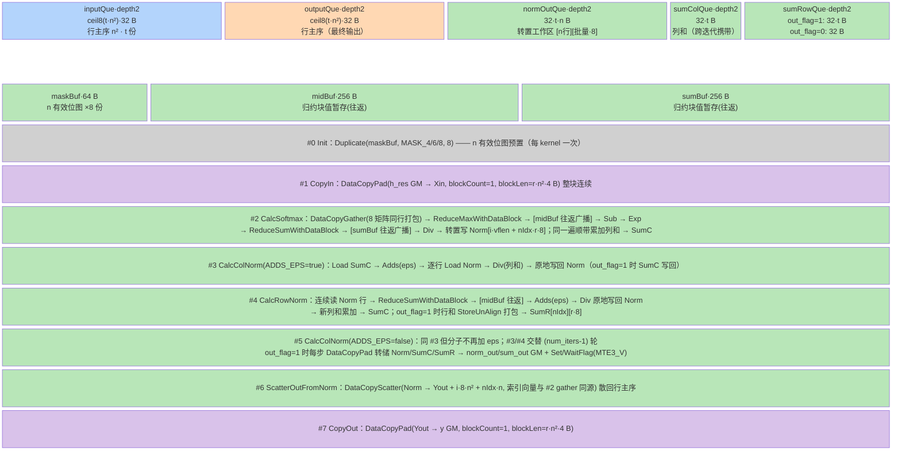

# mhc_sinkhorn arch35 单模板 Sinkhorn 迭代与转置工作区设计

> **目标读者**：模型在设计阶段（Phase 4）为 arch35（Ascend 950）上的迭代归一化类（Sinkhorn / 行列交替归一化）算子选择实现形态，或需要 MicroAPI（RegTensor/__VEC_SCOPE__）级「gather 入 → 寄存器归约 → scatter 出」转置工作区模式的参考。
> **范围**：仅 arch35 路径（`op_kernel/arch35/` + `mhc_sinkhorn_apt.cpp` 路由 + `op_host/config/ascend950/`），README 产品支持表只列 Ascend 950PR/950DT，A2/A3/310 系全 ×（[README.md:5-12](https://gitcode.com/cann/ops-transformer/blob/4b422ccf023d6be832b66bc838c6de8e5e5b18d1/mhc/mhc_sinkhorn/README.md)、[README.md:83](https://gitcode.com/cann/ops-transformer/blob/4b422ccf023d6be832b66bc838c6de8e5e5b18d1/mhc/mhc_sinkhorn/README.md)）。`op_kernel/` 下**没有**非 arch35 模板实现，本路径是该算子唯一实现，**无 MemBase 姊妹卡**（纯 A5 算子）。共享 host 切分实现在 `mhc_sinkhorn_common/`，被 `mhc_sinkhorn` 与 `mhc_sinkhorn_backward` 两算子共用。
> **前置阅读**：无。

---

## 本算子速览

- **数学定义**：Sinkhorn-Knopp 迭代，把 T 个 n×n（n∈{4,6,8}）fp32 非负矩阵投影到双随机流形。第 0 步对最后一维做 softmax，之后每次迭代交替做「列归一化（÷ 列和，dim=-2 求和）→ 行归一化（÷ 行和，dim=-1 求和）」，各分母加 epsilon 防除零（[aclnnMhcSinkhorn.md:22-46](https://gitcode.com/cann/ops-transformer/blob/4b422ccf023d6be832b66bc838c6de8e5e5b18d1/mhc/mhc_sinkhorn/docs/aclnnMhcSinkhorn.md)）；最终输出 `norm_out[2·num_iters-1]`。
- **shape/dtype**：输入 `h_res` 为 3D (T,n,n) 或 4D (B,S,n,n)、FLOAT32、ND（[mhc_sinkhorn_tiling.cpp:162-185](https://gitcode.com/cann/ops-transformer/blob/4b422ccf023d6be832b66bc838c6de8e5e5b18d1/mhc/mhc_sinkhorn/op_host/mhc_sinkhorn_tiling.cpp)）；输出 `y` 与输入同形同 dtype。旁路输出 `norm_out` 1D `[2·num_iters·T·n·8]`、`sum_out` 1D `[2·num_iters·T·8]`，out_flag=0 时两者均为 `{1}`（[mhc_sinkhorn_infershape.cpp:106-123](https://gitcode.com/cann/ops-transformer/blob/4b422ccf023d6be832b66bc838c6de8e5e5b18d1/mhc/mhc_sinkhorn/op_host/mhc_sinkhorn_infershape.cpp)）。属性：`eps`(1e-6) / `num_iters`(20，约束 1~100) / `out_flag`(0/1)（[mhc_sinkhorn_tiling.cpp:85-97](https://gitcode.com/cann/ops-transformer/blob/4b422ccf023d6be832b66bc838c6de8e5e5b18d1/mhc/mhc_sinkhorn/op_host/mhc_sinkhorn_tiling.cpp)）。
- **计算管线一行**：`#0 掩码表预置 → #1 CopyIn(整块连续) → #2 CalcSoftmax(按行 gather 打包 8 矩阵 → 行 softmax → 转置写工作区 → 列和顺带累计) → [#3 CalcColNorm → #4 CalcRowNorm → #5 CalcColNorm]×(num_iters-1)（out_flag=1 时每步 GM 转储）→ #6 ScatterOutFromNorm(scatter 回行主序) → #7 CopyOut`。
- **模板数**：**1 个模板类** `MhcSinkhornSimd<T, OUT_FLAG>` × 2 个 TilingKey（TEMPLATE_MODE 0/1 = OUT_FLAG false/true）。分发由 TPL 模板参数机制在**编译期**展开两份 kernel 变体（见 §3.1），不是运行期 if-else 链。
- **平台**：arch35 / Ascend 950PR/950DT（A5），`KERNEL_TYPE_AIV_ONLY` 纯 Vector（[mhc_sinkhorn_apt.cpp:28](https://gitcode.com/cann/ops-transformer/blob/4b422ccf023d6be832b66bc838c6de8e5e5b18d1/mhc/mhc_sinkhorn/op_kernel/mhc_sinkhorn_apt.cpp)），workspace 固定 0（[mhc_sinkhorn_tiling.cpp:317-323](https://gitcode.com/cann/ops-transformer/blob/4b422ccf023d6be832b66bc838c6de8e5e5b18d1/mhc/mhc_sinkhorn/op_host/mhc_sinkhorn_tiling.cpp)）。

## 1. 源码路径与文件职责

### 1.1 Host 侧（Tiling 计算）

| 文件 | 职责 |
|------|------|
| [`op_host/mhc_sinkhorn_tiling.cpp:55-387`](https://gitcode.com/cann/ops-transformer/blob/4b422ccf023d6be832b66bc838c6de8e5e5b18d1/mhc/mhc_sinkhorn/op_host/mhc_sinkhorn_tiling.cpp) | tiling 主体：`IsCapable()` 恒 true（55-58）、dtype/shape/属性校验（85-105、107-150、152-263）、`SplitByCoreNum()`（265-276）、`SetTilingData()`（287-301）、`GetTilingKey()`（308-315）、workspace=0（317-323）、`PostTiling` 设 BlockDim+LocalMemorySize（325-334） |
| [`op_host/mhc_sinkhorn_tiling.h:35-86`](https://gitcode.com/cann/ops-transformer/blob/4b422ccf023d6be832b66bc838c6de8e5e5b18d1/mhc/mhc_sinkhorn/op_host/mhc_sinkhorn_tiling.h) | `MhcSinkhornCompileInfo{coreNum,ubSize}`（35-38）、`MhcSinkhornTiling : MhcSinkhornBaseTiling`（40-44）、成员与属性默认值 eps=1e-6/num_iters=20/out_flag=0（75-77） |
| [`mhc_sinkhorn_common/op_host/arch35/mhc_sinkhorn_base_tiling.cpp:33-145`](https://gitcode.com/cann/ops-transformer/blob/4b422ccf023d6be832b66bc838c6de8e5e5b18d1/mhc/mhc_sinkhorn_common/op_host/arch35/mhc_sinkhorn_base_tiling.cpp) | **共享切分基类**（与 backward 算子共用）：`BaseSplitCores` 前向/后向双口径取保守 tile（33-46）、`ForwardCalOccupySize` UB 占用式（100-120）、`ForwardSplitCore` tile 反推+向下 8 对齐（122-145） |
| [`mhc_sinkhorn_common/op_host/arch35/mhc_sinkhorn_base_tiling.h:31-57`](https://gitcode.com/cann/ops-transformer/blob/4b422ccf023d6be832b66bc838c6de8e5e5b18d1/mhc/mhc_sinkhorn_common/op_host/arch35/mhc_sinkhorn_base_tiling.h) | `MhcSinkhornSplitCoreInfo` 8 字段（31-40）与基类接口（42-57） |
| [`op_kernel/arch35/mhc_sinkhorn_struct.h:18-31`](https://gitcode.com/cann/ops-transformer/blob/4b422ccf023d6be832b66bc838c6de8e5e5b18d1/mhc/mhc_sinkhorn/op_kernel/arch35/mhc_sinkhorn_struct.h) | `MhcSinkhornTilingData` 裸结构体 11 字段（不经 TILING_DATA_FIELD_DEF 宏，配合 GET_TILING_DATA_WITH_STRUCT） |
| [`op_kernel/arch35/mhc_sinkhorn_tiling_key.h:20-33`](https://gitcode.com/cann/ops-transformer/blob/4b422ccf023d6be832b66bc838c6de8e5e5b18d1/mhc/mhc_sinkhorn/op_kernel/arch35/mhc_sinkhorn_tiling_key.h) | `ASCENDC_TPL_ARGS_DECL(MhcSinkhorn, TEMPLATE_MODE ∈ {0,1})` + `ASCENDC_TPL_SEL` 两组合（编译期模板参数枚举） |
| [`op_host/mhc_sinkhorn_def.cpp:23-59`](https://gitcode.com/cann/ops-transformer/blob/4b422ccf023d6be832b66bc838c6de8e5e5b18d1/mhc/mhc_sinkhorn/op_host/mhc_sinkhorn_def.cpp) | 算子定义：1 输入 3 输出 3 属性（23-49）、ascend950 配置 + `opFile.value=mhc_sinkhorn_apt`（51-59） |
| [`op_host/mhc_sinkhorn_infershape.cpp:46-132`](https://gitcode.com/cann/ops-transformer/blob/4b422ccf023d6be832b66bc838c6de8e5e5b18d1/mhc/mhc_sinkhorn/op_host/mhc_sinkhorn_infershape.cpp) | infershape：unknown rank 处理（66-71）、n0==n1 校验（94-99）、norm/sum 尺寸（106-123） |

### 1.2 Kernel 侧（模板实现）

| 文件 | TilingKey | 类名 | 职责 |
|------|-----------|------|------|
| [`op_kernel/arch35/mhc_sinkhorn_arch35.h:41-557`](https://gitcode.com/cann/ops-transformer/blob/4b422ccf023d6be832b66bc838c6de8e5e5b18d1/mhc/mhc_sinkhorn/op_kernel/arch35/mhc_sinkhorn_arch35.h) | TEMPLATE_MODE 0/1 | `MhcSinkhornSimd<T, OUT_FLAG>` | 单模板：CalcSoftmax（gather 行 softmax + 转置落盘）、CalcColNorm/CalcRowNorm（原地交替归一化）、ScatterOutFromNorm（scatter 还原） |

### 1.3 路由分发

| 文件 | 职责 |
|------|------|
| [`op_kernel/mhc_sinkhorn_apt.cpp:20-42`](https://gitcode.com/cann/ops-transformer/blob/4b422ccf023d6be832b66bc838c6de8e5e5b18d1/mhc/mhc_sinkhorn/op_kernel/mhc_sinkhorn_apt.cpp) | arch35 路由入口：`template <int64_t TEMPLATE_MODE>` + `if constexpr` 两分支实例化 `MhcSinkhornSimd<float,false/true>`；`KERNEL_TASK_TYPE_DEFAULT(KERNEL_TYPE_AIV_ONLY)`（28）+ `REGISTER_TILING_DEFAULT(MhcSinkhornTilingData)`（29） |

---

## 2. 算子特定优化 trick（高杠杆速览）

### 2.1 一次转置工作区贯穿整条迭代链（gather 入、scatter 出）

- **摘要**: 入口 `DataCopyGather` 把 8 个矩阵的同一行打包进一条 vreg，结果以「[行][批量·8]」转置布局写进工作区；此后 num_iters×2 次行/列归一化全部是对该工作区的**连续 load/store + 寄存器域 Reduce**，出口才用 `DataCopyScatter` 一次散回行主序——行、列两个正交方向的归约都在连续访问下完成，全程只有入/出各一次离散（按 lane 散转）访问。
- **触发**: 每次 loop 的 `CalcSoftmax` 落盘（gather+转置写）与结尾 `ScatterOutFromNorm`。
- **golden源**: [mhc_sinkhorn_arch35.h:215-217](https://gitcode.com/cann/ops-transformer/blob/4b422ccf023d6be832b66bc838c6de8e5e5b18d1/mhc/mhc_sinkhorn/op_kernel/arch35/mhc_sinkhorn_arch35.h)（gather+ReduceMax）、[232-233](https://gitcode.com/cann/ops-transformer/blob/4b422ccf023d6be832b66bc838c6de8e5e5b18d1/mhc/mhc_sinkhorn/op_kernel/arch35/mhc_sinkhorn_arch35.h)（按 `i·vflen + nIdx·handleLen` 转置写）、[419-426](https://gitcode.com/cann/ops-transformer/blob/4b422ccf023d6be832b66bc838c6de8e5e5b18d1/mhc/mhc_sinkhorn/op_kernel/arch35/mhc_sinkhorn_arch35.h)（索引向量构造）、[431-436](https://gitcode.com/cann/ops-transformer/blob/4b422ccf023d6be832b66bc838c6de8e5e5b18d1/mhc/mhc_sinkhorn/op_kernel/arch35/mhc_sinkhorn_arch35.h)（scatter 还原）
- **实例化公共原则**: -> `runbooks/operator-optimization/vv-fusion-common.md#OPT-2 正交双方向归约一次转置工作区`（编号为候选占位，最终编号待编排器串行合并回写）
- **预期收益**: 待轨迹验证（该算子迭代链长 2·num_iters 趟，省掉的是每趟一次 n² 规模的 UB 转置搬运，属主导杠杆）
- **迁移条件**: 适用=需要对同一数据做两个正交方向归约/归一化的 VV 算子；前提=寄存器域 gather/scatter 指令可用且索引向量可由 Arange+整除取余一次构造；失效=只做单方向归约时（转置无收益，直接连续访问即可）。

**坏实践（反例）**：每次行/列归一化都现场做一次 UB 内矩阵转置（或用带 stride 的 DataCopy 来回搬）——2·num_iters 趟 × n² 元素的额外 UB 读写，且访存模式碎。

### 2.2 小矩阵按 8-lane 分组打包进单 vreg

- **摘要**: n≤8 的 n×n 小矩阵每 8 个打包进一条 vreg（每矩阵占固定 8 lane，n<8 的 lane 靠掩码屏蔽），`ReduceMaxWithDataBlock` / `ReduceSumWithDataBlock` 按 32B 块归约一次得到 8 个矩阵各自的结果——一次向量指令同时服务 8 份独立归约，归约调用次数与批量解耦。
- **触发**: `CalcSoftmax` / `CalcRowNorm` 的 `__VEC_SCOPE__` 主循环（每次 vreg 迭代处理 blockCnt = GetVRegSize/GetUbBlockSize 个矩阵）。
- **golden源**: [mhc_sinkhorn_arch35.h:195-202](https://gitcode.com/cann/ops-transformer/blob/4b422ccf023d6be832b66bc838c6de8e5e5b18d1/mhc/mhc_sinkhorn/op_kernel/arch35/mhc_sinkhorn_arch35.h)（Arange+Div/Mul/Sub/Mul/Add 构造 `(j%8) + (j/8)·n²` 索引）、[215](https://gitcode.com/cann/ops-transformer/blob/4b422ccf023d6be832b66bc838c6de8e5e5b18d1/mhc/mhc_sinkhorn/op_kernel/arch35/mhc_sinkhorn_arch35.h)（gather）、[217](https://gitcode.com/cann/ops-transformer/blob/4b422ccf023d6be832b66bc838c6de8e5e5b18d1/mhc/mhc_sinkhorn/op_kernel/arch35/mhc_sinkhorn_arch35.h)、[225](https://gitcode.com/cann/ops-transformer/blob/4b422ccf023d6be832b66bc838c6de8e5e5b18d1/mhc/mhc_sinkhorn/op_kernel/arch35/mhc_sinkhorn_arch35.h)（块归约）、[29-39](https://gitcode.com/cann/ops-transformer/blob/4b422ccf023d6be832b66bc838c6de8e5e5b18d1/mhc/mhc_sinkhorn/op_kernel/arch35/mhc_sinkhorn_arch35.h)（MASK_4/6/8 与 N_VALID 常量）
- **实例化公共原则**: -> `runbooks/operator-optimization/vv-fusion-common.md#OPT-3 小矩阵分组打包进单 vreg`（编号为候选占位）
- **预期收益**: 待轨迹验证
- **迁移条件**: 适用=单数据单元元素数 ≤ 分组 lane 数（此处 8）的小尺寸批量算子；前提=单元宽度可补齐到固定分组宽且补齐区可被掩码安全屏蔽；失效=单元宽度大于分组宽时（需多 vreg 拼接，退化为逐单元归约）。

**坏实践（反例）**：每个矩阵单独调一次归约 API——批量 T 个矩阵要 T·n 次调用，而打包后只需 T·n/8 次。

### 2.3 定长分组掩码表预置与 UpdateMask 交集

- **摘要**: host 期已知的 n∈{4,6,8} 在 `Process` 开头一次性把对应位图 `Duplicate` 进 64B TBuf（重复 8 份覆盖一条 mask 寄存器），每轮 `LoadAlign` 取回为 mask 寄存器，再与 `UpdateMask(r·8)` 生成的「本批有效 lane 数」掩码做一次 `MaskAnd`——「每组有效宽 n」与「本批矩阵数 r」两条约束在一条 AND 里同时生效，无逐 lane 判断、无运行期分支。
- **触发**: 每个计算阶段每个 vreg 迭代开头（[206-208](https://gitcode.com/cann/ops-transformer/blob/4b422ccf023d6be832b66bc838c6de8e5e5b18d1/mhc/mhc_sinkhorn/op_kernel/arch35/mhc_sinkhorn_arch35.h)、[282-285](https://gitcode.com/cann/ops-transformer/blob/4b422ccf023d6be832b66bc838c6de8e5e5b18d1/mhc/mhc_sinkhorn/op_kernel/arch35/mhc_sinkhorn_arch35.h)、[350-353](https://gitcode.com/cann/ops-transformer/blob/4b422ccf023d6be832b66bc838c6de8e5e5b18d1/mhc/mhc_sinkhorn/op_kernel/arch35/mhc_sinkhorn_arch35.h)、[428-430](https://gitcode.com/cann/ops-transformer/blob/4b422ccf023d6be832b66bc838c6de8e5e5b18d1/mhc/mhc_sinkhorn/op_kernel/arch35/mhc_sinkhorn_arch35.h)）。
- **golden源**: [mhc_sinkhorn_arch35.h:29-39](https://gitcode.com/cann/ops-transformer/blob/4b422ccf023d6be832b66bc838c6de8e5e5b18d1/mhc/mhc_sinkhorn/op_kernel/arch35/mhc_sinkhorn_arch35.h)（掩码常量）、[450-459](https://gitcode.com/cann/ops-transformer/blob/4b422ccf023d6be832b66bc838c6de8e5e5b18d1/mhc/mhc_sinkhorn/op_kernel/arch35/mhc_sinkhorn_arch35.h)（Process 开头一次性预置）、[206-208](https://gitcode.com/cann/ops-transformer/blob/4b422ccf023d6be832b66bc838c6de8e5e5b18d1/mhc/mhc_sinkhorn/op_kernel/arch35/mhc_sinkhorn_arch35.h)（LoadAlign+MaskAnd）
- **实例化公共原则**: -> `runbooks/operator-optimization/vv-fusion-common.md#OPT-4 定长分组掩码表与更新掩码交集`（编号为候选占位）
- **预期收益**: 待轨迹验证
- **迁移条件**: 适用=分组宽度在 host 期可枚举的算子；前提=掩码表能常驻一块小 TBuf（64B 量级）且 UpdateMask 可表达「本批元素数」；失效=分组宽度运行期才可知时（掩码需现算，开销上升）。

**坏实践（反例）**：标量循环逐 lane 判断 `lane % 8 < n` 决定是否参与计算——每 lane 一次标量分支，向量化收益归零。

### 2.4 归约块结果经 UB 往返广播

- **摘要**: `ReduceMaxWithDataBlock` / `ReduceSumWithDataBlock` 产出的是「每 32B 块一个值」的压缩布局，无法直接参与逐 lane 的 Sub/Div；golden 先 `DataCopy` 写进 256B TBuf，再以 `LoadDist::DIST_E2B_B32`（元素→整块展开）读回，写读之间用一对 `LocalMemBar(VEC_LOAD↔VEC_STORE)` 强制访存顺序——构成 arch35 MicroAPI 下「归约 → 广播」的标准闭环。
- **触发**: `CalcSoftmax`（行最大值广播 218-221、行和广播 226-229）与 `CalcRowNorm`（行和广播 370-371）。
- **golden源**: [mhc_sinkhorn_arch35.h:218-221](https://gitcode.com/cann/ops-transformer/blob/4b422ccf023d6be832b66bc838c6de8e5e5b18d1/mhc/mhc_sinkhorn/op_kernel/arch35/mhc_sinkhorn_arch35.h)、[226-229](https://gitcode.com/cann/ops-transformer/blob/4b422ccf023d6be832b66bc838c6de8e5e5b18d1/mhc/mhc_sinkhorn/op_kernel/arch35/mhc_sinkhorn_arch35.h)、[370-371](https://gitcode.com/cann/ops-transformer/blob/4b422ccf023d6be832b66bc838c6de8e5e5b18d1/mhc/mhc_sinkhorn/op_kernel/arch35/mhc_sinkhorn_arch35.h)
- **实例化公共原则**: -> `runbooks/operator-optimization/vv-fusion-common.md#OPT-5 归约块结果经共享暂存往返广播`（编号为候选占位）
- **预期收益**: 待轨迹验证
- **迁移条件**: 适用=寄存器域块归约结果需要按 lane 广播的场景；前提=有一块 256B 量级暂存 TBuf 与可用的块分布加载形态；失效=高层 API 自带广播形态（如 Brcb）且性能更优时。

**坏实践（反例）**：省掉 `LocalMemBar` 直接写后读（V 访存乱序，读到旧值导致归一化分母错）；或用标量 GetValue 逐块取出再 Duplicate（黑名单 API，性能塌方）。

### 2.5 下一级归一化分母在上一级遍历中顺带累计

- **摘要**: `CalcSoftmax` 在行 softmax 的同一 n 列循环里，把 (+eps 后的) 结果按 lane 累加进 `sumoutReg`（即列和），循环结束一次 `DataCopy` 落盘；`CalcRowNorm` 同样在行归一化后立即累加出新列和——每个归一化分母都不需要单独一趟扫描，n 行遍历结束时下一级归一化的分母已在寄存器里。
- **触发**: `CalcSoftmax`（[234-239](https://gitcode.com/cann/ops-transformer/blob/4b422ccf023d6be832b66bc838c6de8e5e5b18d1/mhc/mhc_sinkhorn/op_kernel/arch35/mhc_sinkhorn_arch35.h)）与 `CalcRowNorm`（[375-379](https://gitcode.com/cann/ops-transformer/blob/4b422ccf023d6be832b66bc838c6de8e5e5b18d1/mhc/mhc_sinkhorn/op_kernel/arch35/mhc_sinkhorn_arch35.h)）。
- **golden源**: [mhc_sinkhorn_arch35.h:234-239](https://gitcode.com/cann/ops-transformer/blob/4b422ccf023d6be832b66bc838c6de8e5e5b18d1/mhc/mhc_sinkhorn/op_kernel/arch35/mhc_sinkhorn_arch35.h)、[375-379](https://gitcode.com/cann/ops-transformer/blob/4b422ccf023d6be832b66bc838c6de8e5e5b18d1/mhc/mhc_sinkhorn/op_kernel/arch35/mhc_sinkhorn_arch35.h)
- **实例化公共原则**: -> `runbooks/operator-optimization/vv-fusion-common.md#OPT-9 下一级归一化分母顺带累计`（编号为候选占位）
- **预期收益**: 待轨迹验证（省的是一整趟 n² 规模的读 + 一次归约，迭代型算子里被放大 2·num_iters 倍）
- **迁移条件**: 适用=交替归一化/链式归一化类算子；前提=当前遍历的输出恰好是下一级归约的输入且遍历方向一致；失效=分母需要跨 batch 全局归约或遍历方向不一致时。

**坏实践（反例）**：归一化完成后再单独发一趟 ReduceSum 求分母——多一整次 n² 读 + 一次归约，迭代链中每趟都要重付。

### 2.6 迭代链原地复用与列和携带缓冲

- **摘要**: 整条 Sinkhorn 迭代链在 `normOutQue`（转置工作区）上原地 Div（load → 计算 → 写回同一地址），列和走 `sumColQue` 单缓冲跨迭代携带，行和（out_flag=1 时）走 `sumRowQue`；除输入/输出队列外，**没有任何随迭代数增长的缓冲**——UB 占用与 num_iters 完全无关。
- **触发**: `CalcColNorm`（[300-306](https://gitcode.com/cann/ops-transformer/blob/4b422ccf023d6be832b66bc838c6de8e5e5b18d1/mhc/mhc_sinkhorn/op_kernel/arch35/mhc_sinkhorn_arch35.h)）与 `CalcRowNorm`（[356-384](https://gitcode.com/cann/ops-transformer/blob/4b422ccf023d6be832b66bc838c6de8e5e5b18d1/mhc/mhc_sinkhorn/op_kernel/arch35/mhc_sinkhorn_arch35.h)）的每轮迭代。
- **golden源**: [mhc_sinkhorn_arch35.h:296-306](https://gitcode.com/cann/ops-transformer/blob/4b422ccf023d6be832b66bc838c6de8e5e5b18d1/mhc/mhc_sinkhorn/op_kernel/arch35/mhc_sinkhorn_arch35.h)（原地 Div 写回）、[356-384](https://gitcode.com/cann/ops-transformer/blob/4b422ccf023d6be832b66bc838c6de8e5e5b18d1/mhc/mhc_sinkhorn/op_kernel/arch35/mhc_sinkhorn_arch35.h)（行归一化原地 + 新列和写回同一 SumC 缓冲）、[111-115](https://gitcode.com/cann/ops-transformer/blob/4b422ccf023d6be832b66bc838c6de8e5e5b18d1/mhc/mhc_sinkhorn/op_kernel/arch35/mhc_sinkhorn_arch35.h)（条件分配）
- **实例化公共原则**: -> `runbooks/operator-optimization/vv-fusion-common.md#OPT-1 迭代收敛链全驻留 UB`（编号为候选占位）
- **预期收益**: 待轨迹验证
- **迁移条件**: 适用=多趟迭代的归一化/迭代收敛类算子；前提=中间态可整块驻留 UB（tile 由 host 反推保证）且迭代内数据依赖是逐元素/逐行；失效=中间态超过 UB 容量或迭代间存在跨 batch 依赖时。

**坏实践（反例）**：每轮迭代 Alloc/Free 一套新的中间缓冲，或把中间矩阵写 GM 再读回——前者碎片化队列、后者多 2·(2·num_iters) 轮 DMA。

### 2.7 out_flag 编译期分档零主链开销

- **摘要**: `out_flag` 进 TilingKey（TEMPLATE_MODE 0/1），kernel 以模板 bool `OUT_FLAG` 在编译期裁剪 4 处 GM 转储与 `sumRowQue` 的尺寸（out_flag=0 时仅 32B，见 [111-115](https://gitcode.com/cann/ops-transformer/blob/4b422ccf023d6be832b66bc838c6de8e5e5b18d1/mhc/mhc_sinkhorn/op_kernel/arch35/mhc_sinkhorn_arch35.h)）；主计算链路的代码与缓冲完全不变——调试/反向所需旁路输出不向正常路径收一分 UB 税。
- **触发**: host `GetTilingKey()`（[mhc_sinkhorn_tiling.cpp:308-315](https://gitcode.com/cann/ops-transformer/blob/4b422ccf023d6be832b66bc838c6de8e5e5b18d1/mhc/mhc_sinkhorn/op_host/mhc_sinkhorn_tiling.cpp)）按 `out_flag` 选 0/1。
- **golden源**: [mhc_sinkhorn_arch35.h:41](https://gitcode.com/cann/ops-transformer/blob/4b422ccf023d6be832b66bc838c6de8e5e5b18d1/mhc/mhc_sinkhorn/op_kernel/arch35/mhc_sinkhorn_arch35.h)（模板参数）、[111-115](https://gitcode.com/cann/ops-transformer/blob/4b422ccf023d6be832b66bc838c6de8e5e5b18d1/mhc/mhc_sinkhorn/op_kernel/arch35/mhc_sinkhorn_arch35.h)（条件 InitBuffer）、[361-369](https://gitcode.com/cann/ops-transformer/blob/4b422ccf023d6be832b66bc838c6de8e5e5b18d1/mhc/mhc_sinkhorn/op_kernel/arch35/mhc_sinkhorn_arch35.h)、[475-544](https://gitcode.com/cann/ops-transformer/blob/4b422ccf023d6be832b66bc838c6de8e5e5b18d1/mhc/mhc_sinkhorn/op_kernel/arch35/mhc_sinkhorn_arch35.h)（if constexpr 转储）、[mhc_sinkhorn_apt.cpp:31-41](https://gitcode.com/cann/ops-transformer/blob/4b422ccf023d6be832b66bc838c6de8e5e5b18d1/mhc/mhc_sinkhorn/op_kernel/mhc_sinkhorn_apt.cpp)（两分支实例化）
- **实例化公共原则**: -> `runbooks/operator-optimization/vv-fusion-common.md#OPT-7 旁路输出编译期分档`（编号为候选占位）
- **预期收益**: 待轨迹验证
- **迁移条件**: 适用=有可选旁路输出（调试快照、反向辅助量）的算子；前提=旁路开关是编译期可知的属性且能进 TilingKey；失效=旁路输出是运行期动态 shape 决定时（只能运行期分支）。

**坏实践（反例）**：运行期 `if (out_flag)` 判断且 `sumRowQue` 恒按全尺寸分配——不需要旁路的调用方白白多付 `32·r·n` 字节 UB，直接压缩 tile。

### 2.8 手工 MTE3→V 屏障复用转储缓冲

- **摘要**: out_flag=1 时同一 `normOutQue` / `sumColQue` 缓冲在「GM 转储(MTE3)」与「下一步计算(V)」之间复用：`DeQue → DataCopyPad(转储) → EnQue(同一张量)` 维持队列事件记账，再用成对的 `SetFlag/WaitFlag(HardEvent::MTE3_V)` 手工屏障保证 MTE3 读完成后 V 才覆写——用一条屏障换回双份转储缓冲，out_flag 分支不需要额外扩 UB。
- **触发**: `Process` 主循环内每处转储之后（[483-485](https://gitcode.com/cann/ops-transformer/blob/4b422ccf023d6be832b66bc838c6de8e5e5b18d1/mhc/mhc_sinkhorn/op_kernel/arch35/mhc_sinkhorn_arch35.h)、[503-504](https://gitcode.com/cann/ops-transformer/blob/4b422ccf023d6be832b66bc838c6de8e5e5b18d1/mhc/mhc_sinkhorn/op_kernel/arch35/mhc_sinkhorn_arch35.h)、[506-508](https://gitcode.com/cann/ops-transformer/blob/4b422ccf023d6be832b66bc838c6de8e5e5b18d1/mhc/mhc_sinkhorn/op_kernel/arch35/mhc_sinkhorn_arch35.h)、[526-527](https://gitcode.com/cann/ops-transformer/blob/4b422ccf023d6be832b66bc838c6de8e5e5b18d1/mhc/mhc_sinkhorn/op_kernel/arch35/mhc_sinkhorn_arch35.h)）。
- **golden源**: [mhc_sinkhorn_arch35.h:479-485](https://gitcode.com/cann/ops-transformer/blob/4b422ccf023d6be832b66bc838c6de8e5e5b18d1/mhc/mhc_sinkhorn/op_kernel/arch35/mhc_sinkhorn_arch35.h)（DeQue→搬出→EnQue→屏障）、[503-504](https://gitcode.com/cann/ops-transformer/blob/4b422ccf023d6be832b66bc838c6de8e5e5b18d1/mhc/mhc_sinkhorn/op_kernel/arch35/mhc_sinkhorn_arch35.h)、[526-527](https://gitcode.com/cann/ops-transformer/blob/4b422ccf023d6be832b66bc838c6de8e5e5b18d1/mhc/mhc_sinkhorn/op_kernel/arch35/mhc_sinkhorn_arch35.h)
- **实例化公共原则**: -> `runbooks/operator-optimization/vv-fusion-common.md#OPT-8 双缓冲与手工搬出计算屏障`（编号为候选占位）
- **预期收益**: 待轨迹验证
- **迁移条件**: 适用=同一缓冲被「搬出」与「继续计算」先后消费的流水；前提=硬件事件 ID 可由 FetchEventID 取得且屏障粒度可控；失效=缓冲可简单加倍时（直接加深度更省心）。

**坏实践（反例）**：漏掉屏障导致 V 覆写尚在被 MTE3 读取的数据（转储内容被污染，精度踩踏且难以复现）；或为规避屏障把所有队列 depth 翻倍（UB 直接超预算，tile 被迫减半）。

---

## 3. 多模板分发原则

### 3.1 分发维度

arch35 侧**单一模板 + 1 个编译期 bool**。与运行期 `TILING_KEY_IS()` if-else 链不同，本算子走 **TPL 模板参数机制**：`mhc_sinkhorn_tiling_key.h` 用 `ASCENDC_TPL_ARGS_DECL(MhcSinkhorn, ASCENDC_TPL_UINT_DECL(TEMPLATE_MODE, 1, UI_LIST, 0, 1))` 声明模板参数取值域 {0,1}，`ASCENDC_TPL_SEL` 枚举两组合（均 AIV_ONLY）——编译框架据此展开两份 kernel 变体；host 侧 `GetTilingKey()` 返回 `GET_TPL_TILING_KEY(out_flag)`（[mhc_sinkhorn_tiling.cpp:308-315](https://gitcode.com/cann/ops-transformer/blob/4b422ccf023d6be832b66bc838c6de8e5e5b18d1/mhc/mhc_sinkhorn/op_host/mhc_sinkhorn_tiling.cpp)）选中其一。

```
GetTilingKey()（mhc_sinkhorn_tiling.cpp:308-315）
  tilingKey = (out_flag == 1) ? 1 : 0 ;  return GET_TPL_TILING_KEY(tilingKey)

TPL 参数 → 模板实例（mhc_sinkhorn_apt.cpp:31-41，编译期展开、非运行期分支）
  TEMPLATE_MODE 0 -> MhcSinkhornSimd<float, false>   （out_flag=0，无旁路转储）
  TEMPLATE_MODE 1 -> MhcSinkhornSimd<float, true >   （out_flag=1，转储 norm_out/sum_out）

核间切分（不进 TilingKey，走 TilingData）
  tNormCore = ceil(T / aivCoreNum) ; usedCoreNum = ceil(T / tNormCore)
  tUbFactor = tNormCore（整核装得下）否则 = (可用UB/2) / 单份占用，向下 8 对齐，下限 8
  常规核 loop = ceil(tNormCore / tUbFactor)，尾核 loop = ceil(tTailCore / tUbFactor)
```

### 3.2 设计阶段就必须决策

「可选旁路输出用 TilingKey + 模板 bool 编译期分档，而不是运行期判断 + 常驻全尺寸缓冲」与「迭代型算子的收敛判据静态化（host 固定 num_iters，kernel 不做设备侧收敛判定）」是本路径两个设计期决策；适用边界已并入候选 `runbooks/operator-optimization/vv-fusion-common.md#OPT-7 旁路输出编译期分档` 与 `#OPT-6 收敛判据静态化免设备侧判定`（编号待编排器串行合并回写）。本文件只留此一行指针。

### 3.3 子维度：dtype × 可用 TilingKey

| dtype | 计算域 | 可用 TilingKey | 说明 |
|-------|--------|----------------|------|
| FLOAT32 | fp32 | TEMPLATE_MODE 0 / 1 | 唯一支持 dtype（[mhc_sinkhorn_tiling.cpp:53,107-118](https://gitcode.com/cann/ops-transformer/blob/4b422ccf023d6be832b66bc838c6de8e5e5b18d1/mhc/mhc_sinkhorn/op_host/mhc_sinkhorn_tiling.cpp)），全程无 Cast |

- `n∈{4,6,8}` **不进 TilingKey**——用运行期掩码表（§2.3）+ 运行期 `for nIdx < n` 循环吸收，与「按对齐档位拆 TilingKey」的做法相反；代价是掩码表需运行期预置，收益是模板数不随 n 增长。
- dtype 校验只允许 DT_FLOAT 且 y 必须与 x 同 dtype（[mhc_sinkhorn_tiling.cpp:107-126](https://gitcode.com/cann/ops-transformer/blob/4b422ccf023d6be832b66bc838c6de8e5e5b18d1/mhc/mhc_sinkhorn/op_host/mhc_sinkhorn_tiling.cpp)）；out_flag=1 时 normOut/sumOut 也必须同 dtype（[128-147](https://gitcode.com/cann/ops-transformer/blob/4b422ccf023d6be832b66bc838c6de8e5e5b18d1/mhc/mhc_sinkhorn/op_host/mhc_sinkhorn_tiling.cpp)）。

---

## 4. 模板：MhcSinkhornSimd（TEMPLATE_MODE 0/1）

### 4.1 触发条件

`IsCapable()` 恒 true（[mhc_sinkhorn_tiling.cpp:55-58](https://gitcode.com/cann/ops-transformer/blob/4b422ccf023d6be832b66bc838c6de8e5e5b18d1/mhc/mhc_sinkhorn/op_host/mhc_sinkhorn_tiling.cpp)）——唯一模板覆盖全部场景；ascend950 之外的 SoC 无配置（[mhc_sinkhorn_def.cpp:59](https://gitcode.com/cann/ops-transformer/blob/4b422ccf023d6be832b66bc838c6de8e5e5b18d1/mhc/mhc_sinkhorn/op_host/mhc_sinkhorn_def.cpp)）。`n` 必须为 4/6/8，否则 host 直接报错（[181-185](https://gitcode.com/cann/ops-transformer/blob/4b422ccf023d6be832b66bc838c6de8e5e5b18d1/mhc/mhc_sinkhorn/op_host/mhc_sinkhorn_tiling.cpp)）；`num_iters` 限 1~100（[85-89](https://gitcode.com/cann/ops-transformer/blob/4b422ccf023d6be832b66bc838c6de8e5e5b18d1/mhc/mhc_sinkhorn/op_host/mhc_sinkhorn_tiling.cpp)）。

### 4.2 Tiling 参数

`MhcSinkhornTilingData`（[mhc_sinkhorn_struct.h:18-31](https://gitcode.com/cann/ops-transformer/blob/4b422ccf023d6be832b66bc838c6de8e5e5b18d1/mhc/mhc_sinkhorn/op_kernel/arch35/mhc_sinkhorn_struct.h)）：

| 字段 | 用途 |
|------|------|
| eps / num_iters / out_flag / n | 属性透传（eps 防除零、迭代数、旁路开关、矩阵边长） |
| usedCoreNum | 实际启动的 AIV 核数（`PostTiling` 里 `SetBlockDim`） |
| tNormCore | 常规核分到的矩阵数（ceil(T/核数)） |
| tNormCoreLoop / tUbFactor | 常规核的 UB 循环数 / 每轮矩阵数 |
| tUbFactorTail | 常规核末轮矩阵数（= tNormCore-(loop-1)·tUbFactor） |
| tTailCoreLoop / tUbTailTail | 尾核的循环数 / 尾核末轮矩阵数 |

切分算法（[mhc_sinkhorn_base_tiling.cpp:100-145](https://gitcode.com/cann/ops-transformer/blob/4b422ccf023d6be832b66bc838c6de8e5e5b18d1/mhc/mhc_sinkhorn_common/op_host/arch35/mhc_sinkhorn_base_tiling.cpp)）：先取 `tUbFactor = tNormCore`（整核一次装下），若 `occupy(tNormCore) > (ubSize-832)/2` 则 `tUbFactor = available/occupy(1)` 并**向下 8 对齐、下限 8**——8 对齐对应 `INDEX_BLOCK_LEN=8` 的 lane 分组，保证尾块仍按整分组处理（[136-138](https://gitcode.com/cann/ops-transformer/blob/4b422ccf023d6be832b66bc838c6de8e5e5b18d1/mhc/mhc_sinkhorn_common/op_host/arch35/mhc_sinkhorn_base_tiling.cpp)）。`BaseSplitCores` 对前向/后向两套占用式各算一份、取 `tUbFactor` 较小者（[33-46](https://gitcode.com/cann/ops-transformer/blob/4b422ccf023d6be832b66bc838c6de8e5e5b18d1/mhc/mhc_sinkhorn_common/op_host/arch35/mhc_sinkhorn_base_tiling.cpp)），保证 `mhc_sinkhorn` 与 `mhc_sinkhorn_backward` 共享同一套切分结果（见 §4.3.2 的 ★ 注）。

### 4.3 UB 分配与内存复用

#### 4.3.1 UBuf 内存布局（mermaid block-beta）

t = tUbFactor（当前核每轮矩阵数），r = 本轮实际矩阵数（末轮取 tail），n = 矩阵边长，vflen = GetVRegSize/4（一条 vreg 的 fp32 lane 数），s = 4 B：



#### 4.3.2 UB 总占用

由 `InitBuffer`（[mhc_sinkhorn_arch35.h:102-115](https://gitcode.com/cann/ops-transformer/blob/4b422ccf023d6be832b66bc838c6de8e5e5b18d1/mhc/mhc_sinkhorn/op_kernel/arch35/mhc_sinkhorn_arch35.h)，全部队列 depth=2）：

```
固定区 = 64 (maskBuf) + 256 (midBuf) + 256 (sumBuf) = 576 B
每槽（单缓冲）：
  inputQue   = ceil8(t·n²)·4 B        ← CeilAlign(tUbFactor·nnSize, blockDataNum=8)
  outputQue  = ceil8(t·n²)·4 B
  normOutQue = t·8·n·4 B = 32·t·n     ← tUbFactor·nnAligSize（nnAligSize = n·8）
  sumColQue  = t·8·4 B   = 32·t
  sumRowQue  = out_flag=1 ? 32·t : 32 B   ★ 条件分配（模板 bool 编译期二选一）
总占用 = 576 + 2·(ceil8(t·n²)·4·2 + 32·t·n + 32·t + (32·t | 32))
       ≈ 576 + 16·t·n² + 64·t·n + 64·t（out_flag=0 再 +64）

tiling 反推（ForwardCalOccupySize / ForwardSplitCore，base_tiling.cpp:100-145）：
  occupy(r) = (ceil8(r·n²) + ceil8(r·n²) + ceil8(n·r·8) + ceil8(r·8) [+ ceil8(r·8)])·4   ← 单槽口径
  available = (ubSize − 64 − 768) / 2     ← MASK_BUFFER 64 + MAX_BUFFER_FORWARD 3×256，再÷2 给双缓冲
  t₀ = tNormCore；若 occupy(t₀) > available：t = (available / occupy(1)) 向下 8 对齐；t = max(t, 8)
  ★ golden 固定区扣 832 B（64+768）而 kernel 实际固定区只有 576 B，且 out_flag=0 的 sumRowQue 64 B
    未入式——两处均为高估预留，按此反推绝不越界（与 InitBuffer 精确式相差 <0.4 KB）
  ★ BaseSplitCores 另算 BackwardCalOccupySize（norm/sum 缓冲形态不同）取两口径 tUbFactor 较小者：
    前向算子可能因此拿到比自身容量上限更小的 tile（见 §2.6 相关 CT 候选）
```

#### 4.3.3 复用序与内存复用策略表

| 子区 | 复用链 |
|------|------|
| Norm（normOutQue，转置工作区） | #2 转置写（行 softmax 结果）→ #3 原地列归一化 → [#4 原地行归一化 → #5 原地列归一化] ×(num_iters-1) → #6 scatter 源 |
| SumC（sumColQue） | #2 列和（行 softmax 顺带累计）→ #3 读 + eps 归一化分母 → #4 新列和写回（覆盖）→ #5 读 …… 跨迭代携带 |
| SumR（sumRowQue） | #4 每轮 AllocTensor → 行和打包 → (out_flag=1 转储) → FreeTensor（跨迭代覆盖） |
| Xin（inputQue） | #1 每轮 Alloc → 整块 CopyIn → #2 读完即 Free（跨迭代覆盖） |
| Yout（outputQue） | #6 Alloc → scatter 写 → #7 搬出 → Free |
| Mid/Sum（归约暂存） | #2/#4 每次归约-广播往返复用（256B，写后即读） |
| Mask（掩码表） | #0 每 kernel 预置一次 → #2/#3/#4/#6 各轮 LoadAlign 只读 |

4 种复用策略对应位置：①原地操作=#3/#5 的 `Div(normReg, normReg, sumReg)` 后写回同一 Norm 地址（[300-306](https://gitcode.com/cann/ops-transformer/blob/4b422ccf023d6be832b66bc838c6de8e5e5b18d1/mhc/mhc_sinkhorn/op_kernel/arch35/mhc_sinkhorn_arch35.h)）；②跨迭代覆盖=每轮循环重复 Alloc 同一队列槽（SumR/Xin/Yout）；③预处理分支消除=`if constexpr (OUT_FLAG)` / `if constexpr (ADDS_EPS)` 编译期裁剪（[297-299](https://gitcode.com/cann/ops-transformer/blob/4b422ccf023d6be832b66bc838c6de8e5e5b18d1/mhc/mhc_sinkhorn/op_kernel/arch35/mhc_sinkhorn_arch35.h)、[475-544](https://gitcode.com/cann/ops-transformer/blob/4b422ccf023d6be832b66bc838c6de8e5e5b18d1/mhc/mhc_sinkhorn/op_kernel/arch35/mhc_sinkhorn_arch35.h)）；④计算直写输出队列=#6 `DataCopyScatter` 的 dst 直接在 outputQue 上（[390,435](https://gitcode.com/cann/ops-transformer/blob/4b422ccf023d6be832b66bc838c6de8e5e5b18d1/mhc/mhc_sinkhorn/op_kernel/arch35/mhc_sinkhorn_arch35.h)）。

### 4.4 计算流程伪码

```
Process()                                            ← arch35.h:444-554
├─ blockIdx >= usedCoreNum ? return                  ← 446-448
├─ #0 mask = (n==4)?MASK_4:(n==6)?MASK_6:MASK_8
│      Duplicate(maskBuf, mask, 8)                   ← 450-459，每 kernel 一次
├─ normStartOfset = blockIdx·(2·num_iters)·tNormCore·(n·8)   ← 461-464，转储区基址/步长
└─ for loop in [0, loop_):            ← loop_ = 本核循环数（尾核取 tTailCoreLoop，118-121）
    ├─ r = 末轮 ? tailHandelSize_ : tUbFactor
    ├─ #1 CopyIn(loop, r)                            ← 125-135
    │      DataCopyPad(Xin, h_res[loop·tUbFactor·n²], {blockCount=1, blockLen=r·n²·4, 0,0,0},
    │                 pad={false,0,0,0})              ★ 整块连续、无对齐间隙（n² 已 32B 对齐域）
    ├─ #2 CalcSoftmax(r)                             ← 150-246
    │   └─ __VEC_SCOPE__ for i in [0, ceil(r/blockCnt)):
    │       maskCalc = MaskAnd(LoadAlign(maskBuf), UpdateMask(r·8))    ← 每矩阵有效宽 n × 本批 lane
    │       maskCopy = UpdateMask(r·8)                                  ← 含 pad lane 的整块搬运掩码
    │       for nIdx in [0, n):                        ← 逐行（n 行 = n 次 gather）
    │           DataCopyGather(inputReg, Xin + i·blockCnt·n² + nIdx·n, idxReg, maskCalc)
    │               ★ idxReg lane j → (j%8) + (j/8)·n²：一条 vreg 装 8 个矩阵的同一行
    │           ReduceMaxWithDataBlock(midReg, inputReg, maskCalc)      ← 每 32B 块(=每矩阵)行最大
    │           LocalMemBar(L→S) → DataCopy(midBuf, midReg) → LocalMemBar(S→L)
    │           DataCopy<DIST_E2B_B32>(midReg, midBuf)                  ← 块值展开到 lane（§2.4）
    │           Sub(inputReg, inputReg, midReg) → Exp(inputReg)         ← 减最大值防溢出
    │           ReduceSumWithDataBlock(sumReg, inputReg, maskCalc)
    │           <sumBuf 同样往返广播> → Div(inputReg, inputReg, sumReg)  ← 行 softmax
    │           DataCopy(Norm + i·vflen + nIdx·r·8, inputReg, addrReg, maskCopy)  ★ 转置写
    │           Adds(inputReg, inputReg, eps) → Add(sumReg, sumReg, inputReg)     ★ 列和顺带累计
    │       DataCopy(SumC + i·vflen, sumReg, addrReg, maskCopy)         ← 238-239
    ├─ #3 CalcColNorm<ADDS_EPS=true>(r)               ← 249-307，列归一化
    │   └─ for i: sumReg = Load(SumC + i·vflen) → Adds(sumReg, eps)
    │             out_flag=1: DataCopy 写回 SumC（转储 sum_out[1] 用）
    │             for nIdx: normReg = Load(Norm + i·vflen + nIdx·r·8)
    │                         ADDS_EPS → Adds(normReg, eps)   ★ 仅首次列归一化分子加 eps（297-299）
    │                         Div(normReg, normReg, sumReg) → DataCopy 写回 Norm   ★ 原地
    ├─ for iter in [1, num_iters):                    ← 505-547
    │   ├─ #4 CalcRowNorm(r)                          ← 310-385，行归一化
    │   │   └─ for i: postStride = 末轮 ? tail : blockCnt
    │   │       for nIdx: normReg = Load(Norm 行 nIdx)     ← 连续地址（转置布局的收益）
    │   │           ReduceSumWithDataBlock(sumReg, normReg, maskCalc) → DataCopy(midBuf, sumReg)
    │   │           out_flag=1: Adds(sumReg, eps) + StoreUnAlign(SumR + i·blockCnt + nIdx·r,
    │   │                          POST_MODE_UPDATE, postStride) + StoreUnAlignPost   ★ 非对齐打包
    │   │           <midBuf 往返> Adds(sumReg, eps) → Div(normReg, normReg, sumReg) → 写回 Norm
    │   │           Add(sumReg, sumReg, normReg)           ★ 新列和顺带累计
    │   │       DataCopy(SumC + i·vflen, sumReg)            ← 新列和覆盖旧列和
    │   ├─ #5 CalcColNorm<ADDS_EPS=false>(r)          ← 529，分子不再加 eps
    │   └─ (out_flag=1：#3/#4 前后各 DataCopyPad 转储 Norm/SumC/SumR → norm_out[2k]/[2k+1]、
    │        sum_out[2k]/[2k+1]，随后 SetFlag/WaitFlag(MTE3_V)；475-544)
    ├─ #6 ScatterOutFromNorm(r)                       ← 388-441
    │   └─ for i / for nIdx: Load(Norm 行 nIdx) → DataCopyScatter(Yout + i·blockCnt·n² + nIdx·n,
    │              idxReg, maskCalc)                   ★ 与 #2 同一 idxReg，散回行主序
    └─ #7 CopyOut(loop, r)                            ← 138-147
           DataCopyPad(y[loop·tUbFactor·n²], Yout, {1, r·n²·4, 0,0,0})
```

MicroAPI 常量（[27-39](https://gitcode.com/cann/ops-transformer/blob/4b422ccf023d6be832b66bc838c6de8e5e5b18d1/mhc/mhc_sinkhorn/op_kernel/arch35/mhc_sinkhorn_arch35.h)）：`INDEX_BLOCK_LEN=8`（每矩阵 lane 数 = n 补齐宽）、`blockDataNum = GetUbBlockSize/4`（32B 块的 fp32 元素数）、`blockCnt = GetVRegSize/GetUbBlockSize`（一条 vreg 装几个矩阵）、`MASK_NUM=8`（掩码表重复份数）、`DOUBLE_BUFFER=2`。

**掩码超发的安全性**：`UpdateMask(r·8)` 在每个 vreg 迭代用同一值、不随 i 递减（[206](https://gitcode.com/cann/ops-transformer/blob/4b422ccf023d6be832b66bc838c6de8e5e5b18d1/mhc/mhc_sinkhorn/op_kernel/arch35/mhc_sinkhorn_arch35.h)），末轮超出 r 的 lane 会读到 Xin 内的陈旧数据并把结果写进 Norm 的 pad 区——因 Xin/Norm 按 `tUbFactor` 上界分配（而非按 r），这些越界 lane 的读写均落在已分配范围内且从不被 #7 搬出，故无害。

### 4.5 路由代码

```cpp
// mhc_sinkhorn_apt.cpp:21-42（节选）
template <int64_t TEMPLATE_MODE>
__global__ __aicore__ void mhc_sinkhorn(GM_ADDR h_res, GM_ADDR y, GM_ADDR norm_out,
                                        GM_ADDR sum_out, GM_ADDR workSpace, GM_ADDR tiling) {
    GM_ADDR user = GetUserWorkspace(workSpace);
    if (user == nullptr) { return; }
    KERNEL_TASK_TYPE_DEFAULT(KERNEL_TYPE_AIV_ONLY);
    REGISTER_TILING_DEFAULT(MhcSinkhornTilingData);
    AscendC::TPipe pipe;
    if constexpr (TEMPLATE_MODE == 0) {            // out_flag=0
        GET_TILING_DATA_WITH_STRUCT(MhcSinkhornTilingData, tilingData, tiling);
        MhcSinkhornSimd<float, false> op(pipe, tilingData);
        op.Init(h_res, y, norm_out, sum_out, tiling); op.Process();
    } else if constexpr (TEMPLATE_MODE == 1) {     // out_flag=1
        ... MhcSinkhornSimd<float, true> op(pipe, tilingData); ...
    }
}
```

---

## 5. 模板对比总表

【实例化: -> OPT-7（旁路输出编译期分档：唯一差异维度进 TilingKey，模板数不随 shape/dtype 增长；编号待串行合并回写）】

| 维度 | MhcSinkhornSimd\<float,false\>（TEMPLATE_MODE 0） | MhcSinkhornSimd\<float,true\>（TEMPLATE_MODE 1） |
|------|------|------|
| 触发属性 | out_flag=0（默认） | out_flag=1 |
| dtype 支持 | FLOAT32（唯一） | FLOAT32（唯一） |
| Queue 深度 | 全 depth=2（InitBuffer DOUBLE_BUFFER） | 同左 |
| TBuf 数 | 3（mask 64B / mid 256B / sum 256B）+ sumRowQue 仅 32B | 3（同左）+ sumRowQue 按 32·t B 全尺寸 |
| 循环层级 | 3 层（核 × loop × num_iters 迭代；迭代内 n 行 × vreg 分段） | 同左 |
| 数据排布 | 行主序载入 → 转置工作区驻留 → 行主序散出 | 同左 |
| 归一化算法 | 行 softmax → [列归一化 → 行归一化] ×(num_iters-1)，全部原地 | 同左 |
| GM 转储 | 无（norm_out/sum_out 不写） | 每步 DataCopyPad 写 norm_out[2k]/[2k+1]、sum_out[2k]/[2k+1] |
| 手工屏障 | 保留 Set/WaitFlag(MTE3_V)（此时无在途 MTE3，等价空屏障） | 屏障真实生效：保证转储读完才覆写 |
| Cast 流水线 | 无（全程 fp32） | 无 |
| workspace | 0 | 0 |
| 设计复杂度 | ★★★（MicroAPI gather/scatter + 块归约往返 + 转置布局） | ★★★（同左 + 转储/屏障时序） |

---

<!-- okf:related:start -->

# 相关

- 相关主题: [vv-fusion-common.md](../../../runbooks/operator-optimization/vv-fusion-common.md) — 本卡实例化候选泛化优化点 OPT-1/2/3/4/5/6/7/8/9 与 CT-1（编号待编排器串行合并回写）
- 相关主题: [moe_gating_top_k_softmax_a5.md](../moe/moe_gating_top_k_softmax_a5.md) — 同为 arch35 单模板 MicroAPI 形态（寄存器域归约、掩码分档、双缓冲）的可对照实现

<!-- okf:related:end -->
