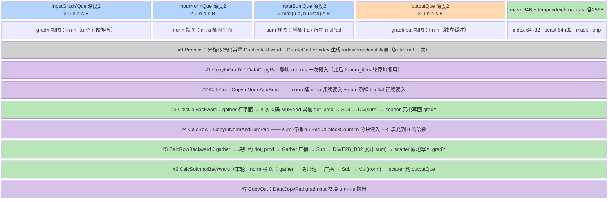

# mhc_sinkhorn_backward arch35 单模板 gather/scatter 原地迭代反向设计

> **目标读者**：模型在设计阶段（Phase 4）为 arch35（Ascend 950，RegBase）上实现「多轮迭代归一化/变换」类的反向算子，需要参考「小矩阵（n≤8）× 大批量（T 很大）」场景下用 gather/scatter 免转置、用输入缓冲原地迭代省中间物化的实现形态。
> **范围**：仅 arch35 / Ascend 950PR/950DT（[README 产品支持表](https://gitcode.com/cann/ops-transformer/blob/4b422ccf023d6be832b66bc838c6de8e5e5b18d1/mhc/mhc_sinkhorn_backward/README.md)：950PR/950DT √，A3/A2/200I-500A2/推理/训练系列全 ×；golden 仅有 `op_kernel/arch35/` 一套实现、`op_host/config/ascend950/` 一份配置，故**本卡无 MemBase 姊妹版**）。代码路径为该算子唯一实现；同仓 `mhc/experimental/mhc` 是另一套 AI 生成实验实现，非本文对象。纯 Vector：路由入口 `KERNEL_TASK_TYPE_DEFAULT(KERNEL_TYPE_AIV_ONLY)`（[mhc_sinkhorn_backward_apt.cpp:28](https://gitcode.com/cann/ops-transformer/blob/4b422ccf023d6be832b66bc838c6de8e5e5b18d1/mhc/mhc_sinkhorn_backward/op_kernel/mhc_sinkhorn_backward_apt.cpp)），全程无 Cube 指令。
> **前置阅读**：无（正向算子 `mhc_sinkhorn` 尚无知识卡；本文在 §1.1/CT 语义处标注了两者的布局耦合约束）。

---

## 本算子速览

- **数学定义**：`MhcSinkhornBackward` 是 `MhcSinkhorn`（Sinkhorn-Knopp 双随机投影）的反向。前向做 `num_iters` 轮「列归一 / 行归一」交替并保存方向向量 `norm_out_k` 与缩放系数 `sum_out_k`；反向从最后一轮往前回溯，每轮做 `dot_prod = Σ(grad·norm_out)`、`grad ← (grad − dot_prod)/sum_out`，最后一轮行归一步不除 `sum_out_0` 而是乘 `norm_out_0` 得 `grad_input`（[README 计算公式](https://gitcode.com/cann/ops-transformer/blob/4b422ccf023d6be832b66bc838c6de8e5e5b18d1/mhc/mhc_sinkhorn_backward/README.md)）。
- **shape/dtype**：`grad_y`/`grad_input` = `(T,n,n)` 或 `(B,S,n,n)`，FLOAT32 ND；`norm` = `2·num_iters·T·n·align_n` 一维；`sum` = `2·num_iters·T·align_n` 一维；`n ∈ {4,6,8}`、`align_n = 8`（= CeilAlign(n, 32B/4B)）、`num_iters ∈ [1,100]`（[tiling.cpp:265-287](https://gitcode.com/cann/ops-transformer/blob/4b422ccf023d6be832b66bc838c6de8e5e5b18d1/mhc/mhc_sinkhorn_backward/op_host/mhc_sinkhorn_backward_tiling.cpp)）。
- **计算管线一行**：`选掩码+预生成索引表 → CopyInGradY 整块一次 → [iter 逆序：CalcCol(gather→n 次掩码累加→Sub/Div→scatter 原地) → CalcRow(gather→块归约→广播→Sub/Div→scatter 原地)] → CalcCol(末轮) → CalcSoftmax(末轮行归一 ×norm) → CopyOut`。
- **模板数**：**1 个模板类** `MhcSinkhornBackwardSimd` × **1 个 TilingKey（恒 1）**。host `GetTilingKey()` 返回常量 1（[tiling.cpp:363-367](https://gitcode.com/cann/ops-transformer/blob/4b422ccf023d6be832b66bc838c6de8e5e5b18d1/mhc/mhc_sinkhorn_backward/op_host/mhc_sinkhorn_backward_tiling.cpp)），模板实参表只声明一个值（[tiling_key.h:20-29](https://gitcode.com/cann/ops-transformer/blob/4b422ccf023d6be832b66bc838c6de8e5e5b18d1/mhc/mhc_sinkhorn_backward/op_kernel/arch35/mhc_sinkhorn_backward_tiling_key.h)），路由入口**没有** `TILING_KEY_IS` 分支（[apt.cpp:20-35](https://gitcode.com/cann/ops-transformer/blob/4b422ccf023d6be832b66bc838c6de8e5e5b18d1/mhc/mhc_sinkhorn_backward/op_kernel/mhc_sinkhorn_backward_apt.cpp)）。多模板分发维度在本算子退化为运行期分支（见 §3.1）。
- **平台**：arch35 / Ascend 950PR/950DT（A5）；`AddConfig("ascend950")` 且 `opFile.value = mhc_sinkhorn_backward_apt`（[def.cpp:48-55](https://gitcode.com/cann/ops-transformer/blob/4b422ccf023d6be832b66bc838c6de8e5e5b18d1/mhc/mhc_sinkhorn_backward/op_host/mhc_sinkhorn_backward_def.cpp)）；workspace 固定 0（[tiling.cpp:369-375](https://gitcode.com/cann/ops-transformer/blob/4b422ccf023d6be832b66bc838c6de8e5e5b18d1/mhc/mhc_sinkhorn_backward/op_host/mhc_sinkhorn_backward_tiling.cpp)）。

## 1. 源码路径与文件职责

### 1.1 Host 侧（Tiling 计算）

| 文件 | 职责 |
|------|------|
| [`op_host/mhc_sinkhorn_backward_tiling.cpp:296-335`](https://gitcode.com/cann/ops-transformer/blob/4b422ccf023d6be832b66bc838c6de8e5e5b18d1/mhc/mhc_sinkhorn_backward/op_host/mhc_sinkhorn_backward_tiling.cpp) | `SplitCores`（调共享基类 `BaseSplitCores`，注释「和正向对齐取较小值」）、`DoOpTiling` = CheckDtype → CheckShape → SplitCores → SetTilingData |
| [`op_host/mhc_sinkhorn_backward_tiling.cpp:253-287`](https://gitcode.com/cann/ops-transformer/blob/4b422ccf023d6be832b66bc838c6de8e5e5b18d1/mhc/mhc_sinkhorn_backward/op_host/mhc_sinkhorn_backward_tiling.cpp) | shape 拍平：3D/4D 判定 `isTShape_`，`totalLength_ = tSize_` 或 `bSize_·sSize_`；`nAlignSize_ = CeilAlign(n, 32/4=8)`；`numIters_ = norm.dim0/(2·totalLength·n·nAlign)` 并校验 [1,100] |
| [`op_host/mhc_sinkhorn_backward_tiling.cpp:363-384`](https://gitcode.com/cann/ops-transformer/blob/4b422ccf023d6be832b66bc838c6de8e5e5b18d1/mhc/mhc_sinkhorn_backward/op_host/mhc_sinkhorn_backward_tiling.cpp) | `GetTilingKey` 恒 1；`GetWorkspaceSize` 置 0；`PostTiling` 设 `blockDim = needCoreNum_` 与 `SetLocalMemorySize(ubSize_)` |
| [`op_host/mhc_sinkhorn_backward_tiling.h:39-66`](https://gitcode.com/cann/ops-transformer/blob/4b422ccf023d6be832b66bc838c6de8e5e5b18d1/mhc/mhc_sinkhorn_backward/op_host/mhc_sinkhorn_backward_tiling.h) | `MhcSinkhornBackwardTiling : public MhcSinkhornBaseTiling`，`IsCapable()` **恒 true**（46-49），8 个 override + 17 个切分成员 |
| [`mhc_sinkhorn_common/op_host/arch35/mhc_sinkhorn_base_tiling.cpp:33-98`](https://gitcode.com/cann/ops-transformer/blob/4b422ccf023d6be832b66bc838c6de8e5e5b18d1/mhc/mhc_sinkhorn_common/op_host/arch35/mhc_sinkhorn_base_tiling.cpp) | **mhc_sinkhorn 系列共享 host 公共实现**：`BaseSplitCores` 同时算前向/反向两套切分并取 `tUbFactor` 较小者（45）；`BackwardCalOccupySize`（48-70）+ `BackwardSplitCore`（72-98）= 本算子的容量反推 |
| [`op_host/mhc_sinkhorn_backward_infershape.cpp:35-77`](https://gitcode.com/cann/ops-transformer/blob/4b422ccf023d6be832b66bc838c6de8e5e5b18d1/mhc/mhc_sinkhorn_backward/op_host/mhc_sinkhorn_backward_infershape.cpp) | `grad_input` 形状/dtype 复制 `grad_y`（含 unknown rank 兜底） |
| [`op_host/mhc_sinkhorn_backward_def.cpp:48-55`](https://gitcode.com/cann/ops-transformer/blob/4b422ccf023d6be832b66bc838c6de8e5e5b18d1/mhc/mhc_sinkhorn_backward/op_host/mhc_sinkhorn_backward_def.cpp) | `DynamicCompileStaticFlag/DynamicRankSupportFlag/DynamicShapeSupportFlag(true)`；仅 `ascend950` 一份 AICore 配置，kernel 文件指到 `*_apt` |
| [`op_host/config/ascend950/mhc_sinkhorn_backward.json`](https://gitcode.com/cann/ops-transformer/blob/4b422ccf023d6be832b66bc838c6de8e5e5b18d1/mhc/mhc_sinkhorn_backward/op_host/config/ascend950/mhc_sinkhorn_backward.json) | 二进制选择配置：全输入 `-2` 动态 shape、`DtypeByte`/`FormatAgnostic` |
| [`op_host/op_api/mhc_sinkhorn_backward.cpp:29-48`](https://gitcode.com/cann/ops-transformer/blob/4b422ccf023d6be832b66bc838c6de8e5e5b18d1/mhc/mhc_sinkhorn_backward/op_host/op_api/mhc_sinkhorn_backward.cpp) | L0 注册：`ADD_TO_LAUNCHER_LIST_AICORE`，仅 AiCore 一条路径 |

### 1.2 Kernel 侧（模板实现）

| 文件 | TilingKey | 类名 | 职责 |
|------|-----------|------|------|
| [`op_kernel/arch35/mhc_sinkhorn_backward_simd.h:48-108`](https://gitcode.com/cann/ops-transformer/blob/4b422ccf023d6be832b66bc838c6de8e5e5b18d1/mhc/mhc_sinkhorn_backward/op_kernel/arch35/mhc_sinkhorn_backward_simd.h) | 1 | `MhcSinkhornBackwardSimd` | 唯一模板：4 个 TQue + 4 个 TBuf、gather/scatter 索引表、三个方向计算函数、`Process` 主循环 |
| [`op_kernel/arch35/mhc_sinkhorn_backward_tiling_data.h:18-36`](https://gitcode.com/cann/ops-transformer/blob/4b422ccf023d6be832b66bc838c6de8e5e5b18d1/mhc/mhc_sinkhorn_backward/op_kernel/arch35/mhc_sinkhorn_backward_tiling_data.h) | 1 | `MhcSinkhornBackwardTilingData` | 裸 class（不走 `BEGIN_TILING_DATA_DEF` 宏），17 个 `int64_t` 公有成员 |
| [`op_kernel/arch35/mhc_sinkhorn_backward_tiling_key.h:20-29`](https://gitcode.com/cann/ops-transformer/blob/4b422ccf023d6be832b66bc838c6de8e5e5b18d1/mhc/mhc_sinkhorn_backward/op_kernel/arch35/mhc_sinkhorn_backward_tiling_key.h) | 1 | — | `ASCENDC_TPL_ARGS_DECL(TILING_KEY, 1, UI_LIST, 1)` + `ASCENDC_TPL_KERNEL_TYPE_SEL(AIV_ONLY)`：声明「模板实参只有一个值 1、kernel 类型 AIV only」 |

### 1.3 路由分发

| 文件 | 职责 |
|------|------|
| [`op_kernel/mhc_sinkhorn_backward_apt.cpp:20-35`](https://gitcode.com/cann/ops-transformer/blob/4b422ccf023d6be832b66bc838c6de8e5e5b18d1/mhc/mhc_sinkhorn_backward/op_kernel/mhc_sinkhorn_backward_apt.cpp) | arch35 路由入口：`template <int64_t TILING_KEY>` 单实例直接构造 `MhcSinkhornBackwardSimd`，**无** `TILING_KEY_IS` if-else；`GetUserWorkspace` 判空早退（24-27）+ `REGISTER_TILING_DEFAULT`（29） |

---

## 2. 算子特定优化 trick（高杠杆速览）

本算子的性能与可实现性几乎全部压在「如何把 n×n 的小矩阵平面塞进一条 vreg、又如何在多轮迭代间不付中间物化的代价」上；以下 6 条 trick 从各模板伪代码里抽出、按杠杆从大到小排列。

### 2.1 UB 内预生成索引表 + gather/scatter 免物理重排

- **摘要**: 要把 `grad_y`（UB 内布局 `t·n·n`，t 为矩阵序）中「第 k 行跨 t 个矩阵」的元素抽成一条 `t·align_n` 平面（lane = `t·8 + c`），不物化任何重排副本——用 `DataCopyGather` 按 per-lane 索引寄存器直接抽取、算完 `DataCopyScatter` 原地写回；索引表 `index[i] = (i mod 8) + (i div 8)·n·n`、广播表 `bcast[i] = i div 8` 用 `Arange + Div + Mul + Sub + Add` 组合在 kernel 启动时一次生成，全 kernel 复用。
- **触发**: 每个 kernel 启动（`CreateGatherIndex` 在 `Process` 首位）；三处计算函数全部依赖它。
- **golden源**: [mhc_sinkhorn_backward_simd.h:476-521](https://gitcode.com/cann/ops-transformer/blob/4b422ccf023d6be832b66bc838c6de8e5e5b18d1/mhc/mhc_sinkhorn_backward/op_kernel/arch35/mhc_sinkhorn_backward_simd.h)（CreateGatherIndex 索引/广播两表）、[183-196](https://gitcode.com/cann/ops-transformer/blob/4b422ccf023d6be832b66bc838c6de8e5e5b18d1/mhc/mhc_sinkhorn_backward/op_kernel/arch35/mhc_sinkhorn_backward_simd.h)（DataCopyGather/DataCopyScatter 用法）、[539](https://gitcode.com/cann/ops-transformer/blob/4b422ccf023d6be832b66bc838c6de8e5e5b18d1/mhc/mhc_sinkhorn_backward/op_kernel/arch35/mhc_sinkhorn_backward_simd.h)（Process 一次生成）
- **实例化公共原则**: → `runbooks/operator-optimization/vv-fusion-common.md` 的 `OPT-1 UB 内预生成索引表 + gather/scatter 免物理重排`（编号为候选占位，最终编号与锚点链接由编排器串行合并回写）
- **预期收益**: 待轨迹验证
- **迁移条件**: 适用=访问模式是「固定步长跨行/跨列抽取」且抽取出的平面会被多步消费（迭代型归一化反向、按行/列缩放的变换）；前提=平台提供寄存器域 per-lane 索引 gather/scatter，索引表可常驻 UB（64·4B 量级）；失效=访问模式连续可整块 SIMD 读时应直接 `DataCopy`，gather 的逐 lane 地址生成反而更慢。

**坏实践（反例）**：为做行/列归一先把 `t·n·n` 数据物理重排成 `t·n·align_n` 平面再算——每轮迭代多一次整块 UB 内搬运 + 多一块 `t·n·align_n` 缓冲；或用 `GetValue/SetValue` 标量循环逐元素抽取（生产黑名单 API）。

### 2.2 字节粒度列掩码：一个掩码同时表达「数据长度」与「列有效」

- **摘要**: `align_n=8` 大于真实 `n`，对齐 padding 列参与运算会把越界/脏数据带进归约。golden 用 **按字节展开** 的掩码常量 `MASK_n = 4·n` bit（n=4/6/8 → 16/24/32 bit，即「有效列数 × 每元素 4 字节」），`Duplicate` 8 份填满 256 bit 全 vreg 掩码，再与 `UpdateMask(dataLen)` 得到的数据长度掩码 `And`——一条掩码同时完成「本 repeat 处理多少 lane」与「每 8 lane 中前 n 列有效」两重语义，padding 列**无需填零**。
- **触发**: `n ∈ {4,6}`（`align_n > n` 时）；`n=8` 时掩码退化为全 1，等价只按数据长度裁剪。
- **golden源**: [mhc_sinkhorn_backward_simd.h:29-32](https://gitcode.com/cann/ops-transformer/blob/4b422ccf023d6be832b66bc838c6de8e5e5b18d1/mhc/mhc_sinkhorn_backward/op_kernel/arch35/mhc_sinkhorn_backward_simd.h)（MASK_4/6/8 = 16/24/32 bit、MASK_NUM=8）、[529-538](https://gitcode.com/cann/ops-transformer/blob/4b422ccf023d6be832b66bc838c6de8e5e5b18d1/mhc/mhc_sinkhorn_backward/op_kernel/arch35/mhc_sinkhorn_backward_simd.h)（n 分档 + Duplicate 8 word）、[178-179](https://gitcode.com/cann/ops-transformer/blob/4b422ccf023d6be832b66bc838c6de8e5e5b18d1/mhc/mhc_sinkhorn_backward/op_kernel/arch35/mhc_sinkhorn_backward_simd.h)（UpdateMask 与 LoadAlign 掩码 And）
- **实例化公共原则**: → `runbooks/operator-optimization/vv-fusion-common.md` 的 `OPT-2 字节粒度掩码一码两语义（数据长度 ∩ 列有效）`（编号为候选占位）
- **预期收益**: 待轨迹验证
- **迁移条件**: 适用=「vreg 内平面布局（单元 × 轴内元素）+ 真实轴宽小于对齐宽」的所有归一化/归约计算；前提=掩码寄存器按字节粒度起效（4B 元素 → 每列 4 bit），掩码常量可随 tiling/编译期固化；失效=元素宽 1B/2B 时每列 bit 数变化需重推；轴宽大于一 vreg 需分段拼接掩码。

**坏实践（反例）**：把 align padding 列填 0 后按全宽归约——多一次整缓冲 `Duplicate`，且掩盖了「n 未对齐」这一事实，n 变档时要改填充逻辑；或用标量 `if (c < n)` 分支逐列判断（指令数 ×8）。

### 2.3 grad_y 原地链式迭代 + 跨阶段显式内存屏障（零中间物化）

- **摘要**: `2·num_iters` 轮迭代都在 `inputGradYQue` 的同一块 UB 上原地推进：gather 读 → `Sub/Div` → scatter 写回同一地址，`num_iters` 轮全程不物化任何中间梯度（`num_iters` 上限 100，朴素写法要多 `100·t·n²·4B` 级中间缓冲或同量 GM 往返）；跨阶段依赖（列步 scatter 的结果被下一个行步 gather 读）用 `LocalMemBar<VEC_STORE, VEC_LOAD>` 在每个计算函数末尾显式定序。
- **触发**: 每轮迭代的每个计算函数（`CalcColBackward`/`CalcRowBackward`/`CalcSoftmaxBackward` 尾部各一条 barrier）。
- **golden源**: [mhc_sinkhorn_backward_simd.h:195-196](https://gitcode.com/cann/ops-transformer/blob/4b422ccf023d6be832b66bc838c6de8e5e5b18d1/mhc/mhc_sinkhorn_backward/op_kernel/arch35/mhc_sinkhorn_backward_simd.h)、[246-247](https://gitcode.com/cann/ops-transformer/blob/4b422ccf023d6be832b66bc838c6de8e5e5b18d1/mhc/mhc_sinkhorn_backward/op_kernel/arch35/mhc_sinkhorn_backward_simd.h)（gather 读与 scatter 写同址）、[199](https://gitcode.com/cann/ops-transformer/blob/4b422ccf023d6be832b66bc838c6de8e5e5b18d1/mhc/mhc_sinkhorn_backward/op_kernel/arch35/mhc_sinkhorn_backward_simd.h)、[250](https://gitcode.com/cann/ops-transformer/blob/4b422ccf023d6be832b66bc838c6de8e5e5b18d1/mhc/mhc_sinkhorn_backward/op_kernel/arch35/mhc_sinkhorn_backward_simd.h)、[307](https://gitcode.com/cann/ops-transformer/blob/4b422ccf023d6be832b66bc838c6de8e5e5b18d1/mhc/mhc_sinkhorn_backward/op_kernel/arch35/mhc_sinkhorn_backward_simd.h)（三处 VEC_STORE→VEC_LOAD barrier）
- **实例化公共原则**: → `runbooks/operator-optimization/vv-fusion-common.md` 的 `OPT-3 链式迭代原地写回 + 跨阶段显式内存屏障`（编号为候选占位）
- **预期收益**: 待轨迹验证
- **迁移条件**: 适用=多轮迭代、每轮输出即下轮输入的反向/递推算子（迭代数可达数十）；前提=整块工作区可常驻 UB（tile 反推保证，见 §4.3.2）、迭代间无「需要回看更早轮结果」的依赖；失效=算法需要保存每轮中间量（如前向保存 `norm/sum`）或迭代间存在跨 tile 归约时，必须物化。

**坏实践（反例）**：每轮迭代把梯度写回 GM、下一轮再读回——`2·num_iters` 次 MTE2+MTE3 整块往返；或省略 `LocalMemBar` 让编译器自由重排——scatter 与后续 gather 无显式依赖时结果不确定（静默精度错）。

### 2.4 两个归约方向各用代价最低的形态（块归约 vs 展开累加）

- **摘要**: vreg 平面是 `单元(t) × 轴内元素(c)`。**沿轴内（列）方向归约**用 `ReduceSumWithDataBlock`：每 8 lane 一个 data block（= 一个 t 的平面）压成块和，再用广播索引表 `Gather` 把块和摊回 8 个 lane；**跨单元（行）方向归约**不做归约指令，而是把 n 行展开成 n 次 `Mul + 掩码 Add` 累加（累加寄存器天然按 lane 对齐，无需广播）。两个方向各自选指令代价最低的形态，共用了同一条 gather 出的平面。
- **触发**: `CalcRowBackward`/`CalcSoftmaxBackward`（块归约）与 `CalcColBackward`（展开累加）。
- **golden源**: [mhc_sinkhorn_backward_simd.h:189-191](https://gitcode.com/cann/ops-transformer/blob/4b422ccf023d6be832b66bc838c6de8e5e5b18d1/mhc/mhc_sinkhorn_backward/op_kernel/arch35/mhc_sinkhorn_backward_simd.h)（Mul → ReduceSumWithDataBlock → Gather 广播）、[232-239](https://gitcode.com/cann/ops-transformer/blob/4b422ccf023d6be832b66bc838c6de8e5e5b18d1/mhc/mhc_sinkhorn_backward/op_kernel/arch35/mhc_sinkhorn_backward_simd.h)（列方向 Duplicate(0) + n 次掩码 Mul/Add）
- **实例化公共原则**: → `runbooks/operator-optimization/vv-fusion-common.md` 的 `OPT-4 归约方向按代价选型（块归约 vs 展开累加）`（编号为候选占位）
- **预期收益**: 待轨迹验证
- **迁移条件**: 适用=二维平面（单元 × 轴内元素）上需要两个方向归约的算子（行/列双归一、双向 softmax、矩阵行/列和）；前提=其中一维的展开次数等于真实轴宽 n（≤8，指令数可控）；失效=轴宽很大时展开累加指令数线性膨胀，应改用分段归约。

**坏实践（反例）**：两个方向都用归约指令 + 各配一套广播表——跨单元方向根本无需归约指令（累加即可），多出的归约 + 广播是纯开销；或把平面拆成两条 vreg 分别归约再合并（多一轮 UB 往返）。

### 2.5 主数据一次整块搬入跨迭代复用，辅助量按迭代桶流式读入

- **摘要**: `grad_y` 在循环开头一次 `DataCopyPad` 整块搬入（`perloopTSize·n²` 元素），`2·num_iters` 轮迭代全在这份副本上原地推进；而 `norm`/`sum` 是「每轮一组」的辅助量，按迭代桶偏移（`bucket·n·align_n·u` / `bucket·align_n·u`）在**该轮**才搬入、`FreeTensor` 释放，双缓冲在相邻桶间流水。若反过来（主数据每轮重搬、辅助量常驻），搬运量放大 `2·num_iters` 倍或 UB 占用放大 `2·num_iters` 倍。
- **触发**: 每个主循环 `i` 的开头 + 每轮迭代的 `CalcCol`/`CalcRow`/`CalcSoftmax`。
- **golden源**: [mhc_sinkhorn_backward_simd.h:543-545](https://gitcode.com/cann/ops-transformer/blob/4b422ccf023d6be832b66bc838c6de8e5e5b18d1/mhc/mhc_sinkhorn_backward/op_kernel/arch35/mhc_sinkhorn_backward_simd.h)（整块一次 CopyInGradY）、[550-563](https://gitcode.com/cann/ops-transformer/blob/4b422ccf023d6be832b66bc838c6de8e5e5b18d1/mhc/mhc_sinkhorn_backward/op_kernel/arch35/mhc_sinkhorn_backward_simd.h)（逆序迭代 + 桶偏移）、[381-388](https://gitcode.com/cann/ops-transformer/blob/4b422ccf023d6be832b66bc838c6de8e5e5b18d1/mhc/mhc_sinkhorn_backward/op_kernel/arch35/mhc_sinkhorn_backward_simd.h)（norm/sum 桶偏移 + 搬入即算即释放）
- **实例化公共原则**: → `runbooks/operator-optimization/vv-fusion-common.md` 的 `OPT-5 主数据一次搬入跨迭代复用、辅助量按桶流式读入`（编号为候选占位）
- **预期收益**: 待轨迹验证
- **迁移条件**: 适用=迭代型算子的「主数据 / 轮辅助量」二分结构（反向、递推、迭代求解器）；前提=主数据 tile 可常驻 UB；失效=辅助量本身超过 UB（需按桶分段多次读）或主数据每轮被外部改写。

**坏实践（反例）**：每轮迭代重新 `CopyIn` 整块 `grad_y`（搬运量 ×迭代数）；或把全部 `2·num_iters` 轮的 `norm`/`sum` 一次性常驻 UB（缓冲放大 `2·num_iters` 倍，tile 被迫缩到 1/迭代数）。

### 2.6 tile 因子向下对齐 VL 整除数，repeat 内单元数恒为整数

- **摘要**: host 在 UB 反推出 `tUbFactor` 后，再向下对齐 `tVlFactor = ⌊VRegSize / (align_n·4B)⌋ = 8`——保证每个 repeat 处理的 t 单元数恰好是 `repeatSize = VRegSize/32B = 8` 的整数倍，`repeatTimes = ⌈u/8⌉` 无碎尾、`perT` 在主循环恒等于 8；尾块（非 8 倍数）只出现在「整核一次装入」或「末轮尾块」两种情形，由 §4.4 的 pad 路径兜住。
- **触发**: `BackwardSplitCore` 的 UB 受限分支；kernel 侧 `repeatTimes = Ceil(perloopSize, repeatSize)`。
- **golden源**: [mhc_sinkhorn_base_tiling.cpp:85-90](https://gitcode.com/cann/ops-transformer/blob/4b422ccf023d6be832b66bc838c6de8e5e5b18d1/mhc/mhc_sinkhorn_common/op_host/arch35/mhc_sinkhorn_base_tiling.cpp)（tUbFactor 向下 FloorAlign tVlFactor，注释「kernel约束: 向下跟8对齐, 8=nAlignSize」）、[mhc_sinkhorn_backward_simd.h:546-547](https://gitcode.com/cann/ops-transformer/blob/4b422ccf023d6be832b66bc838c6de8e5e5b18d1/mhc/mhc_sinkhorn_backward/op_kernel/arch35/mhc_sinkhorn_backward_simd.h)（repeatSize/repeatTimes）
- **实例化公共原则**: → `runbooks/operator-optimization/vv-fusion-common.md` 的 `OPT-6 tile 因子向下对齐 VL 整除数`（编号为候选占位）
- **预期收益**: 待轨迹验证
- **迁移条件**: 适用=以「单元数」为 tile、单元内固定轴宽的算子；前提=轴对齐宽与 dtype 决定的每 repeat 单元数可静态算出；失效=tile 已被别的高阶约束（如库 API 对齐）钉死时，对齐方向要与之调和而非二次下取整。

**坏实践（反例）**：tile 因子只按 UB 容量反推不做 VL 对齐——每个 repeat 都产生碎尾分支，`perT < 8` 的掩码路径频繁切换，向量化效率掉档。

---

## 3. 多模板分发原则

### 3.1 分发维度

本算子**没有多模板**：`GetTilingKey()` 返回常量 1，模板实参表只声明一个值，路由入口单实例直接构造。所有「分档」都发生在运行期，且全部通过 tiling 字段 / 掩码常量而非模板参数表达：

```
GetTilingKey()（tiling.cpp:363-367）
  tilingKey = 1（常量，无 if-else）→ GET_TPL_TILING_KEY(1)
  ASCENDC_TPL_ARGS_DECL(... TILING_KEY, 1, ASCENDC_TPL_UI_LIST, 1)（tiling_key.h:20-22）
      → 唯一模板实参值 1；apt.cpp 单实例，无 TILING_KEY_IS 分支

运行期才分档的四个维度：
  n ∈ {4,6,8}   → MASK_4 / MASK_6 / MASK_8 三档掩码常量（simd.h:529-536，见 §2.2）
  (T,n,n) vs (B,S,n,n) → host 拍平 totalLength = tSize 或 bSize·sSize（tiling.cpp:253-263），kernel 完全不感知
  主核 vs 尾核   → blockIdx_ == needCoreNum−1 时换用 tailCore* 四个字段（simd.h:125-133）
  num_iters     → for 循环边界 + 迭代桶偏移（simd.h:550-563），[1,100] host 校验（tiling.cpp:283-287）
```

设计期含义：当「分档差异」可以用 tiling 字段 + 少量运行期掩码常量吸收时，**单模板 + 运行期分支**比「模板矩阵」更省维护（无 per-dtype/per-shape 模板对）；代价是掩码常量选择这类分支留在热循环外的一次性判断里（`Process` 开头），不影响主循环。

### 3.2 设计阶段就必须决策

两件事必须在设计期定死：①「单模板 + 运行期分档」替代模板矩阵（本算子的选择，与姊妹 MoE 卡的多 TilingKey 路线相反）；②「前反向 tile 因子取较小值」——`norm/sum` 的 GM 布局按核块存，反向必须与正向完全同构才能对上桶（详见 §4.2 的 `coreTSize` 与 §2.5 的桶偏移）。②的失效边界（布局错位即静默精度错）已并入候选 `runbooks/operator-optimization/vv-fusion-common.md` 的 `OPT-7 宿主容量公式与 InitBuffer 严格互为镜像` 与对应 CT 条目（编号为候选占位，合并回写后补锚点链接）。本文件只留此指针。

### 3.3 子维度：dtype × 可用 TilingKey

| dtype | 计算域 | 可用 TilingKey | 说明 |
|-------|--------|----------------|------|
| FLOAT32 | fp32（无 cast） | 1 | 唯一支持 dtype：`CheckDtype` 对 grad_y/norm/sum/grad_input 四张量逐一强制 `DT_FLOAT`（[tiling.cpp:81-124](https://gitcode.com/cann/ops-transformer/blob/4b422ccf023d6be832b66bc838c6de8e5e5b18d1/mhc/mhc_sinkhorn_backward/op_host/mhc_sinkhorn_backward_tiling.cpp)）；全流程无 `Cast` 指令 |

| n | align_n | 掩码常量（4·n bit） | vreg 内平面 | 每 repeat 单元数 |
|---|---------|---------------------|-------------|------------------|
| 4 | 8 | MASK_4 = 16 bit | t·8 lane | 8（有效列 4） |
| 6 | 8 | MASK_6 = 24 bit | t·8 lane | 8（有效列 6） |
| 8 | 8 | MASK_8 = 32 bit | t·8 lane | 8（有效列 8） |

`align_n = CeilAlign(n, 32B/4B) = 8` 对三个 n 档取同一值，因此 vreg 平面宽度、索引表结构、UB 公式全部与 n 无关，n 的差异被压缩成**一个掩码常量**（[tiling.cpp:271-273](https://gitcode.com/cann/ops-transformer/blob/4b422ccf023d6be832b66bc838c6de8e5e5b18d1/mhc/mhc_sinkhorn_backward/op_host/mhc_sinkhorn_backward_tiling.cpp)）。

---

## 4. 模板：MhcSinkhornBackwardSimd（TilingKey = 1）

### 4.1 触发条件

`IsCapable()` **恒 true**（[tiling.h:46-49](https://gitcode.com/cann/ops-transformer/blob/4b422ccf023d6be832b66bc838c6de8e5e5b18d1/mhc/mhc_sinkhorn_backward/op_host/mhc_sinkhorn_backward_tiling.h)），无优先级链——因为该算子只有 ascend950 一份 AICore 配置（[def.cpp:55](https://gitcode.com/cann/ops-transformer/blob/4b422ccf023d6be832b66bc838c6de8e5e5b18d1/mhc/mhc_sinkhorn_backward/op_host/mhc_sinkhorn_backward_def.cpp)），其他平台根本不会编译到这份 kernel。kernel 侧以 `KERNEL_TASK_TYPE_DEFAULT(KERNEL_TYPE_AIV_ONLY)` 声明纯 Vector 任务（[apt.cpp:28](https://gitcode.com/cann/ops-transformer/blob/4b422ccf023d6be832b66bc838c6de8e5e5b18d1/mhc/mhc_sinkhorn_backward/op_kernel/mhc_sinkhorn_backward_apt.cpp)）；`blockIdx_ >= needCoreNum` 的核直接 return（[simd.h:525-527](https://gitcode.com/cann/ops-transformer/blob/4b422ccf023d6be832b66bc838c6de8e5e5b18d1/mhc/mhc_sinkhorn_backward/op_kernel/arch35/mhc_sinkhorn_backward_simd.h)）。

### 4.2 Tiling 参数

`MhcSinkhornBackwardTilingData`（[mhc_sinkhorn_backward_tiling_data.h:18-36](https://gitcode.com/cann/ops-transformer/blob/4b422ccf023d6be832b66bc838c6de8e5e5b18d1/mhc/mhc_sinkhorn_backward/op_kernel/arch35/mhc_sinkhorn_backward_tiling_data.h)，裸 class 直接落盘）：

| 字段 | 用途 | kernel 是否消费 |
|------|------|------|
| totalLength / tSize / bSize / sSize | 拍平前后的总矩阵数与原始维度 | 否（host 校验/dump 用） |
| nSize | n（4/6/8） | 是：掩码分档、gather 基址、内层循环边界 |
| nAlignSize | 8（vreg 平面宽 / sum 列宽） | 是：全部 stride 计算 |
| numIters | 迭代次数 | 是：逆序循环边界 |
| needCoreNum | 实际启用核数（`SetBlockDim` 同值） | 是：越界早退 + 尾核判定 |
| coreTSize | 普通核分到的 T 数 | 是：GM 基址的核块跨度 |
| normCoreTLoops / normCorePerLoopTSize / normCoreLastLoopTSize | 普通核循环数 / 每轮 T 数 / 尾块 T 数 | 是 |
| tailCoreTSize / tailCoreLoops / tailCorePerLoopTSize / tailCoreLastLoopTSize | 尾核同上四项（`tailCorePerLoopTSize` 与普通核同值、只尾块不同，[tiling.cpp:307-311](https://gitcode.com/cann/ops-transformer/blob/4b422ccf023d6be832b66bc838c6de8e5e5b18d1/mhc/mhc_sinkhorn_backward/op_host/mhc_sinkhorn_backward_tiling.cpp)） | 是（尾核替换普通核四项） |

**布局耦合（关键约束）**：`norm/sum` 在 GM 上按核块存——`norm` 桶内为 `n·T_core·align_n`、`sum` 列桶为 `T_core·align_n`、行桶为 `n·T_core`（kernel 偏移见 [simd.h:381-385](https://gitcode.com/cann/ops-transformer/blob/4b422ccf023d6be832b66bc838c6de8e5e5b18d1/mhc/mhc_sinkhorn_backward/op_kernel/arch35/mhc_sinkhorn_backward_simd.h)、[413-417](https://gitcode.com/cann/ops-transformer/blob/4b422ccf023d6be832b66bc838c6de8e5e5b18d1/mhc/mhc_sinkhorn_backward/op_kernel/arch35/mhc_sinkhorn_backward_simd.h)；正向写侧同构 `sumStartOfset = blockIdx·iterCnt·tNormCore·nAlign`，[mhc_sinkhorn_arch35.h:462](https://gitcode.com/cann/ops-transformer/blob/4b422ccf023d6be832b66bc838c6de8e5e5b18d1/mhc/mhc_sinkhorn/op_kernel/arch35/mhc_sinkhorn_arch35.h)）。因此反向的切核/切 tile 必须与正向完全一致——golden 的做法是两个算子继承同一个 `MhcSinkhornBaseTiling` 并对 `tUbFactor` **取较小值**（[base_tiling.cpp:43-45](https://gitcode.com/cann/ops-transformer/blob/4b422ccf023d6be832b66bc838c6de8e5e5b18d1/mhc/mhc_sinkhorn_common/op_host/arch35/mhc_sinkhorn_base_tiling.cpp)，注释「和正向对齐取较小值」）。

### 4.3 UB 分配与内存复用

#### 4.3.1 UBuf 内存布局（mermaid block-beta）

记 u = `perloopTSize`（本循环处理的 T 数）、n = `nSize`、a = `nAlignSize` = 8、s = 4B、uPad = ⌈u/8⌉·8：



#### 4.3.2 UB 总占用

由 `InitBuffer`（[mhc_sinkhorn_backward_simd.h:135-146](https://gitcode.com/cann/ops-transformer/blob/4b422ccf023d6be832b66bc838c6de8e5e5b18d1/mhc/mhc_sinkhorn_backward/op_kernel/arch35/mhc_sinkhorn_backward_simd.h)）逐块写出字节：

```
总占用 = 64                                  ← maskBuffer（MASK_BUFFER_SIZE）
       + 3·256                               ← tempBuffer + indexBuffer + broadcastBuffer（TEMP_BUFFER_SIZE）
       + 2·u·n·n·s                           ← inputGradYQue（DOUBLE_BUFFER=2）
       + 2·u·n·a·s                           ← inputNormQue（DOUBLE_BUFFER=2）
       + 2·max(u·a, n·⌈u/8⌉·8)·s             ← inputSumQue（flat 与 pad 两视图取大，142-145）
       + 2·u·n·n·s                           ← outputQue（DOUBLE_BUFFER=2）
       = 832 + (4·u·n² + 2·u·n·a + 2·max(u·a, 8·n·⌈u/8⌉))·s

host 反推（BackwardSplitCore，base_tiling.cpp:72-98）：
  available   = ubSize − 64 − 3·256 = ubSize − 832      ★ 832 恰为四个小 TBuf 常量，公式即镜像
  singleUb    = available / 2                            ★ 四个队列全开 double buffer（DOUBLE_SIZE=2）
  occupy(u)   = (inQue + outQue + normQue + sumQue)·s   ★ BackwardCalOccupySize，48-70
  若 occupy(⌈T/AIV⌉) ≤ singleUb：tUbFactor = ⌈T/AIV⌉     ★ 整核一次装入，无 tile 循环（此时允许非 8 倍数 → 走 pad 路径）
  否则：tUbFactor = ⌊singleUb / occupy(1)⌋，再向下 FloorAlign(tVlFactor = ⌊256/(8·4)⌋ = 8)
  loop = ⌈tNormCore / tUbFactor⌉；尾块 = tNormCore − (loop−1)·tUbFactor
```

★ 与姊妹 MoE 卡的保守近似不同，这里 host 公式与 kernel `InitBuffer` **逐字节互为镜像**（含 832B 小缓冲常量与 double buffer 折半），tile 利用率无冗余损失；代价是任何一侧改缓冲结构必须同步改另一侧。

#### 4.3.3 复用序与内存复用策略表

| 子区 | 复用链 |
|------|------|
| inputGradYQue（双槽） | #1 一次搬入 → #3/#5 scatter 原地写回（2·num_iters 轮）→ 循环尾 `FreeTensor` 释放换槽 |
| inputNormQue / inputSumQue（双槽） | #2/#4 按迭代桶搬入 → #3/#5/#6 计算消费 → 当轮 `FreeTensor`（[simd.h:405-407](https://gitcode.com/cann/ops-transformer/blob/4b422ccf023d6be832b66bc838c6de8e5e5b18d1/mhc/mhc_sinkhorn_backward/op_kernel/arch35/mhc_sinkhorn_backward_simd.h)、[443-445](https://gitcode.com/cann/ops-transformer/blob/4b422ccf023d6be832b66bc838c6de8e5e5b18d1/mhc/mhc_sinkhorn_backward/op_kernel/arch35/mhc_sinkhorn_backward_simd.h)） |
| indexBuffer / broadcastBuffer | #0 一次生成 → #3/#5/#6 所有 gather/scatter/Gather 复用（跨全 kernel） |
| maskBuffer | #0 一次 `Duplicate` → 三个计算函数 `LoadAlign` 复用 |
| outputQue | #6 末轮 scatter 直写（计算结果直接落到输出队列）→ #7 搬出 |

4 种复用策略对应位置：①原地操作=#3/#5 的 scatter 写回与 gather 读同址（[simd.h:183-196](https://gitcode.com/cann/ops-transformer/blob/4b422ccf023d6be832b66bc838c6de8e5e5b18d1/mhc/mhc_sinkhorn_backward/op_kernel/arch35/mhc_sinkhorn_backward_simd.h)）；②跨迭代覆盖=norm/sum 队列每轮 Alloc/Free 同槽轮转；③预处理分支消除=n 档掩码常量在 `Process` 开头一次性选择，主循环内无 dtype/n 分支；④计算直写输出队列=#6 `CalcSoftmaxBackward` 直接 scatter 到 `outputQue` 的张量（[simd.h:459-471](https://gitcode.com/cann/ops-transformer/blob/4b422ccf023d6be832b66bc838c6de8e5e5b18d1/mhc/mhc_sinkhorn_backward/op_kernel/arch35/mhc_sinkhorn_backward_simd.h)）。

### 4.4 计算流程伪码

```
Process()                                            ← simd.h:523-570
├─ if blockIdx_ >= needCoreNum: return               ← 越界核早退
├─ mask = n==4 ? MASK_4 : n==6 ? MASK_6 : MASK_8     ★ 4·n bit 字节粒度列掩码
├─ Duplicate(maskLocal, mask, MASK_NUM=8)            #0 8 word = 256 bit = 全 vreg 掩码
├─ CreateGatherIndex(n)                              #0  index[i] = (i%8) + (i/8)·n²
│                                                    #0  bcast[i] = i/8（块内广播索引）
│                                                    #0  LocalMemBar<STORE→LOAD> 收尾
└─ for i in [0, loop_):                              ← 主核 normCoreTLoops / 尾核 tailCoreLoops
    ├─ perloopSize = 末轮 ? tailLoopTSize_ : loopTSize_
    ├─ repeatSize  = GetVRegSize()/32 = 8            ★ 一条 vreg 装 8 个 t 的行/列平面
    ├─ repeatTimes = ⌈perloopSize / 8⌉
    ├─ CopyInGradY(off, perloopSize·n²)              #1 整块一次搬入（blockCount=1 连续）
    ├─ for iter = num_iters−1 .. 1:                  ★ 逆序回溯
    │   ├─ CalcCol(…, colOffset = 2·iter+1, …)       #2/#3 列归一（sum 桶 2·iter+1）
    │   └─ CalcRow(…, rowOffset = 2·iter,  …)        #4/#5 行归一（sum 桶 2·iter）
    ├─ CalcCol(…, colOffset = 1, …)                  #2/#3 最后一次迭代的列归一
    ├─ CalcSoftmax(…)                                #6   末轮行归一：norm 桶 0、不用 sum
    └─ CopyOut(gradInputOffset, perloopSize·n²)      #7   blockCount=1 连续搬出

CalcColBackward（#3 内层，列方向）                     ← simd.h:203-252
├─ LoadAlign(maskReg, maskAddr) + LoadAlign(indexReg, indexAddr)
├─ for j in [0, repeatTimes):
│   ├─ perT = min(8, perloopSize − 8·j); dataLen = perT·8
│   ├─ CalcMask = UpdateMask(dataLen) And maskReg    ★ 一码两语义（§2.2）
│   ├─ Duplicate(sumColReg, 0)
│   ├─ DataCopy(sumReg, sumAddr + j·8·8)             ★ 列桶 [t·a] flat 连续读 64 lane
│   ├─ for i in [0, n):                              ★ 行方向归约 = n 次展开掩码累加（§2.4）
│   │   ├─ DataCopyGather(gradYReg, gradY + j·8·n² + i·n, indexReg, CalcMask)
│   │   ├─ DataCopy(normReg, norm + j·8·8 + i·8·perloopSize)   ★ norm 桶 [n·t·a]
│   │   ├─ Mul(mul, gradYReg, normReg, CalcMask)
│   │   └─ Add(sumColReg, sumColReg, mul, CalcMask)  ★ dot_prod[c] = Σ_r grad·norm_out
│   └─ for i in [0, n):                              ★ 两段必须分开：先累加完再更新
│       ├─ DataCopyGather(gradYReg, …)               ★ 取 scatter 后的新值
│       ├─ Sub(gradInput, gradYReg, sumColReg, CalcMask)
│       ├─ Div(gradInput, gradInput, sumReg, CalcMask)
│       └─ DataCopyScatter(gradY + …, gradInput, indexReg, CalcMask)   ★ 原地写回
└─ LocalMemBar<VEC_STORE → VEC_LOAD>                 ★ 交给下一阶段的 gather 读

CalcRowBackward（#5 内层，行方向）                     ← simd.h:149-201
├─ 同上装载 mask / index / bcast 三表
├─ for j in [0, repeatTimes):
│   ├─ CalcMask = UpdateMask(perT·8) And maskReg
│   └─ for k in [0, n):                              ★ k = 行号（被归约方向的另一侧）
│       ├─ DataCopyGather(gradYReg, gradY + j·8·n² + k·n, indexReg, CalcMask)
│       ├─ DataCopy(normReg, norm + k·8·perloopSize + j·8·8)   ★ 同一 norm 桶布局
│       ├─ DataCopy<E2B_B32>(sumReg, sum + k·uPad + j·8)       ★ 行桶 [n·uPad] 8 元素按块展开
│       ├─ Mul → ReduceSumWithDataBlock(sumGradY, ·, CalcMask) ★ 每 8 lane 一块 = 一个 t 的块和
│       ├─ Gather(sumBrcb, sumGradY, bcastReg)       ★ 块和广播回 8 lane
│       ├─ Sub(dotProd, gradYReg, sumBrcb, CalcMask)
│       ├─ Div(dotProd, dotProd, sumReg, CalcMask)
│       └─ DataCopyScatter(gradY + …, dotProd, indexReg, CalcMask)
└─ LocalMemBar<VEC_STORE → VEC_LOAD>
（golden 在此函数与 #6 中各有一条 UpdateMask(perT) 的 dataCopyMaskReg 赋值后未被消费——忠实记录，勿模仿）

CalcSoftmaxBackward（#6 内层，末轮行归一）             ← simd.h:254-309
├─ for k in [0, n): for j in [0, repeatTimes):       ★ 注意 k 外 j 内（与 #5 相反，无写后读依赖）
│   ├─ gather 行平面（norm 基址无 iter 偏移 → 桶 0）
│   ├─ Mul → ReduceSumWithDataBlock → Gather 广播
│   ├─ Sub(gradInput, gradYReg, dotProdBrcb, CalcMask)
│   ├─ Mul(gradInput, gradInput, normReg, CalcMask)  ★ 除 sum_out 换成乘 norm_out（README 末轮公式）
│   └─ DataCopyScatter(gradInputAddr + …, ·, indexReg, CalcMask)   ★ 直写 outputQue
└─ LocalMemBar<VEC_STORE → VEC_LOAD>
```

辅助搬运（[simd.h:311-376](https://gitcode.com/cann/ops-transformer/blob/4b422ccf023d6be832b66bc838c6de8e5e5b18d1/mhc/mhc_sinkhorn_backward/op_kernel/arch35/mhc_sinkhorn_backward_simd.h)）：`CopyInNormAndSum` 用 `blockCount=1` 平铺读（列桶）；`CopyInNormAndSumPad` 在 `perloopSize % 8 != 0` 时改 `blockCount=nSize_`、`blockLen=perloopSize·4B`、右填充 `padNum = 8 − u mod 8`，得到行距 `uPad` 的 `[n·uPad]` 视图（[421-426](https://gitcode.com/cann/ops-transformer/blob/4b422ccf023d6be832b66bc838c6de8e5e5b18d1/mhc/mhc_sinkhorn_backward/op_kernel/arch35/mhc_sinkhorn_backward_simd.h)）；`CopyInGradY`/`CopyOut` 均为 `blockCount=1` 的整块连续搬运。

### 4.5 路由代码

```cpp
// mhc_sinkhorn_backward_apt.cpp:20-35（完整，无 TILING_KEY_IS 分支）
template <int64_t TILING_KEY>
__global__ __aicore__ void mhc_sinkhorn_backward(GM_ADDR gradY, GM_ADDR norm, GM_ADDR sum,
                                                 GM_ADDR gradInput, GM_ADDR workSpace, GM_ADDR tiling)
{
    GM_ADDR user = GetUserWorkspace(workSpace);
    if (user == nullptr) {
        return;
    }
    KERNEL_TASK_TYPE_DEFAULT(KERNEL_TYPE_AIV_ONLY);
    REGISTER_TILING_DEFAULT(MhcSinkhornBackwardTilingData);
    GET_TILING_DATA(tilingData, tiling);
    AscendC::TPipe pipe;
    MhcSinkhornBackwardSimd op(pipe, tilingData);
    op.Init(gradY, norm, sum, gradInput, tiling);
    op.Process();
}
```

---

## 5. 阶段对比总表（单模板内的三段计算）

模板数为 1，模板矩阵的对比维度（dtype、Queue 深度、循环层级）在本算子退化为常量（dtype 仅 FLOAT32、四队列全深度 2、循环恒为 核 × loop × iter × repeat 四层）；真正有设计价值的是**同一模板内三个计算阶段的差异**：

【实例化: → OPT-1（UB 内预生成索引表 + gather/scatter 免物理重排）、OPT-2（字节粒度掩码一码两语义）、OPT-4（归约方向按代价选型）——编号为候选占位，最终编号由编排器串行合并回写】

| 维度 | CalcColBackward（#3 列归一） | CalcRowBackward（#5 行归一） | CalcSoftmaxBackward（#6 末轮行归一） |
|------|------|------|------|
| 归约方向 | 跨行 r（README dim=-2） | 跨列 c（dim=-1） | 跨列 c（dim=-1） |
| 归约实现 | n 次掩码 Mul+Add 展开累加（无归约指令） | `ReduceSumWithDataBlock` 块归约 | 同左 |
| 归约结果回平面 | 无需（累加寄存器本身按 lane 对齐） | `Gather` + bcast 表广播 | 同左 |
| sum 消费 | flat `[t·a]` 连续读 → `Div` | `[n·uPad]` + `E2B_B32` 块展开读 → `Div` | **不用 sum**，改 `Mul(norm_out_0)` |
| norm 桶 | 桶 `2·iter+1`（末轮为 1） | 桶 `2·iter` | 桶 0（无 iter 偏移） |
| 结果去向 | scatter **原地**写回 gradY | scatter **原地**写回 gradY | scatter 到 outputQue（独立缓冲） |
| 循环序 | j 外、i 内（累加/更新两段 i 循环） | j 外、k 内 | **k 外、j 内**（无写后读依赖） |
| GM 读入 | norm + sum（`CopyInNormAndSum` 平铺） | norm + sum（u 非 8 倍数时走 pad 分块） | 仅 norm（`CopyInNorm`） |
| 写后读风险 | 有（第二段 i 重取新值） | 有（下一阶段的 gather 依赖） | 无（写独立缓冲） |
| 设计复杂度 | ★★☆ | ★★★ | ★★☆ |

---

<!-- okf:related:start -->

# 相关

- 相关主题: [mhc_sinkhorn_a5.md](mhc_sinkhorn_a5.md) — 正向算子卡：`norm`/`sum` 的写侧（核块化布局 + 方向相关双布局的来源），与本卡共享 `mhc_sinkhorn_common` 分核基类、tile 因子取较小值
- 相关主题: [moe_gating_top_k_softmax_a5.md](../moe/moe_gating_top_k_softmax_a5.md) — 同平台（arch35/950）MicroAPI 寄存器域范式的另一实现：短行寄存器驻留 + 排序 KV 交错抽取，与本卡的 gather/scatter 原地迭代互补
- 相关主题: [runbooks/operator-optimization/vv-fusion-common.md](../../../runbooks/operator-optimization/vv-fusion-common.md) — 本卡 §2 各 trick 实例化的泛化优化点库（OPT 编号待串行合并回写）

<!-- okf:related:end -->
