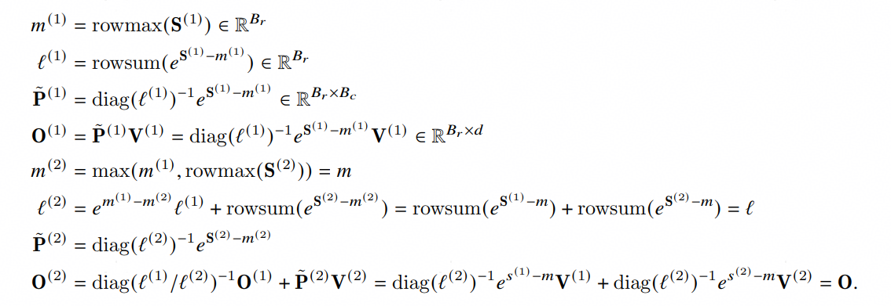
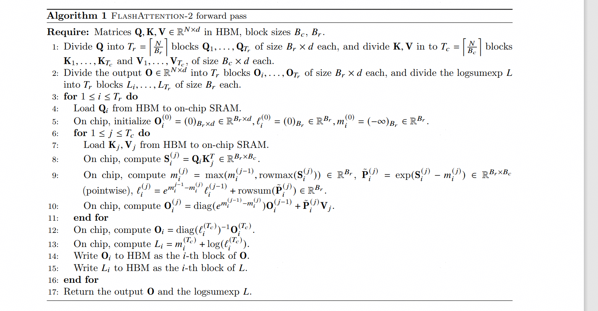
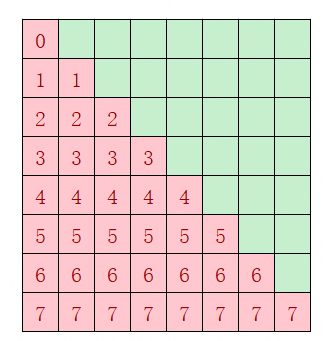
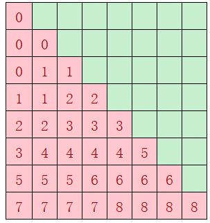

# 修订记录

|日期|修订版本|修改描述|作者|
|-|-|-|-|
|2025-03-10|1.0|初稿完成|隋唯一/00833900|

# 缩略语清单

|Abbreviations 缩略语|Full spelling 英文全名|Chinese explanation 中文解释|
|-----------------------|-----------------------|--------------------------------|
|FA|FlashAttention|-|
|Fp32|Float point 32|32位浮点数|
|Fp16|Float point 16|16位浮点数|
|Fp8  |Float point8   |8位浮点数|

# 功能域概述

Transformer模型的核心即为注意力机制。然而，注意力计算公式中的Softmax降低了并行度。为此有一系列尝试，其中之一为Tri Dao的FlashAttention系列。本算子基于Tri Dao的FlashAttention2.0。

# 功能域总体方案

## 计算公式

- 标准Attention计算流程
  
  $$
  S = QK^T \in \R^{N\times N}, P=softmax(S)\in \R^{N\times N}
  $$
- Softmax计算流程(假设$S$为两行)
  离线Softmax:
  
  $$
  m = max(rowmax(S^{(1)}), rowmax(S^{(2)})\in \R^{B_r}
  $$
  
  $$
  \ell = rowsum(\mathit{e}^{S^{(1)} - m}) + rowsum(\mathit{e}^{S^{(2)} - m}) \in \R^{B_r}
  $$
  
  $$
  P = [P^{(1)}\quad P^{(2)}] = diag(\ell)^{-1}[\mathit{e}^{S^{(1)} - m} \quad \mathit{e}^{S^{(2)} - m}] \in \R ^{B_r \times 2B_c}
  $$
  
  $$
  O = [P^{(1)} \quad P^{(2)}]\begin{bmatrix} V^{(1)} \\ V^{(2)} \end{bmatrix} = diag(\ell)^{-1}\mathit{e}^{S^{(1)} - m}V^{(1)} + \mathit{e}^{S^{(2)} - m}V^{(2)} \in \R^{B_r \times d}
  $$
  
  Online Softmax:
  
  
- FlashAttention计算流程
  
  

# 功能实现设计

## Flash Attention Forward功能实现

### 功能概述

在每个核上使用tl.dot, 左矩阵tl.trans做转置，并行计算各batch上的数据, 得到qk矩阵；qk矩阵使用上文的在线softmax计算得到p矩阵， 最后tl.dot v得到结果。所有核计算完毕后将各核结果拼接作为最终输出。

### 实现思路

**算法 1**  Flash Attention forward 核函数
qk矩阵乘：

```py
q = tl.load(Q_block_ptr)
q = tl.reshape(q, [BLOCK_M, HEAD_DIM])
...
V_block_ptr = tl.make_block_ptr(
        base=V + qvk_offset ,
        shape=(N_CTX, HEAD_DIM),
        strides=(stride_vn, stride_vk),
        offsets=(0, 0),
        block_shape=(BLOCK_N, HEAD_DIM),
        order=(1, 0),
    )
_qk_matmul(q, K_block_ptr, qk_ub_ping,qk_ub_pong, HEAD_DIM, BLOCK_N,sid,PIPE_STAGES,block_idx)

```

\_qk_ matmul方法:

```py
k = tl.load(K_block_ptr)
trans_k = tl.trans(k)
qk = tl.dot(q, trans_k)
```

加mask以及qk结果缩放操作在online softmax里进行

online softmax计算：

```py
l_ij = bl.alloc(tl.float32, [BLOCK_M // 2], al.ascend_address_space.UB)
m_ij = bl.alloc(tl.float32, [BLOCK_M // 2], al.ascend_address_space.UB)
...
qk_scale = bl.alloc(tl.float32, [BLOCK_M // 2, BLOCK_N], al.ascend_address_space.UB)
...
curr_mask_ptr = tl.advance(attn_mask_ptr, ((sub_vec_id * BLOCK_M // 2).to(tl.int32), 0))
atten_mask = tl.load(curr_mask_ptr)
...
for loop in range(BLOCK_M // 2):
        qk_loop = al.extract_slice(qk, [loop, 0], [1, BLOCK_N_UNROLL], [1, 1])
        qk_loop = qk_loop * sm_scale
        if STAGE == 1:
            # if need_mask == 1:
            mask = al.extract_slice(atten_mask, [loop, 0], [1, BLOCK_N_UNROLL], [1, 1]).to(tl.int1) # 64*128 -> 1*64
            qk_loop = qk_loop + tl.where(mask, -1.0e4, 0)
        qk_scale = al.insert_slice(qk_scale, qk_loop, [loop, 0], [1, BLOCK_N_UNROLL], [1, 1])

        qk_loop_unroll = al.extract_slice(qk, [loop, BLOCK_N_UNROLL], [1, BLOCK_N_UNROLL], [1, 1])
        qk_loop_unroll = qk_loop_unroll * sm_scale
        if STAGE == 1:
            # if need_mask == 1:
            mask_unroll = al.extract_slice(atten_mask, [loop, BLOCK_N_UNROLL], [1, BLOCK_N_UNROLL], [1, 1]).to(tl.int1)
            qk_loop_unroll = qk_loop_unroll + tl.where(mask_unroll, -1.0e4, 0)
        qk_scale = al.insert_slice(qk_scale, qk_loop_unroll, [loop, BLOCK_N_UNROLL], [1, BLOCK_N_UNROLL], [1, 1])

         row_max = tl.maximum(qk_loop, qk_loop_unroll, propagate_nan=tl.PropagateNan.ALL)
         row_max_agg = tl.max(row_max, 1, propagate_nan=True)

        tmp_max = al.insert_slice(tmp_max, row_max_agg, [loop], [1], [1])

    m_ij = tl.maximum(m_i, tmp_max, propagate_nan=tl.PropagateNan.ALL)
...
for loop in range(BLOCK_M // 2):
        m_ij_loop = al.extract_slice(m_ij, [loop], [1], [1])

        qk_loop = al.extract_slice(qk_scale, [loop, 0], [1, BLOCK_N_UNROLL], [1, 1])
        qk_loop_unroll = al.extract_slice(qk_scale, [loop, BLOCK_N_UNROLL], [1, BLOCK_N_UNROLL], [1, 1])

        qk_loop = qk_loop - m_ij_loop[:, None]
        qk_loop_unroll = qk_loop_unroll - m_ij_loop[:, None]

        p_loop = tl.math.exp(qk_loop)
        p_loop_unroll = tl.math.exp(qk_loop_unroll)

        p_loop_reshape = p_loop.reshape(BLOCK_N_UNROLL // 16, 1, 16)
        p_cast_loop = p_loop_reshape.to(cast_dtype)
        p_nz = al.insert_slice(p_nz, p_cast_loop, [0, loop, 0], [BLOCK_N_UNROLL//16, 1, 16], [1, 1, 1])

        p_loop_unroll_reshape = p_loop_unroll.reshape(BLOCK_N_UNROLL // 16, 1, 16)
        p_cast_loop_unroll = p_loop_unroll_reshape.to(cast_dtype)
        p_nz = al.insert_slice(p_nz, p_cast_loop_unroll, [BLOCK_N_UNROLL//16, loop, 0], [BLOCK_N_UNROLL//16, 1, 16], [1, 1, 1])

        row_sum = p_loop + p_loop_unroll
        l_ij_loop = tl.sum(row_sum, 1)
        l_ij = al.insert_slice(l_ij, l_ij_loop, [loop], [1], [1])
```

最后qk产物（记为p）与v做矩阵乘

```py
if (pvid & 1) == 0 :
    p_l1 = bl.to_tensor(p_l1_ping,target_shape=[BLOCK_M, BLOCK_N])
    pv_ub = bl.to_tensor(pv_ub_ping)
else:
    p_l1 = bl.to_tensor(p_l1_pong,target_shape=[BLOCK_M, BLOCK_N])
    pv_ub = bl.to_tensor(pv_ub_pong)

pv = tl.dot(p_l1, v)
```

**算法 2** wrapper函数

1. 计算负载均衡超参
   非均衡核排布：
   
   
   均衡核排布：
   
   
   
```py
def init_sparse_valid_array(sparse_valid_array: List[int],
    s2_size, BLOCK_S1, BLOCK_S2,s1_sparse_valid_size,s2_sparse_valid_size):
    ...

    s2_num_blocks = math.ceil(s2_size / BLOCK_S2)
    valid_s1_size = math.ceil(s1_sparse_valid_size / BLOCK_S1)
    valid_s2_size = math.ceil(s2_sparse_valid_size / BLOCK_S2)
    for i in range(len(sparse_valid_array)):
        reduce_blocks = 0 if i < valid_s1_size else (triton.cdiv((i + 1) * BLOCK_S1 - s1_sparse_valid_size , BLOCK_S2) - 1)
        add_blocks = min(s2_num_blocks - valid_s2_size,
            math.ceil(((i + 1) * BLOCK_S1 + s2_sparse_valid_size) / BLOCK_S2) - valid_s2_size)
        valid_block_num = valid_s2_size - reduce_blocks + add_blocks
        sparse_valid_array[i] = valid_block_num  if valid_block_num > 0 else INVALID_ROW_SPARSE_RATIO
    return True
```

2. 计算分核配置
   采用绑核，逻辑核等同于物理核
   ```py
   num_cores = get_npu_aicore_num()
   
   ```
3. launch kernel

```py
_attn_fwd[(num_cores,)](
            q, k, v, atten_mask, M, o, sm_scale, #
            sparse_start_idx,
            q.stride(0), q.stride(1), q.stride(2), q.stride(3),  #
            k.stride(0), k.stride(1), k.stride(2), k.stride(3),  #
            v.stride(0), v.stride(1), v.stride(2), v.stride(3),  #
            o.stride(0), o.stride(1), o.stride(2), o.stride(3),  #
            q.shape[2],#
            q.shape[0], q.shape[1], N_CTX=q.shape[2],
            HEAD_DIM=HEAD_DIM_K,  # 64
            BLOCK_M = BM, # 32
            BLOCK_N = BN, # 32
            STAGE=stage,
            NUM_BLOCKS_PER_CORE=NUM_BLOCKS_PER_CORE,
            NUM_BLOCKS=NUM_BLOCKS,
            NUM_BLOCKS_M=NUM_BLOCKS_M,
            CORE_NUM = num_cores,
            debug=True,
            multibuffer=True,
            disable_auto_inject_block_sync=True,
            limit_auto_multi_buffer_of_local_buffer="no-limit",
			enable_auto_vectorize_v2=False,
            **extra_kern_args)
```

### 实现设计

#### 分核策略

在实际使用场景中，为方便计算，在B, N, N_CTX上分别分核，因此逻辑核如下(q为BNSD格式）：

```
NUM_BLOCKS_M = triton.cdiv(q.shape[2], BM)
NUM_BLOCKS = NUM_BLOCKS_M * q.shape[0] * q.shape[1]
```

为了性能最优，我们显式地执行逻辑核-物理核映射逻辑。

#### 核函数设计

见上文FlashAttention计算流程

#### 接口设计

IR

|Parameter|ParameterType|Shape|Dtype|Format|
|-----------|-----------------|-------|------|--------|
|q|InTensor|[Z, H, N_CTX, HEAD_DIM]|Fp16/Bf16/Fp8|ND|
|k|InTensor|[Z, H, N_CTX, HEAD_DIM]|Fp16/Bf16/Fp8|ND|
|v|InTensor|[Z, H, N_CTX, HEAD_DIM]|Fp16/Bf16/Fp8|ND|
|mask|InTensor|[N_CTX, N_CTX] or [1, 1]|int32|ND|
|causal|param|-|bool|-|
|sm_scale|param|-|float|-|
|BM|param|-|int|-|
|BN|param|-|int|-|
|o|OutTensor|[Z, H, N_CTX, HEAD_DIM]|Fp16/Bf16/Fp8|ND|

约束：

1. q, k, v, o数据类型相同
2. 若causal为True，mask为[N_CTX, N_CTX]形状的倒三角阵，否则为[1,1]形状的矩阵（值不做要求）

#### DFX分析

##### 精度DFX

精度测试标杆选择为CPU的matmul的计算结果，测试场景涵盖如下特性的组合：

i.      单/多batch

ii.    输入维度是否对齐分块大小

iii.  多种context len

iv.   输入数据类型fp16/bf16/fp8

精度测试验收标准为双标杆。

##### 输入防护DFX

本算子的输入防护在wrapper函数内校验如下几个维度：

i.      输入tensor维度及shape

##### 性能DFX

要求在如下规格的输入下，性能达到0.6x aclnn

```
dtype	bs	num_head	head_dim	ctx	causal
fp16  	128	8	        128	        8192    False
fp16	128	8	        64	        8192	 False
fp16	128	8	        128	        1024	 False
fp16	128	8	        64		1024	 False
fp16	128	8	        128		8192	 True
fp16	128	8	        64		8192	 True
fp16	128	8	        128		1024	 True
fp16	128	8	        64		1024	 True
bf16	128	8	        128		8192	 False
bf16	128	8	        64		8192	 False
bf16	128	8	        128		1024	 False
bf16	128	8	        64		1024	 False
bf16	128	8	        128		8192	 True
bf16	128	8	        64		8192	 True
bf16	128	8	        128		1024	 True
bf16	128	8	        64		64	 True
fp8	128	8	        128		8192	 False
fp8	128	8	        64		8192	 False
fp8	128	8	        128		1024	 False
fp8	128	8	        64		1024	 False
fp8	128	8	        128		8192	 True
fp8	128	8	        64		8192	 True
fp8	128	8	        128		1024	 True
fp8	128	8	        64		1024	 True
```

# 参考资料清单

