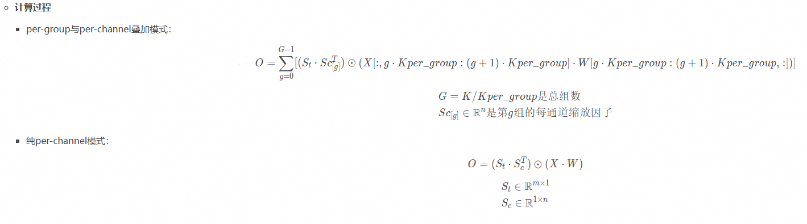
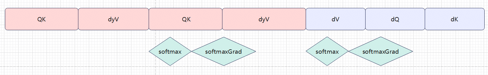
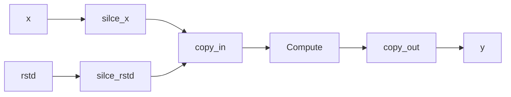

[toc]

---

# 1. 需求分析

## 1.1 需求背景

> *填写要求：*
> 
> * ①此处要求粘贴AR链接与截图。
> * ②说明需求来源，以及涉及到的周边组件。明确是否要额外PTA、图模式的适配，若有则需要同步交付。

## 1.2 功能分析

**- 接口功能：**

> *填写要求：*
> 
> * ①功能说明应详细，指明算子的具体功能和特性。
> * ②若为存量算子迭代，应说明具体的修改，带来的收益/影响。
>   例如：基于XX场景的的功能断点补齐需求，新增MoeGatingTopKSoftmax融合算子，该算子在Moe计算中，对输入X做Softmax计算后取topK操作。

**- 计算公式：**

> *填写要求：*
> 
> * ①格式如以下的，若为反向需要则列出推导过程。
>   

**- 原型设计**

> *填写要求：*
> 
> * ①此处填充输入和输出的名称、类型（输入/属性/输出）、支持Shape、数据类型、数据格式以及其具体的意义。
> * ②若基于存量算子修改，则只补充增量变化。

| 参数名 | 入参类型 | 默认值 | 基础类型 | 数据&格式类型 | 语义说明|
|-----------|------|-------|-------|------------|---------|
|    x  |     必选输入    |   无       |   TensorList        |    fp16:[ND]、bf16:[ND]     | xxxx |

**- 原型约束**

> *填写要求：*
> 
> * ①此处填充输入、输出之间存在的依赖关系。
> * ②指明输入的shape边界。
> * ③指明输入的值域边界。

## 1.3 对标实现分析

> *填写要求：*
> 
> * ①此项信息需SE/MDE给出。
> * ②具体说明和竞品的异同，包括不限于关键处理、功能特性、输入输出等。
> * ③注明竞品的确定性策略是否默认开启。

# 2. 特性实现方案

## 2.1 算子整体计算流程图

> *填写要求：*
> 
> * ① 填写计算流程图，所有的计算步骤要体现，transpose、matmul计算
> * ② 核心目的是为了开发同学可以直观的识别大体计算流程

> 

## 2.2 aclnn设计

> *填写要求：*
> 
> * ①此处主要为对输出的Dtype和Shape的推导逻辑。
> * ②需要对-1/-2场景做特殊适配。 -1 场景：unknownShape、-2场景：unknownRank。
> * ③若存在aicpu和aicore场景区分，需要体现何种场景走aicpu何种场景走aicore

## 2.3 Infershape设计

> *填写要求：*
> 
> * ①此处主要为对输出的Dtype和Shape的推导逻辑。
> * ①需要对-1/-2场景做特殊适配。 -1 场景：unknownShape、-2场景：unknownRank。

## 2.4 Tiling设计

> *填写要求：*
> 
> * ①TilingKey的设计采用范式完成，并指明实际意义。参考以下代码实现【TODO 待补充链接】
> * ②此处完成分核策略的设计，可使用图示辅助说明。
> * ③若在此对输入校验，应对每个输入设计上限；若无约束，应每一维度应泛化至2^31（同时保证GM不超上限）。
> * ④注意TilingData需要内存对齐,默认使用int64_t。
> * ⑤Tiling设计按照下面的格式，详细参考见代码中的TILING_DATA_DEF定义。
>   | 变量名|  语义 | 设计边界 |
| ---------- |  ----- | ----- |
|     例如：GMMBaseParams(结构体名)->groupNum(变量名)      |   分组数量        |  [1, 65536]       |
>   
>   

## 2.5 片上内存资源设计

> *设计要求：*
> 
> * ①详细列出UB空间的具体使用分配。
> * ②若涉及L1，需要给出具体的资源分配。
>   【TODO】此处最好给出一个模板，还需要再设计下

## 2.6 kernel方案

> *填写要求：*
> 
> * ①用图示说明算子的计算流程，若存在多个分支，每个分支需要做详细说明。
> * ②注明算子的精度转换策略，要和竞品对齐，若未对齐说明理由。

# 3. 其他算子交付件

> *填写要求：*
> 
> * ①其他算子交付件包括README.md，Examples，ACLNN文档、UT和DT。
> * ②各项交付件的要求和功能如下：
>   README.md ：算子说明文档。包括支持硬件、功能和参数信息。
>   Example：算子调用示例。为Aclnn接口的C++调用示例，代码上库时需要保证此示例可以正常调用。
>   ACLNN文档：ACLNN接口说明文档，包括对ACLNN的接口功能、输入输出及其约束等说明。
>   UT：**单元测试，必须具备**。包括对infershape、tiling和Kernel的功能及覆盖率测试。
>   DT：ATK工具的测试看护，能够实现对算子功能、精度和性能的看护，**至少需要200条基础用例**，随功能一起交付。
>   | ✓    | 交付件名称 | 完成状态  | 备注  | 
| ------- | ------------ | -------- | ------------------------ |
| [✓]  | [README.md ]       |  已完成/进行中/未开始/不涉及  |  | 
| [ ]  | [Example ]     |   | | 
| [ ]  | [ ACLNN文档]      |   |  | 
| [ ]  | [ UT ]     |    | | 
| [ ]  | [ DT ]      |   |  |
>   
>   

# 4. 测试设计（开发&&测试）

## 4.1 测试标杆

> *填写要求：*
> 
> * ①此处填充实现精度对比的测试标杆脚本。

## 4.2 测试用例设计

> *设计要求：*
> 
> * ①覆盖支持规格、模型场景基础功能、边界值、约束内场景，要求精度符合新精度标准，性能达到目标。
> * ②自测用例的设计和方法标准参考[算子开发自验证质量标准](https://wiki.huawei.com/domains/68949/wiki/106372/WIKI202408094263045)。
> * ②类似Rsqrt、sqrt、div、Reciprocal等存在入参值域限制的操作，补充特殊值用例。

### 4.2.1 白盒用例

> *设计要求：*
> 
> * ①边界自验证，覆盖输入的shape和value边界约束。
> * ②异常场景的自验证，覆盖算子资料中的约束。
> * ③内存检测的自验证，覆盖非对齐场景OOM内存检测。
> * ④确定性自验证，涉及确定性计算一定要提供测试用例。
> * ⑤使用下表进行整体说明。
>   举例：
>   
>   | 验证场景                        | 验证用例                    | 覆盖场景|
| --------------------- | ------------------------- | ---|
|边界验证 | x:fp16、[1,13072,1,1]; rstd:fp16、[1,131072] |验证第二维为边界值场景|
|边界验证 | shape\dtype等信息 | 输入X的shape为[1,2]，设置属性A的值为X的输入最后一维|
|异常验证 | shape\dtype等信息 | 输入X为7维|
|内存验证 |shape\dtype等信息|测试UB空间容量全部使用场景 |
|内存验证 |shape\dtype等信息 |开启OOM编译后，对非对齐场景进行批量验证测试 |
|典型模型场景 |shape\dtype等信息|输入shape为[1024，7168] [1024，66] |
|正态分布数值输入| shape\dtype等信息| 输入值域在[-5,5]，数据类型和维度符合约束的组合场景|
|离群点分布数值输入| shape\dtype等信息| 存在千分之一，1000倍离群点数据，数据类型和维度符合约束的组合场景|
|拦截用例设计| 某个场景不支持，设计拦截 | |
>   
>   

### 4.2.2 性能用例

> *填写要求：*
> 
> * ①性能测试需要指明对比的性能来源和标准。
>   *例如：XX场景下和小算子拼接对比提升10%，XX分支模式和XXV1版本提升20%。
> * ②使用下表格式进行整体说明：
>   例如：
>   
>   | 验证项        | 验证平台信息| 性能基线| 备注 |
| --------------------- | ----|---|---|
|模型场景，小算子拼接性能提升10% |910B3/A5|0.8 A100或1.2倍8.3.B060 小算子拼接 | 存在两个case性能不满足要求，自提单链接|
|数据类型和维度符合约束的组合场景，和perCHANEL模式V1版本性能提升20%| 910B3/A5| | |
>   
>   

| 验证项        | 验证平台信息| 性能基线| 备注 |
| --------------------- | ----|---|---|
| | | | |
| | | | |

# 5. 遗留问题

> *填写要求：*
> 
> * 该部分填写算子功能边界、精度相关、性能相关和标杆相关等重点注意项、未达成事项，便于测试边界覆盖及后续迭代开发。

