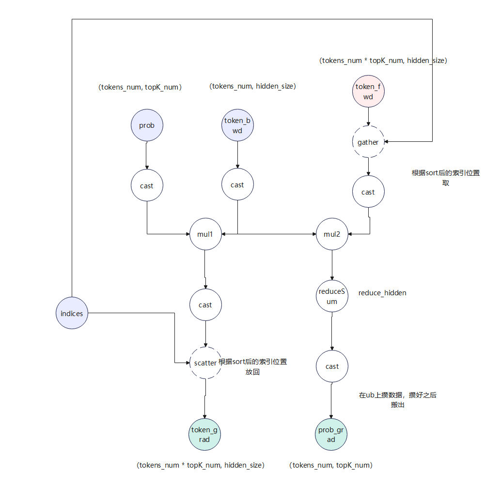
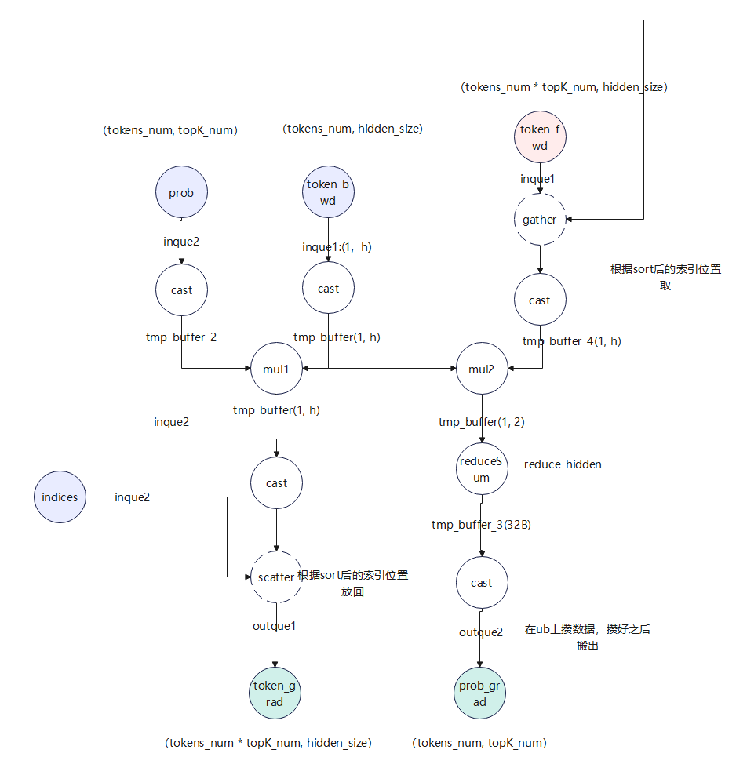

[toc]

---

修订记录

| 日期 | 修订版本 | 修改描述 | 作者 |
|-------|-------|-------|-------|
|  |  |  |  |
|  |  |  |  |

# 1. 需求分析

## 1.1 功能分析

<font color="#0000dd">*对算子功能进行概要描述，本章节列出算子本身的数学公式，我们要实现的数学公式，讲解各个变量的含义，对当前算子有一个直观的感受*</font><br />

## 1.2 竞品方案分析（可选）

<font color="#0000dd">*若有对应竞品算子，此处需要列出竞品算子的对外接口、实现的具体功能范围、若有源码，分析对应步骤和流水切分，参照业界通用接口和方案设计*</font><br />

# 2. 原型设计

<font color="#0000dd">*明确当前算子原型(外部调用接口，入参、出参，对应格式)，对外提供的接口和各个输入输出的数据类型*</font>
<font color="#0000dd">
1、GEIR
2、aclnn
3、加速kernel原型

</font>

# 3. 规格约束

<font color="#0000dd">*资料中明确当前算子支持的规格，芯片，数据格式，功能范围*</font><br />

|  类别                          |  参数                                                                                              |  约束描述                                                |
| -------------------------------- | ---------------------------------------------------------------------------------------------------- | ---------------------------------------------------------- |
|  算子名称                      |  /                                                                                                 |                                                          |
|  支持NPU型号                   |  310B/310P/910A/910B/910C                                                                          |                                                          |
|  CANN版本                      |  CANN7.0及以上/ CANN8.0及以上                                                                      |                                                          |
|  输入支持的数据类型            |  FLOAT、FLOAT16、INT32、DOUBLE、UINT8、INT4、INT8、INT16、INT64、BFLOAT16                                |  BFLOAT16（仅昇腾910B AI处理器、昇腾910C AI处理器支持）  |
|  输出支持的数据类型            |  FLOAT、FLOAT16、INT32、DOUBLE、UINT8、INT4、INT8、INT16、INT64、BFLOAT16                                |                                                          |
|  算子参数               |  参数名称、维度、格式(NCHW/NHWC/NC1HWC0/ND/NZ）                                                                                          |  B 1\~ 256 ND需要特殊组合                                |
|  对外属性param                 |                                                                                                    |  确定性计算/稀疏/旋转系数等                              |
|  PTA版本                       |  pt1.11及以上版本                                                                                  |                                                          |
|  交付形式                      |  ATB直调/pytorch直调/ACLNN调用                                                                     |                                                          |
|  接口名称                      |  XXOperation                                                                                       |                                                          |
|  动态、静态、动静合一、二进制  |  二进制/动态库/静态库                                                                              |                                                          |
|  精度标杆                      |  单标杆搬移类算子/数值转换类/整数计算/量化计算/浮点计算/vector融合/CV融合/高精度浮点/高精度双标杆  |                                                          |
|  性能目标                      |  平均xx竞品/最差性能xx竞品                                                                         |                                                          |
|  明确上下文关系                |                                                                                                    |                                                          |

# 4. 特性实现方案

<font color="#0000dd">*我们想要将大数据量的运算部署到昇腾加速器上，通常会根据加速器的特性进行并行处理提升效率，算子本身可以分为3个部分：
1 数据切分（tiling）：加速器通常是多核或多线程的形式来处理数据，如何合理的将外部数据进行划分是我们需要重要考虑的点，也是决定算子并行策略的重要一环，此部分大多是标量运算，一般在host侧（CPU侧）处理 *部分场景下沉可以用到昇腾中的aicpu处理*；
2 内存分配（片上buffer）: 片上buffer，可以通俗理解成我们需要在加速器核内处理数据时承载数据片段的局部变量，核中的buffer为了考虑数据搬移的带宽，空间是有限的，我们需要合理的分配片上内存，进行充分利用；
3 流水编排（片上流水）：加速器核内通常有各个不同的流水线来负责处理不同的功能，例如数据搬移，矩阵计算，矢量计算，都是通过不同的流水线负责处理，不同的流水线之间可以并行操作，我们可以利用这种特性让所有的流水线同时动起来，通过相互的并行掩盖，来减少算子本身的执行时间；
本章节设计算子整体方案，包含切分策略，核内实现，若针对不同规格有不同特性模板，分章节填写*</font><br />

## 4.1 xxx特性实现

### 4.1.1 算子计算流图

<font color="#0000dd">
描述算子计算过程流程图， 参考下图：
</font><br />



### 4.1.2 tiling切分

#### 4.1.2.1 分核策略

<font color="#0000dd">描述算子分核策略，具体要使用几个核，每个核需要处理哪些数据</font>

#### 4.1.2.2 单核内切分策略

<font color="#0000dd">*片上内存往往是有限的，例如我们的L1, UB等等，我们需要合理的设置变量来承载将要处理的数据，在写算子代码之前，我们需要设计当前片上需要使用的内存大小，和各个内存变量应该承载什么数据，给出核内明确的内存划分，表现形式不限（可以使用图示，也可以使用表格，能够表明当前的内存切片即可）*</font><br />
示例：



**内存使用：**
**Que**​**使用:**

inque1: (align(1 \* h \* sizeof(bfloat16), 512) + align(1 \* h \* sizeof(bfloat16), 512) \* ​muti\_token​)\* buffer\_num

​muti\_token：当无prob时，可以使能此字段 > 1，有prob时=1

inque2：align(x \* sizeof(int64) + x \* sizeof(bfloat16)(prob存在), 256)  // prob 和 indice共用一个que。

outque1: align(1 \* h \* sizeof(bfloat16), 512) \* DB\_NUM(2)

outque2：512B

**tmp\_buffer**​**使用：**

tmp\_buffer: align(1 \* h \* sizeof(float), 512)

tmp\_buffer\_reserve: 256B  // 解决tmp\_buffer和tmp\_buffer\_4的bank冲突

tmp\_buffer\_4: align(1 \* h \* sizeof(float), 512)

tmp\_buffer\_2: align（x \* sizeof(float32)，32）

tmp\_buffer\_3: 32B

**切分策略如下：**
1、给indices+prob预留空间，单core内h能全载优先全载。
预留空间：min(align(x \* sizeof(int64) + 3 \* x \* sizeof(bfloat16)(prob存在), 256), 2k)
3: 输入bf16一份，tmpbuffer float32, 2份
2k：能放下128 element
2、  h能全载优先全载，不能全载进行均匀对齐切分。h全载，需要额外一份tmp\_buffer3(32B)保存临时数据。
3、  h决策完了之后刷新indices+prob载入策略，能全载全载，不能全载对齐切分载入。

#### 4.1.2.3 tilingdata & tilingkey设计

<font color="#0000dd">1、描述关键tilingdata字段及其含义</font>
<font color="#0000dd">2、描述tilingkey设计以及模板功能</font>

### 4.1.3 kernel方案

##### 4.1.3.1 片上流水编排策略

<font color="#0000dd">*昇腾芯片上有各个不同的流水线来处理不同的操作，在800I A2中有7大流水线，MTE2，MTE1, MTE3, FIX_PIPE是处理不同内存之间的数据搬运，CUBE是处理矩阵乘运算，VEC是处理矢量间的运算，我们写算子时可以通过不同流水线间的掩盖来达到优化的目标
例如我现在需要处理一个小块的加法操作（片上内存够用的情况下），大致分为3步：
1 数据A,B从外部搬到片上buffer(UB)；
2 执行加法操作C=A+B；
3 将加完后的结果C搬到外部*；
这样看是一个串行的过程，但我们思考不同的流水线是可以并行操作的，可以做出如下改变（将A，B分成A1,A2,B1,B2）：
1 将数据A1和B1从外部搬到片上buffer(UB)；
2 执行加法操作C1=A1+B1，同时将A2，B2搬到片上；
3 执行加法操作C2=A2+B2, 同时将C1搬出去；
4 将C2搬出去;
在本章节中需要明确这样的流水排布策略，可以给出每一步不同的流水线在做什么</font><br />

<font color="#0000dd">形式不限，描述流水排布过程。</font>

示例1：使用伪代码描述过程
非splitk，单Kernel实现伪代码：

```
非splitk，单Kernel实现伪代码：
DatacopyIn：indices
DatacopyIn：prob
cast prob
For n_cur_core:
    if n_idx % indices_n == 0 & n_idx > 0:
        DatacopyIn：indices
        DatacopyIn：prob
        cast prob
    For h_loop:
        DatacopyIn：token，（1,  h_one_loop）
        cast token
        muls prob // 
        for 1: topk : // topk == 1 独立拆分模板支持
            DatacopyIn：token，（1,  h_one_loop）
            cast token
            muls prob
            add
            cast
            DatacopyOut
    // 处理h的尾块
```

### 

## 4.2 xx特性实现（可选）

...<font color="#0000dd">*若有特性扩展或新增，参照4.1章节规格书写，若仅为增量特性，不涉及的章节表明等同于x.x设计*</font><br />

# 5 软件设计

<font color="#0000dd">*软件框架设计，例如设计模式，通过UML图表示*</font><br />

# 6 测试设计

## 6.1 测试标杆（对应新精度标准xxx）

<font color="#0000dd">*明确当前算子对应新精度标准中的xx章节*</font><br />

<font color="#0000dd">*算子类别：搬移类算子/数值转换类/整数计算/量化计算/浮点计算/vector融合/CV融合/高精度浮点单标杆/高精度双标杆
算子类别确认：浮点计算分为高精度算子和高性能算子2大类，确认高性能算子还是高精度算子来源于需求方/SE/MDE。算子在需求评审及需求转测的时候需明确算子的出口条件（高性能量化算子/高精度浮点算子）及计算次数。
计算次数确认：开发人员需准确写明计算次数的计算方法*</font><br />

## 6.2 测试用例设计

<font color="#0000dd">*明确当前算子规格约束下的正交用例设计*</font><br />

# 

[算子详设.md](./算子详设.md)


